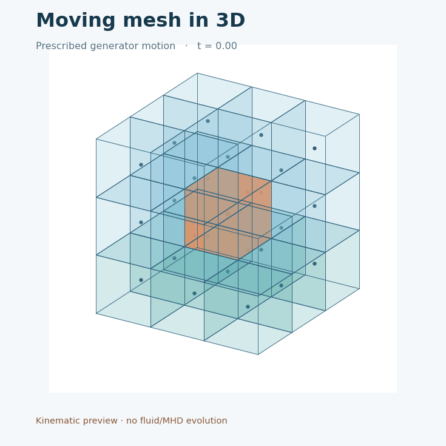
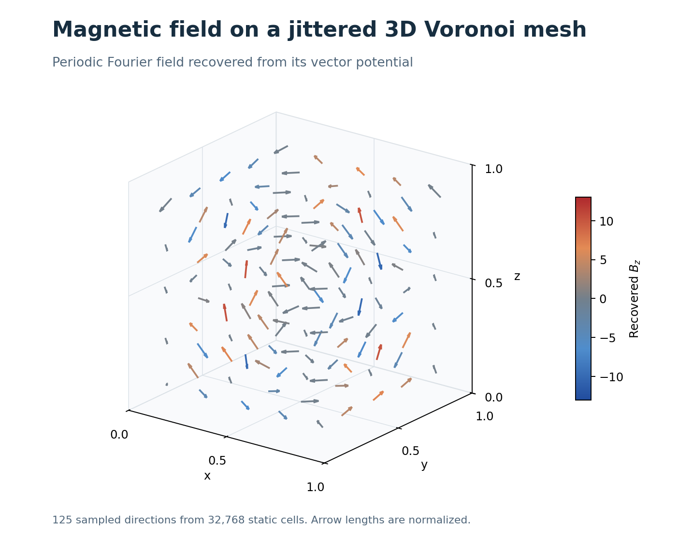
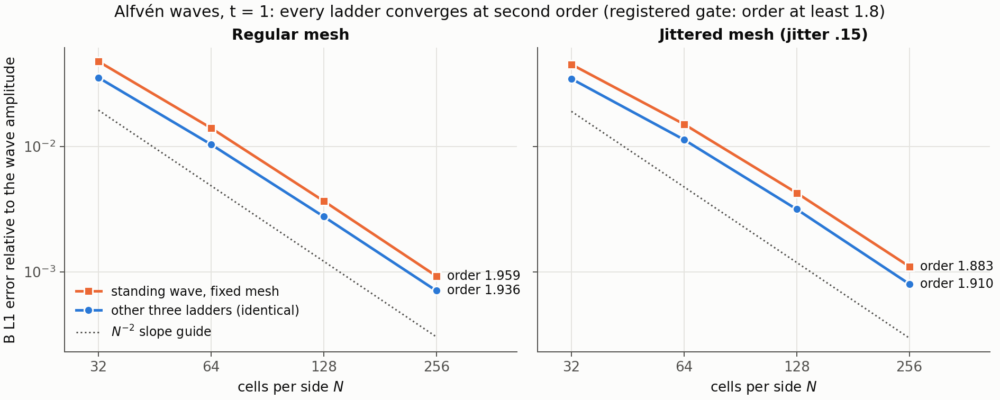
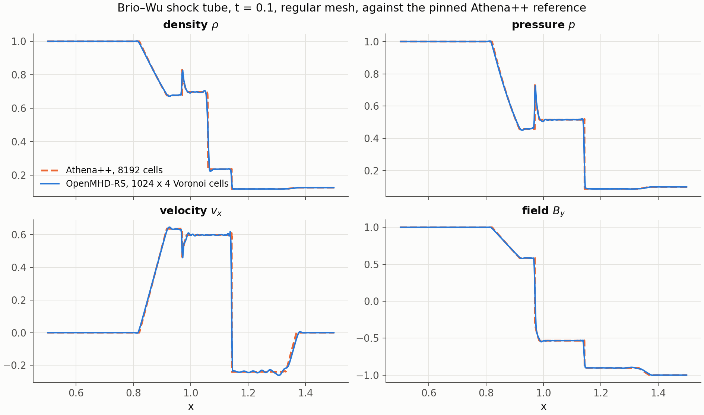
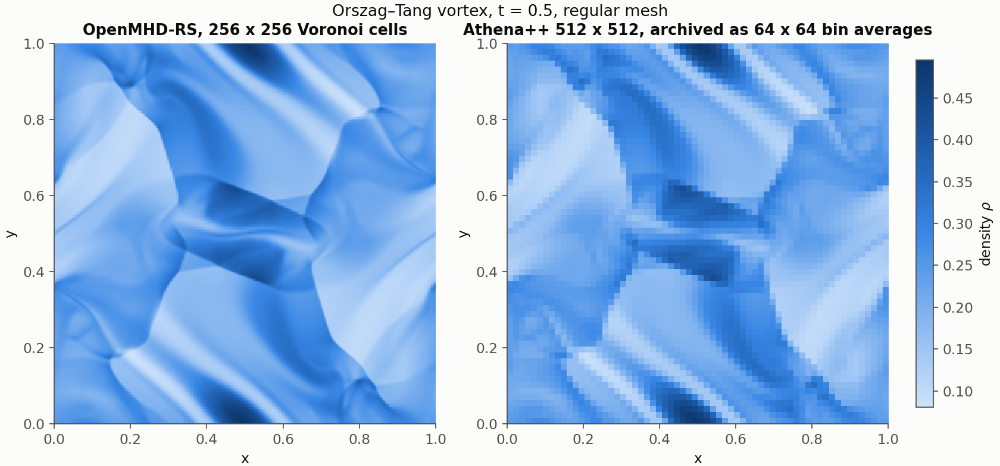
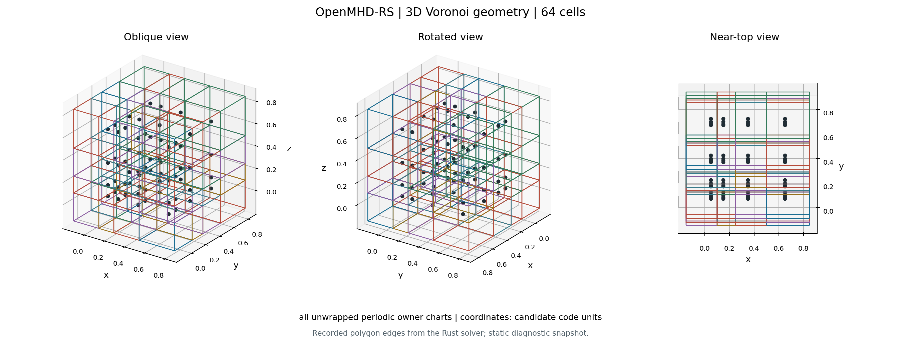
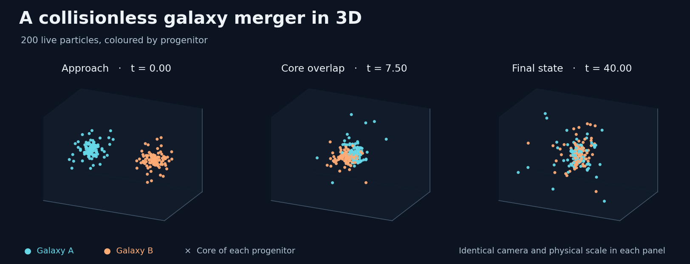

# OpenMHD-RS

**Vector-potential magnetohydrodynamics on Voronoi meshes, in Rust.**

An independent implementation of the ideal-MHD method described by
[Springel, Mayer & Pakmor (2026)](https://arxiv.org/abs/2609.35989),
with conservative gas dynamics and a magnetic field reconstructed from a
cell-centred vector potential. The project uses Rust 2024 and `f64`, with
Rayon kernels and a staged path toward MPI and magnetized galaxy mergers.
It is independently written, rather than an AREPO fork.

[Results](#results-at-a-glance) · [The formalism](#the-formalism) ·
[Code and execution](#code-and-execution) · [Roadmap](docs/GALAXY_MERGER_PLAN.md) ·
[Development history](HISTORY.md)



*A 3D geometry teaser: 27 generators follow prescribed periodic paths, with
one cell highlighted. This independent kinematic illustration has no fluid
or magnetic evolution. [Static figure, renderer and provenance](docs/MESH_MOTION_3D_PREVIEW.md).*

## Results at a glance

**November 27, 2026. M2b has measured results for 3D magnetic-field reconstruction.**
On 32³ cells the quadratic curl has a relative error of 1.76% on the regular grid
and 3.81% on the jittered grid. Both pass the 10% accuracy limit. M2b remains
open because the face-mean magnetic divergence fails the required decrease on
some refinement sequences. [Operator measurements and convergence plots](docs/galaxy/M2B_STATIC_OPERATORS.md).



*Arrows show field directions at 125 sampled cell centroids in one static mesh.
Color gives the measured vertical field component.*

**November 26, 2026. M2a is accepted for the static 3D Voronoi reference.**
The Rust build passed 678 workspace regressions, 252 analytic mesh comparisons
and all eleven independent geometry checks on 252 irregular and difficult
mesh runs. The largest mesh had 512 cells and 4,063 shared faces. All 84
input arrays produced byte-identical meshes at one, two and four declared
threads. The named fixed/rigid 2.5D MHD reference holds its separate M1
acceptance.
[M2a decision](tests/reference/m2a_static_geometry/acceptance.json) ·
[Results and periodic contact analysis](docs/galaxy/M2A_FINALIZATION_STATUS.md).

| Result | Recorded evidence | Scope |
| --- | --- | --- |
| **214 fresh MHD cases, 58 checks passed** | [Accepted M1 packet and final review](tests/reference/m1_final_acceptance/README.md) | Periodic, single-process, fixed or rigidly translated 2.5D meshes |
| **99 boost pairs, 8 spatial ladders** | [Six independent reductions and exact configuration](tests/reference/m1_final_acceptance/acceptance.json) | Registered comparisons; temporal orders remain observations |
| **252 static 3D comparisons passed** | [Seven analytic families on the repaired build, 2,016 gate groups](docs/galaxy/results/m2a_general_20261125/repaired-analytic.json) | Volumes, centroids, faces, normals, moments and closure across scales and transforms |
| **240 geometry reproducibility comparisons** | [231 strict passes and nine exact zero-area contact cases](docs/galaxy/M2A_FINALIZATION_STATUS.md#reproducibility-results) | Reordered inputs, repeated runs, thread settings, translations and periodic crossings |

In 2.5D, fields depend on two spatial coordinates and retain all three vector
components. The accepted configuration is an explicitly named engineering
reference; the historical `paper-global-v2` binary default is unchanged.

### Waves, shocks and vortices



*Eight Alfvén ladders meet the registered order threshold of 1.8. This figure
shows the earlier iterative campaign A, with fitted orders 1.883–1.959.
[Campaign results](tests/reference/m1_iterative_step_campaigns/README.md) ·
[Figure inputs and hashes](docs/images/overview/provenance.json).*



*Brio–Wu shock structure from campaign A compared with the pinned Athena++
reference. The [benchmark packet](docs/M0_BENCHMARK_PACKET.md) records the
reference setup and comparison rules.*



*Orszag–Tang density at time 0.5: campaign A on a 256² Voronoi mesh, beside a
512² Athena++ calculation retained as 64² bin averages. The displayed physics
figures precede the fresh accepted M1 rerun; their original provenance is
preserved. [Fresh output review](docs/M1_FRESH_SCIENTIFIC_OUTPUT_REVIEW.md).*

### Actual Rust geometry in 3D



*Recorded polygon edges and generators from the Rust `geometry3-case`
executable, rendered from its actual output. These are three static camera
views, retaining periodic owner/image charts.
[More figures and rendering provenance](docs/galaxy/STATIC_GEOMETRY_VISUALIZATION.md) ·
[All 252 analytic comparisons](docs/galaxy/STATIC_GEOMETRY_COMPARISON_RESULTS.md).*

### A collisionless galaxy merger in 3D

[](docs/galaxy/NBODY_MERGER_100.md)

Two equal-mass galaxies merged under direct N-body gravity. At the final snapshot, the inner 100 particles contained 49 from one progenitor and 51 from the other. A second run with half the timestep reproduced sustained core overlap. [Watch the movie](docs/images/nbody_merger_100/merger.mp4) · [Explore the 3D trajectory and measurements](docs/galaxy/NBODY_MERGER_100.md).

## The formalism

The continuum starting point is ideal MHD with magnetic permeability
$\mu_0=1$. A fixed periodic mean field is stored separately from the
periodic vector potential:

$$
\mathbf B=\overline{\mathbf B}+\nabla\times\mathbf A,
\qquad
E=\frac{p}{\gamma-1}
  +\frac{\rho\lvert\mathbf v\rvert^2}{2}
  +\frac{\lvert\mathbf B\rvert^2}{2}.
$$

The auxiliary velocity $\mathbf u$ selects the advective gauge, while
$\phi$ supplies gauge cleaning. With zero explicit resistivity, the
Eulerian vector-potential equation is

$$
\partial_t\mathbf A
=\mathbf v\times\mathbf B
-\nabla(\mathbf u\cdot\mathbf A)
+\nabla\phi.
$$

Gas mass, momentum and total energy are cell integrals. Oriented fluxes
through each shared moving face enter its two cells with opposite signs:

$$
\mathbf Q_i=V_i
\bigl(\rho_i,\rho_i\mathbf v_i,E_i\bigr)^{\mathsf T},
\qquad
\frac{d\mathbf Q_i}{dt}
=-\sum_{j\in\mathcal N(i)}a_{ij}\widehat{\mathbf F}_{ij},
\qquad
\widehat{\mathbf F}_{ji}=-\widehat{\mathbf F}_{ij}.
$$

The magnetic potential is evolved as a point value rather than a conserved
cell integral. Its fitted derivatives reconstruct the magnetic field.
The code reports distinct least-squares and face-based divergence diagnostics:
the continuum identity for the divergence of a curl does not make arbitrary
discrete operators vanish to machine precision.

The accepted M1 reference combines a bulk-frame gauge, quadratic fits,
reevaluated Heun stages, an iterative projected-rate solve, the `hlld-pressure`
flux blend and the `smooth-extrema` potential limiter. These engineering
choices and their measured tradeoffs are recorded separately from the paper's
endpoint formulation. See the [equation-to-code map](docs/PAPER_IMPLEMENTATION_SPEC.md),
[discrete reference contract](docs/VECTOR_POTENTIAL_REFERENCE.md) and
[scoped acceptance](tests/reference/m1_final_acceptance/acceptance.json).

## Code and execution

The toolchain is pinned to **Rust 1.85.1**. Start with the
[setup guide](docs/MAC_CODEX_SETUP.md) and [REANA execution guide](docs/REANA.md).
Project validation uses immutable source snapshots, required build/import
preflights and one independent benchmark case per REANA workflow.

The accepted M1 configuration is selected explicitly:

```text
--profile bulk-frame-heun-quadratic-v1
--projection-screening 1
--riemann hlld-pressure
--potential-limiter smooth-extrema
```

It uses the iterative projection, fixed/rigid periodic geometry and the
default trial-step fraction of 1. The cached `--accelerated-projection`
option is a separate choice. [Full configuration and campaign plan](docs/M1_FULL_VALIDATION_PLAN.md#configuration-under-test).

| Component | Code | Guide |
| --- | --- | --- |
| States, EOS and face fluxes | [`mhd-core`](crates/mhd-core) | [Conservative flux validation](docs/CORE_FLUX_VALIDATION.md) |
| Vector potential and 2.5D evolution | [`mhd-vector-pot`](crates/mhd-vector-pot) | [Method and discrete operators](docs/VECTOR_POTENTIAL_REFERENCE.md) |
| Voronoi geometry and reconstruction | [`moving-mesh`](crates/moving-mesh) | [Static 3D implementation](docs/galaxy/M2A_IMPLEMENTATION.md) · [Predictive Lloyd mesh motion](docs/galaxy/LLOYD_REGULARISATION.md) |
| Persistent entity identity | [`galaxy-types`](crates/galaxy-types) | [Identity implementation](docs/galaxy/IDENTITY_IMPLEMENTATION.md) |
| Direct gravity and collisionless KDK | [`gravity`](crates/gravity) | [Gravity implementation](docs/galaxy/G1_IMPLEMENTATION.md) · [Force–energy gradient results](docs/galaxy/G1_FORCE_GRADIENT.md#measured-reana-results) |
| Checkpoints and command-line drivers | [`mhd-io`](crates/mhd-io), [`openmhd`](apps/openmhd) | [Restart contract](docs/CHECKPOINT_RESTART.md) |

## What comes next

The [galaxy-merger plan](docs/GALAXY_MERGER_PLAN.md) separates static geometry,
moving geometry, gravity, gas/MHD, equilibrium components and published
ISM/star-formation/feedback physics into independent validation gates.
The repaired static geometry build has completed its workspace regressions.
The current validation compares its analytic and irregular meshes with
independent references and checks reproducibility across periodic crossings.
[M2a results and remaining checks](docs/galaxy/M2A_FINALIZATION_STATUS.md).

The current results do not establish deforming 3D MHD, MPI equivalence,
adaptation/local timesteps, general Galilean invariance, a coupled
self-gravitating galaxy or a full-duration magnetized merger. M1 acceptance
also retains the measured 3–10% fixed passive-loop error increase and
17–36% rim-undershoot increase of its chosen limiter. Reviews are explicitly
labelled AI reviews; human peer review and author confirmation are not claimed.

[Roadmap](docs/ROADMAP.md) · [Validation requirements](docs/VALIDATION.md) ·
[Architecture](docs/ARCHITECTURE.md) · [Current handoff](docs/CODEX_HANDOFF.md) ·
[Earlier results and reproduction commands](HISTORY.md) ·
[Contributing](CONTRIBUTING.md) · [MIT license](LICENSE)
