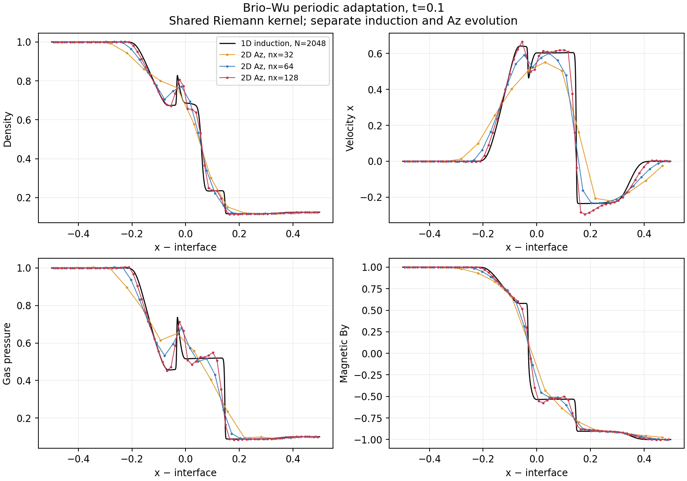
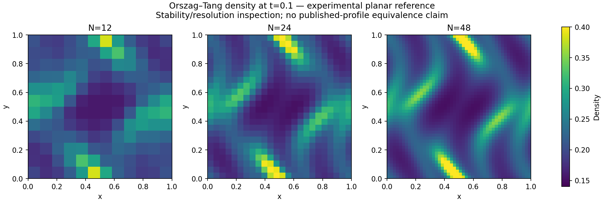

# Coupled 2D examples: run commands and results

These figures show the experimental planar MHD reference run on an Apple arm64 Mac on **2026-11-04**, using simulation commit [`da58490`](https://github.com/arm2arm/openmhd-rs-/commit/da58490bc4bc26ba30924ace34136e677767aebf), Rust **1.85.1**, `f64`, the release profile and one serial process/thread. The setup uses nondimensional units with magnetic permeability `mu0=1`, conservative gas updates and a cell-centred `Az` field. Both illustrated cases use fixed, regular periodic Voronoi meshes, CFL **0.3**, and globally synchronized Heun steps.

## Run on macOS

From the repository root, with Rust installed:

```sh
# This is the main checkout on the development Mac; use your clone's path elsewhere.
cd /Users/arm2arm/orca/openmhd-rs-
source "$HOME/.cargo/env"
mkdir -p results/manual

# One 24 x 24 vortex run.
cargo run --release -p openmhd -- \
  --case orszag-tang --nx 24 --time 0.1 \
  --output results/manual/vortex.csv

# One 128 x 4 shock-tube run; ny defaults to 4 for brio-wu.
cargo run --release -p openmhd -- \
  --case brio-wu --nx 128 --time 0.1 \
  --output results/manual/shock.csv
```

Cargo builds the executable automatically. Each invocation prints a CSV header and one diagnostics row to Terminal. The output snapshot contains cell ID, position, area, `Az`, density, velocity, gas pressure and magnetic field. The serial solver has no external Rust dependencies and needs no MPI installation.

The figures below use the **full resolution study**, which also creates the separate 1D comparison and the boost/jitter checks:

```sh
python3 scripts/run_coupled_2d.py
```

The study uses Python's standard library, builds the release binaries with `--locked`, and saves snapshots, `summary.csv` and `provenance.json` under `results/coupled_2d/`. Small reference diagnostics are committed under [tests/reference/coupled_2d](../tests/reference/coupled_2d/). Large generated results stay outside Git.

## Brio–Wu shock tube



The four panels show density, x velocity, gas pressure and transverse magnetic field `By` at **t=0.1**. Orange, blue and red curves use **32 x 4**, **64 x 4** and **128 x 4** cells. The black curve uses a separate **2048-cell 1D conservative-induction** calculation. It shares the EOS and HLLD/HLL Riemann kernel but evolves `By` directly, providing a comparison with the `Az`/curl evolution.

The domain is periodic `[0,2] x [0,1/8]`, with `gamma=2` and constant mean `Bx=0.75`. Initially, the two sides of the central interface have `(rho,p,By)=(1,1,1)` and `(0.125,0.1,-1)`, with zero velocity. The plot covers `x in [0.5,1.5]`; its horizontal coordinate is measured from the central interface at `x=1`. A second interface closes the periodic domain at `x=0`.

| x resolution | Normalized density L1 | Normalized By L1 |
| --- | --- | --- |
| 32 | 0.04119 | 0.03995 |
| 64 | 0.02442 | 0.04001 |
| 128 | 0.01427 | 0.02530 |

Errors compare one transverse row with averages of the fine 1D cells over each coarse cell in the central window. Both finest errors improve over the coarsest result; `By` has a small intermediate increase. The plot retains visible shock broadening and overshoots. This is a consistency check against another magnetic discretization, with a shared Riemann kernel; independent published-profile agreement remains a later validation task.

## Orszag–Tang vortex



The panels show density at **t=0.1** on **12 x 12**, **24 x 24** and **48 x 48** cells. Every panel uses the same colour scale, **0.14 to 0.40**, so the sharpening structures can be compared directly. These are early-time density maps; the plotted samples lie at geometric cell centroids.

The unit-square domain is periodic, with `gamma=5/3`, initial `rho=25/(36pi)`, `p=5/(12pi)`, `v=(-sin(2pi y),sin(2pi x),0)` and zero mean field. The potential is `Az=[cos(2pi y)/(2pi)+cos(4pi x)/(4pi)]/sqrt(4pi)`; the discrete curl supplies the initial magnetic field and its energy contribution. See the [numerical specification](COUPLED_2D.md) for the complete method and initialization.

All study runs retained positive density and gas pressure. Across the full suite, the largest normalized gas mass/momentum/total-energy budget residual was **1.95e-14**. A separate N=12 run boosted both fluid and mesh by `(2,-1)` and agreed with the stationary-coordinate run's density, pressure and B to **1.03e-15**.

These images document stable execution and a resolution comparison. Magnetic-wave convergence, longer-time vortex agreement, deforming meshes and the general 3D gauge/cleaning method remain open. The independent limited-face divergence RMS is **0.1512 / 0.1113 / 0.09046** on the three regular grids. The separate jittered N=12 run has limited-face divergence RMS **0.2457** and discrete mean-B drift **1.79e-4**. The report therefore makes no claim that arbitrary discrete divergence operators vanish.

## Regenerate the images

After running the study, install the plotting dependency into a virtual environment outside the repository. The committed figures used **Matplotlib 3.9.4**:

```sh
python3 -m venv "$HOME/.venvs/openmhd-plot"
"$HOME/.venvs/openmhd-plot/bin/python" -m pip install 'matplotlib==3.9.4'
"$HOME/.venvs/openmhd-plot/bin/python" scripts/plot_coupled_2d.py

open results/coupled_2d/brio_comparison.png
open results/coupled_2d/vortex_density.png
```

The plotting script reads the study CSV files and writes the two PNGs. Copies are committed under `docs/images/coupled_2d/` so this page renders on GitHub. The [figure provenance](images/coupled_2d/provenance.json) records the input CSV and image checksums, simulator revision, plotting-script hash and plotting-library versions. The regenerated figures were visually checked before publication.

The implementation commit also passed [GitHub CI](https://github.com/arm2arm/openmhd-rs-/actions/runs/41792760235): formatting, Clippy, **29 Rust tests** and **9 M0 algebra checks**. The six scripted benchmark gates passed locally; CI does not run the full resolution study. Full scientific acceptance criteria remain in [VALIDATION.md](VALIDATION.md).
