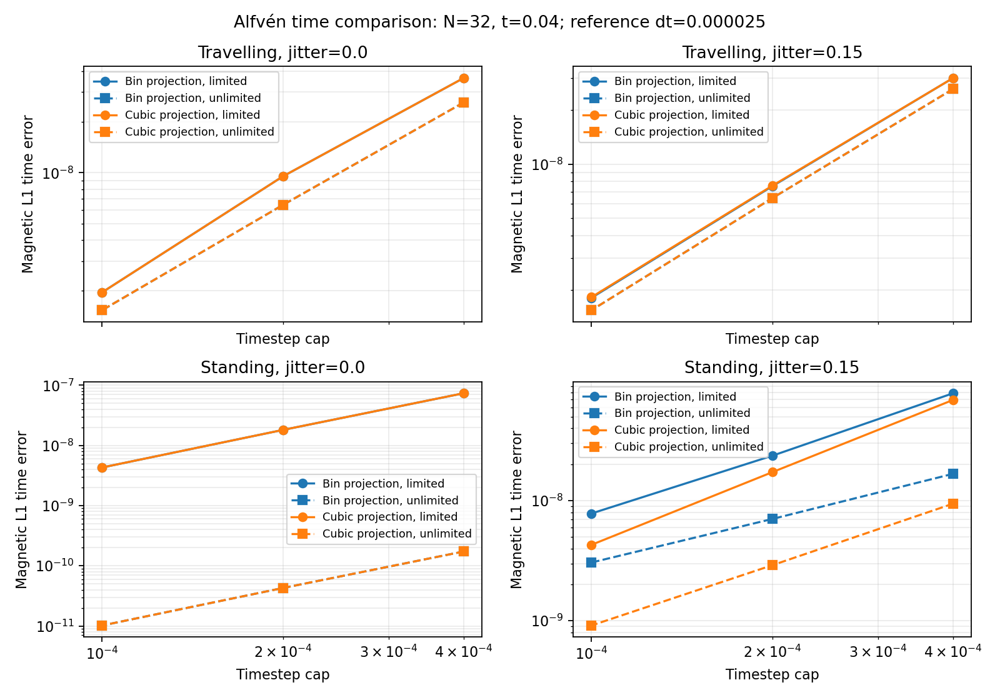

# Auxiliary-projection investigation results

The separately named `bulk-frame-heun-spline-v1` comparator implements the
[prospectively specified continuous auxiliary projection](M1_AUXILIARY_INVESTIGATION.md).
Its purpose is to investigate the remaining jittered standing-wave time error.
The default paper profile and the four existing algorithms are unchanged.
M1 physical acceptance remains open.

## Local checks — 2026-11-08

All 102 Rust tests and 29 Python tests pass, together with `cargo fmt --check`
and `cargo clippy --all-targets --all-features --locked -- -D warnings`.
The new auxiliary tests establish nonnegative partition-of-unity weights,
periodic aliases, constant preservation, boost/translation covariance, empty
support coarsening, invalid-state rejection and continuity across an old bin
boundary. That last fixture explicitly retains a finite jump in the historical
nearest-bin projection. The existing coupled uniform/time-order/boost/
permutation checks now run for both Heun variants, and the threading test
includes the new profile at 1/2/4/24 threads with identical states and diagnostics.

The N8, t=.004 execution study completed all 80 runs and all 16 boost pairs,
with zero rejections, every cap reached, positive sampled states and maximum
normalized budget residual 1.150e-15. This is an execution check, not the
registered N32 time-convergence measurement.

The frozen pre-change executable and the new executable produce byte-identical
initial/final CSVs, summary and history for all four historical profiles on
N8 jitter=.15 standing waves, t=.004, cap=.0001, fluid/grid boost=(2,-1,.8).
Evidence is retained under `results/auxiliary_legacy_20261108/`; the quick run
is in `results/auxiliary_quick_20261108/`. No historical result was overwritten.

## Completed REANA measurement

Workflow `openmhd-auxiliary-20261108.1` was submitted with 24 independent
one-thread simulations and a 64G test-job memory limit. Source-snapshot SHA-256:
`bad2821c6b8dad78e8ed5dd30ee3bc4bd01670c97dfd164a1776330b4fa00ea5`.
The numerical study has 80 runs: two projections, limiting on/off, regular/
jittered meshes, travelling/standing waves, four time caps and 16 boost pairs.
The workflow completed at `2026-11-08T16:12:39Z`. All format/Clippy, 102 Rust,
29 Python, release-build and M0 checks passed remotely. The numerical runner
took 53.13 seconds with 24 workers; the whole workflow took about five minutes.
All 80 evolutions completed, reached their caps and retained positive sampled
states. There were no rejected steps or auxiliary coarsenings; both stages
used root=4 throughout. The maximum normalized budget error was 2.053e-14.
All 16 boost/geometry pairs passed; the worst wave-relative field difference
was 3.984e-14, below the unchanged 1e-8 threshold. All three independent magnetic
divergence diagnostics remain in the archived records.

For limiting enabled, magnetic L1 time-error slopes against the finite reference
are:

| Wave / mesh | Historical bin projection | Cubic projection |
| --- | --- | --- |
| Travelling / regular | 1.935, 2.282 | 1.935, 2.282 |
| Standing / regular | 2.027, 2.075 | 2.027, 2.075 |
| Travelling / jitter=.15 | 1.999, 2.061 | 1.990, 2.058 |
| Standing / jitter=.15 | **1.729, 1.598** | **2.000, 2.011** |

For that last case, v slopes also improve from 1.907/1.787 to 2.009/2.046,
A from 1.365/1.269 to 2.009/2.037, and phi from 1.246/1.293 to 2.014/2.058.
At cap=.0001, the magnetic time error falls from 7.817e-9 to 4.286e-9 (1.82x).
Each projection is compared against its own fine-step solution. An ideal
dt-squared error on this finite-reference ladder has apparent slopes
2.017/2.070; slopes slightly above two are not evidence of a higher-order method.

The unlimited jittered standing case still has sub-second-order magnetic
slopes: 1.250/1.205 with bins, improving to **1.704/1.668** with cubic weights.
Its v/A/phi slopes are near two, so a residual magnetic error remains to be
isolated. Removing the limiter alone does not resolve the historical error.
No uniform second-order or shock-safe unlimited-method claim follows.

Together with the independent bin-crossing fixture, the controlled comparison
supports discontinuous auxiliary projection as a contributor to the original
time error. It does not uniquely isolate every remaining nonsmooth term;
the new weights also change the spatial averaging. The analytic-wave magnetic
L1 error in the limited jittered standing fine-step run is 0.00124919, versus
0.00124946 with bins: physical error is still overwhelmingly larger than the
measured time error. This short N32 packet does not repair or replace the
registered spatial ladders, N64 t=1 temporal packet, N256 boost failure or
general shock/vortex validation.

All 17 exported artifacts and every raw run-file hash were verified locally.
The 20 historical Heun cases shared with the previous REANA study have
byte-identical initial/final CSVs, summaries and histories. The
[evidence archive](../tests/reference/m1_auxiliary/README.md) retains all 80 raw
run directories, 47 hash-verified source files, execution/runtime/log records,
measurements, old/new parity checks and the inspected plot.
