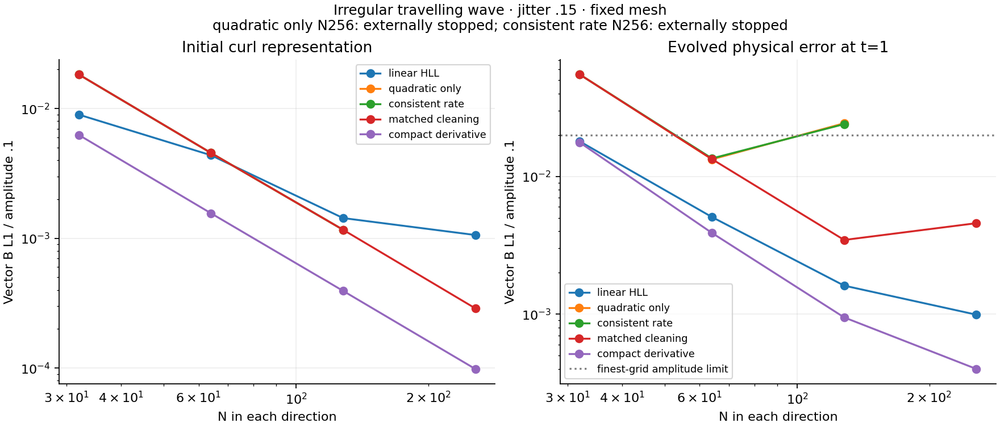
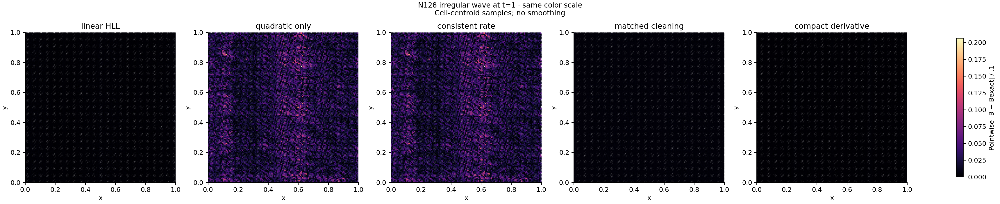

# M1 compact-derivative experiment

**The compact profile does not pass M1.** Its irregular travelling-wave order is 1.64016, below 1.8, and two regular standing-wave boost pairs fail the registered tolerance. The complete expensive benchmark matrix was therefore not launched. These results are evidence of remaining defects, not acceptance of an alternative threshold.

The [prospectively registered](M1_COMPLETION_PLAN.md) `bulk-frame-hll-compact-v1` removes the quadratic Taylor moment from the direct-neighbour derivative using the existing quadratic Hessian. It applies that derivative to raw A/curl/div, unlimited phi and the limited A polynomial, while retaining the consistent source/transport choices, frozen cleaning C1 and original timestep controller. The [separate AI implementation review](M1_COMPLETION_AI_REVIEW.md) approved evaluation, not physical accuracy.

## Complete irregular travelling-wave ladder

The frozen `aae382e` release binary evolved true N-by-N periodic unit-square meshes with jitter .15 to t=1, with a checkpoint at .25. The case uses gamma=5/3, rho=1, p=.1, mean B=(1,0,0), transverse amplitude .1, zero parallel velocity and fixed geometry. States are f64, dimensionless and mu0=1; no pressure floor or energy reset is used.

| N | Initial vector B L1 | Final vector B L1 | Runtime, seconds |
|---:|---:|---:|---:|
| 32 | .000626892 | .00176164 | 7.24 |
| 64 | .000156016 | .000388398 | 47.13 |
| 128 | .0000393161 | .0000946209 | 403.17 |
| 256 | .00000983901 | .0000399763 | 3281.17 |

The finest-three fitted order is **1.640159**, failing the required 1.8. The finest error divided by amplitude is .000399763, satisfying its separate .02 limit. Initial representation remains approximately second order; that does not establish evolved accuracy. Every run remains positive, with largest normalized conservative-budget residual 9.26e-15.





The maps show unsmoothed cell-centroid errors at N128. Their common scale is dominated by earlier failed mixed-cleaning experiments; a darker compact panel is not a full-ladder pass. Independent interim diagnostics found high-frequency Bz/vz contamination at N256 and a nonzero discrete curl of the cleaning gradient. This is a plausible contributor, not a unique causal diagnosis.

## Small wave and coupled-loop subset

A separate frozen 48-run subset uses N32/64, regular/jittered meshes, travelling/standing waves, fixed/comoving mesh families and joint boost (2,-1,0). All runs complete with positive states and normalized budget residual at most 7.31e-14. The wave comparison passes 14 of 16 pairs; the two failures are:

| Standing wave, regular fixed family | Normalized B L1 | Largest normalized physical L1 | Limit |
|---|---:|---:|---:|
| N32 | 8.60248e-6 | 1.03153e-5 | 1e-8 |
| N64 | 1.29806e-5 | 1.35202e-5 | 1e-8 |

The primary scales remain rho=1, p=.1, B=.1, v=.1 and E=.66+.5*v_parallel². Both failing pairs also fail the alternate historical scale convention. Initial, checkpoint and final states are retained for diagnosis. Near-ubiquitous endpoint CFL rejections and differing accepted-step counts in the N32 pair are observations requiring investigation, not a reason to excuse the gate.

All eight N32/64 coupled-loop boost pairs pass; maximum relative magnetic L1 is 3.80e-14 against .001. These coupled runs evolve the fluid and are distinct from prescribed passive transport. Their N128/256 ladder, full mean-field/temporal packet and compact shock/vortex study remain unexecuted. Results from earlier numerical profiles do not fill those gaps.

## Reproduction and evidence

The exact execution commands, source/binary/cache hashes, raw artifact hashes, diagnostics and runtime are archived. The bounded ladder has 28 verified raw artifacts. The quick study was remeasured with the explicit primary-normalization labels; original execution records remain intact.

```sh
# Execute from the recorded aae382e source in fresh output directories.
python3 scripts/run_m1_quadratic_probe.py --profile bulk-frame-hll-compact-v1 \
  --jobs 4 --mesh-cache-dir results/m1_mesh_cache --output-dir results/m1_compact_probe
python3 scripts/run_m1_wave_loop.py --suite physical --quick \
  --profile bulk-frame-hll-compact-v1 --jobs 4 --mesh-cache-dir results/m1_mesh_cache \
  --output-dir results/m1_compact_quick

# Current analysis verifies immutable execution evidence before relabelling the primary verdict.
python3 scripts/run_m1_wave_loop.py --analyze-only --output-dir results/m1_compact_quick

# Redraw the two comparison figures from measured archived inputs, without rerunning the solver.
python3 scripts/plot_m1_wave_probes.py \
  --figure-input tests/reference/m1_completion/wave_probes/compact_comparison_figure_inputs.json.gz \
  --output-dir results/reproduced_compact_figures
```

See [bounded-probe provenance](../tests/reference/m1_completion/wave_probes/compact/archive_provenance.json), [48-run archive provenance](../tests/reference/m1_completion/compact_quick/archive_provenance.json) and [figure provenance](images/m1_completion/compact/provenance.json). Large raw CSVs remain local; figure replay reproduces measured plots, not a new physical validation. M1 stays open until a reviewed implementation passes every registered gate.
