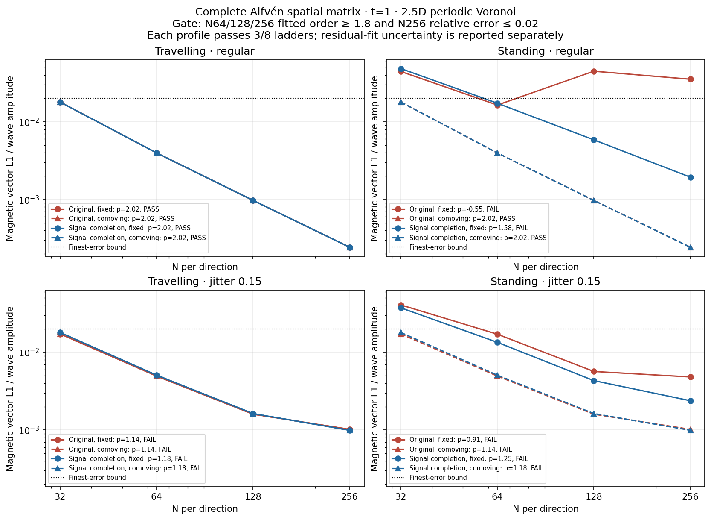
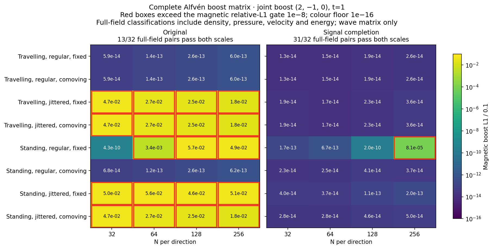
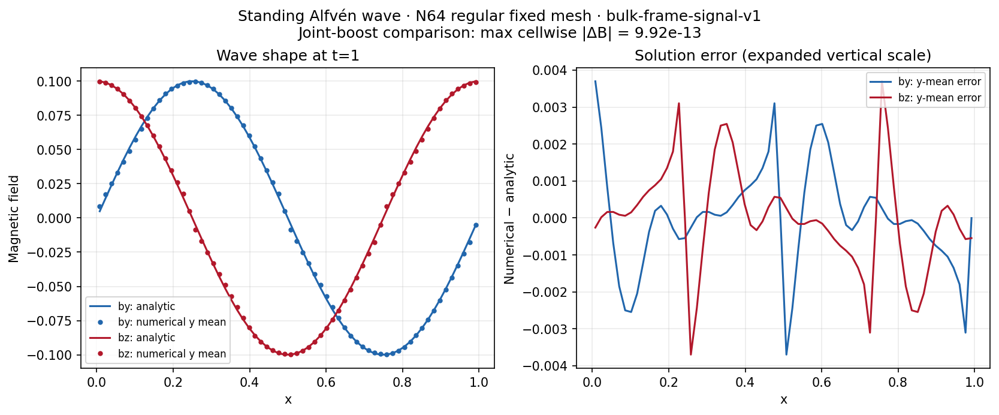
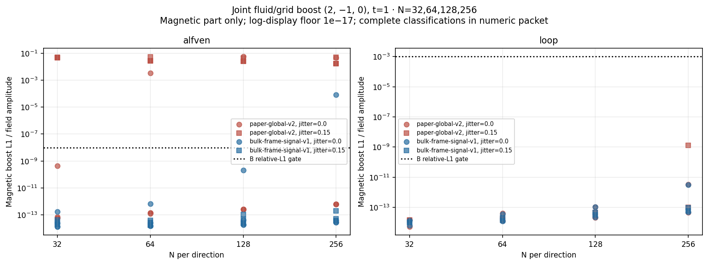
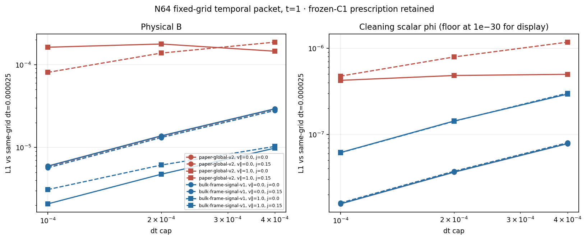
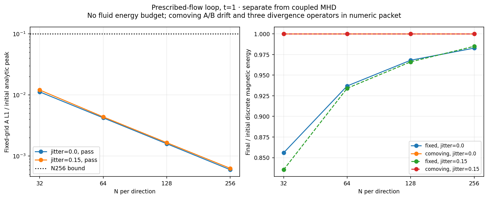
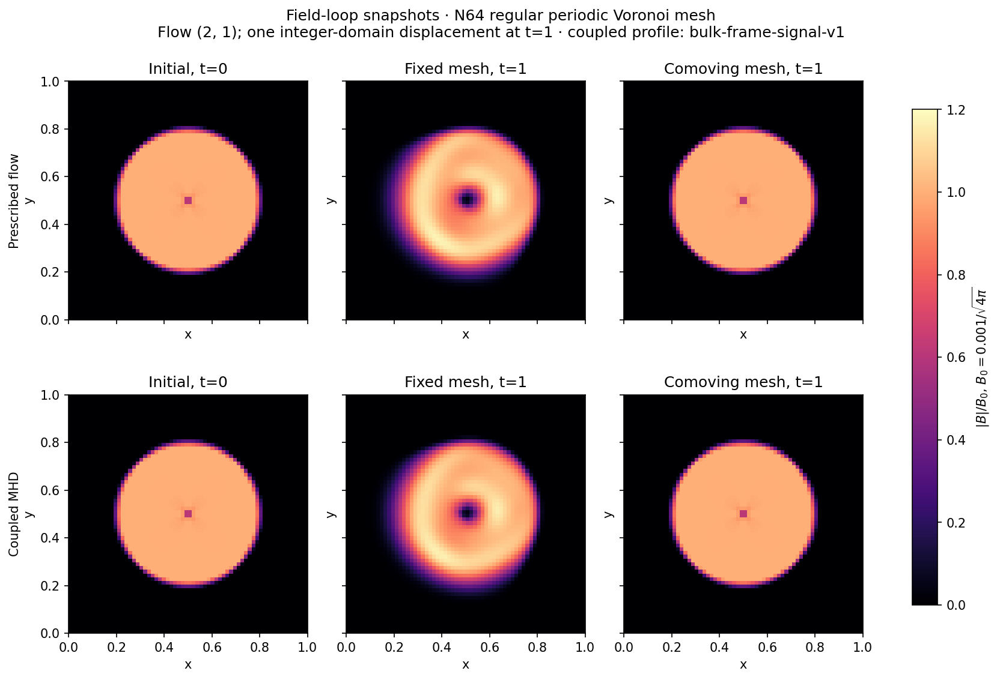

# Issue #7 continuation: full wave and loop measurements

**All registered executions are complete: 112 original-profile runs, 184 runs
in the comparator study, and 32 prescribed-flow runs. Scientific acceptance
has not passed.** The default remains `paper-global-v2`; historical failures
and the broader M1 shock/vortex requirements are preserved.

| Completed physical study | Original `paper-global-v2` | `bulk-frame-signal-v1` |
| --- | ---: | ---: |
| Wave spatial gates | 3/8 pass | 3/8 pass |
| Wave boost pairs, both normalizations | 13/32 pass | 31/32 pass |
| Coupled-loop boost pairs | 16/16 pass | 16/16 pass |

The new profile still fails the N256 regular standing fixed-grid boost pair.
Irregular spatial convergence and second-order physical time accuracy are not
established. All 296 coupled runs reach their target times with positive
sampled density/pressure and accepted periodic budgets; the maximum recorded
normalized budget residual is `1.684e-12`, below the registered `1e-10` bound.
These checks are distinct from the failed accuracy/invariance gates.

The 184-run study contains 72 mean-field evolutions across three profiles,
96 signal-profile physical runs and 16 temporal runs. Both bulk-frame
comparators pass 12/12 bounded mean-field boost gates; the original profile's
12 pairs remain diagnostic observations without a retrospective gate.
The runs use dimensionless units with mu0=1, gamma=5/3, f64 states and periodic
unit-square Voronoi meshes, regular or deterministic jitter .15. Each evolution
is serial with globally synchronized timesteps; jobs schedule independent runs.

## Numerical changes and review

The [prospective continuation plan](M1_COMPLETION_PLAN.md) records the original
HLL completion experiment and its rejection during the separate
[AI review](M1_COMPLETION_AI_REVIEW.md). Although that experiment removed the
known N64 standing-wave boost discrepancy, the reviewer found an O(1) A-source
jump at an outer-wave boundary. Its 81 completed partial-run records, source
snapshot and counterexamples are retained; interrupted and queued runs are
not successful results.

The supported new profile is `bulk-frame-signal-v1`. It combines the existing
bulk-frame gauge with a convex signal-weighted conservative state for the
A-face magnetic field and the undetermined normal EMF:

```
U_A = (SR U_L - SL U_R)/(SR-SL)    when SL < 0 < SR
U_A = upstream state             outside the outer wave fan
```

It retains the numerical tangential EMF and the conservative fluid/induction
fluxes, including the existing HLL fallback policy. The completion tends to
the upstream state at each outer-wave boundary. It has no fitted small-field
or contact-speed threshold. This is an explicitly named engineering convention,
not a paper equation. The tests establish bounded algebraic properties;
continuity of every inherited HLLD/fallback switch is not claimed.

Targeted tests cover signed normal fields/contact speeds, one-ULP changes,
face reversal and rotation, outer-wave boundaries, density contrast, finite
normal-field rotational waves, uniform/upwind/fallback controls, cell-ID
permutations, deforming meshes and three-component boosts. An independent
10,000-face AI probe finds maximum complete-source reversal/boost errors of
`3.93e-15`/`5.88e-15`, with bit-identical conservative and induction fluxes
for identical input states.

The independent review also reconstructs an actual N64 standing-wave face
after one common step dt=1e-4. Its rotational speed is zero in the base run
and `-2.22e-16` in the boosted run. The historical complete A-face source
differs by `1.825e-5`, despite a transformed conservative-flux difference of
only `2.22e-15`. Applying the signal completion to those same face inputs
reduces the source difference to `5.83e-16`. The next common step produces a
historical B component discrepancy of `7.33e-9`. This is a concrete
roundoff-amplification mechanism in the benchmark, retained as a compact
regression. The common-dt experiment does not identify the exclusive first
branch in the original adaptive-CFL trajectory; the archived review includes
negative controls and a bit-identical replay of the t=.25 checkpoint.

## Wave results

The new N32/64 physical packet contains 48 evolutions to t=1. All 16 Alfvén
boost pairs pass under both reported normalizations, and all eight coupled-loop
boost pairs pass. The previously failing regular N64 standing-wave pair has
magnetic boost L1 `6.7383e-14`, compared with historical `3.1077e-4` for
`bulk-frame-v1`. This comparison supports the degenerate face-state mechanism
in this fixture, without establishing that it explains every historical error.
The numerical gate was not relaxed.

The complete wave spatial/boost matrix is measured and independently reviewed.
Only **3/8** spatial gates pass for each profile. The regular travelling and
standing-comoving ladders have order about 2.016; the irregular ladders miss
the 1.8 threshold. The new profile's regular standing fixed-grid order is
1.581, versus -0.552 for the historical profile. The separate AI review
contains the complete table and the initial irregular LS-curl diagnostics.

The full new-profile wave matrix passes **31/32** boost pairs, with one
unresolved failure: the regular N256 standing fixed-grid pair has B boost L1
`8.10194e-6`, failing both reported normalizations. At t=.25 it was
`4.34685e-14`. Its base/boost step counts differ (10308/10331), while both
auxiliary root sets contain only 4; there are no HLL fallbacks, state/geometry
rejections or auxiliary coarsenings. These controls do not establish its cause.
The original profile passes **13/32** pairs and fails 19/32. The N64 improvement
therefore does not establish general boost invariance or full #7 validation.





These wave-only figures use the independently remeasured, hash-verified
64-run reports for each profile. They can be reproduced with
`python3 scripts/plot_m1_wave_review.py`. Original denotes `paper-global-v2`; signal completion denotes
`bulk-frame-signal-v1`. The boost heat map displays magnetic error; its title
counts the complete physical-field gates under both reported normalizations.



The snapshot plots show the regular N64 solution, including the standing-wave
numerical residual at finite timestep; boost agreement does not remove that
discretization error. The curves are y means, whereas the reported boost maximum includes
every cell and all three magnetic components.

## Coupled-loop results

All 64 coupled-loop evolutions reach t=1. All 16 boost pairs per profile pass
the unchanged B L1/amplitude bound `.001` plus positivity/budget conditions.
The largest relative B boost errors are `1.29479e-9` for the original profile
and `3.08804e-12` for the signal profile. The loop's amplitude is
`B0=.001/sqrt(4*pi)`. The passive analytic A/B comparison is a diagnostic,
not an exact solution of the coupled MHD equations.

| N256 base case | Original final/initial magnetic energy | Signal final/initial magnetic energy |
| --- | ---: | ---: |
| Regular, fixed | .9826304 | .9802992 |
| Jitter .15, fixed | .9848717 | .9834567 |
| Regular, comoving | .9999707 | .9999707 |
| Jitter .15, comoving | .9999703 | .9999703 |

Comoving here means rigid motion with the background flow. Coupled A/B drift
is finite: the signal N256 jittered comoving B changes by a maximum cellwise
vector magnitude `4.14495e-7`. Fixed-grid magnetic magnitudes overshoot locally,
reaching about `1.2120 B0` original and `1.2101 B0` signal in the full matrix.
Neither the near-unity energy ratio nor boost agreement implies exact transport.

Three distinct divergence operators remain reported: raw neighbour-LS,
arithmetic shared-face and limited shared-face. Their largest final
dimensional RMS values across the coupled-loop matrix are respectively
`2.75961e-4`, `4.05436e-4` and `4.66632e-4`. The dimensionless cell value is
`sqrt(volume/pi) * div(B) / (|B| + 1e-12*Bscale)`, with signed volume mean,
volume-weighted RMS and absolute maximum recorded separately. Near-zero fields
can give very large scaled values: the original regular fixed N256 limited-face
maximum is `3.57148e7`. These values are retained, not clipped or called zero.
The independent review recomputes norms from saved divergence columns; it does
not reconstruct every large-grid stencil. Unit/operator tests and exact source
snapshots establish the implemented operator definitions.



## Temporal observations

All 32 N64 temporal evolutions complete. The caps are `.0004`, `.0002`, `.0001`,
with a same-grid `.000025` reference. All caps are reached and there are no
rejected steps in these runs. Recorded counts and min/max dt match a capped
clock walk landing at t=.25 and 1, including tiny endpoint steps. No per-step
dt trace is available; the independent check concerns these aggregate records.

| Physical B L1 orders vs finite-dt reference | Original | Signal |
| --- | --- | --- |
| Travelling, regular | 1.083, 1.214 | 1.083, 1.214 |
| Travelling, jitter .15 | 1.084, 1.215 | 1.083, 1.214 |
| Standing, regular | -.289, .129 | 1.046, 1.189 |
| Standing, jitter .15 | .438, .774 | .747, .983 |

Orders use the two adjacent cap ratios. The original regular standing B error
is nonmonotone. The new profile improves this case, but these data do not
demonstrate second-order physical time accuracy. The frozen-C1 prescription
is unchanged. A, reduced A and phi errors are retained separately from B;
roundoff-scale components and the finite reference limit order interpretation.
The registered temporal requirement is to measure/report these quantities;
it supplies no numerical temporal-order acceptance threshold. No new gate has
been added to relabel these observations.



## Prescribed-flow loop

`prescribed-loop` implements the constant-velocity planar reduction on the
same periodic Voronoi geometry, including deterministic jitter .15. It shares
the coupled solver's donor/face-derivative reconstruction. With u=v, mean B=0
and Ax=Ay=phi=0, it evolves only `(w-v) dot grad_upwind Az` using Heun.
No gas state, EOS, force feedback or total-fluid-energy budget is evolved.
Regular/irregular comoving discrete A/B preservation and fixed-grid transport
convergence have deterministic tests. The full loop ladder reports analytic
A/B errors (excluding the cusp/edge for B), magnetic energy, discrete drift
and raw-LS, arithmetic-face and limited-face divergence operators separately.

All **32/32** prescribed-flow evolutions reached t=1. All **16/16** joint-boost
pairs and **16/16** comoving drift gates pass, with exactly zero discrete A/B
differences in these constant-flow fixtures. Both fixed-grid error ladders
decrease and pass the unchanged finest-resolution bound of .1:

| N | Regular A L1 / initial peak | Jitter .15 A L1 / initial peak |
| --- | ---: | ---: |
| 32 | .0112575 | .0120843 |
| 64 | .00423029 | .00438642 |
| 128 | .00159453 | .00166063 |
| 256 | .000599089 | .000631101 |





The snapshot panels use a common magnetic-field magnitude scale. Fixed-grid
transport smooths the loop and produces local magnetic-magnitude overshoots
(maximum `|B|/B0` 1.1748 prescribed and 1.1653 coupled). The comoving panels
retain its shape at this resolution. Only the prescribed-flow discrete A/B
preservation is exact.
The field plots can be reproduced from the compact verified N64 snapshots
with `python3 scripts/plot_m1_snapshots.py` (NumPy and Matplotlib required).

These results validate the specified constant-flow reduction. They do not
replace coupled-MHD loop, wave or general gauge/cleaning tests. The execution
predates the replacement of the rejected HLL completion, which is unused by
this gas-free driver; the exact transport sources and corrected measurement
provenance are archived in [the prescribed packet](../tests/reference/m1_completion/prescribed).

## Reproduction and provenance

The commands below run the current implementation with the registered settings.
For the exact archived execution source, restore the source tarball over a
fresh checkout at its recorded revision; see the [archive instructions](../tests/reference/m1_completion/README.md).

```sh
python3 scripts/run_m1_wave_loop.py --suite physical --temporal --jobs 6 \
  --output-dir results/m1_original_full
python3 scripts/run_m1_wave_loop.py --profile bulk-frame-signal-v1 --temporal \
  --jobs 6 --output-dir results/m1_signal_full
python3 scripts/run_prescribed_loop.py --jobs 4 --output-dir results/m1_prescribed
```

Every simulation is serial; `--jobs` schedules independent simulations.
Use fresh output directories. Add `--quick` for the explicitly incomplete
N32/64 spatial subset. The full N256 matrix is considerably more expensive
than the quick packet, including its ordered-clipping geometry construction.

Render the checked-in compact packets with NumPy 2.0.2 and Matplotlib 3.9.4
(the recorded plotting environment uses Python 3.9.6):

```sh
python3 scripts/plot_m1_completion.py
python3 scripts/plot_m1_wave_review.py
python3 scripts/plot_m1_snapshots.py
```

The [original](../tests/reference/m1_completion/original),
[comparator](../tests/reference/m1_completion/candidate) and
[prescribed-flow](../tests/reference/m1_completion/prescribed) archives contain
the measured numeric packets. Full local raw copies are retained under
`results/issue7_completion_20261106/{original,candidate,prescribed,signal_quick}`
(ignored by Git). Their execution commands truthfully retain the original
temporary output locations. The comparator archive additionally preserves
all six initial/quarter/final N256 standing-wave counterexample snapshots.

Snapshot analysis validates persistent IDs, N² cell count, positive finite
volumes summing to the unit domain, exact output times and paired geometry.
Missing metrics and failed evolutions cannot become zero errors. Temporal
results report dt caps and actual accepted bounds; convergence fits include
their residual-based slope standard error, not a systematic error bound.

Reanalysis checks immutable execution metadata/raw hashes and records its own
source hashes. Compact archives retain both original execution and corrected
measurement layers, exact execution sources and selected raw snapshots.
Plot loaders reject modified reports and unverified files that shadow archived
summaries; failed/missing resolutions and log-display floors are labelled.

Current-workspace format, Clippy with warnings denied, locked release build and
**88 Rust tests** pass. All **15 Python measurement/archive tests** pass, as do M0 algebra/reference checks
and all 29 issue #6 regression runs. Shared #6 summary values differ from the
historical archive by at most `6.66e-16`. See the separately labelled
[AI review](M1_COMPLETION_AI_REVIEW.md) for independently checked evidence,
source/provenance records and limitations; human peer review is not claimed.

## Remaining scientific work

- Diagnose the later N256 signal-profile standing-wave boost separation; the
  N64 face fixture and t=.25 negative control do not identify its cause.
- Address failed spatial gates, including the already present irregular
  initialization/LS-curl error and the fixed-grid standing-wave behavior.
- Establish physical time accuracy separately from the retained frozen-C1
  gauge mode and finite same-grid reference.
- Complete the broader M1 shock/vortex requirements before extending claims
  to the full 3D paper method, general invariance or AREPO-equivalent results.
