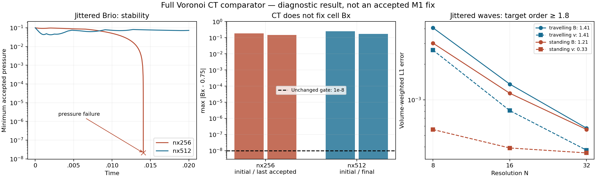

# Bounded fixed/rigid Voronoi CT comparator

Later continuation: the separate [coupled admissibility profile](M1_CT_POSITIVITY.md)
prevents this comparator's short pressure crash while retaining conservative
budgets. It does not resolve the Bx or jittered wave-order failures below.
The original `voronoi-ct-heun-v1` and its archived results remain unchanged.

This is a separately named `voronoi-ct-heun-v1` engineering comparator for
issue #7, authorized on 2026-11-09. It tests a complete alternative magnetic
coupling. It does not replace or implement the Springel–Mayer–Pakmor (2026)
cell-centred vector-potential method, and cannot establish that method's M1
acceptance. The default profiles, physical configurations and gates remain.

## Source and prospective contract

The magnetic discretization follows Mocz, Vogelsberger & Hernquist (2014),
[section 2.3, equations 25–32](https://arxiv.org/html/1402.5963v2#S2.SS3).
The fluid update reuses our independently implemented moving-face HLLD/ALE
kernels (Springel's moving finite-volume formalism). Public AREPO's
direct-B/Powell implementation is a source reference, not this CT algorithm
or the 2026 paper implementation. See the [pinned source audit](provenance/m1_literature_review_20261109.json).
No external source code is imported (public AREPO is GPL-3.0).

- Units mu0=1, f64, ideal gas; periodic 2.5D geometry; all three physical
  field/velocity components. Fixed or rigidly translating mesh only, stored
  in comoving coordinates. No topology changes, cleaning, Powell sources,
  pressure floors, entropy fallback or energy resets.
- One oriented magnetic flux Phi per shared face, oriented left to right.
  With t=(-ny,nx), endpoints minus/plus are centroid +/- length*t/2.
  Initialize Phi=Az(plus)-Az(minus)+length*(mean_B dot n), evaluating the
  periodic analytic potential once per shared vertex. Bz is a cell integral,
  initialized separately from the analytic physical Bz and evolved by FV.
- Recover cell Bxy by equation 30's weighted least squares of Phi/length
  against face normals, with w=1/distance(cell centroid,face centroid).
  Use this recovered field for pressure closure and primitive reconstruction.
  Riemann Bn remains the average of the two limited reconstructed states
  (equation 20), as in the published Voronoi CT method. It is not in general
  identical to Phi/length. Report CT and independent cell-field divergences.
- Interpolate face Riemann EMFs in the rigid-mesh rest frame to each vertex
  with affine-exact barycentric weights (equation 31). For four or more
  incident faces at a degenerate vertex, use the minimum-norm affine-exact
  extension; this is an explicit engineering choice. No upwind weight change.
  Update Phi_dot=EMF(plus)-EMF(minus). Shared vertex incidence must telescope
  exactly at the integer topology level; only floating-point accumulation
  remains in the signed cell flux sum. Degenerate/ill-conditioned fits fail.
- Heun method of lines, with full primitive/B/flux recomputation at each
  stage; this differs from the published endpoint predictor. Fluid and Bz
  face exchanges are equal and opposite. The existing limited neighbour-LS
  reconstruction, HLL fallback and cfl=.3 are retained. Both trial stages
  must be positive and satisfy their CFL bounds, otherwise halve dt (16
  attempts) from immutable old data. Count accepted and attempted fallbacks.

## Bounded checks, declared before execution

First test periodic vertex incidence (regular and jittered), affine EMF
interpolation, constant-field recovery, a manufactured Faraday sign/update,
uniform states, conservation, failed-step immutability and joint rigid boosts.
Audit frozen pressure rates via dp=(gamma-1)*(dE-v dot dm+v^2 drho/2-B dot dB).

Then run original Brio nx256/512, ny4, jitter0/.15, base and fluid/grid boost
(2,-1,0), to t=.01 and .02. Keep gamma2 and box [0,2]x[0,.125]. Retain
max |Bx-.75| <=1e-8, positive states, budgets <=1e-10 and boost comparison
<=1e-8; execution completion is distinct from passing those gates.
Run short Alfvén N8/16/32 regular/jittered travelling/standing t=.02,
dt<=.00025, measuring B/v spatial order (development screen >=1.8), plus
N16 boosts. These short controls do not replace the full M1 wave ladder.

At most three serial simulations at once; 30 wall seconds per case. Archive
failures and initial/final physical fields, accepted-step minima/budgets,
CT/LS/arithmetic-face divergence, frozen rates, run commands and revision.
Do not resume long REANA jobs or promote the comparator from these tests.

## Measured results (2026-11-09)

Implemented as the separate `mhd_vector_pot::ct` module and `ct-comparator`
executable. The original A solvers are unchanged. **This comparator is not an
accepted repair:** 30/32 runs complete, while the nx256 jittered base/boost
shocks both fail at t=.01406918922931 (target .02), in cell 645. Each case
takes <=1.39 wall seconds, with no timeout or REANA submission. An additional
bounded repetition supplies the frozen failure audit (33 total evolutions).

| Brio base case | Initial max Bx error | Last/final max Bx error | Minimum accepted p | Result |
| --- | ---: | ---: | ---: | --- |
| nx256 regular, t=.02 | 0 | 0 | .0889594 | Completes |
| nx512 regular, t=.02 | 0 | 0 | .0862538 | Completes |
| nx256 jitter .15, t=.01 | .184049 | .146915 | .0506390 | Completes; Bx fails |
| nx256 jitter .15, t=.02 | .184049 | .147237 | 2.06551e-8 | Fails at .0140692; Bx fails |
| nx512 jitter .15, t=.02 | .248573 | .169313 | .0424384 | Completes; Bx fails |

All 11 complete boost pairs pass the additional maximum-absolute-component
screen <=1e-8 (worst 8.18e-14, including transformed total energy). The failed
pair is not counted as passed, although its failure times agree to 2e-18.
The eight regular Brio runs preserve Bx=.75 exactly in these measurements.
All jittered Brio runs fail the unchanged 1e-8 Bx gate, already initially.
The maximum normalized fluid-budget residual over all accepted states is
1.50e-14. The face-flux divergence max is <=4.19e-12 in dimensional units;
independent neighbour-LS and arithmetic cell-field divergence remain nonzero.
These are different operators. No floors or energy corrections occur.
The reported rejection counts include both endpoint-CFL retries and invalid
states; they are not all pressure rejections. HLL fallbacks are counted.

At nx256 cell 253, the original initial pressure drain is removed:
`dE=-.754757`, `dK=0`, `dM=-9.339343`, `dp=+8.584586`, versus the literal
paper profile's previously measured `dp=-35.355148`. This changes both the
field representation and its evolution; it does not isolate one operator.
The later failure is at **cell 645**, where the final accepted state has:

```text
t = .014069189229309878, p = 2.0655099853e-8
dE = -15.68749053, dK = +.42072218, dM = -5.06354496
dp = dE - dK - dM = -11.04466775     (gamma=2)
```

The CT face-flux divergence at that time is <=7.31e-13. The semidiscrete
pressure derivative is still negative as pressure approaches zero: the CT
identity does not by itself guarantee positivity of the coupled fluid/cell-B
closure. Further timestep reduction alone does not change that frozen rate.
This is evidence about this comparator, not a proof of instability of the
published Mocz method or of all CT schemes. Our Heun stages, degenerate-vertex
extension, limiter and HLL fallback are explicit implementation choices.

An independent NumPy/SVD solution of equation 30 agrees with production cell
fields within 1.45e-15 at initialization and the failure snapshot. Integer
vertex incidence telescopes exactly, including periodic seams. The exhausted
retry leaves fluid integrals, magnetic fluxes, Bz and time unchanged.

| Short wave family (N8/16/32, t=.02) | B order | v order | >=1.8 screen |
| --- | ---: | ---: | --- |
| Regular travelling | 1.977 | 2.142 | Pass |
| Regular standing | 2.005 | 1.922 | Pass |
| Jittered travelling | 1.411 | 1.407 | Fail |
| Jittered standing | 1.213 | .328 | Fail |



The evidence argues against replacing the current projected quadratic
candidate with this comparator: that candidate already survives both fine
short shocks and has better bounded jittered wave order. The remaining work
is a **coupled positivity and magnetic reconstruction** problem. Changes to
EMF upwinding or positivity limiting must be derived and measured as separate
choices; neither an arbitrary diffusion coefficient nor another Bn-only patch
is justified by these results. The paper's discrete initialization and its
actual AREPO-2 implementation remain useful further comparisons. Public
AREPO's Powell code is not a source-level reference for those new A stages.

Reproduce the packet with `python3 scripts/run_ct_controls.py --output-dir
results/ct_fresh`; reanalyze with `--analyze-only`. Run the frozen audit using
`cargo run --release --example ct-shock-audit -- results/ct_audit_fresh`, then
`python3 scripts/check_ct_audit.py results/ct_audit_fresh` (NumPy required).
See [the source/data archive](../tests/reference/m1_ct_comparator/README.md).
M1 and #7/#19–#22 remain open; this experiment is a diagnostic result.
