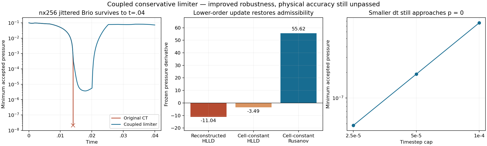

# Coupled admissibility experiment

Prospective contract, 2026-11-09, issue #7. Continue the separately named
[CT comparator](M1_CT_COMPARATOR.md); do not change the paper A profiles.

## Mathematical basis and limits

For fixed geometry, the recovered B is linear in stored face fluxes and
the cell Bz integral. The set rho>0, E-|m|²/(2rho)-|B|²/2>0 is convex
([Wu & Shu, lemma 2.2](https://arxiv.org/html/1807.11467v1#S2)). Therefore a
single convex coefficient applied to **all fluid integrals, magnetic face
fluxes and Bz integrals together** can limit a high-order update toward an
admissible low-order one. Shared-face conservation and the CT incidence
identity are retained. Limiting gas fluxes alone would not give this result.

The literature does not prove that our low-order CT update is positive.
[Pang & Wu (2024)](https://arxiv.org/html/2410.05173v1) instead construct a
different split Cartesian method; their theorem is not inherited here.
First measure the frozen original CT failure with reconstructed HLLD,
cell-constant HLLD and cell-constant Rusanov fluxes. Rusanov uses the existing
moving-face transformation and common normal B, with symmetric speed
a=max(|sL|,|sR|); its flux is (FL+FR-a*(UR-UL))/2 in the face frame.
No arbitrary diffusion multiplier, energy reset or pressure floor.

If the lower-order full Euler update is admissible, test a separately named
global convex limiter. For each forward-Euler leg of SSP Heun, form both
coupled updates and search theta in [0,1] for the largest admissible blend.
Require density and internal energy at least 1e-10 of their positive
low-order values as a relative roundoff margin (engineering choice, not a
physical floor or source). If high order passes use theta=1 unchanged.
If low order fails, halve dt; never label it a positivity guarantee.
Apply the final SSP convex average, check positivity again, and count all
limited legs, minimum theta and low-order failures. A scalar shared by the
whole domain is deliberately simple and potentially over-diffusive; do not
claim locality, general accuracy, or the original paper algorithm.

## Bounded tests

Keep the original nx256/512, ny4 Brio geometry, regular/jitter .15, base and
joint boost, t=.01/.02. Keep Bx<=1e-8, fluid budgets<=1e-10 and the existing
short-wave order screen>=1.8. Add uniform/boost, analytical Rusanov flux,
joint convexity and conservation/divergence tests, and baseline output parity.
At most three serial cases, 30 wall seconds per case. No long REANA runs.
Retain failures; a stable evolution is not full M1 acceptance.

After the primary packet completes, additional short robustness controls are
declared: nx256 jittered t=.02 with dt caps .0001/.00005/.000025, each base
and boost; nx256/512 jittered t=.04 base and boost. These ten cases check
step-size sensitivity and whether stability extends beyond the original
failure, without changing any accuracy gate or starting the full M1 matrix.

## Measured outcome

The separate `voronoi-ct-admissible-v1` profile is implemented. All **42/42**
bounded evolution controls complete; all **17/17** complete boost comparisons
pass (maximum absolute component difference 1.86e-13). The largest normalized
fluid-budget residual is 1.50e-14, and the maximum dimensional CT face-flux
divergence is 7.10e-12. No low-order Euler rejection or high-order rate failure
occurs in these controls. Rejection counters still include ordinary endpoint
CFL reductions. Maximum measured case wall time is 4.12 seconds; no timeout
or long remote job occurs.

This is a **robustness improvement, not an accepted physical repair**. The
limiter prevents the previous CT pressure crash and allows continuation
through t=.04, but all jittered Bx gates and both jittered wave-order screens
remain failed. The paper A profiles and default CT profile are unchanged.
The existing projected quadratic A candidate remains separate.

### Frozen failure test

At the original last accepted state (nx256 jitter .15, cell 645, t=.0140692):

| Rate construction | dE | dK | dM | dp |
| --- | ---: | ---: | ---: | ---: |
| Reconstructed HLLD | -15.68749 | .42072 | -5.06354 | -11.04467 |
| Cell-constant HLLD | -12.49886 | .59102 | -9.60226 | -3.48762 |
| Cell-constant Rusanov | 36.22509 | .95292 | -20.34419 | 55.61636 |

All rates are per volume, gamma=2. Removing slopes alone still drains
pressure. Rusanov changes the fluid and magnetic update together; its full
Euler trial at its CFL bound dt=.0002159774 is positive in **every** cell,
with minimum p=.0119511. Half- and quarter-bound probes are also positive.
The high-order and cell-constant HLLD trials fail all three step-size probes.
This measured admissible lower-order endpoint justifies testing the convex
blend; it does not prove admissibility for arbitrary future states.

The blend acts on both Euler legs of SSP Heun and then takes the final SSP
average. Global theta is found by 52 bisections, with a 1e-12 inward relative
backoff and actual field/pressure recovery checked before acceptance. The
new Rusanov kernel retains the moving-face transformation, normal-B convention
and EOS. Its analytic flux, orientation and joint-boost tests pass. It is
an explicit solver option, not a silent change to HLLD fallback behavior.

### Short shocks and timestep sensitivity

| Case, base run | Limited Euler legs | Minimum theta | Minimum accepted p | Final p minimum | Final max Bx error |
| --- | ---: | ---: | ---: | ---: | ---: |
| nx256 jitter, t=.02 | 59 | .834377 | 3.63954e-6 | 4.05423e-6 | .130886 |
| nx256 jitter, t=.04 | 60 | .834377 | 3.63954e-6 | .0719387 | .108835 |
| nx512 jitter, t=.02 | 0 | 1 | .0424138 | .0726867 | .169315 |
| nx512 jitter, t=.04 | 0 | 1 | .0424138 | .0770329 | .202953 |

The finest shock already survived under original CT; its limiter stays
inactive. Unrestricted timesteps differ slightly because the new profile
also imposes the lower-order CFL bound, even when theta=1. The regular
shocks need no limiting and retain Bx exactly. Their slightly different
solutions therefore do not imply active limiting or altered HLLD fluxes.

On nx256 jittered t=.02, the step-size controls give:

| dt cap | Limited legs | Minimum accepted p | Final p minimum |
| --- | ---: | ---: | ---: |
| .0001 | 121 | 7.62679e-7 | 1.18383e-6 |
| .00005 | 239 | 1.90448e-7 | 3.02372e-7 |
| .000025 | 477 | 4.76137e-8 | 7.64427e-8 |

The minimum approaches zero approximately as dt² over this small sequence.
This is **not physical convergence**: it shows that the limited trajectory
remains close to the pressure-admissibility boundary while the unlimited
spatial operator points outside it. A positive accepted state alone is
insufficient for accurate shock thermodynamics. No fixed pressure floor is
enforced and no energy is reassigned; the coefficient changes shared fluxes.

All 16 wave runs have theta=1 and reproduce the original CT initial/final
physical CSVs and accepted histories **byte for byte**. Regular B/v orders
remain 1.977/2.142 and 2.005/1.922; jittered orders remain 1.411/1.407 and
1.213/.328. The unchanged >=1.8 screen still rejects both jittered families.
The original CT frozen-failure snapshots/rates and failure time also
reproduce byte for byte. A post-implementation audit repeats the original
probe, giving 44 new evolutions in total: 42 controls and two frozen-audit
repetitions (the first motivates the limiter, the second verifies final source).



### Reproduction and next decision

```sh
python3 scripts/run_ct_controls.py --profile voronoi-ct-admissible-v1 --output-dir results/ct_positive_fresh
python3 scripts/run_ct_controls.py --profile voronoi-ct-admissible-v1 --extended-controls --output-dir results/ct_positive_extended_fresh
```

The [archive](../tests/reference/m1_ct_positivity/README.md) retains exact source,
raw failures/baselines, commands, frozen probes, independent checks and plots.
Validation: 138 debug workspace and 146 release all-target Rust tests, 45
Python and 13 M0 tests, strict all-feature Clippy, format and pinned reference
integrity pass. No unstructured-MHD positivity theorem is claimed.

Retain this as an opt-in conservative pressure guard and diagnostic. It
provides a way to continue otherwise failing CT states, but does not justify
replacing the paper algorithm or declaring M1 complete. Next resolve the
magnetic reconstruction/spatial error and compare pressure profiles to the
independent reference before expanding the run matrix. Repeating long runs
or raising a pressure threshold would not address the demonstrated error.
