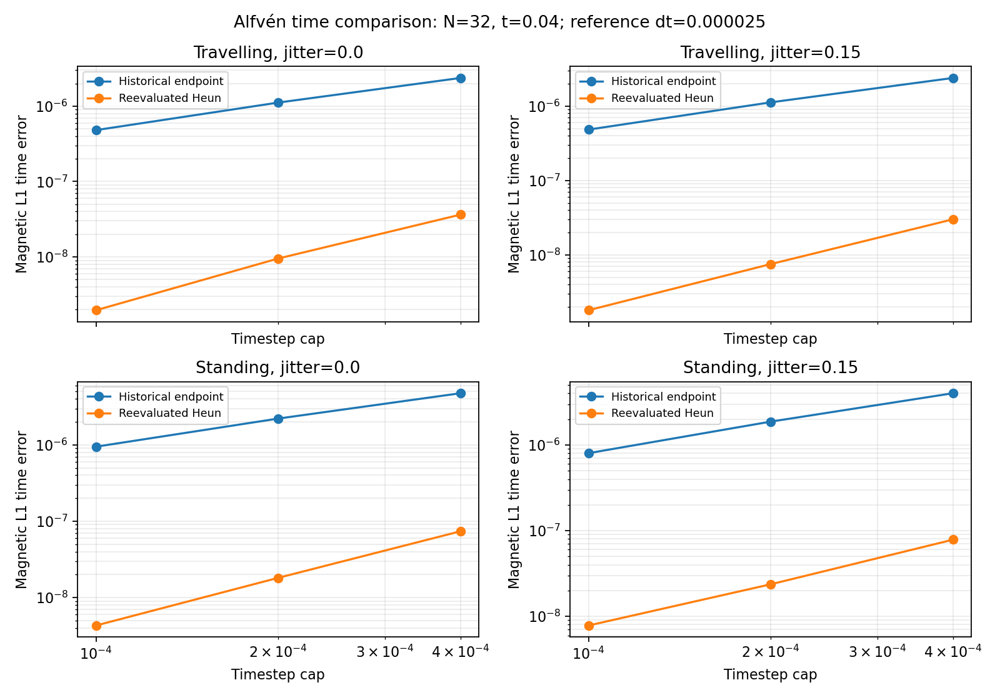

# M1 Heun investigation results

M0 is complete within its accepted AI-reviewed specification scope. M1 remains
under scientific validation. The new `bulk-frame-heun-v1` profile implements
the [prospectively specified time-integrator comparison](M1_HEUN_INVESTIGATION.md),
on fixed/rigid meshes only. The default endpoint profile is unchanged.

## Local bounded checks — 2026-11-08

All 92 Rust tests and 27 Python tests pass, as do `cargo fmt --check` and
`cargo clippy --all-targets --all-features --locked -- -D warnings`.
Four new Rust checks cover unsupported-motion rejection, uniform states,
three-component boosts/permutations and smooth semidiscrete time convergence.
Positive density/pressure, conservative budgets <=1e-10, finite values for
each independent magnetic divergence diagnostic, and endpoint auxiliary
counters are checked.

On the registered smooth unlimited N8 jitter=.15 fixture at t=.02, the
ratios of successive self-differences are:

| Quantity | First ratio | Second ratio |
| --- | ---: | ---: |
| Integrated conservative Q | 4.013868857 | 4.006854528 |
| Reduced vector potential A | 4.001677838 | 4.000766580 |
| Cleaning scalar phi | 4.004813829 | 4.002429889 |
| Magnetic field B | 3.999944912 | 3.999963327 |

These use dt=.001/.0005/.00025/.000125, with zero rejected steps, all caps
reached and auxiliary root=4 at both stages. Ratios near four support
second-order time integration for this bounded smooth semidiscrete problem;
they do not establish physical spatial convergence or nonsmooth-stage order.

The separate N8 t=.004 execution check completed all 40 wave evolutions,
passed all eight boost/geometry comparisons (four per profile), conserved
the registered budgets, reached every cap and had zero rejections. Raw data
and the execution-check plot are in `results/heun_quick_20261108/`.
The historical signal profile's jittered standing-wave CSV was byte-identical
to the previously frozen signal binary on this N8, dt=.0001, t=.004 fixture.
This is a bounded regression check, not a cross-platform identity claim.

The finite reference matters when reading adjacent slopes: an ideal error
proportional to dt has apparent slopes 1.09954 and 1.22239 against dt_ref=.000025
on this ladder; an ideal dt² error gives 2.01707 and 2.07039. These follow from
log2[(dt^p-dt_ref^p)/((dt/2)^p-dt_ref^p)]. Values above two alone therefore do not
establish a higher-order method. Limiter/auxiliary/face switches may reduce the
order on other cases, which are reported independently.

## REANA measurement

Workflow `openmhd-heun-20261108.1` completed at `2026-11-08T14:03:54Z` and contains the exact numerical source plus
uncommitted changes, with source-snapshot SHA-256
`295e3b6372a78b1e01fa6664c388242267538515fc24595d541f3c796b7230bd`.
It is configured for 24 independent simulations and a 64 GB test-job memory
limit. The registered study uses N32, t=.04, two profiles, regular/jittered
meshes, travelling/standing waves, four timestep caps and eight boost pairs.
All 92 Rust tests, 27 Python tests, formatting, Clippy, release build and both
M0 checks passed remotely on Linux/x86-64 with Rust 1.85.1. All 40 evolutions
completed with positive sampled density/pressure, every timestep cap reached,
zero rejected steps and root=4 at both stages (no auxiliary coarsening).
All eight boost/geometry comparisons pass (four per profile); the worst
magnetic wave-relative boost L1 error is 1.084e-14, below 1e-8. The maximum
recorded normalized conservative-budget error is 2.053e-14, below 1e-10.
All three independent divergence operators and A/phi errors are retained in
the run records. No machine-zero divergence claim follows.

The magnetic L1 adjacent time slopes against the finite reference are:

| Wave / mesh | Signal endpoint slopes | Reevaluated Heun slopes | B time-error reduction at dt=.0001 |
| --- | --- | --- | ---: |
| Travelling / regular | 1.086, 1.215 | 1.935, 2.282 | 246x |
| Standing / regular | 1.103, 1.224 | 2.027, 2.075 | 220x |
| Travelling / jitter=.15 | 1.089, 1.217 | 1.999, 2.061 | 268x |
| Standing / jitter=.15 | 1.101, 1.224 | **1.729, 1.598** | 103x |

This supports reevaluated coupling as a useful engineering comparator. It does
not isolate which of the simultaneously refreshed sources caused each old
error, nor establish uniform second-order behavior. In particular, the
jittered standing case remains below second order; the regular travelling
velocity slopes are 1.881 and 1.905. Nonsmooth limiter, auxiliary-membership
and face-state behavior needs further investigation. This short N32 time study
does not replace the N64 t=1 temporal packet or spatial/N256 boost gates.

The 40-case numerical runner took **33.35 seconds** with 24 workers; the full
workflow took about five minutes including toolchain preparation and checks.
This timing does not predict the larger N256 studies.

All 17 exported artifact checksums and every per-run raw-file checksum were
verified locally. The [evidence archive](../tests/reference/m1_heun/README.md)
retains all raw snapshots, 43 hash-verified source files, execution/runtime
records, measurements and the inspected plot. The original download remains
under `results/reana_remote_20261108/heun/`.

The earlier full original/signal/prescribed Linux repeats remain separate
frozen workflows. No previous failure is removed or relabelled by this study.
Irregular-mesh curl accuracy, the N256 standing-wave boost failure and the
general solver's shock/vortex validation remain open.

The subsequent [auxiliary-projection investigation](M1_AUXILIARY_RESULTS.md)
retains these results and tests a separately named continuous-projection
comparator. It improves the limited jittered standing-wave time slopes in
the bounded packet while preserving the remaining limitations explicitly.
