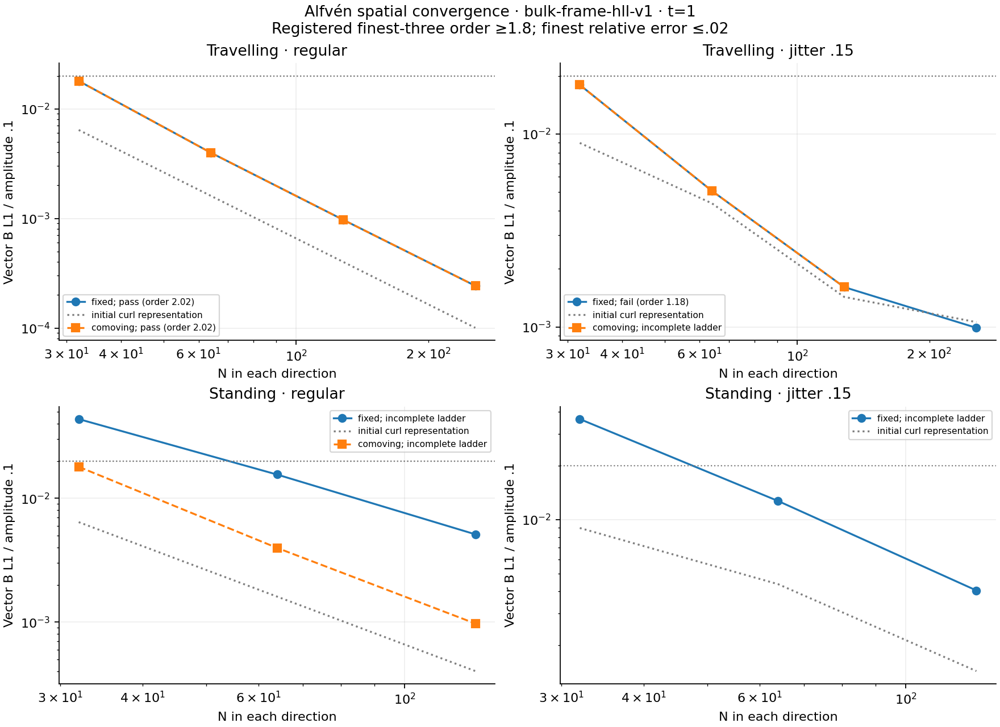
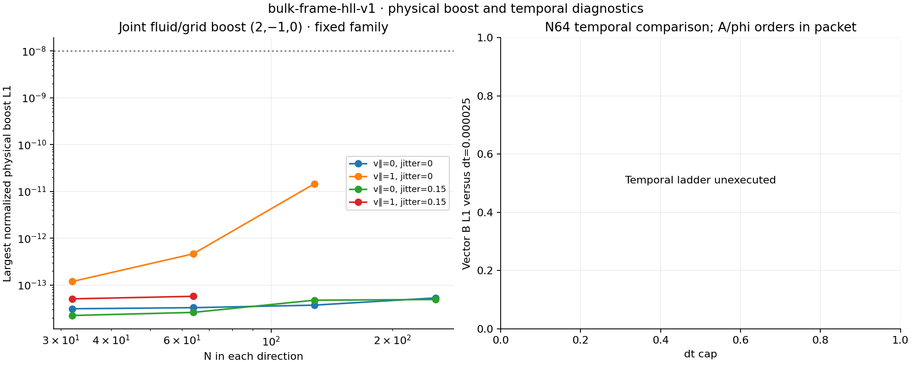
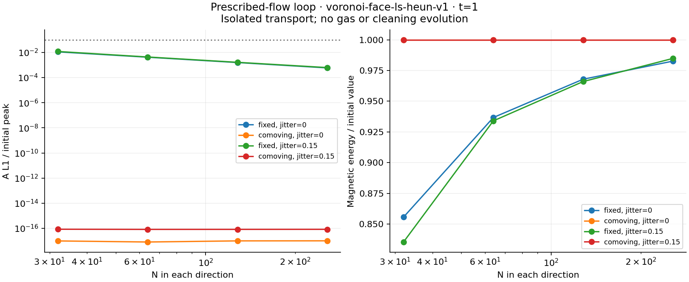
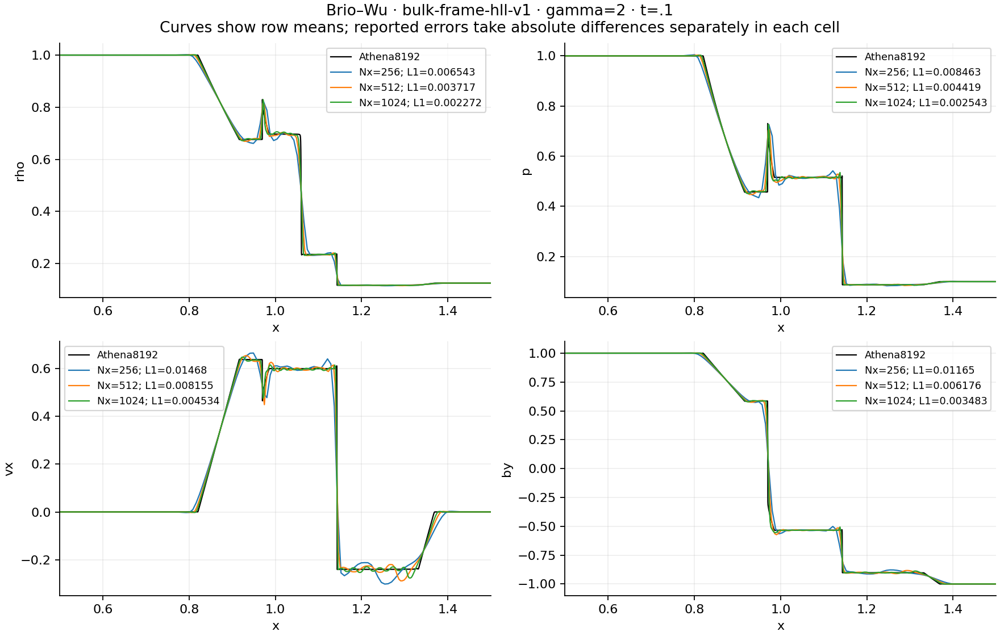
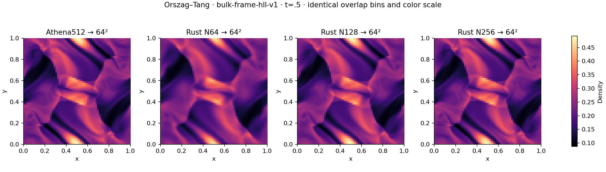
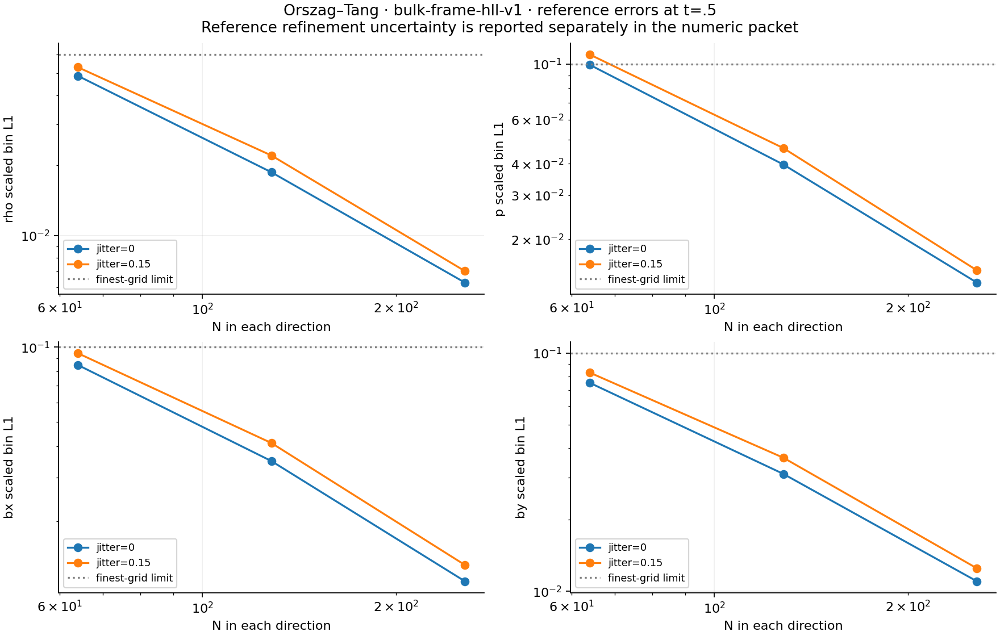

# M1 completion study: historical HLL results

**This profile does not pass M1.** `bulk-frame-hll-v1` passes the complete prescribed-flow loop, Brio–Wu and initial Orszag–Tang packet, but its complete irregular travelling-wave ladder fails the unchanged convergence-order gate. The remaining wave/loop execution was stopped to evaluate the separately registered matched-derivative candidate. M1 remains open pending that candidate's complete physical packet and separate AI review. The historical results below received a separate, explicitly labelled AI review; human peer review is not claimed.

These are serial f64 calculations with dimensionless units, mu0=1, periodic Voronoi cells and global timesteps. Conservative shared-face gas updates use strict positive density/pressure, with no pressure floors or magnetic-energy resets. The [implementation guide](M1_IMPLEMENTATION.md), [prospective plan](M1_COMPLETION_PLAN.md) and [separate AI review](M1_COMPLETION_AI_REVIEW.md) define the numerical choices and limits. This is an engineering reference, not an AREPO-equivalence claim.

## Wave convergence: a retained failure

The travelling-wave case has gamma=5/3, rho=1, p=.1, transverse amplitude .1, mean B=(1,0,0), v_parallel=0 and t=1. Every grid is genuinely N-by-N. Initial curl error is reported separately from evolved physical B error.

| N | Regular fixed-grid vector B L1 | Jitter .15 fixed-grid vector B L1 |
|---:|---:|---:|
| 32 | .00179543 | .00179557 |
| 64 | .000397360 | .000506707 |
| 128 | .0000972445 | .000160960 |
| 256 | .0000242756 | .0000990515 |

The finest-three fitted orders are **2.01643 regular** and **1.17745 irregular**, against the required 1.8. The irregular finest error is small relative to the wave amplitude, but this does not satisfy its separate order criterion. Neither the gate nor the resolution family was changed after seeing this result.



The historical wave study records 119 completed outcomes, 8 externally stopped partial evolutions and 57 unexecuted configurations, out of 184 planned. The latter groups are not numerical failures or successful evidence. Temporal and coupled-loop work not reached in this execution remain unexecuted for this packet. The earlier [bounded wave/loop results](M1_WAVE_LOOP_RESULTS.md) remain separate evidence.



## Prescribed-flow loop and Brio–Wu

The isolated loop uses v=(2,1), fixed or rigidly comoving meshes, N32/64/128/256, regular/jitter.15 geometry and t=1. It evolves scalar Az only; no gas or cleaning field evolves. All four ladders pass. Finest fixed-grid A L1/initial peak is .00058854 regular and .00062319 irregular, below .1; errors decrease with refinement. Comoving discrete A and B drift is exactly zero. Small plotted analytic errors arise from evaluating the translated analytic reference at floating-point positions.



Brio–Wu uses gamma=2, a periodic 2×.125 box, Nx256/512/1024 with Ny4, interface x=1, mean Bx=.75 and t=.1. Fine Athena8192 reference primitive values are averaged onto each candidate polygon clipped to x=[.5,1.5] **before** absolute differences are taken. Distinct y rows remain separate in error norms; plotted curves show row means.

| Finest Nx1024 error | Measured L1 | Limit |
|---|---:|---:|
| Density | .00227216 | .03 |
| Pressure | .00254266 | .04 |
| vx | .00453443 | .03 |
| By | .00348327 | .04 |

All errors decrease relative to Nx256. Maximum Bx departure is 4.97e-14. The accepted-stage global maximum signal speed times duration is .440767, below the .45 seam-isolation bound; this frozen execution predates the directly integrated signal-travel output, and its conservative upper bound is explicitly labelled.



## Orszag–Tang at t=.5

The periodic unit square uses gamma=5/3, rho=25/(36pi), p=5/(12pi), v=(-sin(2pi y),sin(2pi x),0), mean B=0 and the registered analytic Az. N64/128/256 regular and jittered meshes are paired with joint fluid/grid boost (2,-1,0). Candidate cell primitive fields are projected by exact polygon overlap to the same 64×64 bins as the archived Athena512 reference. All four reference ladders and all six boost pairs pass.



| Finest scaled bin L1 | Regular | Jitter .15 | Limit |
|---|---:|---:|---:|
| Density | .00627691 | .00703473 | .06 |
| Pressure | .0134451 | .0150494 | .1 |
| Bx | .0114935 | .0133615 | .1 |
| By | .0110187 | .0124930 | .1 |

The largest normalized physical boost L1 among all six pairs is 5.03e-13, below 1e-8. Every run passes the separate mean-B drift and limited-face divergence bounds. All 31 loop/shock/vortex executions completed; all gas runs remain positive with maximum normalized conservative-budget residual 2.36e-13. Raw neighbour-LS, arithmetic-face and limited-face magnetic divergences remain distinct recorded operators. No machine-zero divergence identity is assumed.



The [independent reference packet](M0_BENCHMARK_PACKET.md) records Athena source/license/provenance and its refinement sensitivity. Those reference changes are reported separately and are not rigorous error bounds. This initial vortex gate is at t=.5; later times and 3D remain outside this packet.

## Execution, correction and reproduction

The wave execution used revision `dfcae22`; the 31 remaining cases used `3249360`. Both ran release builds with the pinned Rust toolchain on an arm64 Mac, one serial process per case. Exact commands, source/binary hashes, counts, diagnostics and runtimes are in the archives. The historical commands, from their respective source checkouts, were:

```sh
# dfcae22: full planned wave study; the archived execution was stopped as described above
python3 scripts/run_m1_wave_loop.py --suite all --profile bulk-frame-hll-v1 \
  --temporal --jobs 8 --output-dir /tmp/hll_wave

# 3249360: complete passive/shock/vortex execution
python3 scripts/run_m1_completion.py --jobs 4 --output-dir /tmp/hll_remaining

# Current checkout: verify raw hashes, preserve original analysis, remeasure and seal projections
python3 scripts/run_m1_completion.py --analyze-only --output-dir /tmp/hll_remaining
```

The frozen remaining-case runner's original Brio averaging and vortex normalization analysis was corrected at measurement revision `99a6b24`. Original execution metadata and summary are preserved; no raw evolution was altered. The source/reference/raw hashes and new measured projection hashes were verified before archival.

- [Complete 31-run remaining-case archive](../tests/reference/m1_completion/hll_remaining/archive_provenance.json): ledgers and all figure projection inputs, with compressed/uncompressed hashes.
- [Explicitly interrupted wave archive](../tests/reference/m1_completion/hll_wave_interrupted/partial_archive_provenance.json): completed outcomes, full planned manifest, interruption reason and separate unexecuted/stopped lists.
- Large raw CSVs remain in the local execution directories; their digests and reproduction commands are retained in the archived ledgers.

Reproduce all six displayed figures directly from the checked-in numeric archives (recorded plotting environment: Matplotlib 3.9.4, NumPy 2.0.2):

```sh
python3 scripts/plot_m1_completion.py \
  --wave-dir tests/reference/m1_completion/hll_wave_interrupted \
  --remaining-dir tests/reference/m1_completion/hll_remaining/remaining \
  --output-dir results/reproduced_hll_figures
```

The figure data and output hashes are in [plot provenance](images/m1_completion/hll/provenance.json). Passing the shock/loop/vortex packet does not erase the failed wave-order gate; acceptance of the matched candidate requires its own complete results.
