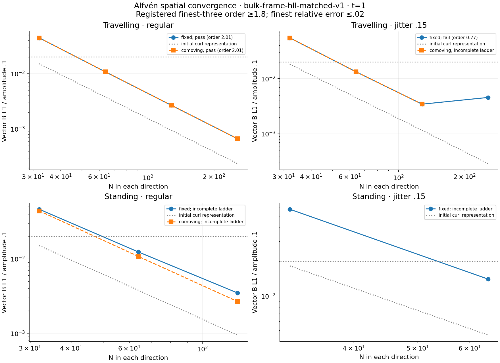
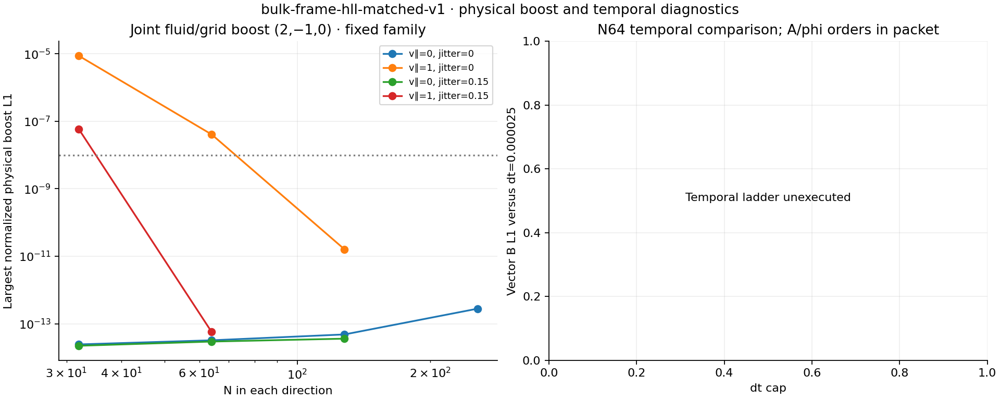
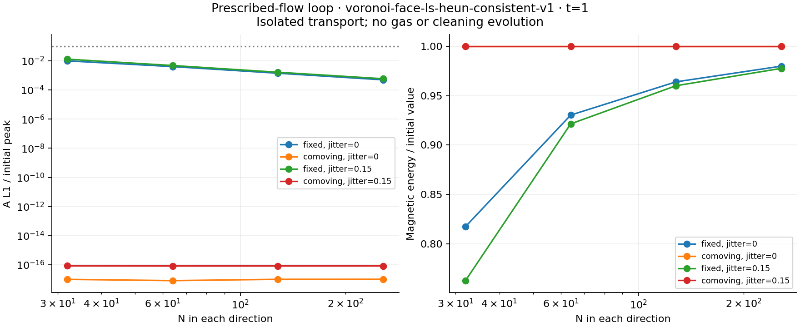
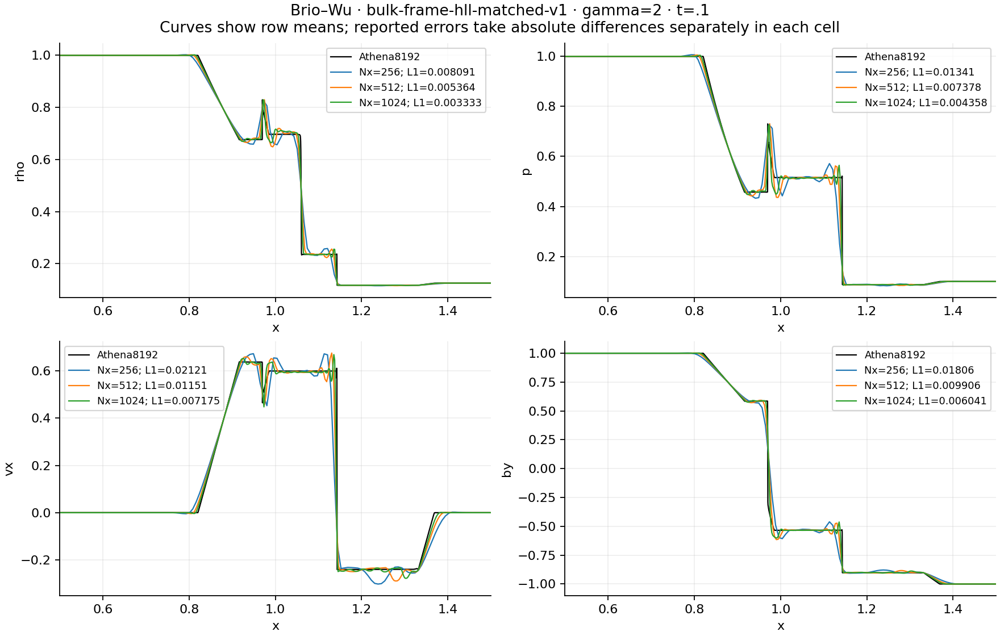
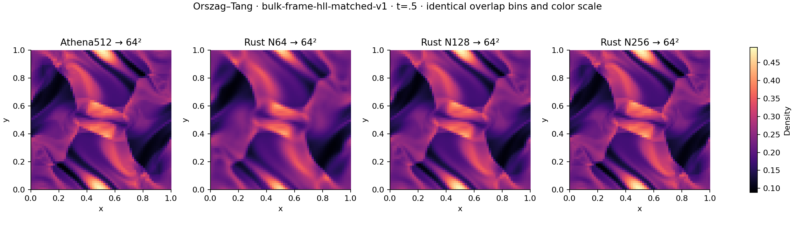
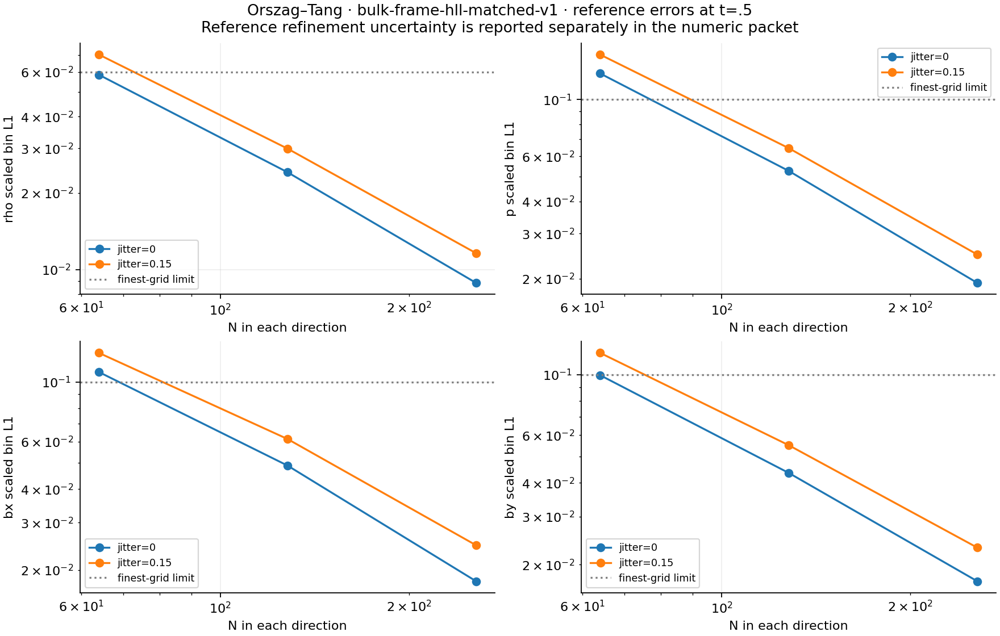

# M1 matched-derivative study

**This profile fails M1's wave-convergence and several standing-wave boost gates.** Its complete 31-case prescribed-loop, Brio–Wu and Orszag–Tang study passes the registered gates for those cases. That does not erase the failed irregular Alfvén order .77243, below 1.8. The newer compact derivative is a separate experiment and cannot inherit these physical results.

`bulk-frame-hll-matched-v1` uses the quadratic derivative for both A and phi, positive centroid-triangle source averaging, quadratic donor/receiver transport and the continuous HLL face completion. See the [prospective plan](M1_COMPLETION_PLAN.md) and [implementation guide](M1_IMPLEMENTATION.md). These serial f64 calculations use dimensionless units, mu0=1, periodic Voronoi cells, global steps and strict positive states, without pressure floors or energy resets.

## Waves

The periodic travelling wave has gamma=5/3, rho=1, p=.1, mean B=(1,0,0), transverse amplitude .1, zero parallel velocity and t=1. Every mesh is a true N-by-N grid.

| N | Regular fixed-grid B L1 | Jitter .15 fixed-grid B L1 |
|---:|---:|---:|
| 32 | .00441497 | .00548993 |
| 64 | .00107720 | .00133465 |
| 128 | .000267474 | .000345468 |
| 256 | .0000666873 | .000457424 |

The finest-three orders are 2.00687 regular and .77243 irregular. The irregular finest error meets the separate amplitude bound, but fails the required order and increases relative to N128. Initial representation error and evolved error remain separate measurements.



The interrupted full study preserves 189 completed, 8 externally stopped and 59 unexecuted cases out of 256 planned. Missing resolutions, coupled-loop runs and temporal studies are not counted as passes. External stops are not numerical failures. The [diagnostic comparison](M1_WAVE_DIAGNOSTICS.md) records the retained earlier experiments and the independent noise analysis.

Of the 22 completed Alfvén boost pairs, 19 pass the registered wave-amplitude normalization. Fixed-grid standing waves fail at regular N32/N64 and irregular N32; their largest normalized physical L1 errors are 8.76e-6, 4.08e-8 and 5.87e-8 against 1e-8. The N64 regular pair passes the alternate historical normalization, but that does not satisfy the registered wave-amplitude gate. These failures remain in the archived numeric tables.



## Prescribed loop and shock

The prescribed loop evolves scalar Az at v=(2,1), t=1, on regular/jittered N32/64/128/256 meshes. It uses the consistent transport restriction; no gas or cleaning field evolves. All four fixed/comoving ladders pass. Finest fixed A L1/peak is .000495037 regular and .000588510 irregular; discrete comoving A/B drift is exactly zero. Tiny analytic errors plotted for comoving runs arise from floating-point coordinate evaluation.



Brio–Wu uses gamma=2, a periodic 2×.125 strip, interface x=1, mean Bx=.75, Nx256/512/1024 and Ny4, at t=.1. The Athena8192 reference is averaged onto each candidate polygon clipped to x=[.5,1.5] before taking absolute differences; separate y rows are retained.

| Finest Nx1024 L1 | Measured | Limit |
|---|---:|---:|
| Density | .00333328 | .03 |
| Pressure | .00435831 | .04 |
| vx | .00717488 | .03 |
| By | .00604090 | .04 |

All errors decrease from Nx256. Maximum Bx error is 5.00e-15. The largest integrated accepted-stage signal bound is .440113, below .45.



## Orszag–Tang

The periodic unit square uses gamma=5/3, rho=25/(36pi), p=5/(12pi), v=(-sin(2pi y),sin(2pi x),0), mean B=0 and the registered Az. At t=.5, regular/jittered N64/128/256 calculations are projected by exact polygon overlap onto the same 64² bins as Athena512. All four reference ladders and six joint fluid/grid boost pairs pass.



| Finest scaled bin L1 | Regular | Jitter .15 | Limit |
|---|---:|---:|---:|
| Density | .00885399 | .0115955 | .06 |
| Pressure | .0192566 | .0248491 | .1 |
| Bx | .0181462 | .0247012 | .1 |
| By | .0173657 | .0230921 | .1 |

The maximum normalized boost L1 is 9.04e-14, below 1e-8. Across all vortex runs, mean-B drift/Bscale is at most .000582830 and limited-face dimensionless divB RMS at most .0524825, below .001 and .1 respectively. All gas states remain positive; the largest normalized conservative-budget residual across the packet is 2.45e-13. Neighbour-LS, arithmetic-face and limited-face divergences remain distinct diagnostics; no machine-zero identity is claimed.



## Run and reproduce

Both studies used frozen revision `f9a11f0`, release builds with the pinned Rust toolchain on an arm64 Mac. The remaining-case study reused 27 completed exact-configuration runs from its earlier two-worker execution, then ran the four N256 vortices concurrently. Original per-run execution origins, captured reuse metadata and exact source/binary/cache/raw hashes are preserved.

```sh
# Run from the recorded source revision, with fresh output directories.
python3 scripts/run_m1_wave_loop.py --suite all --profile bulk-frame-hll-matched-v1 \
  --temporal --jobs 8 --mesh-cache-dir results/m1_mesh_cache --output-dir results/m1_matched_full
python3 scripts/run_m1_completion.py --profile bulk-frame-hll-matched-v1 \
  --jobs 4 --mesh-cache-dir results/m1_mesh_cache --output-dir results/m1_matched_remaining_final

# Current measurement code verifies raw evidence and seals the projection inputs.
python3 scripts/run_m1_completion.py --analyze-only --output-dir results/m1_matched_remaining_final
```

The full wave execution was stopped after its failed ladder; rerunning the command above normally continues the complete planned matrix. The published partial archive explicitly records which cases were executed. The 31-case reanalysis at `bb73618` preserves the original summary and source evidence; its measurement formulas agree with the frozen runner, and projection hashes are now sealed for archival. Large raw CSVs remain local with hashes and exact commands in the ledgers.

All six figures reproduce byte for byte from raw measured versus compressed archived inputs:

```sh
python3 scripts/plot_m1_completion.py \
  --wave-dir tests/reference/m1_completion/matched_wave_interrupted \
  --remaining-dir tests/reference/m1_completion/matched_remaining/remaining \
  --output-dir results/reproduced_matched_figures
```

See [archive provenance](../tests/reference/m1_completion/matched_remaining/archive_provenance.json), [figure provenance](images/m1_completion/matched/provenance.json), the [independent reference packet](M0_BENCHMARK_PACKET.md) and the separately labelled [AI review](M1_COMPLETION_AI_REVIEW.md). Reference-refinement sensitivity remains reported separately, and this initial vortex packet does not validate later times or 3D.
