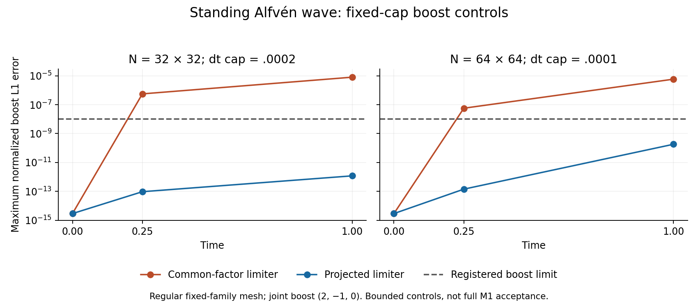

# Continuous quadratic limiter: bounded standing-wave controls

**Both previously failing fixed-cap standing-wave boost controls now pass. M1 remains open.** This is evidence for a separately named limiter experiment, not full spatial/temporal or physical acceptance.

## Measured improvement

The regular N-by-N unit-square Alfvén wave has rho=1, p=.1, gamma=5/3, mean B=(1,0,0), transverse amplitude .1 and parallel velocity 1. The base mesh is stationary; the paired mesh and fluid receive boost (2,-1,0). All physical vectors retain three components. The unchanged primary normalization scales are rho=1, p=.1, v=.1, B=.1 and E=1.16; the maximum normalized volume-weighted L1 must be at most 1e-8. Compare identical cell IDs at matched times after transforming coordinates, velocity and energy.

| Grid | Maximum dt | Common-factor limiter, final | Projected limiter, final | Projected steps per frame |
|---|---:|---:|---:|---:|
| 32 × 32 | .0002 | **7.99255e-6: fail** | **1.18865e-12: pass** | 5,001 |
| 64 × 64 | .0001 | **5.84084e-6: fail** | **1.82609e-10: pass** | 10,002 |



Every projected run stays positive, has zero CFL/state/geometry rejection, and conserves the periodic fluid budgets; largest recorded normalized budget residual is 3.15303e-14. Paired step counts match. The N64 discrepancy is below the gate but is not described as roundoff-level. These fixed-cap controls do not replace the originally failed adaptive runs. The wider projected-profile wave/loop subset and complete irregular-wave ladder are separate studies.

## Diagnosis and change

Disabling only the A limiter reduces the compact N32 mismatch to 2.29e-13; disabling only primitive limiting still fails. Full two-wave HLL and symmetric-fan fluid/induction controls also fail. None of these isolation controls is adopted as a production algorithm.

The separate **AI review** reproduced a discontinuity in the common quadratic limiter factor. At a local maximum, an arbitrarily small inadmissible transverse curvature can set the whole factor to zero, suppressing a finite admissible longitudinal curvature. Actual row-constant cosine data also acquire spurious transverse curvature from the two-ring fit. The evolving wave trace confirms that transverse changes can strongly amplify differences in the longitudinal reconstruction. These observations distinguish a concrete limiter defect from the earlier coordinate-Jacobian eigenvalues, which did not validate as genuine linear eigenmodes under directional checks.

The new `bulk-frame-hll-projected-v1` projects the dimensionless gradient/Hessian onto the same face-value bounds using a rotation-invariant minimum-change metric. It retains the compact raw curl/divergence and phi derivative, conservative flux, gauge, frozen cleaning and timestep. The [prospective specification](M1_COMPLETION_PLAN.md#prospective-continuous-quadratic-limiter-experiment) records the equations and unchanged gates. This does not prove general nonlinear stability.

## Reproduction and review

The four completed controls use frozen implementation `0f2e5e2`. Subsequent `fb8bb14` adds explicit rejection of unrepresentable original-normalization projection multipliers; independent reference cases retain identical ordinary-scale outputs. The broader studies use their own frozen `fb8bb14` provenance.

For the exact control implementation, build a checkout at `0f2e5e2`, then run each row of the table with its N and dt. Example N32 pair:

```sh
cargo run --release --locked -p openmhd --bin vector-potential -- --profile bulk-frame-hll-projected-v1 --case alfven --n 32 --jitter 0 --parallel-velocity 1 --motion rigid --mesh-x 0 --mesh-y 0 --time 1 --dt .0002 --checkpoint .25 --output results/projected_n32_base
cargo run --release --locked -p openmhd --bin vector-potential -- --profile bulk-frame-hll-projected-v1 --case alfven --n 32 --jitter 0 --parallel-velocity 1 --motion rigid --mesh-x 2 --mesh-y -1 --boost-x 2 --boost-y -1 --time 1 --dt .0002 --checkpoint .25 --output results/projected_n32_boost
python3 scripts/plot_m1_standing_controls.py --input tests/reference/m1_completion/projected_controls/analysis.json.gz --output-dir results/projected_control_figures
```

The actual execution additionally used the hash-sealed exact mesh caches. [Archived commands, execution/measurement provenance and raw hashes](../tests/reference/m1_completion/projected_controls) preserve all 28 raw-artifact digests. Large CSVs remain in `results/m1_projected_controls/`; the PNG reproduces byte for byte from its archived measurements and was visually checked. Figure replay does not rerun the solver.

The [separate AI review](M1_COMPLETION_AI_REVIEW.md#continuous-projection-limiter-review) independently checked high-precision projection references, historical equivalence, profile wiring and all four controls. All 122 Rust tests, formatting, strict Clippy and release build pass; 28 Python measurement tests and 13 M0 algebra checks pass. The [diagnosis and implementation archives](../tests/reference/m1_completion/README.md) retain the failed controls, numerical edge findings and fixes, sources, matrices and checksums. Approval is limited to the bounded experiment; every original M1 acceptance gate remains required.
