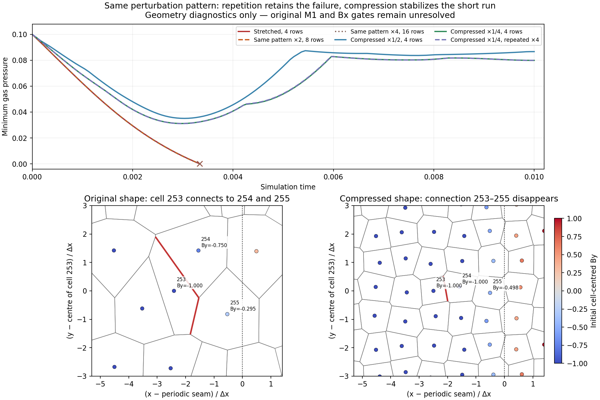
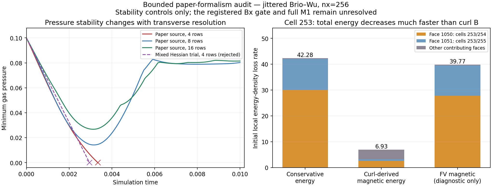
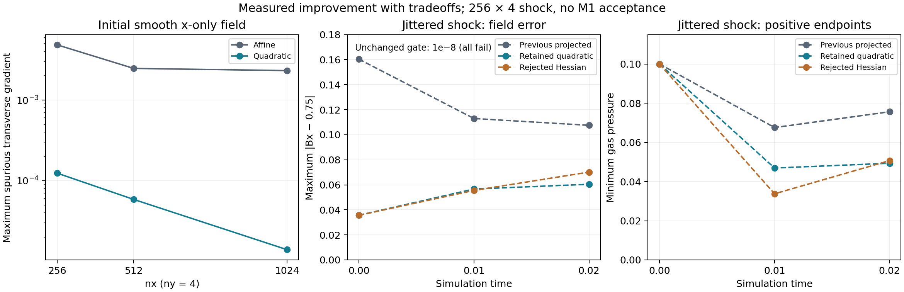
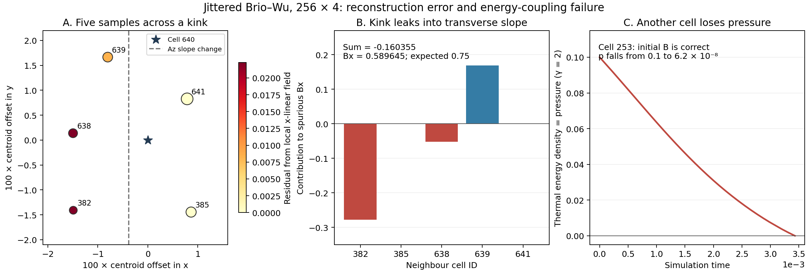
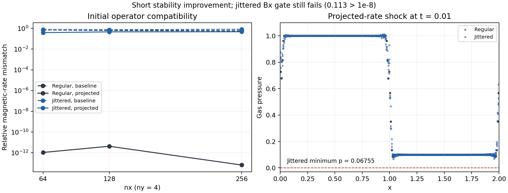
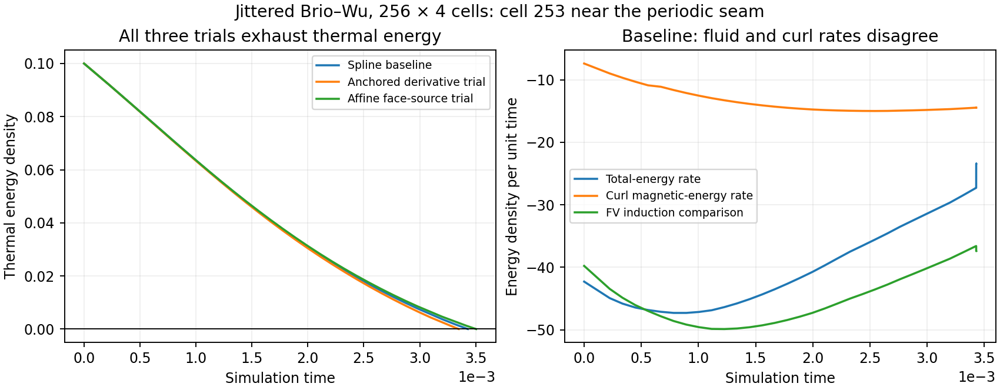

# Jittered-shock closure investigation

## Current development loop: short tests first

At the user's request on 2026-11-08, all four long original/candidate/spline/
physics workflows are stopped. Preserve their partial records and raw remote
workspaces. Hold new long submissions during this development phase.

Use the bounded four-case runner for each proposed fix:

```sh
python3 scripts/run_shock_repro.py --output-dir results/shock_short_fresh
```

It runs nx256 x ny4 to t=.01 on regular/jittered meshes, each base and jointly
boosted. The default cap is 30 wall seconds per case, at most four serial
workers. Timeouts and aborted evolutions fail the screen. It saves exact
source/binary hashes, a source archive, commands, timings, snapshots, logs,
positivity/budget checks, the unchanged short-time Brio diagnostics and boost
comparisons. Add `--trace-energy` only when an accepted-step energy trace is
needed; `--dt` supports a separate smaller-step check. A fresh directory is
required each time.

The first four-case screen took **0.87 wall seconds** after a cached build:
both regular cases completed; both jittered cases reproduced the t=.0034298
failure. This is an expected failed screen, not a successful stability test.
Source and measurements are under `results/shock_short_screen_20261108/`.
Small algebra/unit checks and this reproduction form the immediate iteration
loop. Candidates that fail it do not justify another full matrix.

A passing short screen is only the first development check. Medium-duration
shock/refinement controls and the original full-time M1 matrix are still
required before acceptance or merging. The short runner never submits jobs
or marks full M1 acceptance. Report a passing candidate before considering
resumption of longer validation.

The registered spline physics study failed all six jittered Brio evolutions.
The unchanged M0 thresholds, historical profiles and raw failures are retained.
No pressure floor, entropy switch, energy reset or explicit resistivity is
authorized as a substitute for passing that conservative packet.

## Observations before a numerical change

### Prospective repeated-pattern and cell-shape controls (2026-11-09)

Following the user's approval, isolate geometry effects using the exact
nx256 x ny4 generator pattern from the failing jitter=.15 case. Keep nx,
analytic initial A, EOS, mean field, fixed motion and paper-state source
unchanged. Copy that pattern in y, with no new random/jitter samples:

- Baseline: height .125, four rows, one copy (nominal dy/dx=4).
- Repeat it twice/four times in height .25/.5: eight/sixteen rows with the
  same local shapes and physical perturbations, up to floating-point geometry.
- Compress the original four-row generator pattern in y to height .0625
  and .03125 (dy/dx=2 and 1), preserving normalized perturbations. Retessellate;
  topology is allowed to change and must be measured, not assumed identical.
- Repeat the compressed height .03125 pattern four times in height .125,
  retaining its local shapes as a separate small-period control.

Require periodic geometry, neighbor-displacement, volume and effective
derivative-row equivalence for repeated patterns before interpreting solver
differences. Export geometry/stencils and initial rates. Compare initial and
predicted endpoint face contributions with the existing independent audit;
auxiliary velocity is exactly zero for that initial stationary fixture.
Then run to t=.01, at most three serial processes with 30-second external caps.
Track the same base-cell identities, histories, failures, budgets and all
independent divergence operators. Repeating the domain may change subsequent
auxiliary smoothing; initial equivalence does not imply later equality.
Preserve the original failing case and all gates. No new solver profile or
claimed fix follows merely from a successful alternate geometry.

#### Measured repeated-pattern result

All six configurations and their independent first-step face audits finish
within the cap (3.16–11.27 wall seconds per configuration, including its audit).
The original initial/final states, pressure history and initial rates are
byte-identical to the previous failing geometry control. No production solver
code, profile, registered benchmark or threshold changes in this increment.

| Exact four-row pattern | Total box height / rows | Status / reached time | Final minimum p | Minimum p over accepted history | Final max Bx error |
| --- | --- | --- | ---: | ---: | ---: |
| Original | .125 / 4 | fails at .00334288704 | 1.62607e-8 | 1.62607e-8 | .150138 |
| Original, repeated twice | .25 / 8 | fails at .00333644471 | 8.60940e-10 | 8.60940e-10 | .150203 |
| Original, repeated four times | .5 / 16 | fails at .00333641951 | 6.04636e-8 | 6.04636e-8 | .150207 |
| Compressed by 1/2 | .0625 / 4 | completes .01 | .0866851 | .0351083 | .0932526 |
| Compressed by 1/4 | .03125 / 4 | completes .01 | .0799264 | .0311445 | .0710402 |
| Compressed by 1/4, repeated four times | .125 / 16 | completes .01 | .0799231 | .0310870 | .0706868 |

All three repetition comparisons preserve local periodic geometry: maximum
centroid error 2.23e-16, relative volume error 1.67e-14 and absolute face-geometry
error 7.89e-15. Effective derivative rows agree within 3.87e-14 relative L1
(1.81e-12 absolute coefficient error); initial states and rates agree within
6.85e-15 and 9.67e-13 respectively, scaled by 1+abs(reference). The analyzer
includes duplicate periodic neighbor images and the first-sample subtraction
in each derivative row. An early test falsely paired those images by base ID;
matching their physical displacement fixed that diagnostic test, without a
solver change. The original failed test logs are retained.

Every independent initial/endpoint audit reproduces the production first step
with zero measured Q/A difference on both regular and jittered fixtures.
The largest normalized conservative-budget error over all six histories is
2.12e-15. These checks do not make the energy/curl coupling physically correct.
The three independent divergence diagnostics (least-squares cell divergence,
unlimited cell-field face sum and limited reconstructed face sum) remain in
the histories; none is replaced by a continuum curl identity.

The repeated stretched patterns retain cell 253's initial dE=-42.2816,
dM_curl=-6.92645 and dp=-35.3551. Compressing by 1/2 changes dp to +4.36341;
compressing by 1/4 changes it to +3.34461, with dE approximately zero and
dM_curl=-3.34461. Cell 253 starts with B=(.75,-1,0) in every case. Compression
removes its face with cell 255 and changes its neighboring reconstruction:
the right reconstructed By on face 253/254 changes from -.871549 to -1.
This suppresses the two-face initial energy loss identified above. Other
faces in the derivative stencil still contribute to its magnetic rate.

Thus increasing the periodic row count while preserving local shape does
**not** cure this failure. Altering the local shape/topology does improve this
short test. Retessellation changes connectivity as well as aspect ratio, so
this does not isolate either one alone or establish a generally stable method.
Later auxiliary sampling can differ between repeated boxes; initial operator
equivalence is not a claim of identical trajectories. The original pressure
failure and every jittered Bx gate remain unresolved. The next investigation
should target reconstruction across the magnetic discontinuity and its
coupling to the conservative energy update, within the verified paper
formalism. A stable alternate mesh is not a replacement acceptance case.



Source, raw CSVs, exact failures, checksums and reproduction commands:
[controlled-pattern evidence](../tests/reference/m1_pattern_controls/README.md).
Final checks pass 129 release Rust tests across all targets, 42 Python tests,
13 M0 algebra tests, pinned-reference integrity, formatting and strict Clippy.
No long workflow is restarted; full M1 acceptance remains false.

### Resumed paper audit and prospective mixed-stencil trial (2026-11-09)

The accumulated source/evidence is checkpointed on the development branch in
`4c5341a`, `76470eb`, `b5bea83`, `5175240` and `e17cf9b`. A fresh check passes
127 Rust, 41 Python and 13 M0 tests, format/strict Clippy and pinned references.
All 126 files named by archive manifests verify. No long runs are restarted.

The new `paper-shock-audit` independently assembles the initial and predicted
endpoint face sweeps for the stationary Brio state. Initial auxiliary velocity,
phi and non-Az potential components vanish, eliminating gauge/transport terms
in both stages. At dt=1e-6 its Q and A updates match the actual paper-source
solver bit for bit on regular and jittered nx256 x ny4 meshes. The old and
endpoint energy/curl rates agree with the initial diagnostic; no missing
factor/sign in stage assembly was found by this check.

On the jittered mesh, faces 1050 (253/254) and 1051 (253/255) contribute
-29.9905146 and -12.0420220 of the target's total initial dE=-42.2815944.
Both are HLLD faces with state-product and flux EMFs agreeing to roundoff.
Their right reconstructed By values are -.871549 and -.841936 while the
target starts at By=-1. These two faces account for about 99.4% of the energy
loss, but only -3.2146893 of dM_curl=-6.9264465. This localizes the discrepancy
to reconstruction/curl coupling; it is not proof that either published
formula is wrong. The regular control instead has dE=0 and dM_curl=-5.33202
in the same indexed cell, with the latter driven by a face outside that cell.

Test the source's optional mixed reconstruction (Section 4.2.2, Eqs. 62–66):
retain the original linear cell B and derive only B face slopes from quadratic
A Hessians, with component limiting. This differs from the rejected experiment
that also changed cell B and used projected Heun coupling. Name the new trial
`paper-hessian-v1`; retain literal Eq. (69), original gauge and paper endpoint
stages, initial A samples, conservative Q and all gates. No projection,
resistivity, entropy switch or energy reset is part of this trial.

Before measuring outcomes, require polynomial Hessian reproduction, smooth
2D convergence, symmetric mixed derivatives, constant/mean-field and bounded
coupled controls. Then run the unchanged four-case t=.01 screen with 30-second
case caps. Preserve the exact failed source and remove the evolution profile
if it provides no useful improvement. A zero raw Hessian-based trace is not a
claim of independent zero magnetic divergence or physical acceptance.

The mixed-stencil trial passes its operator and uniform/mean-zero-boost controls
but fails the jittered short shocks **earlier**, at t=.00295085417. Regular
cases reach t=.01; neither full short screen passes. Remove the new evolution
profile and Hessian additions from the retained library. Its exact source,
operator ladder and all four outcomes remain archived. This rules out this
specific optional source reconstruction as a sufficient pressure repair.

Next perform an observational geometry control with the retained
`paper-state-emf-v1`, fixed generators, unchanged box/EOS/analytic initial A,
nx64/128/256 and ny4/8/16 combinations. Compare t=.01 (same physical time)
and, on the nx ladder at ny4, t=2.56/nx (same nominal cell-crossing scale).
Use only jitter=.15, plus regular nx256 x ny16 as a control. At nx256, ny16
gives equal nominal x/y spacing, while the registered ny4 has aspect ratio 4.
Each process is capped at 30 wall seconds with at most three serial processes.
Export initial cell states, extrema/rates, failure time/cell, conservation,
independent divergence and final state. These are geometry diagnostics, not
new accepted benchmarks or authorization to alter the registered ny4 gate.

Measured geometry outcome: seven of eight evolutions complete; only the
registered jittered nx256 x ny4 control fails. At nx256 and t=.01:

| Geometry | Status / reached time | Final minimum p | Max Bx error at final accepted state |
| --- | --- | ---: | ---: |
| ny4, jitter=.15 | fails at .00334288704 | 1.62607e-8 | .150138 |
| ny8, jitter=.15 | completes .01 | .0802609 | .110146 |
| ny16, jitter=.15 | completes .01 | .0814819 | .0821556 |
| ny16, regular | completes .01 | .0849090 | 7.11e-15 |

The ny8/ny16 pressure minima dip before recovering; the values in the table
are final-state minima, not minima over the full history (.0141654/.0267612
respectively). Nx64 x ny4 and
nx128 x ny4 also complete the separate cell-crossing-scale controls at .04
and .02. Maximum normalized conservative-budget error across the eight
histories is 7.24e-15. All jittered configurations retain failed Bx diagnostics.
These controls establish sensitivity to geometry, not a proof that aspect
ratio alone causes failure: changing ny also changes topology, jitter samples
and auxiliary sampling. The original nx256 x ny4 problem remains unresolved.



The retained library is identical to the checkpoint after removing the failed
Hessian trial. New developments are bounded face/geometry diagnostic examples,
their runner and reproducible evidence. The source audit has not identified a
confirmed arithmetic defect to patch. Continue #19/#20 by separating stencil
topology, aspect ratio and initial discontinuity reconstruction; coordinate
the distinct normal-field requirement with #21. Do not treat these controls
as a replacement for the registered M1 packet or restart long runs.

### Current direction: return to the paper formalism

The user explicitly requested the Springel–Mayer–Pakmor/AREPO formalism during
the symmetry audit. Stop the independent face-integral solver direction.
Its two bounded operator tests pass, but it is not a coupled method or a
physical fix. Preserve its source and observations, and remove the unused
module from the working library. The rank audit remains a diagnostic of the
paper-style cell curl, not permission to alter the gates or the paper method.

Re-audit the source equations and distinguish published terms from our M0
engineering choices. The first concrete discrepancy to test is Eq. (69):
the printed expression uses the Riemann-state product `(v_face-u_i) cross
B_face`, whereas our U2 engineering rule uses `numerical_EMF-u_i cross B_face`.
Those differ for approximate Riemann states, especially HLL fallbacks. Test
the literal state expression as `paper-state-emf-v1`, keeping the default
profile frozen. Use the existing paper endpoint sequence, linear cell curl,
original gauge, nearest-bin auxiliary field and no rate projection. This
isolates one source choice; it does not establish complete AREPO equivalence
or remove the remaining documented 2.5D engineering choices.

Require an equation-level state-product test and bounded uniform/mean-field/
endpoint controls, then the same four-case t=.01 screen. Preserve all failures.
No resistivity or entropy closure is enabled in this trial. Those are separate
options in the source and would need explicit coefficients/selection criteria
and separately reported conservation effects, not guessed settings.

### Paper-source comparison: measured result

`paper-state-emf-v1` is now implemented in both endpoint stages. The
equation-level test deliberately supplies a numerical EMF different from the
Riemann-state product; the test distinguishes the two sources in all three
components. Uniform-state/mean-field drift checks pass for fixed and rigid
motion on regular and jittered meshes. No historical profile changes its
algorithm, and ten historical wave/loop outputs remain byte-identical.

The fresh, matched nx256 x ny4, t=.01 comparisons give:

| Profile | Regular base/boost | Jittered base/boost | First failure cell | Initial dp/dt there |
| --- | --- | --- | ---: | ---: |
| `paper-global-v2` | Both complete | Both fail at t=.00336336379 | 253 | -34.8807413 |
| `paper-state-emf-v1` | Both complete | Both fail at t=.00334288704 | 253 | -35.3551478 |

Both regular pairs pass the short positivity, budget, Bx and joint-boost
checks. Each entire four-case screen correctly fails. The measured screen
times are .62 and .95 wall seconds after cached builds; these are development
timings, not a controlled performance comparison. In the initially failing
cell, dE/dt stays -42.2815944, whereas the magnetic-energy rate changes from
-7.40085312 to -6.92644653. The literal source expression does not resolve the
energy/curl mismatch or repair the pressure failure. Retain it for further
source-based investigation; do not promote it as a successful solver.

The source audit below refers to [paper v1, Sections 4–5](https://arxiv.org/html/2609.35989v1).
It checks correspondence, not undocumented AREPO implementation details.

| Published component | Current reference status |
| --- | --- |
| Eqs. (51)–(61): neighbour-only, free-intercept, area-weighted derivatives; unlimited curl | Retained linear cell curl; 2.5D reduction |
| Eq. (69): surface-weighted Riemann-state product | Literal source added; historical U2 flux-EMF choice preserved separately |
| Eqs. (70)–(72), (76): gauge distortion, upwind transport, cleaning gradient, mean field | Retained original-gauge terms |
| Section 5.1, Eqs. (80)–(92): two endpoint fluxes/predictors and centroid-velocity correction | Existing endpoint sequence retained, including Eq. (90)'s old div(A) and sound speed |
| Section 4.3: smooth auxiliary interpolation | Bicubic 2D reference with documented deposition, origin and coarsening choices |
| Sections 4.6–4.7: optional dissipation/entropy treatment | Disabled; no undocumented repair parameters |

The quadratic/projected experiments are not this paper-source profile. In
particular, the paper generally retains the smaller stencil for cell B;
our rejected Hessian experiment also changed cell B and therefore did not
test the paper's preferred mixed-stencil choice. Further work should audit
the existing linear primitive reconstruction, limiter, Riemann-state
selection and endpoint extrapolations before proposing another method.

The jittered constant-Bx requirement is a project extension; the source does
not establish that result for this jitter family. The rank finding below
requires reconciling the discrete representation and benchmark interpretation,
not silently changing either the method or acceptance threshold. Full M1,
general Galilean invariance and AREPO equivalence remain unestablished.

### Symmetry audit: measured result and disposition

The exported exact derivative matrices include the implementation's baseline
subtraction and periodic duplicate-index accumulation. On the tested regular
meshes, the normal derivative has a nonconstant nullspace supporting a
transverse field. Every jittered direction tested has full numerical rank
after removing the constant-potential gauge. For the actual nx256 x ny4,
jitter=.15 mesh and x-normal, the volume-weighted result is:

| Curl | Rank | Smallest singular value | Rank tolerance | K | Bound on transverse RMS if max normal error <= 1e-8 |
| --- | --- | ---: | ---: | ---: | ---: |
| Affine | 1023/1023 | 2.08361e-6 | 3.4843e-11 | 30497.7 | .000304977 |
| Quadratic | 1023/1023 | 6.79960e-8 | 1.6513e-11 | 757527 | .00757527 |

Here `||D_parallel A||_V <= K ||D_perp A||_V`; volume normalization cancels
in their RMS ratio. These numerical bounds conflict with retaining the
shock's order-one transverse field under the current normal-field gate.
They are not rigorous interval proofs. Two matrix-product paths agree;
the retained explicit-contraction rerun raises on floating-point warnings,
checks finite values, constant annihilation, gauge orthogonality and SVD
backward residuals. Preserve the initial BLAS warnings as well as the clean
rerun, rather than suppressing or deleting them.

The face-integral prototype passed two operator tests, but had no coupled
evolution or general numerical EMF reconstruction. Following the user's
paper-formalism request it was removed from the library and its exact source
archived. This does not reverse or establish any physical acceptance result.
All new source versions, measurements, logs and reproduction instructions
are in [the audit archive](../tests/reference/m1_paper_audit/README.md).

### Prospective symmetry and compatible-face-curl audit

Before another coupled solver change, test representability as well as the
values returned by the selected fit. Export the exact affine/quadratic cell
derivative matrices, including first-sample baseline subtraction, on small
regular/jittered meshes. Independently compute their singular values after
removing the constant-potential gauge. For a unit direction n, compare
`D_perp = n_x Dy - n_y Dx` and `D_parallel = n_x Dx + n_y Dy` with volume
weighting. If D_perp has full rank on the gauge complement, compute a numerical
bound K satisfying `||D_parallel A||_V <= K ||D_perp A||_V`. Report rank
tolerance, singular values and backward residuals. Do not infer an impossibility
result from an unresolved/small singular value. This tests whether a
nonconstant transverse field and machine-small normal field error can coexist
in the chosen discrete representation; it does not change the Bx gate.

Independently test an experimental face-integral curl:
`C_face A_i = sum_f sign_if area_f (n_f cross A_f) / V_i`, where A_f is a
single shared face-average potential. Integrate analytic scalar potentials
along faces with controlled quadrature for x-only, y-only, oblique and genuinely
2D smooth/kink controls. Compare midpoint and integrated face data. For fixed
geometry, using the same face EMF as the induction flux should give
`C_face EMF = -div_FV(F_induction)` algebraically. Verify that identity with
actual core Riemann fluxes and check volume-weighted curl conservation.

These are initial/operator diagnostics only, not a new coupled MHD evolution,
constrained-transport proof, pressure fix or acceptance result. In particular,
exact quadrature of a supplied analytic EMF must not be confused with a
numerical EMF reconstruction from evolving cell data. Keep the retained
quadratic profile, all historical outputs and benchmark gates unchanged while
the audit decides whether a coupled face-potential trial is justified.

### Prospective quadratic-curl trial

Test `bulk-frame-heun-quadratic-v1` as a separate engineering comparator.
Retain spline/Heun, the projected comoving induction-rate coupling, conservative
fluid exchanges, initial analytic A samples and all acceptance thresholds.
Replace only the A/phi derivative stencil by a free-intercept quadratic fit
over distinct first/second-neighbour periodic images (excluding the central
image). Use inverse Euclidean distance weights, isotropic coordinate scaling
by sqrt(cell volume), column normalization and twice-orthogonalized QR. Reject
rank-deficient or badly conditioned fits rather than silently falling back.
Take the linear coefficients as the raw curl/cleaning/advection derivatives;
use the identical new curl and its transpose in the rate projection. Fluid
primitive gradients and independent divergence diagnostics retain their
existing operators. This is not the complete concurrent-Hessian method of
paper Eq. (62): it isolates the effect of the higher-order A derivative.

First require constant/affine/quadratic reproduction, periodic-image controls,
smooth x-only and genuinely two-dimensional convergence. Measure initial
Brio/smooth errors on the existing nx256/512/1024, ny4 ladder without claiming
isotropic convergence. Then run the existing uniform/boost/permutation/time
controls and the four-case t=.01 screen, with the same wall limits. Preserve
the exact source and every failure. No full matrix, energy reset, pressure
floor, directional field overwrite or threshold change is part of this trial.
Retain a solver candidate only if its bounded results justify further work.

The first quadratic screen completes all four cases but retains a jittered
Bx error .0566374. Before choosing a disposition, test a second separately
named `bulk-frame-heun-hessian-v1` variant: obtain the magnetic face slopes
from the symmetric Hessians of the same quadratic A fit, using
`grad(Bx)=(Az_xy,Az_yy)`, `grad(By)=(-Az_xx,-Az_xy)` and
`grad(Bz)=(Ay_xx-Ax_xy,Ay_xy-Ax_yy)`. Apply the existing component limiter
to these slopes. The raw trace cancels algebraically; independently measured
divergence operators and all acceptance gates remain unchanged. All other
quadratic/projected choices are identical. Require quadratic Hessian
reproduction and the same bounded evolution controls before the four-case
screen. This tests spatial reconstruction consistency, not a claim that
zero trace alone repairs the shock.

Both variants complete t=.01, with jittered final minimum p=.0469114
(quadratic) and .0337549 (Hessian), compared with .0675525 (earlier projected).
Before retaining either, run a bounded **observational extension** to t=.02
at nx256, jitter=.15 for these three profiles, each base and jointly boosted.
Cap each process at 30 wall seconds, at most three processes, no per-step
energy trace. Preserve p/rho minima, budgets, all independent divergence
diagnostics, Bx error and boost agreement. The original short Bx gate already
fails, so this extension cannot award acceptance. It tests whether the reduced
Bx error hides a delayed pressure failure; no full t=.1 study is launched.

Measured disposition: **retain the quadratic comparator; reject/remove the
Hessian evolution variant**. All eight new t=.01 cases complete, and all six
t=.02 extensions complete with zero state/geometry rejections. Both short
screens still correctly return failure because of the unchanged Bx gate.
The earlier projected method and both new methods have passing joint boosts
and conservative fluid budgets in the extension. The Hessian variant does
not offer a compelling improvement over the simpler quadratic candidate.
Its exact source, operator/control results and outputs are archived.

| Jittered nx256, ny4 | Initial max Bx error | t=.01 max Bx error | t=.02 max Bx error | t=.02 minimum p |
| --- | ---: | ---: | ---: | ---: |
| Previous projected | .160355 | .112966 | .107515 | .0756037 |
| Retained quadratic | .0356738 | .0566374 | .0604426 | .0493331 |
| Rejected Hessian | .0356738 | .0555302 | .0701692 | .0506847 |

The quadratic candidate reduces final Bx error by 49.9% at t=.01 and 43.8%
at t=.02 relative to the earlier projected candidate. Its own Bx error grows
from initialization, and the unchanged 1e-8 gate remains far from passing.
Regular short shocks retain Bx within 5e-14. In the six extensions, the largest
reported boost relative L1 is 9.61e-15 and the largest sampled normalized
fluid-budget residual is 6.23e-16. No full-time shock, physical-reference
agreement, wave/loop/vortex acceptance or general positivity guarantee is
established. The extension changes neither gates nor initial analytic inputs;
different curls produce different initial discrete B and total energies at
the same prescribed gas pressure, which are recorded explicitly.

The initial smooth x-only probe's maximum transverse error falls from
.00484205/.00246816/.00231862 to .000124217/.0000585633/.0000139439 at
nx256/512/1024, ny4. On the separate isotropically refined smooth 2D control,
quadratic gradient L2 orders are 1.899 and 1.835, versus 1.631 and 1.360 for
the affine stencil. **Tradeoff:** quadratic absolute errors are larger at
those three resolutions (.170513/.0457045/.0128096 versus
.0549586/.0177383/.00691192); the wider stencil also broadens the initial
shock, increasing its complete gradient L2 error. Better transverse-field
accuracy is not proof of a more accurate complete solution.

The t=.01 traced screens take 14.30 and 14.80 wall seconds. The untraced
t=.02 cases take 4.6–4.8 seconds for the previous projected profile and
15.1–16.1 seconds for the two quadratic variants, with up to three concurrent
processes. These exploratory timings are not a controlled scaling benchmark.
The global projection is costlier with the extended stencil. All runs remain
bounded laptop diagnostics; no REANA workflow was restarted.

Retained verification: exact constant/linear/quadratic reproduction including
thin periodic meshes; 2D smooth convergence; the new curl's weighted transpose
and manufactured compatible-rate solve; uniform state, full-component boost,
cell permutation and smooth time order; bit-identical one-step results at
1/4/24 threads. Format, strict Clippy, **126 Rust tests** (release/all targets),
41 Python tests, 13 M0 algebra checks and pinned-reference verification pass.
Ten historical boosted wave/loop cases retain byte-identical initial/final
CSVs, histories and summaries. The default and older profiles stay unchanged.



See [the complete evidence archive](../tests/reference/m1_quadratic_curl/README.md)
for the source versions, raw data, provenance, rejected variant and validation
logs. Reproduce the retained initial probe and short screen with:

```sh
cargo run --release --locked -p mhd-vector-pot --example quadratic-curl-probe
python3 scripts/run_shock_repro.py --profile bulk-frame-heun-quadratic-v1 --output-dir results/fresh_quadratic --trace-energy
```

The screen is expected to exit 1 because of Bx. The next numerical question
is how to preserve one-dimensional field structure on irregular stencils
without inserting the known benchmark answer or losing genuinely 2D accuracy.
The present polynomial extension reduces the error but does not solve that
structural problem. Long validation and the requested merge remain held.

### Prospective initial Bx reconstruction audit

The projected candidate's remaining Bx error exists at initialization. Audit
the existing raw free-intercept neighbour curl before changing it. At fixed
nx256/512/1024, ny4 on regular and jitter=.15 meshes, evaluate the registered
piecewise-linear Brio Az and a smooth periodic one-dimensional Az control.
For every cell, record the derivatives, stencil condition, whether neighbour
samples cross a Brio slope discontinuity, and the Bx-error decomposition
`Dy Az = sum_j D_yj [Az_j - Az_i - gx_exact_i*(x_j-x_i)]`, retaining the
implementation's first-sample baseline subtraction. This checks whether the
transverse derivative is generated by non-affine stencil data.

Independently solve the weighted free-intercept affine fit in high-precision
Decimal arithmetic for the worst Brio Bx cell in each family, using exported
centroid offsets, face weights and potential samples. Check affine/constant
controls and the explicit coefficient formula against production derivatives.
Do not evolve states, alter initialization, replace curl components by known
answers or change the Bx gate. These are bounded reconstruction diagnostics,
not a new candidate or a claim that the full-time gate is impossible.

Measured result: all 12 initial reconstructions complete in **2.29 seconds**.
The independent 70-digit normal-equation fits agree with production gradients
to a worst absolute difference of **2.23e-16**. Constant
derivatives vanish, affine controls agree within 3.56e-15, and the nonlinear
residual decomposition reproduces the transverse gradient within 3.89e-16.

| nx, ny=4 | Initial jittered Brio max Bx error | Initial smooth 1D max Bx error | Brio mixed stencils |
| --- | ---: | ---: | ---: |
| 256 | .160355 | .00484205 | 29 |
| 512 | .149907 | .00246816 | 39 |
| 1024 | .284451 | .00231862 | 49 |

For Brio, stencils whose neighbour values stay on one affine branch have
Bx error <=3.34e-16; the large errors occur where the fitted samples span a
slope change. Regular-mesh maximum Bx error is <=1.39e-17 across these probes.
The smooth control also develops a spurious transverse derivative on jittered
meshes, so an interface-specific correction would not establish general 1D
preservation. This diagnoses a limitation of the chosen affine reconstruction,
not roundoff or a mismatch between its formula and this Rust implementation.
It does not establish that the entire solver is free of programming errors.

No evolution algorithm, initial data, mesh or acceptance threshold changed.
The projected profile remains the partial short-time stability improvement;
the Bx gate and full M1 acceptance remain open. Exact source, every initial
cell, worst-cell fit samples and independent checks are in the
[initial curl audit archive](../tests/reference/m1_curl_audit/README.md).
Reproduce with:

```sh
mkdir results/fresh_curl_audit
cargo run --release --locked -p mhd-vector-pot --example shock-curl-audit -- results/fresh_curl_audit/cells > results/fresh_curl_audit/summary.csv
python3 scripts/check_shock_curl_audit.py results/fresh_curl_audit
```

The example requires its `cells` directory not to exist yet. No remote jobs
are submitted. Format, strict Clippy, all 118 Rust tests (release/all targets),
41 Python tests, 13 M0 algebra checks and pinned-reference checks pass. SHA-256
comparison confirms all production source files and the packet are unchanged
from the retained projected-rate candidate.

### Root-cause interpretation: two separate errors

The pressure failure and the initial Bx error have different local examples.
Cell 640 has the largest initial Bx error at nx256; cell 253 is the cell that
first loses pressure and initially has the correct B. Neither observation
alone establishes that all other implementation details are correct.

For the reconstruction, the implemented fit minimizes
`sum_j area_j * (Az_j - a - gx*dx_j - gy*dy_j)^2` over the neighbours.
With weighted centred moments `Sxx,Sxy,Syy` of the offsets and cross moments
`Tx,Ty` with Az, its transverse slope is

```text
gy = (Sxx*Ty - Sxy*Tx) / (Sxx*Syy - Sxy*Sxy).
```

If Az is affine in x, the numerator cancels. For a kink or curved x-only
function on scattered samples, the unmodelled x variation can correlate with
y. Minimizing this objective can then prefer a nonzero gy. A minimal exact
example samples `Az=abs(x)` at `(-1,0)`, `(1,0)` and `(0.5,1)`. The unique
plane through the three values is `Az_fit=1-0.5*y`: it invents a transverse
slope despite every input being a sample of an x-only function. This is an
analytical counterexample, not a replacement mesh or solver experiment.

For the actual cell 640, `(x,y)=(1.003813608,0.070116266)`, the independent
fit gives `(a,gx,gy)=(-.9894218013,.1142891742,-.1603550179)`. The centred
2x2 covariance has spectral condition number **1.463785**, so this particular
error does not require an ill-conditioned matrix. Allowing the false gy
reduces the weighted squared fitting residual by **49.25%** relative to the
best plane constrained to gy=0. This constrained fit is an explanatory
comparison only; it is not used by the solver.

Subtract the exact local right-branch affine field from each neighbour value.
The remaining kink residuals, multiplied by the existing y-derivative
coefficients, give the following decomposition:

| Neighbour | Kink residual in Az | Contribution to Dy Az |
| --- | ---: | ---: |
| 382 | .022185746 | -.277299585 |
| 385 | 0 | 0 |
| 638 | .022284247 | -.052058226 |
| 639 | .008409950 | +.169002793 |
| 641 | 0 | 0 |
| Sum | | **-.160355018** |

Hence Bx is `.75-.160355018=.589644982`, a 21.38% error in that component.
Both this sum and the implementation's first-sample baseline subtraction
agree with the independent fit within 1e-12. The problem is approximation
of nonlinear samples by a plane, not a failure to minimize the stated fit.
More generally, a fixed linear derivative on a stencil with distinct x
coordinates cannot annihilate *every* x-only function while differentiating
y exactly: an interpolating polynomial in x can take the same values as y
at those finitely many points. Stronger accuracy or symmetry claims therefore
need a specified function class, geometric structure or additional information.
This observation does not prove that the final-time Brio gate is impossible.

For the pressure failure, with gamma=2 and mu0=1,
`p=E-K-M`, `M=|B|^2/2`. Cell 253 starts with thermal energy .1, magnetic
energy .78125 and zero kinetic energy. Its initial rates are
`dE=-42.281594`, `dK=0`, and `dM=-7.400853`, giving `dp=-34.880741`.
Using the induction flux from the very same Riemann faces gives a comparison
magnetic-energy rate `-39.768890`, and thus a pressure-rate comparison
`-2.512704`. This comparison is not an accepted alternative solution, nor is
a negative instantaneous pressure derivative itself unphysical. The actual
trajectory exhausts the thermal energy at t≈.00343, and timestep refinement
does not remove it. The demonstrated failure mechanism is that total energy
leaves the cell faster than the curl-based magnetic energy and kinetic energy
can account for, with the thermal remainder absorbing the difference.
Global conservation of total energy does not ensure positive local pressure.

The initial compatibility probe makes this spatial mismatch explicit: on the
jittered nx256 mesh, even the converged least-squares projection of the FV
induction rate onto the existing curl range leaves a **.4718 relative weighted
L2 magnetic-rate residual**. This is not a 47% energy error. The regular-mesh
projection reaches roundoff. This explains why a better time integrator or
more CPU cores cannot by itself make these spatial operators compatible.
The projected-rate candidate reduces the mismatch enough to complete the
short shock, but has neither passed the Bx gate nor established long-time
stability or profile accuracy.

The registered nx256/512/1024 ladder keeps ny=4. Nominal generator spacing
ratios `dy/dx` are 4, 8 and 16; this is not isotropic refinement of the
jittered geometry. These ratios are not measurements of individual Voronoi
cell aspect ratios. The nonmonotone maximum Bx error cannot establish a
multidimensional convergence rate. A separate isotropic reconstruction study
would help characterize this limitation, without replacing the registered
gate or authorizing another long evolution.

Source cross-check: [paper §4.2.1, Eqs. (51)–(61)](https://arxiv.org/html/2609.35989v1#S4.SS2.SSS1)
specifies neighbour-only, free-intercept, face-area-weighted fits and an
unlimited curl. That matches the audited choice. Section 6.2 reports constant
Bx for its stationary shock setup but does not establish the same result for
our jitter family. Section 4.7 describes an optional low-beta entropy closure
that resets energy and records the conservation error. We have not established
that it was used for the published Brio result; it is outside our current
conservative packet. This audit diagnoses our discrete implementation and
validation assumptions, not a failure of the continuum ideal-MHD equations
or proof that the paper's implementation shares this failure.



The new explanatory figure uses only archived measurements. Reproduce it with
Matplotlib installed:

```sh
python3 scripts/plot_shock_mechanism.py results/shock_curl_audit_20261108 results/shock_diagnosis_20261108/traced/energy_trace.csv --output docs/images/m1_completion/shock_error_mechanism.png --report results/shock_deep_dive_20261108/mechanism.json
```

The report records the input/script SHA-256 hashes, covariance, fit residuals,
all five contributions and the initial/final failing-cell data. Executed
checks verify the covariance formula, both contribution sums and the full
gamma=2 pressure-rate trace identity. No production code, initial state,
acceptance threshold or numerical evolution changed for this explanation.

### Prospective compatibility probe

Before adding another evolution profile, test whether the initial finite-volume
induction rate can be represented by the existing raw neighbour curl. On the
fixed Brio meshes, v=u=0 and phi=0 initially, so the baseline Az rate is exactly
the face-area average of the numerical EMF. Assemble that rate and the
conservative induction rate from the same reconstructed Riemann problems;
check agreement with `Simulation::energy_rates()` before interpreting results.

For the planar rate operator `C a = (Dy a, -Dx a)`, minimize the volume-weighted
residual `sum_i V_i |C(a_dot_baseline + delta)_i - B_dot_FV_i|²` by solving
the normal equations with conjugate gradients, starting delta=0. Report
convergence/residuals and the implied initial pressure rate; do not evolve,
overwrite B or adjust energy. Test the true transpose against the exact
implemented constant-baseline derivative, including its target subtraction,
and recover a known compatible manufactured rate up to curl accuracy. Compare
regular/jittered nx64/128/256 controls. A reduced initial mismatch alone is not
a stability result, a fix, a new physical gate, or permission for long runs.

The six initial-state probes complete in .73 seconds. At nx256 the regular
rate residual falls from .5714 to 6.59e-14, but the jittered residual only
falls from .8007 to .4718. The independently recomputed normal-equation
relative residual is 9.54e-12; operator assembly agrees with the production
energy diagnostic to 1.53e-15. Thus the remaining residual is not an unfinished
iterative solve. In cell 253 the projected initial pressure rate improves
from -34.8807 to -15.0369; it remains negative.

### Prospective projected-rate evolution trial

Test `bulk-frame-heun-projected-v1`, retaining the spline Heun algorithm and
all gas fluxes, stored energies, raw curl, diagnostic operators and thresholds.
After forming the baseline A rate at each stage, add a correction minimizing
`sum_i V_i |curl(A_dot + delta)_i - target_i|²`. Use the full planar 3-component
curl and its exact weighted transpose. The target is the oriented divergence
of the Riemann induction flux in the rigid mesh frame: add `Bn*w` to the
existing ALE induction flux before summation. This explicit engineering
choice removes the boost-dependent `w*div_face(B)` term in the target when
the face sum is nonzero. It is not a Powell source in the fluid equations,
an overwrite of B, or a total-energy reset. The default method is unchanged.

The 3-component boost control caught an incomplete frame definition in the
first draft (w_z=0): density agreement failed at the unchanged 1e-10 tolerance.
For the 2.5D target use `w=(mesh_wx,mesh_wy,Vref_z)`, with the same fixed initial
mass-weighted reference velocity as the bulk-frame gauge. The z component
adds no positional motion; it removes the out-of-plane boost times the
discrete normal-field divergence. Preserve the first draft and failure record.

Use diagonal-preconditioned conjugate gradients with relative normal residual
1e-11, independently checked at 1e-9 and capped at 8 times the scalar unknown
count. Never silently accept a failed solve. Validate transpose, manufactured
compatible/incompatible targets and bounded uniform/boost/permutation/time
controls before the four-case short shock screen, capped at 30 seconds per
case. Reject if it cannot complete this screen; do not launch long runs.

Measured disposition: the corrected projected-rate candidate completes all
four t=.01 shock cases in **2.62 wall seconds**, compared with baseline
jittered failure at t=.0034298. Both jittered cases take 82 accepted steps,
zero state rejections and end with minimum p=.0675525. Both boost pairs pass
(largest reported relative L1 difference 6.80e-15); every periodic fluid budget
residual is below 1.77e-15. The two operator checks and four Heun controls pass.

This is a retained experimental **stability improvement**, not a passed short
screen: the jittered final Bx maximum error is **.112966**, above the unchanged
1e-8 gate (initial error .160355). The existing raw curl and initial state are
unchanged. The actual screen exits 1 with `short_screen_passed=false` and
`full_m1_accepted=false`. No medium/full runs, waveform/reference agreement,
or convergence acceptance is inferred. The projection is global and has no
new proven positivity/CFL bound. Long jobs remain stopped and M1 unmerged.

Reproduce the initial-state probe and retained candidate separately:

```sh
cargo run --release --locked -p mhd-vector-pot --example shock-compatibility -- results/fresh_compatibility
python3 scripts/run_shock_repro.py --profile bulk-frame-heun-projected-v1 --output-dir results/fresh_projected
```

The second command is expected to report a failed overall screen because of
Bx, despite successful evolution. Exact sources, all six initial-state
probes, all four shock evolutions and the first draft's boost-test failure are
preserved in the [projected-rate archive](../tests/reference/m1_projected_rate/README.md).

Final verification: formatting, strict Clippy, all 117 Rust tests across all
targets, 38 Python tests, the 13 M0 algebra checks and reference-hash checks
pass. A bounded one-step 1/4/24-thread comparison is bit-identical. All ten
historical profile/wave/loop cases retain byte-identical physical snapshots,
histories and summaries against the frozen pre-experiment binary outputs.



The nx256, ny4, jitter=.15 case stops near t=.00343 in cell 253, adjacent to
the periodic seam, although the requested final time is .1. All five existing
profiles fail. Reducing the spline timestep cap to 1e-5 and 1e-6 yields failure
times .00343412 and .00343445. This is not resolved by timestep refinement.

An observational energy-rate diagnostic evaluates, on fixed/rigid geometry,
`dK=v dot d(momentum)-|v|² d(rho)/2`, `dM=B dot curl(dA)`, and
`dp=(gamma-1)*(dE-dK-dM)`. For comparison it also computes `B dot dB_FV`
from the same oriented Riemann induction fluxes, without evolving that field.
At initialization in cell 253, dE=-42.28159, dM=-7.40085 and dK=0,
so dp=-34.88074. The independent finite-volume magnetic rate is -39.76889.
Thermal energy subsequently approaches zero. Tracing leaves every physical
snapshot, history, summary and timestep identical to the frozen baseline.
This demonstrates a discrete fluid/curl energy mismatch in that cell; it is
not a proof that the gradient stencil alone causes all instabilities.

## Prospective reconstruction comparator

Test `bulk-frame-heun-centered-v1` separately. Retain the spline auxiliary
projection, Heun stages, fluxes, primitive gradients, limiter, budgets and
failure policy. Change only the A/phi derivative fit used for the raw curl,
potential extrapolation, div(A) and grad(phi): minimize the face-area-weighted
residuals `A_j-A_i-G dot (c_j-c_i)` with the intercept anchored to the target
cell. Use the same scaled conditioning rejection. Cache the stencil on the
fixed/rigid geometry. The paper profile remains its prescribed free-intercept,
target-excluding fit. The new comparator is an engineering amendment, not a
correction attributed to the paper.

Before larger runs: verify affine reproduction, constant annihilation,
periodic manufactured convergence, observer passivity, analytic energy-rate
identities and temporal finite differences; reproduce the failing short
shock with baseline and comparator, plus regular and joint-boost controls.
If the short case improves, run the registered shock ladder on REANA and
report all existing profile/state/diagnostic/boost gates. A stable evolution
alone does not resolve the strict Bx diagnostic or the full M1 wave gates.
Reject an unsuccessful comparator rather than changing acceptance thresholds.

The centered comparator passes affine/constant/convergence and bounded
uniform/boost/time-order tests, but the short jittered shock still fails near
t=.00334879. It is rejected as the shock fix; exact source and results are
retained under `results/shock_diagnosis_20261108/`.

## Second prospective comparator: face-source location

The historical area-weighted face-source average does not generally reproduce
an affine electric field at a skewed cell centroid: its first spatial moment
is nonzero. Test `bulk-frame-heun-facefit-v1`, retaining the historical raw
curl and spline Heun choices. Replace only the face-source average by the
free-intercept least-squares value evaluated at the cell centroid. If
`m=sum_f(a_f/perimeter)*(f-c)` and `D_f` are the existing face derivative
coefficients, use source weights `a_f/perimeter - m dot D_f`. They sum to one
and have zero first moment. Apply them to the whole `EMF_f-u_i cross B_f`
source; keep advection, mean-field and gauge terms unchanged. This is another
explicit engineering comparator, not a claim about the published method.

First verify affine-source reproduction and uniform/boost/time-order
regressions, then repeat the same regular/jittered nx256 short shock controls.
Preserve all failures. The original M1 gates and resistivity/energy policy
remain unchanged.

## Disposition and retained development

### Prospective shared face-normal field experiment

Next test `bulk-frame-heun-vertex-v1` as a separate engineering comparator.
The current Riemann solver takes the arithmetic common normal component of
two independently reconstructed cell fields. This shared normal field need
not have zero oriented face sum in each cell. Construct instead one Az value
at each geometrically shared Voronoi vertex, using an affine-exact unweighted
least-squares intercept from its incident cell-centre values. For a face with
tangent `t=(-n_y,n_x)` and endpoints `v_minus,v_plus`, use
`Bn = mean_B dot n + (Az(v_plus)-Az(v_minus))/area`. The vertex differences
telescope around a cell. This identity applies only to this face-sum operator,
not to the historical cell-centred curl or its independent divergence tests.
Preserve gas pressure and tangential B when supplying the common Bn to both
Riemann states. Keep all other spline/Heun choices, conservative exchanges,
curl-based recovery and original acceptance gates unchanged.

Recover vertex topology by joining consecutive oriented face endpoints around
each cell, validating their geometric coincidence including periodic images.
Do not independently interpolate an endpoint for every face. First test
constant/affine reproduction, periodic telescoping, smooth convergence,
uniform states, boost/permutation and time order. Then use the four-case short
screen. Reject and archive a failed candidate; do not launch a full matrix.
This prospective description is recorded before candidate measurements.

Measured disposition: all three operator tests and four uniform/boost/
permutation/time-order controls pass. Initial maximum absolute divergence of
the actual Riemann face-normal field falls from **23.6786 to 2.22e-13**; in
cell 253 it falls from 1.07469 to -3.91e-14. Nevertheless that cell's initial
pressure rate remains -34.8306 (baseline -34.8807), with dE=-42.4052 and
B dot curl(dA)=-7.57460. Both jittered cases fail at t=.0033337193, slightly
earlier than the baseline t=.0034298036. Both regular cases complete t=.01
and pass their boost comparison. The four-case screen takes .85 seconds.

The candidate is rejected and removed; its exact source, seven tests, all
four traced runs and initial-state measurements are preserved in the
[shared-vertex probe archive](../tests/reference/m1_face_normal_probe/README.md).
This shows that making this face-normal flux sum cancel is insufficient to
repair the observed fluid/curl energy mismatch. It does not rule out other
coupling treatments or establish cell-curl solenoidality. Long jobs remain
stopped; the next numerical work concerns the compatibility of the discrete
curl evolution with the spatial energy flux, not a rerun of these long cases.
After removing the candidate, the four touched solver/driver/test files match
their pre-trial bytes exactly. Format, strict Clippy, all 107 Rust tests,
38 Python tests, the 13 M0 algebra checks and pinned reference verification
pass. The new evidence archive is excluded from minimal REANA source uploads.

The face-source comparator passes affine reproduction and bounded
uniform/boost/time-order checks, but still fails the jittered shock at
t=.00350419. Both alternative reconstructions are rejected as fixes and
removed from the working solver. Their exact source, tests and failed runs
are preserved in the [investigation archive](../tests/reference/m1_shock_diagnosis/README.md).
No new scientific gate is claimed.



At initialization, the failing cell itself has exactly B=(.75,-1,0) and
p=.1. Its pressure collapse cannot be attributed solely to an incorrect
initial B in that cell. The incompatible spatial transfer of magnetic and
total energy remains the demonstrated failure mechanism. The FV induction
curve is an independent comparison, not a separately accepted solution or
a proposal to overwrite the curl-derived field.

Retained changes are observational: `--trace-energy` writes every accepted
cell's thermal/kinetic/magnetic energies and instantaneous rates, without
introducing checkpoint times; `advance_to_observed` exposes accepted states;
closure errors identify the cell, location and Heun stage. Fixed/rigid meshes
only are supported for energy-rate interpretation. The trace can be reproduced:

```sh
cargo run --release --locked -p openmhd --bin vector-potential -- \
  --case brio-wu --profile bulk-frame-heun-spline-v1 --n 256 --jitter .15 \
  --time .005 --trace-energy --output results/shock_trace
```

This command is expected to fail with the preserved positivity error.
All five historical profiles retain byte-identical initial/final CSVs,
histories and summaries in ten boosted jittered wave/loop comparisons with
tracing enabled. The traced failing shock also matches its frozen baseline.
Format, Clippy, all 107 Rust tests, 36 Python tests and both M0 checks pass.
The new rate tests check uniform zero rates, temporal finite differences,
joint boosts, integrated energy conservation and observer passivity.

The remaining work is a justified coupling treatment that keeps the
curl-derived magnetic energy and conservative fluid fluxes compatible on
irregular shocks, followed by the unchanged full M1 gates. The current
investigation does not establish such a treatment. M1 remains unmerged.
