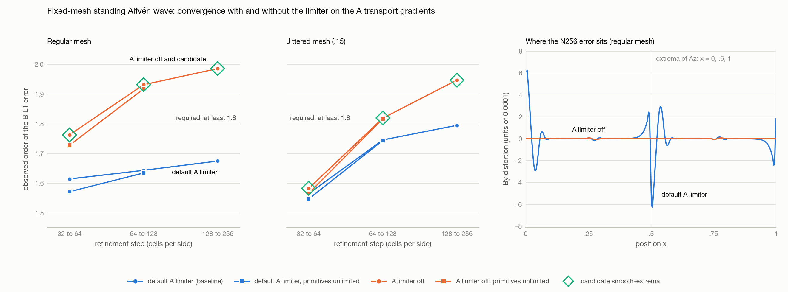

# Plan: fixed-mesh standing Alfvén convergence (issue #26)

Registered 2026-11-12, **before any new evolution**. This is a prospective
contract, not a result. It changes no acceptance threshold, grid, reference,
default profile or default limiter. Everything here is implementing-assistant
analysis; it is not independent scientific review and claims no paper or
AREPO equivalence.

The contract below is unchanged since registration. Measurements made under
it are appended in [Measured results](#measured-results-2026-11-13).

## What the retained outputs already show

Read-only reduction of the stopped `openmhd-m1-pressure-reuse-20261110.1`
outputs ([reducer and numbers](../tests/reference/m1_standing_limiter/README.md)):

- Of the eight registered base-frame wave ladders, only the two with **fluid
  moving through a fixed mesh** fail (orders 1.6591 and 1.7705). The six
  travelling/comoving ladders give 1.9098–1.9372.
- The fundamental-mode error converges at about second order in both families
  (1.93–1.98 between N64 and N256). The failure is carried by the remaining
  distortion, which contains **odd harmonics only**.
- In the failing regular standing ladder, 94 % of that distortion at N256 lies
  within 1/16 box length of the **extrema of the vector-potential component**
  whose derivative is the affected field component, and it converges at only
  1.43–1.49. In the passing travelling ladder it sits at the field's own
  extrema (93 %), is 3–6 times smaller and converges at 2.14–2.20.

A translation-invariant linear scheme cannot create harmonics on the regular
mesh, and circular polarisation gives no even harmonics. Odd harmonics at
extrema are the signature of a clipping limiter.

## Hypothesis

**H1.** The cell-anchored neighbour-extrema limiter applied to the copy of the
`A` gradients used by the upwind transport term `b · grad(A)`, `b = w − u`,
clips the reconstruction at smooth extrema of `A`. With `|b| ≈ 1` and the
pattern at rest on the mesh, the same cells are clipped for the whole run.
The travelling/comoving families have `b_x ≈ 0`, so this term is inactive.

H1 is a hypothesis until the controls below are measured. The primitive
limiter is the registered alternative explanation and is tested separately.

## Opt-in controls (no default changes)

`vector-potential --potential-limiter MODE` selects only the limiter of the
`A` gradients used for face advection. The curl, `div(A)`, cleaning and
primitive reconstruction are untouched. Without the option every historical
command line is unchanged.

| Label | `A` transport gradient | Primitive gradients | Purpose |
| --- | --- | --- | --- |
| baseline | neighbour-extrema (default) | limited | retained failing ladders; N32 parity rerun |
| `none` | unlimited | limited | direct test of H1 |
| `--unlimited --potential-limiter neighbour-extrema` | neighbour-extrema | unlimited | alternative explanation |
| `--unlimited` (existing) | unlimited | unlimited | fully linear reference |
| `smooth-extrema` | relaxed, defined below | limited | candidate correction |

`none` and both `--unlimited` rows are **smooth-wave diagnostics**. They are
not proposed for shocks and do not justify disabling a limiter in production.

## Candidate: `smooth-extrema` (engineering choice, not from the paper)

The paper states that face extrapolations are limited to avoid new extrema
relative to neighbouring values; its limiter formula is unspecified (see
[the specification](PAPER_IMPLEMENTATION_SPEC.md#limiting-and-face-advection)).
The existing limiter is our choice E. The candidate keeps that limiter and
widens its bounds only where two cells independently confirm a curvature of
the same sign. It therefore deliberately admits curvature-confirmed extrema,
which departs from the literal "no new extrema" wording.

For a scalar `q` with unlimited gradients `G`, cell `i`, face neighbour `j`
and centroid offset `d_ij = c_j − c_i` in one periodic image:

```text
here_ij  = (q_j − q_i) − G_i · d_ij
there_ij = G_j · d_ij − (q_j − q_i)
```

Both equal `d_ij^T H d_ij / 2` for a quadratic with Hessian `H`. With
`low_i`, `high_i` the unchanged extrema over `i` and its face neighbours:

```text
concave_i = max_j min(−here_ij, −there_ij)   over pairs with both negative, else 0
convex_i  = max_j min( here_ij,  there_ij)   over pairs with both positive, else 0
factor_i  = min over faces f of
              (high_i − q_i + concave_i) / (G_i · d_if)   if G_i · d_if > 0
              (low_i  − q_i − convex_i ) / (G_i · d_if)   if G_i · d_if < 0
G_limited_i = clamp(factor_i, 0, 1) G_i
```

The allowance coefficient is one, not a tuned constant: for a quadratic the
linear extrapolation from either cell to a point at fraction `θ` of the
centroid line exceeds the chord by `θ` times that curvature term. The limiter
is scale-free, uses no reference magnitude and equals the existing limiter
whenever no pair confirms a curvature. On a regular line it reduces to bounds
widened by `minmod(D2_i, D2_j)/2` of neighbouring second differences, the
curvature measure of accuracy-preserving monotonicity constraints (Suresh &
Huynh 1997, J. Comput. Phys. 136, 83; compare Colella & Sekora 2008,
J. Comput. Phys. 227, 7069). It is not total-variation diminishing and can
keep a two-cell extremum. Its behaviour at kinks of `A` across field
discontinuities is unproven and must be measured.

## Cases

Profile and options are the stopped candidate's: `bulk-frame-heun-quadratic-v1
--accelerated-projection --projection-screening 1 --riemann hlld-pressure`,
f64, periodic unit square, gamma 5/3, CFL .3, t=1, parallel velocity 1, fixed
mesh. Each case is one REANA workflow reusing one preflight-verified binary.

1. **Default parity.** The six-case fan-out packet with no new option must
   reproduce the retained final CSVs byte for byte.
2. **Diagnostic ladders.** N32/64/128/256, regular and jitter .15, base frame,
   for the three diagnostic rows above (24 workflows).
3. **Candidate ladders.** The same eight meshes with `smooth-extrema`, base and
   joint-boost frames (16 workflows), so the unchanged boost gate is measured.
4. **Candidate shock/vortex screen.** The registered 30-case Brio–Wu and
   Orszag–Tang matrix with `smooth-extrema`.

N256 cases take hours; coarser rungs are reduced as they arrive. Monitors run
with `--observe-only` for the diagnostic plans, where failure is an expected
outcome, and with cancellation for the candidate plans.

## Prospective decision rules

- H1 is **supported** if `none` removes the localisation at potential extrema
  on both meshes and raises the regular N64→N128 B L1 order by at least .2,
  while unlimited primitives with the default `A` limiter do not. It is
  **rejected** if `none` leaves the order within .05 of the baseline.
- The candidate proceeds only if both standing fixed ladders meet the
  unchanged gate (finest-three B L1 order ≥ 1.8, finest relative B L1 ≤ .02,
  positive states, 1e-10 budgets, boost 1e-8 under both normalisations).
- It is then subject to every unchanged registered gate. A failed shock or
  vortex gate rejects it; no gate is amended to accommodate it.
- If the candidate fails where `none` passes, record that and stop. `none`
  is not adopted without the owner's decision.
- A passing candidate is a new configuration. The mean-field ladder, bounded
  gate, calibration and the full wave/loop/temporal matrix must be rerun for
  it before any acceptance statement; the stopped campaign's passes do not
  transfer.

## Unchanged

Historical default profile and its recorded failures (#20), primitive
limiter, Riemann solvers, screening, auxiliary field, thresholds, grids,
physical times and references. No floors, resets or retrospective thresholds.
All new tests and evolutions run on REANA; local work is editing, formatting,
static lint, packaging and read-only reduction.

## Measured results (2026-11-13)

Appended after execution; nothing above was edited. Numbers, reducers,
workflow identities and run records are in the
[evidence directory](../tests/reference/m1_standing_limiter/README.md). All
evolutions ran on REANA, one workflow per case, from the preflight-verified
binary of source `f60eaa8`.

**Default parity.** Passed: six default-option cases are byte-identical to
the retained outputs.

**H1 is supported by the registered rule.**

| Regular mesh, B L1 order N64→N128 | Value | Change from baseline |
| --- | ---: | ---: |
| baseline (default limiters) | 1.643 | |
| `none`: `A` transport gradient unlimited, primitives limited | 1.932 | +.289 (rule: at least +.2) |
| primitives unlimited, default `A` limiter | 1.635 | −.008 |
| both unlimited | 1.918 | +.275 |

`none` removes the concentration of the distortion at the potential extrema
on both meshes (N128 By fraction .854 → .031 regular, .834 → .226 jittered;
uniform is .25). Unlimited primitives with the default `A` limiter leave it
at .857 and .843. With `none` both standing ladders meet the unchanged gate:
finest-three order **1.9590** (regular) and **1.8834** (jitter .15), against
1.6591 and 1.7705. `none` remains a smooth-wave diagnostic and is not
proposed for production.

**Candidate `smooth-extrema` on the two failing ladders: the unchanged gate
passes.** Finest-three B L1 order **1.9590** on the regular mesh and
**1.8834** at jitter .15 (required: at least 1.8), finest relative B L1
9.3e-4 and 1.1e-3 (required: at most .02), all sixteen runs positive and
within the 1e-10 budgets, and all eight boost pairs pass at 8.8e-13 or
better. The frozen production evaluator and the independent reducer agree.
The candidate reproduces `none`: byte-identical snapshots on the regular mesh
at every resolution, differences below 1e-6 on the jittered mesh, and an
inactive limiter at the start and end of every run.



**Candidate screens: no registered gate fails.**

- Waves and loops N32/64 (48 cases, the bounded gate's medium stage): all 24
  boost pairs pass.
- Nonuniform mean-field ladder (24 cases): all 12 boost pairs pass at 1e-14.
- Brio–Wu ladders and N64/128 vortices (26 cases): every state, diagnostic
  and boost check passes; reference L1 errors are within .9984–1.0021 of the
  baseline. The profile-family gate needs the N256 vortices and is unexecuted.
- **Measured cost:** on fixed-mesh field loops the candidate's passive
  diagnostic errors are 3–10 % larger than the baseline's and the undershoot
  of the potential at the loop rim is 17–36 % larger (about .6–.8 % of the
  peak instead of .5–.7 %). This is the admitted behaviour at kinks named
  under [Candidate](#candidate-smooth-extrema-engineering-choice-not-from-the-paper).
  No registered gate measures it.

**Still required before any statement about M1**, in this order:

1. The bounded short stages, then the complete registered matrices for the
   new configuration (48-run medium stage, 24-run mean ladder, 30-run
   shock/vortex ladder, 112-run wave/loop/temporal matrix) from one frozen
   source, as declared in the
   [full-validation plan](M1_FULL_VALIDATION_PLAN.md#explicit-smooth-extrema-continuation-2026-11-13-before-execution).
   Its condition, the gate above, is met and the sequence started on
   2026-11-13. The screens above do not substitute for it.
2. The owner's decision on whether an opt-in limiter that admits
   curvature-confirmed extrema is acceptable as the M1 configuration, and
   independent review.
