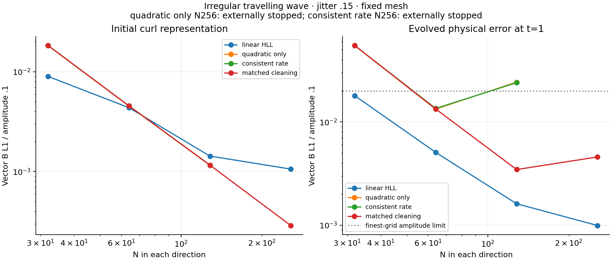
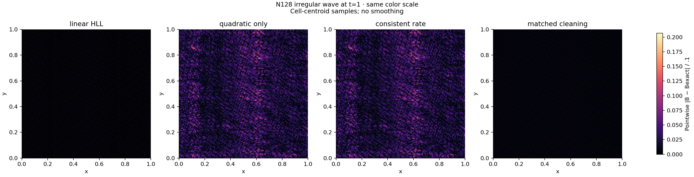

# M1 wave reconstruction diagnostics

**M1 remains open.** Every experiment below retains the original wave gate: finest-three vector B L1 order at least 1.8, plus finest error divided by amplitude .1 at most .02. Passing the amplitude bound alone is insufficient.

The runs use gamma=5/3, rho=1, p=.1, mean B=(1,0,0), circular amplitude .1, zero parallel velocity, a fixed periodic unit square and jitter .15. Each resolution is a true N-by-N mesh, evolved to t=1 with the existing global timestep controller. No pressure floor, energy repair or post-run threshold change is used.

| Profile | N64 B L1 | N128 B L1 | N256 B L1 | Outcome |
|---|---:|---:|---:|---|
| Linear HLL | .0005067075 | .0001609596 | .0000990515 | Order 1.17745 fails |
| Quadratic only | .0013304921 | .0024316707 | Externally stopped | Error increases at 128 |
| Consistent rate | .0013508419 | .0023968023 | Externally stopped | Error increases at 128 |
| Matched cleaning | .0013346523 | .0003454683 | .0004574236 | Order .77243 fails |



The quadratic fit improves fine-grid initial curl representation, but that does not guarantee evolved accuracy. Matching the cleaning derivative substantially reduces the N128 error, yet its N256 error rises. The independently measured short-wavelength Bz/vz contamination and coupled-operator probes motivate the separately registered compact derivative experiment. They do not prove a unique cause for the nonlinear failure.



These N128 maps use the same color scale and unsmoothed cell-centroid errors. The darker matched panel shows improvement at that resolution only; the full ladder above still fails.

## Execution and reproduction

The bounded quadratic, consistent and matched runs used frozen revisions `73dd508`, `cbc7d80` and `f9a11f0`, respectively. The first predates the separately reviewed QR reorthogonalization correction; its original results are retained. Exact commands, configuration, source/binary/cache hashes, runtime, raw-artifact digests and external-stop records are in [the evidence archive](../tests/reference/m1_completion/README.md). The linear full study used `dfcae22`. The matched full study independently reproduces its bounded-probe wave errors; it was stopped after the failed ladder, preserving 189 completed, 8 externally stopped and 59 unexecuted configurations.

Reproduce a bounded experiment from its recorded revision using a fresh output directory:

```sh
python3 scripts/run_m1_quadratic_probe.py --profile bulk-frame-hll-matched-v1 \
  --jobs 4 --mesh-cache-dir results/m1_mesh_cache --output-dir results/m1_matched_probe
```

The completed matched diagnostic figures were generated with Python 3.9, Matplotlib 3.9.4 and NumPy 2.0.2:

```sh
python3 scripts/plot_m1_wave_probes.py \
  --linear-dir results/m1_completion_full --quadratic-dir results/m1_quadratic_probe \
  --consistent-dir results/m1_consistent_probe --matched-dir results/m1_matched_probe \
  --output-dir results/m1_probe_figures_completed_matched
```

The plotter verifies each plotted raw snapshot against the execution ledger. Figure provenance records its source hash and all input/output hashes. Large raw CSVs are retained locally; regenerating the figures on another machine requires reproducing those runs or obtaining the matching raw snapshots. See the [prospective plan](M1_COMPLETION_PLAN.md) and separate [AI review](M1_COMPLETION_AI_REVIEW.md) for the algorithm definitions and review limits.
