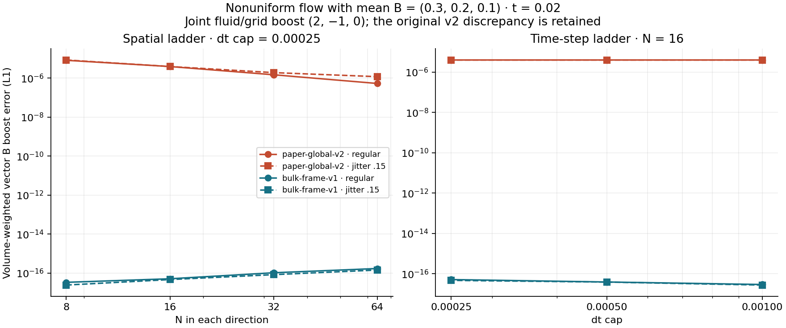
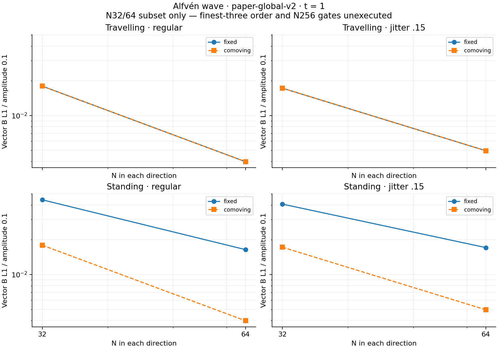
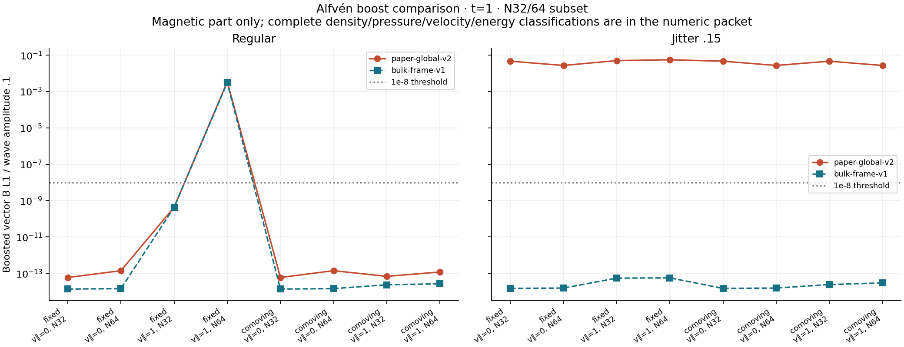
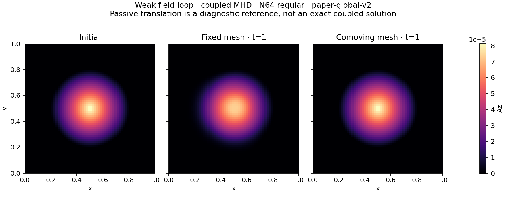
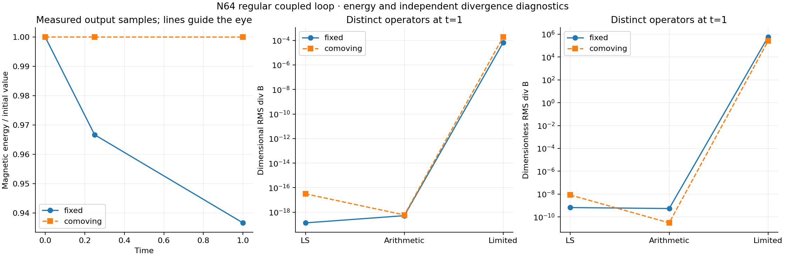

# Issue #7: wave/loop development and mean-field boost results

**Incremental validation; issue #7 and M1 remain open.** The complete mean-field investigation and coupled N32/64 wave/loop subset are measured. N128/256, the Alfvén temporal study and the separate prescribed-flow loop packet remain unexecuted. The default `paper-global-v2` is preserved, including its failed Alfvén boost comparisons. A separately named `bulk-frame-v1` gauge comparator is available.

The [prospective plan](M1_WAVE_LOOP_PLAN.md) records the unchanged thresholds, gauge amendment and optimization gates. A separate, explicitly labelled [AI review](M1_WAVE_LOOP_AI_REVIEW.md) checks the implementation and evidence; this is not a claim of human peer review or AREPO equivalence.

## What changed

The driver now supplies deterministic three-component circular Alfvén and weak-loop initial conditions, exact physical Alfvén references and a separately labelled passive-loop reference. It writes initial/final snapshots, optional checkpoints, output-time diagnostic histories and the last accepted state if evolution fails. A/phi have no assumed exact translated-wave solution. Loop derivatives are undefined at the centre and edge; those points are excluded from analytic B comparisons.

`bulk-frame-v1` stores reduced potential a and a uniform offset C, with A=a+C, fixed initial mass-weighted V_ref, and C_dot=V_ref cross mean_B. Both stages use `(u−V_ref) cross mean_B` and `−H^T a`; curl and cleaning act on a. This chooses gauge psi=u dot a. It deliberately omits the `−H^T C` term that a literal storage substitution into v2 would retain. Gas fluxes, geometry, frozen-C1 cleaning and auxiliary-origin evolution are unchanged. Outputs distinguish total A, reduced a, offset and reference velocity. Offset updates commit only after a successful step.

Geometry construction now prunes only clipping calls that would take the existing enclosing-circle no-op branch, preserving the original plane order. Explicit all-pairs comparisons give bit-identical geometry; cached immutable stencils and batched validation pass multi-step equivalence tests. No state-dependent gradients or extrema are cached. The proposed exact Cartesian shortcut was withdrawn after its equivalence gate failed; the independent AI investigation exposed an unresolved [degenerate HLLD face-state convention](DEGENERATE_FACE_FOLLOWUP.md).

## Mean-field mechanism and refinement

For the registered paper-global-v2 first-step experiment, c=b cross mean_B and the measured coupled step obeys

```text
A1_boost − A1_base = dt*c − 0.5*dt²*H1^T*c
B1_boost − B1_base = −0.5*dt²*curl_LS(H1^T*c).
```

Here H1 differentiates the frozen bicubic auxiliary interpolant analytically, while curl_LS is the independent neighbour-centre least-squares curl. N8/16 regular/jitter tests match the magnetic identity to about 6e-17. The conservative first-step boost and pressure/energy identity are also checked. Zero mean field, parallel boosts and constant auxiliary velocity provide negative controls. This identifies the **first-step mechanism**; it does not claim the same closed formula for the nonlinear many-step error.

The following vector-B L1 boost differences use t=.02, dt cap=.00025, b=(2,−1,0), mean_B=(.3,.2,.1):

| N per direction | v2 regular | v2 jitter .15 | bulk-frame regular | bulk-frame jitter .15 |
| --- | ---: | ---: | ---: | ---: |
| 8 | 8.240e-6 | 8.566e-6 | 3.358e-17 | 2.434e-17 |
| 16 | 3.947e-6 | 3.951e-6 | 5.115e-17 | 4.660e-17 |
| 32 | 1.492e-6 | 1.925e-6 | 1.039e-16 | 8.324e-17 |
| 64 | 5.338e-7 | 1.193e-6 | 1.717e-16 | 1.437e-16 |

Original-v2 spatial rates range from .69 to 1.48 in this ladder; no asymptotic rate was imposed on the known discrepancy. At N16, reducing dt from .001 to .00025 leaves the v2 error almost unchanged. The new gauge passes all **12/12** preregistered mean-field pairs, including the temporal ladder, with maximum transformed component error **9.55e-15** versus the 1e-9 gate and identical auxiliary-root sequences. Rates fitted to its roundoff-sized errors are recorded but have no convergence interpretation. Rectangular, nonzero-phi, three-component-boost, prescribed/fluid-following unit fixtures also pass.



## Coupled Alfvén and loop subset

All physical runs in the first packet reached t=1 with positive density and pressure. The 96-run packet comprises 48 mean-field evolutions, 32 Alfvén evolutions and 16 coupled-loop evolutions; the worst normalized conservative-budget residual is **6.91e-14**. Every physical run writes t=0,.25,1 diagnostics. Everything is serial per simulation; the study launcher schedules eight independent runs concurrently.

At N32→64, the unboosted travelling-wave magnetic L1 error falls from **.001795 to .0003974** on regular meshes and **.001724 to .0004951** on jittered meshes. The standing fixed-grid case falls from **.004439 to .001642** on regular meshes; comoving standing results match the travelling family closely. These two-point observations do **not** evaluate the registered finest-three-resolution order or N256 error gate.



For the original profile, **7/16 Alfvén boost pairs pass and 9/16 fail under both reported normalization conventions**. The largest B L1 boost difference is .005611. The old M0 packet specified relative L1 but did not uniquely tabulate all Alfvén boost scales. The report therefore retains raw component/vector norms and reports both wave-amplitude and mean-field/initial-speed scales, with the original 1e-8 threshold unchanged. This scale table is explicitly a post-run clarification for the first packet; no original acceptance claim is inferred from an ambiguous normalization.

A further **48-run bulk-frame physical subset** improves the Alfvén boost comparison to **15/16 pass under both normalizations**; all jittered pairs agree at approximately roundoff. The remaining **N64 regular, standing wave, fixed baseline mesh** fails with B L1 difference **3.108e-4** and maximum transformed physical-component error **.002573**. Its mechanism has not yet been isolated; the separately observed degenerate-face sensitivity is a candidate to investigate, not an established explanation. The gauge amendment therefore does **not** establish general Galilean invariance. All eight bulk-frame loop pairs also pass.



All **8/8 original-profile coupled-loop boost pairs** pass: B L1 divided by the prescribed loop field amplitude is at most **4.00e-14**, below .001. The passive analytic field is a diagnostic reference, not an exact coupled-MHD solution. On the regular N64 grid, final magnetic-energy retention is **.936666 fixed** and **.999969 comoving**.



Three divergence operators are retained: raw neighbour LS; shared arithmetic face sum; separately limited face reconstruction. On the regular N64 loop the dimensional RMS values are respectively `(1.36e-19,5.24e-19,6.73e-5)` for fixed geometry and `(3.15e-17,6.01e-19,1.89e-4)` for comoving geometry. The independently limited-face operator is not constrained to annihilate the discrete curl. Dimensionless RMS can be very large outside the loop because its normalization uses `|B|+1e-12*Bscale`, with fixed Bscale and almost zero cell B; those values remain plotted and archived, not suppressed. Signed means are not substituted for RMS or absolute norms.



## Reproduce on a Mac

Use the pinned Rust toolchain, release build, f64, gamma=5/3, nondimensional mu0=1 and a periodic unit square. The deterministic trigonometric jitter is .15 where requested; no random seed or external numerical dependency is used. From the repository root:

```sh
source "$HOME/.cargo/env"
python3 scripts/run_m1_wave_loop.py --quick --jobs 8 --output-dir results/m1_wave_loop_quick
python3 scripts/run_m1_wave_loop.py --suite physical --quick --profile bulk-frame-v1 \
  --jobs 8 --output-dir results/m1_wave_loop_bulk_quick
```

Use fresh output directories to preserve earlier results. `--quick` explicitly selects the N32/64 physical subset; the mean-field ladder still uses N8/16/32/64. Omit `--quick` for the full spatial packet and add `--temporal` for the registered N64 dt ladder. These commands make the remaining work reproducible; their availability does not mean those larger studies were executed. The prescribed-flow loop packet remains separate.

A single run can be inspected with:

```sh
cargo run --release --locked -p openmhd --bin vector-potential -- \
  --case alfven --profile bulk-frame-v1 --n 32 --jitter .15 \
  --parallel-velocity 1 --time 1 --checkpoint .25 --output results/alfven_example
```

To regenerate the figures from the archived packet:

```sh
python3 -m venv .venv-plot
.venv-plot/bin/pip install matplotlib==3.9.4 numpy==2.0.2
.venv-plot/bin/python scripts/plot_m1_wave_loop.py
```

The first study evolved clean revision `433ef7d`; corrected measurements use separately recorded analysis provenance and verify raw-output hashes. The immutable original execution summary is retained alongside the corrected report, including its superseded gate labels. The bulk physical study records its own clean execution revision. See [the evidence packet](../tests/reference/m1_wave_loop) for exact commands, source/binary hashes, per-run elapsed times, raw selected snapshots and all diagnostics. `--analyze-only --output-dir ...` remeasures a full raw result directory after validating immutable execution metadata; it does not rerun or relabel the evolution revision.

## Acceptance boundary

Format, Clippy with warnings denied, locked workspace build/tests, 80 Rust tests, seven measurement fixtures, M0 algebra/reference checks and all 29 original #6 study runs pass. Shared #6 numeric summary entries differ from the archived packet by at most 6.7e-16. The separate AI review and plot reproducibility record define their exact review scope.

**Still open:** full N128/256 spatial ladders; the N64 temporal packet; the separate prescribed-flow loop study including irregular geometry; a reviewed convention for degenerate HLLD A-face states; and broader shock/vortex/full-M1 validation. Original-profile failed Alfvén boost gates remain failures. This increment does not close #7 or M1.
