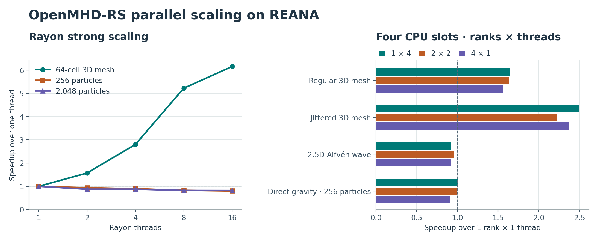

# Hybrid parallel validation

The initial REANA campaign compared two MPI ranks against the serial numerical path for 11 problem families. The complete scientific files matched byte for byte for 3D rigid and jittered mesh motion, a face flip, a periodic self-neighbour, Lloyd motion, 3D magnetic reconstruction and HLLD fluxes, direct gravity with KDK, and four 2.5D flows. The four flows were an Alfvén wave, a boosted field loop, Brio–Wu and Orszag–Tang. The MHD and gravity comparisons include full checkpoints. [Registered inputs and layouts](../reana/m3/mpi_matrix.py) · [Hybrid implementation](PARALLEL_HPC.md).

The left panel uses the thread benchmarks below. The right panel compares three allocations of four CPUs against a single MPI rank and thread at source `515c698ad`. All plotted runs completed, and the independent strong-scaling workflows compared their full scientific outputs. The figure was rendered on REANA in workflow `68f3d8ab-2fe7-4452-8d33-4d3a43167d6d`. [Timing records](../tests/reference/m3_parallel/hybrid-measurements.json) · [Plot source](../reana/m3/plot_scaling.py).

## Rayon strong scaling

These medians are elapsed seconds for a complete executable invocation, including its output. Each row used its own REANA workflow and each workflow ran three repetitions. All five thread layouts produced the same geometry output and the same particle and conservation files as their respective one-thread runs. The source was `bc82f7421f`, with build workflow `7a6a1228-5b87-4bff-8847-ccf5b006f24c`. [Original timings, workflow IDs, CPU time and memory](../tests/reference/m3_parallel/rayon-measurements.json).

| Rayon threads | Rigid 64-cell Voronoi mesh, s | Two 128-particle populations, 16 KDK steps, s | Two 1,024-particle populations, 4 KDK steps, s |
| ---: | ---: | ---: | ---: |
| 1 | 1.072 | 0.240 | 3.216 |
| 2 | 0.683 | 0.255 | 3.670 |
| 4 | 0.382 | 0.267 | 3.666 |
| 8 | 0.205 | 0.290 | 3.903 |
| 16 | 0.174 | 0.299 | 3.914 |

The mesh run was 6.16 times faster at 16 threads. For both particle counts the one-thread direct-force run was fastest. At 2,048 particles the run took 3.216 s with one thread and 3.914 s with 16. The larger case used source `512c762ebb` and four KDK steps. Pair evaluation is parallel, while the compensated pair accumulation still follows persistent ID order. Both families used `f64`. Each workflow requested the listed CPU count. The worker exposed 24 CPUs through affinity and reported `max 100000` for its cgroup CPU quota. These measurements describe a shared REANA worker. [Exact executable arguments and fixture generator](../reana/m3/kernel_case.py).

## MPI measurement protocol

The serial reference calls the original operator and the hybrid case assigns individual cells, shared faces or particle pairs to ranks. Each job retains the original resulting scientific files as well as the rank work counts, exchange timing, halo byte counts and CPU allocation. A separate REANA comparison checks the acquired bytes. Strong scaling holds the full input fixed. Weak scaling holds the cell count per rank or the approximate number of unique gravity pairs per rank fixed. In the restart test two ranks save a checkpoint and four ranks resume it. [REANA case runner](../reana/m3/mpi_case.py) · [Comparison rules](../reana/m3/mpi_reduce.py).

The scope is single-node MPI and Rayon on the explicitly named scientific paths. Each rank retains the current geometry and halo. Sparse halo scaling across nodes, parallel HDF5, and a coupled deforming 3D MHD evolution remain open. [Roadmap](ROADMAP.md) · [Acquired evidence manifest](../tests/reference/m3_parallel/manifest.json).
