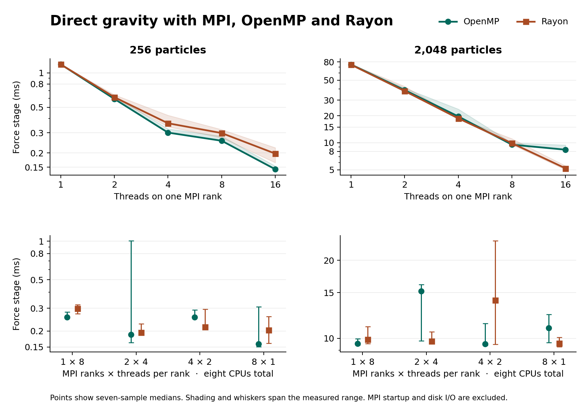
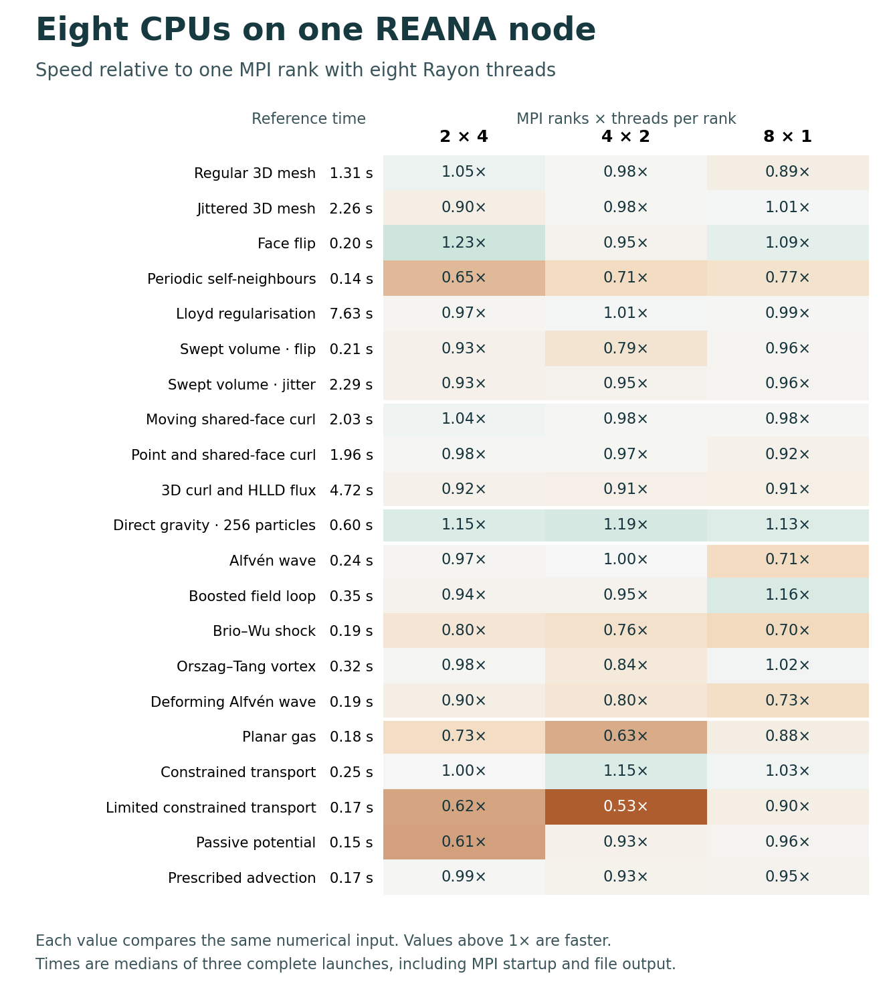

# MPI and thread scaling on one REANA node

## Direct-gravity kernel with OpenMP and Rayon

At 2,048 particles, increasing one MPI rank from one thread to eight cut a force stage from 74.94 to 9.54 ms with OpenMP and from 74.56 to 9.90 ms with Rayon. With 16 threads, the medians were 8.38 and 5.18 ms, respectively. The smaller catalogue reversed their order at 16 threads. These measurements support retaining both problem size and rank layout when choosing a thread count. [Full timing table and sample ranges](../tests/reference/m3_gravity_threading/gravity-timings.csv).



| MPI ranks × threads | 256 particles, OpenMP | 256 particles, Rayon | 2,048 particles, OpenMP | 2,048 particles, Rayon |
|---|---:|---:|---:|---:|
| 1 × 1 | 1.190 ms | 1.186 ms | 74.942 ms | 74.557 ms |
| 1 × 8 | 0.255 ms | 0.298 ms | 9.537 ms | 9.900 ms |
| 2 × 4 | 0.187 ms | 0.194 ms | 15.181 ms | 9.748 ms |
| 4 × 2 | 0.255 ms | 0.215 ms | 9.519 ms | 14.044 ms |
| 8 × 1 | 0.159 ms | 0.204 ms | 10.950 ms | 9.582 ms |
| 1 × 16 | 0.144 ms | 0.197 ms | 8.376 ms | 5.185 ms |

MPICH partitions the target particles across ranks. Within each rank, either GCC OpenMP or Rust Rayon schedules the same compiled force function on the same set of logical CPUs. The kernel visits all other particles in ID order and returns the softened acceleration and specific potential. This tests the cost of scheduling and gathering a fixed amount of direct-gravity work. The production Rust solver uses a symmetric pair kernel and also advances positions and momenta during a KDK step. [Force definition, tolerances and sample protocol](../benchmarks/m3/gravity-threading/README.md).

The two larger catalogues contain 256 and 2,048 particles drawn from the published Rust solver runs. The reference for each particle is its recorded step-zero acceleration. A separate two-particle system with an exact softened solution checks force signs and potentials. Each timing workflow measures seven samples after warm-up. Stage times include force evaluation and the MPI gather, using the slowest rank. MPI startup and disk I/O are outside the timer. [Registered cases](../tests/reference/m3_gravity_threading/registration.json).

The measured build used GCC 11.4.0, `libgomp`, Rust 1.85.1 and Rayon 1.10.0. Jobs requested one CPU per rank thread and reported an Intel Xeon Gold 6252. Each rank checked its disjoint logical-CPU mask and actual thread-team size. Each layout ran in a separate REANA workflow on shared hardware. The chart shows the spread across samples within each workflow. [Pinned build and case preparation](../benchmarks/m3/gravity-threading/README.md#reproduction).

All four analytic controls and 44 timing workflows passed. Every layout produced the same force-file bytes for each catalogue. All accelerations and total potential energies at 256 and 2,048 particles matched the recorded Rust values exactly. On the analytic binary, the largest scaled acceleration error was 1.93 × 10⁻¹⁶, below the preregistered 5 × 10⁻¹³ bound. One workflow creation had a network error. Two service checks confirmed the original name was available, and that case ran once under the planned name and version. [Raw workflow records](../tests/reference/m3_gravity_threading/records.tar.gz) · [Verification](../tests/reference/m3_gravity_threading/gravity-verification.json).

Two separate REANA replays verified all 48 results and confirmed that perturbing a force triggered the accuracy check. The second generated the four-panel figure above and reproduced the first replay's timing CSV and verification record byte for byte. [First replay receipt](../tests/reference/m3_gravity_threading/thread-sweep-replay.json) · [Final replay and figure receipt](../tests/reference/m3_gravity_threading/replay.json).

To reproduce the gravity table, figure and correctness checks from the retained files, run the following command from the repository root with Python 3.11+ and Matplotlib installed.

```sh
data=tests/reference/m3_gravity_threading
python3 benchmarks/m3/gravity-threading/report.py "$data/records.tar.gz" \
  "$data/registration.json" tests/reference/m3_parallel /tmp/m3-gravity-replay
```

## Production solver

All 21 benchmark families reproduced their published scientific files and diagnostics at six additional layouts. The fixed-input comparisons covered 1×2, 1×8, 2×4, 4×2, 8×1 and 1×16, where the first number is MPI ranks and the second is Rayon threads per rank. Together with six larger-input runs, the study measured 396 complete executable launches across 132 independently submitted workflows. The eight-rank face-flip cases used five cells and also exercised ranks with no owned cell. [Registered inputs](../tests/reference/m3_single_node_extension/plan.json) · [All measured layouts](../tests/reference/m3_single_node_extension/measurements.csv).



Each larger input had a serial run and an eight-rank run. Both produced identical scientific files. Times are medians of three launches, including MPI startup and file output. The last column sums the halo bytes received across the eight ranks for one launch. [Raw REANA records](../tests/reference/m3_single_node_extension/workflows.tar.gz).

| Larger input | Serial | 8 MPI ranks × 1 thread | Halo bytes received |
|---|---:|---:|---:|
| 216-cell rigid 3D mesh | 22.024 s | 12.584 s | 3,656,674 |
| 512-cell Alfvén wave | 0.348 s | 0.446 s | 71,479,744 |
| 361-particle direct-gravity evolution | 0.306 s | 0.473 s | 266,297,598 |

The eight-rank mesh build was 1.75× as fast as the serial control. The wave and gravity evolutions took longer on eight ranks at these sizes. The current MPI implementation collects each rank's results on every rank. Sparse neighbour exchange for the mesh and field stages is the next parallel milestone. Direct gravity still needs every source particle. Tree gravity follows the separate long-orbit direct-solver validation. [MPI transport](../apps/openmhd-mpi/src/transport.rs) · [Roadmap](ROADMAP.md).

### Replay the production comparisons

From the repository root, the command below reads the original workflows, compares the numerical output with the published baseline, and writes the full timing table.

```sh
data=tests/reference/m3_single_node_extension
python3 reana/m3/verify_node_scaling.py "$data/plan.json" "$data/workflows.tar.gz" \
  tests/reference/m3_parallel/hybrid-e4034c9f2-e4034c9f2.tar.gz /tmp/m3-solver-replay
```

Separate REANA workflow `2db49c7b-f685-40a0-9949-2c8f613d0312` replayed all 126 fixed-input comparisons and the three larger serial/parallel pairs from the downloaded records. [Verification](../tests/reference/m3_single_node_extension/verification.json) · [REANA receipt](../tests/reference/m3_single_node_extension/replay.json).
