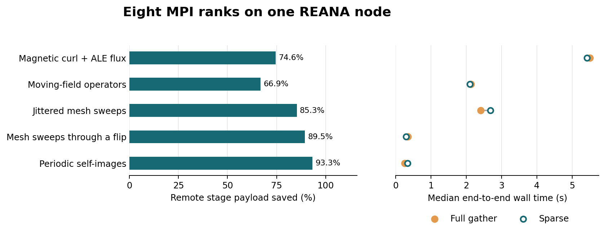

# Sparse MPI exchange for 3D mesh and field stages

The shared-face curl, conservative ALE flux and swept-volume update assign each canonical face to one MPI rank. The cell with the smaller persistent ID supplies the interior face owner. Each face owner publishes a single oriented exchange to the ranks that own the incident cells. Each cell owner accumulates its incidences in canonical face order. Moving-mesh sweeps use the union of the old and rebuilt face keys for the current substep.

| Stage | Producer | Consumers | Values per row |
| --- | --- | --- | ---: |
| Potential samples | Cell owner | Owners of cells whose quadratic fits use the sample | 3 |
| Quadratic jets | Cell owner | Incident face owners | 30 |
| Magnetic curl exchange | Face owner | Incident cell owners | 3 |
| Fluid, magnetic and generator state | Cell owner | Incident face owners | 11 |
| Extensive ALE flux | Face owner | Incident cell owners | 5 |
| Euler and Heun conserved states | Cell owner | Swept-face owners | Conserved field width |
| Corrected swept-face exchange | Face owner | Incident cell owners | Conserved field width |
| Completed sweep ledger | Face and cell owners | Rank zero | Conserved field width |

Receivers are sorted and deduplicated per global row. Periodic images reuse the transferred real-cell value and retain their distinct offsets and moments in the fit. Shared interior faces supply opposite signs, self-image exchanges give zero net cell increment and bounded faces have one incidence. Ranks with empty partitions participate in the collectives.

## Run and measure

The MPI driver selects sparse transport by default for the stages above. Select a mode explicitly to compare both transports with the same source, inputs, rank count and thread team.

```sh
mpiexec -n 4 openmhd-mpi 2 --halo sparse field3 mesh.txt fields.txt 1.6666666666666667 0.5 -0.25 0.125 out-sparse
mpiexec -n 4 openmhd-mpi 2 --halo full   field3 mesh.txt fields.txt 1.6666666666666667 0.5 -0.25 0.125 out-full
```

For each row of width $w$ doubles, the sparse payload across all ranks is $8w$ times the number of distinct requesting ranks other than its producer. The full comparison sends $8w(R-1)$ bytes per row for $R$ ranks. The sparse path uses `MPI_Alltoallv` with zero counts for unrelated peers. The full path uses `MPI_Allgatherv` and retains the same required rows for the numerical stage. Both preserve binary64 values and producer order.

Each rank's `openmhd-halo` record reports its stage, call count, remote payload received, corresponding full payload and time inside the payload collective. These byte counts exclude collective implementation overhead, plan hashes and count metadata. Wall time includes planning, packing, MPI, geometry, numerical work and output.

The validated tessellation, fit topology, grounded sweep graph solve and public global field outputs still use replicated data. The transpose, Gram, point operators and other solver families retain their existing transport. These are single-node MPI measurements. Cross-node tests and fully distributed geometry remain separate roadmap items.

## REANA results on November 28, 2026

All 21 matched full/sparse pairs reproduced the same complete scientific files as their same-input serial controls. Reversing the input order reproduced the canonical outputs. The 47 scientific workflows ran each case three times. Eight additional four-rank workflows exercised transport routing and collective error handling. A separate REANA replay verified the original build, workflows, numerical outputs and network counts. [Replay receipt](../tests/reference/m3_sparse_halo/replay.json) · [Verification](../tests/reference/m3_sparse_halo/verification.json).

| Eight MPI ranks, one thread each | Full stage payload (B) | Sparse stage payload (B) | Reduction | Full wall (s) | Sparse wall (s) |
| --- | ---: | ---: | ---: | ---: | ---: |
| Jittered curl and ALE flux (64 cells) | 377,664 | 95,904 | 74.6% | 5.497 | 5.417 |
| Moving field (27 cells) | 160,608 | 53,176 | 66.9% | 2.132 | 2.102 |
| Jittered mesh sweep (27 cells) | 107,856 | 15,888 | 85.3% | 2.406 | 2.687 |
| Face flip (5 cells) | 32,032 | 3,376 | 89.5% | 0.341 | 0.296 |
| Periodic self-images (1 cell) | 1,904 | 128 | 93.3% | 0.248 | 0.336 |

Payload is summed over all receiving ranks for one execution and includes the root sweep ledger. Wall time is the median of three complete MPI launches. In the 64-cell field case, all recorded receives fell from 9,491,734 to 9,209,974 bytes (3.0%). Replicated geometry and the other operator stages account for most of the remaining traffic. The table measures small single-node cases, where startup, geometry and run-to-run variation contribute to elapsed time. [Measurements](../tests/reference/m3_sparse_halo/measurements.csv) · [Per-stage traffic](../tests/reference/m3_sparse_halo/stage-traffic.csv).



The first two build workflows stopped on missing inputs in the offline build package. The first exposed two missing locked dependencies, and the second exposed a missing existing analytic fixture used by Clippy's test targets. The third built the same numerical revision after those inputs were included. All three original build records are retained. [Build evidence](../tests/reference/m3_sparse_halo/builds.tar.gz).

## Reproduce the comparison

The matrix specifies separate REANA workflows for serial, full and sparse transport. It includes static jittered fields, a moving-field case, jittered sweeps, a topology flip, periodic self-images and reversed input. The compiled transport controls exercise asymmetric routes, duplicate requests, empty owners, row errors and mismatched plans. [Case matrix](../reana/m3/halo_matrix.py) · [MPI controls](../apps/openmhd-mpi/examples/halo_contract.rs).

The replay reads the original result archives, rank logs, workflow receipts, build logs and published earlier-generation solver evidence. It checks the scientific file hashes against the serial control and the published solution, rechecks the nonuniform tracer budget, and compares each rank's actual payload with the corresponding full-gather run.

```sh
python3 reana/m3/verify_halos.py tests/reference/m3_sparse_halo \
    tests/reference/m3_single_node_extension/workflows.tar.gz /tmp/openmhd-halo-replay
```
