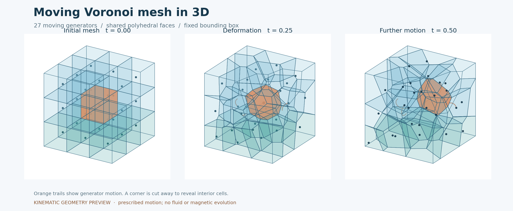

# Moving Voronoi mesh in 3D: kinematic preview

[Animation](images/mesh_motion_3d_preview/moving_mesh_3d.gif) ·
[Vector figure](images/mesh_motion_3d_preview/moving_mesh_3d.svg)

The same27 generators move along prescribed smooth periodic paths in all
three axes. Their Euclidean Voronoi cells are clipped to a fixed unit cube.
An orange central cell and several orange motion trails help track the
deformation; a corner is cut away to expose the interior. The figure shows
times0,0.25,0.5; the25-frame animation covers one complete prescribed cycle.

This is an independent geometry illustration, created at the user's request.
It uses a small floating-point halfspace clipping drawing utility, not the
OpenMHD Rust geometry candidate or a coupled moving-MHD evolution. It is
not a validation fixture, physical trajectory, magnetic-field result, galaxy
merger or component acceptance. The original full simulator goal remains.

The actual REANA workflow `openmhd-3d-motion-preview-20261122-a01.1`, UUID
`92f935c5-e763-448c-a8ac-011278a0a8b6`, completed its dependency/compile
preflight and render steps. The declared resources were1CPU/2Gi, with one
library thread; the render took about12seconds. Seven normal-TLS artifact
downloads succeeded and all body hashes match the renderer's inventory.
The static figure was visually inspected for readable text and visible3D
geometry. The earlier transient observation failure remains in the separate
operational record; the workflow was not rerun.

The exact renderer, runtime/motion metadata, artifact hashes and acquisition
provenance are retained beside the images. Original job/spec/command/log and
download evidence is under `results/mesh_motion_3d_preview_20261122/`.
PNG SHA256:`4a0ac44bf65fb55fa9d6fcdfd198c851ada2dd04850b41286685f747e92158d7`.
GIF SHA256:`ddbe6df6042e4f7599deb824d81d3c4b82ec34a2f4406c522687b519ae0f7450`.

The separate `scripts/plot_geometry3.py` renderer still awaits real candidate
driver output and the corresponding build/input/provenance prerequisites.
This illustration does not close those gates or broaden scoped M1 acceptance.
