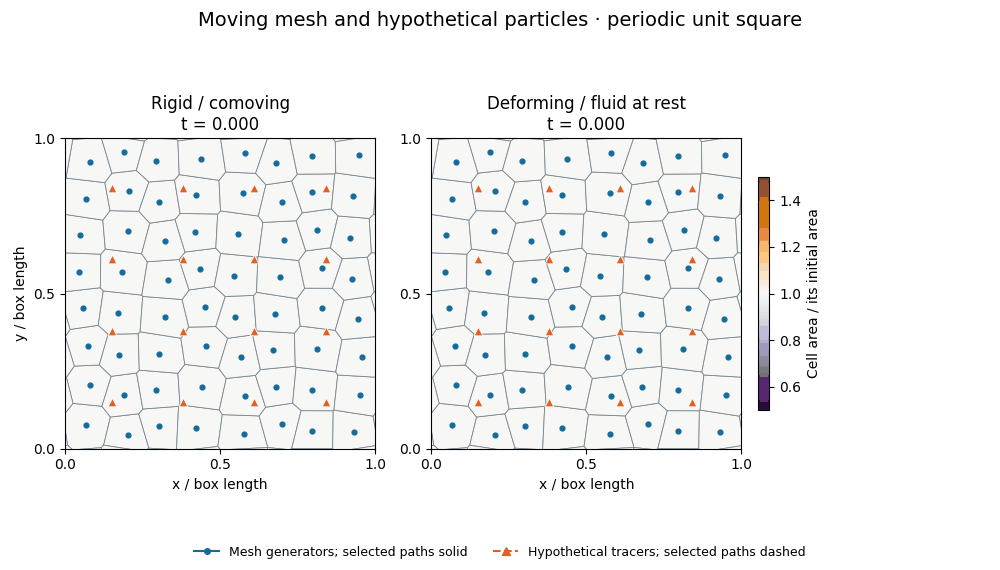
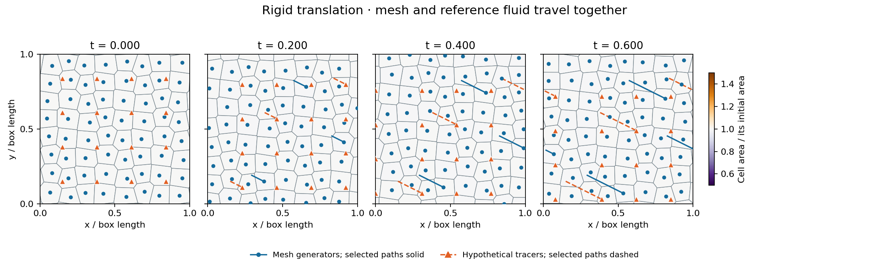
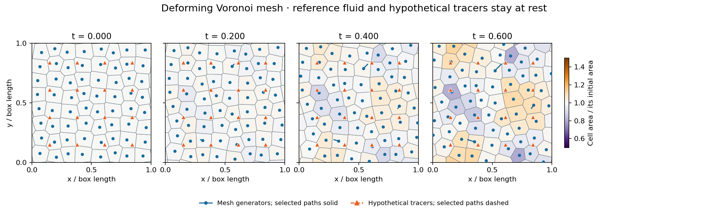

# Moving Voronoi cells and hypothetical particles

These plots show two small runs of the existing serial 2.5D solver: a mesh translating with a uniform flow, and a deforming mesh moving through a fluid whose analytic reference state is stationary. Each run contains **64 periodic Voronoi cells**, **312 accepted integration steps**, and **25 saved times from t=0 to 0.6**. They illustrate mesh motion; they do not complete the M1 physical-validation gates.



The animation advances by 0.025 simulation-time units per frame, then pauses before returning to the initial state. Opposite edges of the square are connected periodically. A point leaving the right edge reappears on the left; this is a coordinate wrap, not a jump in its physical trajectory.

## Reading the plots

- **Blue dots** are mesh generators. Each generator defines the Voronoi region closer to it than to any other generator, including periodic images. They are not necessarily at the geometric centres of their cells.
- **Grey lines** are Voronoi cell boundaries. The solver exchanges conservative mass, momentum and energy across these moving faces.
- **Orange triangles** are 16 hypothetical massless fluid tracers, added in post-processing. They follow the exact uniform-flow reference described below. They have no effect on the solver and are not a new particle, dust or SPH implementation.
- **Solid blue and dashed orange trails** follow three selected generators and three selected tracers from their initial positions. Trails are split at periodic seams. Stationary tracers leave no extended trail.
- **Cell colour** measures each cell's current area divided by its own initial area. The same colour scale is used throughout. This is a geometric quantity, not density or magnetic-field strength.

## 1. Mesh and fluid translating together



The gas has constant velocity `v=(0.4,-0.2,0.3)`. The mesh generators move in the xy plane with `w=(0.4,-0.2)`. For this uniform example, the in-plane mesh motion and the exact fluid motion agree:

```text
generator_i(t) = wrap(generator_i(0) + (0.4,-0.2) t)
tracer_a(t)    = wrap(tracer_a(0)    + (0.4,-0.2) t)
```

Cell shapes and areas remain unchanged, and a tracer keeps its location relative to the translating cells. By t=0.6, both have travelled `(0.24,-0.12)` in box-length units. The physical z-velocity is retained by the 2.5D solver; there is no third geometric dimension in this plot.

This run uses the CLI's `rigid` option. The separate `fluid` option sets each generator velocity from its cell's current in-plane fluid velocity at the beginning of a step. For nonuniform flow, the generators can have different velocities and the mesh then deforms.

## 2. Mesh deforming around stationary reference particles



The analytic physical reference is uniform gas at rest, `v=(0,0,0)`. The mesh deliberately moves independently of that gas. The existing `prescribed` CLI option assigns a velocity to each persistent generator ID using its **initial** position:

```text
w_i = (0.1 sin(2 pi y_i(0)), 0.1 cos(2 pi x_i(0)))
generator_i(t) = wrap(generator_i(0) + w_i t)
tracer_a(t) = tracer_a(0)
```

Those assigned generator velocities stay constant during this run; the sinusoid is not re-evaluated at each new position. Neighbouring generators move differently, so faces shift, cell areas change and neighbour relationships can change when the geometry is rebuilt. The orange particles remain fixed while mesh boundaries pass them. A particle is therefore not permanently attached to a cell ID.

Across the saved times, cell area / initial area ranges from **0.7997 to 1.1279**. The numerical fluid acquires small discretization errors: the final density lies between `0.999999860` and `1.000000085`. The stationary orange particles represent the exact reference, not trajectories obtained by interpolating these numerical velocities.

## What happens during integration

For each attempted step, the general-component solver obtains generator velocities from the selected motion mode and moves the generators to their trial endpoint positions. A deforming endpoint rebuilds the periodic Voronoi mesh and its reconstruction stencils; a rigid translation can reuse equivalent geometric data. Cell-centre motion includes the change in the centre's offset from its generator.

The solver uses old and predicted endpoint states, moving-face fluxes and the vector-potential/cleaning stages to update the fluid and magnetic representation. Each shared face contributes equal-and-opposite conservative updates. Invalid trial states, geometry or timestep bounds cause a retry from the old state. Both illustrated runs completed without retries or HLL fallbacks. See the [endpoint-stage contract](VECTOR_POTENTIAL_REFERENCE.md#implementation-contract-and-source-map) for the actual discretization.

Mesh motion and tracer motion answer different questions: generators choose the control volumes; hypothetical tracers mark where fluid elements would travel. Even in fluid-following mode, Voronoi faces need not be material surfaces, and a cell need not contain the same fluid forever.

## Run configuration and evidence

Both runs use `paper-global-v2`, a periodic unit square, an `8 x 8` lattice with deterministic trigonometric jitter `0.15`, `f64`, ideal gas with `gamma=5/3`, `mu0=1`, and uniform mean `B=(0.3,0.2,0.1)`. Length, time and velocity are in the solver's dimensionless code units. There is no random seed. The rigid case starts with `rho=p=1`, `A=(0.1,-0.05,0.03)`; the deforming case starts with `rho=1`, `p=0.01`, `A=0`. Both start with `phi=0` and use the existing limited reconstruction and default CFL/cleaning settings.

The maximum step is `0.002`; steps shorten to land on the saved times. Actual accepted steps range from approximately `0.001` to `0.002`. The 25 saved frames are samples of the integration, not all 312 steps. Tracers start on the Cartesian product `{0.15,0.38,0.61,0.84}²` and use the exact trajectories above; no tracer time-integration error is introduced.

The CSV files contain cell **centroids and areas**, not generators or polygon vertices. The plotting script reconstructs the known generator trajectories and independently clips their periodic Voronoi polygons. It checks every displayed polygon's area and centroid against the corresponding saved solver cell before drawing anything. It never treats the saved centroids as Voronoi generators.

| Check over all saved frames | Rigid translation | Deformation |
| --- | ---: | ---: |
| Snapshots checked | 25 | 25 |
| Maximum polygon-area difference from solver | 3.47e-17 | 1.93e-15 |
| Maximum periodic centroid-coordinate difference | 1.34e-14 | 1.28e-14 |
| Maximum total-area error from unity | 2.23e-16 | 1.12e-16 |

All saved densities and pressures are positive. Periodic normalized mass/momentum/energy budgets are checked against `1e-10`. Full diagnostic histories retain the three different magnetic-divergence operators: raw neighbour least squares, arithmetic shared-face sum, and separately limited-face sum. These illustrations make no general zero-divergence or Galilean-invariance claim. The longer deforming run here is an illustration, not a replacement for the existing short-time convergence study.

The [small solver-output archive](../tests/reference/mesh_motion/) includes all 50 compressed snapshots, full histories and summaries, commands, source hashes, compiler information and simulation revision `25aaace`. The [figure provenance](images/mesh_motion/provenance.json) records geometry-check results, plotting-library versions and image checksums.

## Reproduce on a Mac

From the repository root, use a plotting environment with the versions used here:

```sh
python3 -m venv "$HOME/.venvs/openmhd-plot"
"$HOME/.venvs/openmhd-plot/bin/python" -m pip install \
  matplotlib==3.9.4 numpy==2.0.2 pillow==11.3.0
"$HOME/.venvs/openmhd-plot/bin/python" scripts/plot_mesh_motion.py
```

That command verifies the archived data and regenerates the two PNG sequences, animated GIF and figure provenance under `docs/images/mesh_motion/`.

To run the existing Rust solver again and plot fresh outputs in ignored directories:

```sh
source "$HOME/.cargo/env"
"$HOME/.venvs/openmhd-plot/bin/python" scripts/plot_mesh_motion.py \
  --run --input-dir results/mesh_motion_fresh \
  --output-dir results/mesh_motion_fresh/plots
```

`--run` requires an empty input directory to protect earlier measurements. It builds the existing `vector-potential` binary in `results/mesh_motion_build`, runs both cases with a checkpoint every `0.025`, and losslessly compresses the CSV snapshots. No solver equations or production source files are changed by the plotting workflow.
