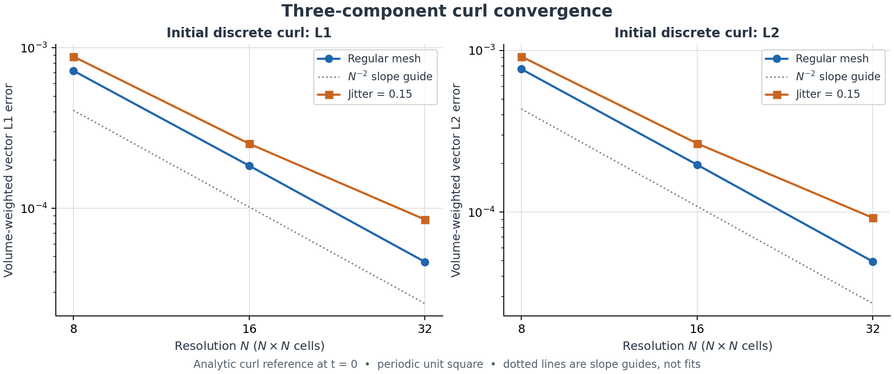
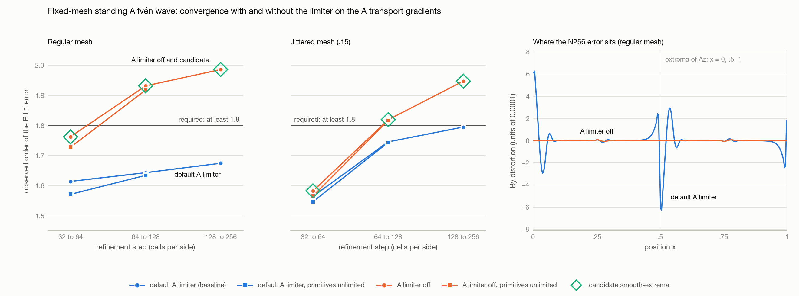
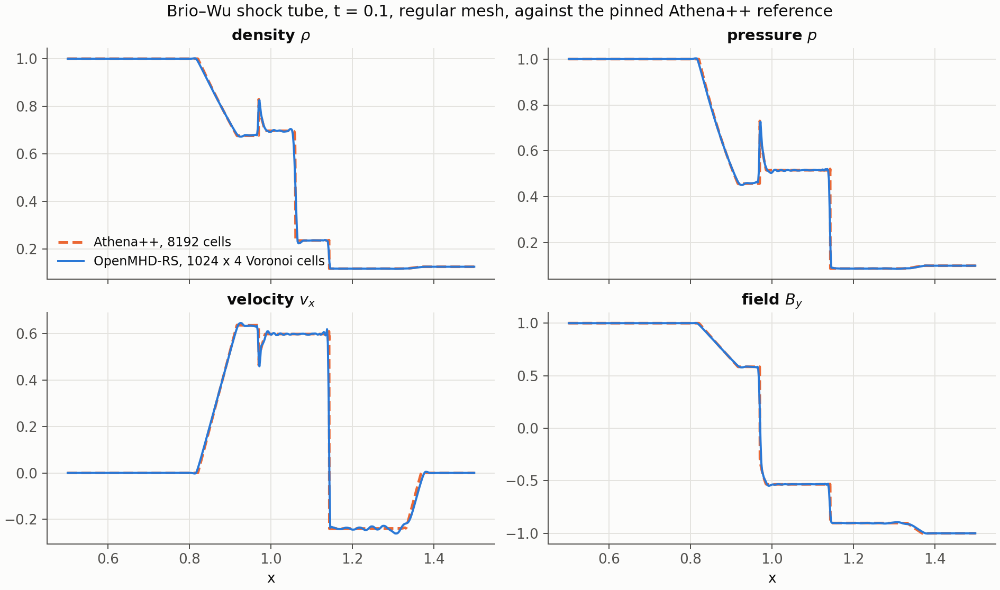
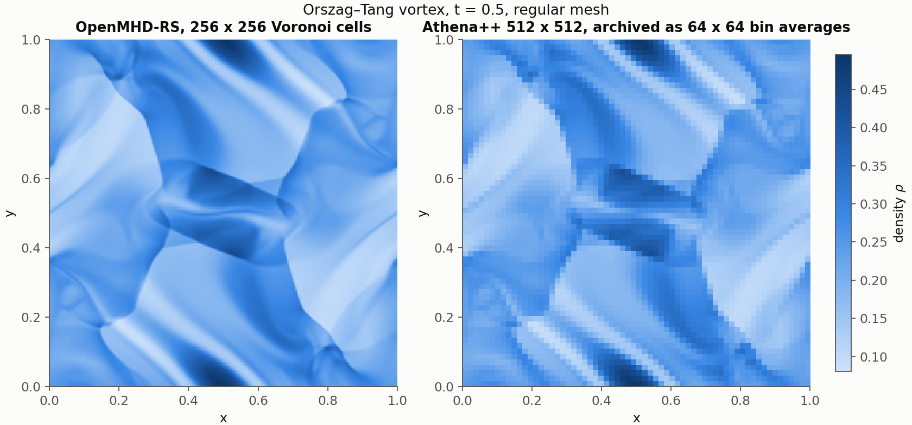

# OpenMHD-RS at a glance

*Status of November 2026. Everything below links to the evidence it summarises.*

OpenMHD-RS is an independent implementation, in Rust, of the
vector-potential moving-mesh method for ideal magnetohydrodynamics (MHD) of

> V. Springel, A. C. Mayer & R. Pakmor (2026), *Divergence-free
> magnetohydrodynamics on a moving mesh*, [arXiv:2609.35989](https://arxiv.org/abs/2609.35989).

Instead of evolving the magnetic field **B** itself, the method evolves a
vector potential **A** on a moving Voronoi mesh and obtains **B** as its curl,
so that the field is divergence-free in the continuum. The code is written from
the paper alone. It is not an AREPO fork, and it makes no claim to reproduce
the paper's results bit for bit.


*The moving mesh during integration: 64 periodic Voronoi cells, translating
with a uniform flow (left) and deforming around a fluid at rest (right).
Orange triangles are massless tracers added in post-processing. Details:
[MESH_MOTION_VISUALIZATION.md](MESH_MOTION_VISUALIZATION.md).*

## Where the project stands

| Milestone | Scope | Status |
| --- | --- | --- |
| M0 | Paper-to-code specification, reference data, acceptance thresholds | **Accepted** ([#1](https://github.com/arm2arm/openmhd-rs-/issues/1), [#2](https://github.com/arm2arm/openmhd-rs-/issues/2)) |
| M1 | Serial 2D/2.5D reference: Alfvén waves, field loops, Brio–Wu, Orszag–Tang | **Implemented, validation open** ([#7](https://github.com/arm2arm/openmhd-rs-/issues/7)) |
| M2 | Dynamic 3D Voronoi mesh and 3D benchmarks | Not started |
| M3 | MPI ranks and Rayon threads | Deterministic Rayon threading of the main kernels; MPI not started |
| M4 | Refinement, local time steps, self-gravity | Not started |
| M5 | Validation and release report | Not started |

In one sentence: **the 2D/2.5D solver is complete, the paper's own default
configuration does not yet pass the registered accuracy gates, and an opt-in
engineering configuration now passes all of them but has not been reviewed or
adopted.** Details are in [the validation section](#validation).

## The method

The paper's equations are restated in the
[M0 specification](PAPER_IMPLEMENTATION_SPEC.md), which cites the paper's
equation and page for every formula. It labels each one as stated in the paper
(P), our derivation (D), our engineering choice (E) or left unspecified by the
paper (U). This section summarises it.

**Fluid.** Ideal MHD in Lorentz–Heaviside units ($\mu_0 = 1$), with an ideal
gas of adiabatic index $\gamma$:

$$
U = (\rho,\ \rho\mathbf v,\ E), \qquad
E = \frac{p}{\gamma - 1} + \tfrac12 \rho |\mathbf v|^2 + \tfrac12 |\mathbf B|^2, \qquad
\partial_t U + \nabla \cdot \mathbf F(U, \mathbf B) = 0 .
$$

**Magnetic field from a vector potential** (P, Eqs. 35–42, 75–76). With a
fixed periodic mean field $\mathbf B_0$:

$$
\mathbf B = \mathbf B_0 + \nabla \times \mathbf A ,
$$

$$
\frac{D_w \mathbf A}{Dt} = (\mathbf v - \mathbf u) \times \mathbf B - \mathsf H^{\mathsf T} \mathbf A
  + \big[(\mathbf w - \mathbf u) \cdot \nabla\big] \mathbf A - \eta \mathbf J + \nabla \phi + \mathbf u \times \mathbf B_0 ,
$$

$$
\frac{D_w \phi}{Dt} = \alpha\, c_s^2\, \nabla \cdot \mathbf A - \beta\, \frac{c_s}{r_\mathrm{cell}}\, \phi .
$$

- $\mathbf w$ is the mesh velocity.
- $\mathbf u$ is a smooth auxiliary velocity that sets the gauge
  $\psi = \mathbf u \cdot \mathbf A$, and $\mathsf H_{ab} = \partial_b u_a$.
- $\phi$ is a cleaning scalar that damps $\nabla \cdot \mathbf A$, with
  $\alpha = 1$ and $\beta = 0.15$, and $\mathbf J = \nabla \times \mathbf B$.
- The resistivity $\eta$ is zero in every run here.

In Eulerian form this is
$\partial_t \mathbf A = \mathbf v \times \mathbf B - \nabla(\mathbf u \cdot \mathbf A) + \nabla \phi - \eta \mathbf J$ (D).
In 2.5D all quantities depend on $(x, y)$ but keep three vector components:
$A_z$ carries the in-plane field, and $A_x, A_y$ carry $B_z$.

**Discrete curl** (P, Eqs. 51–61). $\mathbf A$ and $\phi$ are point values at
the cell centres $\mathbf c_i$. Each component is fitted over the face
neighbours $j$ of cell $i$, weighted by the face areas $a_{ij}$, with a free
intercept:

$$
X_{ij} = (1, \boldsymbol\delta_{ij})^{\mathsf T}, \quad \boldsymbol\delta_{ij} = \mathbf c_j - \mathbf c_i, \qquad
M_i = \sum_j a_{ij} X_{ij} X_{ij}^{\mathsf T}, \qquad
M_i \chi_{i,k} = \sum_j a_{ij} A_{j,k} X_{ij} .
$$

The fitted, unlimited gradients give $\mathbf B_i$ and $\nabla \cdot \mathbf A$.
A separately limited copy reconstructs $\mathbf A$ at the faces for upwind
transport (Eq. 71). The curl converges at second order on regular and
irregular meshes:



A cell-centred least-squares curl is **not** machine-precision constrained
transport. The solver therefore reports three independent discrete divergence
measures of $\mathbf B$ (least-squares, shared-face sum and limited-face sum)
rather than claiming $\nabla \cdot \mathbf B = 0$.

**Gas on the moving mesh** (P, Section 5.1, with derivation D). Each face
moves with velocity $\mathbf w_f$. An HLLD Riemann problem is solved in the
face's rest frame and its flux $f'$ is transformed to the laboratory frame:

$$
f^\mathrm{lab}_{\mathbf p} = f'_{\mathbf p} + \mathbf w_f f_m, \qquad
f^\mathrm{lab}_E = f'_E + \mathbf w_f \cdot f'_{\mathbf p} + \tfrac12 |\mathbf w_f|^2 f_m .
$$

Each shared face adds $-\Delta t\, a_f f^\mathrm{lab}$ to one cell and
$+\Delta t\, a_f f^\mathrm{lab}$ to the other, so mass, momentum and energy are
conserved to roundoff. Periodic budgets stay within $10^{-10}$ in every
validation run.

**Smooth auxiliary velocity.** $\mathbf u$ is a C¹ bicubic Hermite field on a
periodic Cartesian grid. This is our 2D reduction of the paper's adaptive
tricubic construction (Eq. 68).

**Time stepping.** The default is the paper's globally synchronised two-stage
endpoint sequence, with mesh rebuilds for moving generators.

## Two configurations

| | Default `paper-global-v2` | Opt-in candidate |
| --- | --- | --- |
| What it is | The paper's method as specified in M0 | `bulk-frame-heun-quadratic-v1 --projection-screening 1 --riemann hlld-pressure --potential-limiter smooth-extrema` |
| Gauge | $\psi = \mathbf u \cdot \mathbf A$ | Bulk-frame gauge: $\mathbf A = \mathbf a + \mathbf C$, with $\dot{\mathbf C} = \mathbf V_\mathrm{ref} \times \mathbf B_0$ |
| Time integration | Two-stage endpoint sequence | Method-of-lines Heun, every rate re-evaluated |
| A rate | As in the paper | Least-squares projection of the comoving induction rate, damping κ = 1 |
| A and φ derivatives | Direct-neighbour linear fit | Double-neighbour quadratic fit |
| Flux | HLLD with HLL fallback | HLLD/HLL blend weighted by a pressure sensor |
| A limiter | Neighbour extrema | Bounds widened where two cells confirm a curvature |
| Mesh motion | Fixed, rigid, fluid-following or prescribed | Fixed or rigid only |

Each element of the candidate is an explicitly named engineering choice beyond
the paper's text. Its most consequential one, the limiter, came from a
measured diagnosis. The default limiter clips the smooth extrema of $A$ that
the $b \cdot \nabla A$ transport carries through a fixed mesh, which caps the
standing wave's convergence order near 1.66:



## Validation

Validation follows a registered plan: every case, grid, time, gate and
threshold was declared before running
([M1_FULL_VALIDATION_PLAN.md](M1_FULL_VALIDATION_PLAN.md)). After short bounded
stages, the matrix has 214 evolutions, each run as its own workflow on a REANA
cluster:

- Alfvén waves at N = 32–256 on regular and jittered meshes, fixed and
  comoving, each also jointly boosted;
- coupled and prescribed-flow field loops, a mean-field ladder and temporal
  ladders;
- Brio–Wu at nx = 256–1024 and Orszag–Tang at N = 64–256, against a pinned
  Athena++ reference.

| Registered checks | Default `paper-global-v2` | Opt-in candidate |
| --- | --- | --- |
| Alfvén spatial order (8 ladders, order at least 1.8) | 3/8 pass | **8/8 pass** (1.88–1.96) |
| Alfvén boost pairs (base vs. Galilean-boosted twin) | 13/32 pass | **32/32 pass** |
| Field-loop boost pairs | 16/16 pass | **16/16 pass** |
| Brio–Wu and Orszag–Tang reference and boost gates | jittered Brio–Wu loses positive pressure ([#20](https://github.com/arm2arm/openmhd-rs-/issues/20)) | **all pass**, 15/15 boost pairs |

Sources: [default](M1_COMPLETION_RESULTS.md),
[candidate, 2026-11-14](../tests/reference/m1_standing_limiter/README.md#8-fan-out-campaign-from-the-campaign-snapshot-2026-11-13-to-14)
and its repeat with an iterative projection solver on 2026-11-18,
[which reproduces it to the solver tolerance](../tests/reference/m1_iterative_step_campaigns/README.md).
The figures below come from that repeat (`scripts/plot_overview.py`,
[provenance](images/overview/provenance.json)).






**What is not established:**

- **M1 acceptance.** It needs independent review and the owner's decision to
  adopt the candidate. That includes accepting the candidate's limiter cost:
  fixed-mesh loop transport errors are 3–10 % larger.
- **The paper's own default** passing the gates.
- **Deforming meshes with the candidate.** Its Heun integrator supports only
  fixed and rigidly moving meshes.
- **General Galilean invariance** for nonuniform flows with a nonzero mean
  field.
- **3D, MPI, and equivalence with the paper's or AREPO's results.**

## Try it

The workspace builds with the pinned Rust 1.85.1 toolchain
(`rust-toolchain.toml`) and has no MPI or HDF5 dependency:

```sh
cargo build --release --locked -p openmhd --bin vector-potential

# Travelling Alfvén wave on a jittered Voronoi mesh, candidate configuration
target/release/vector-potential --case alfven --n 64 --jitter 0.15 --time 1 \
  --profile bulk-frame-heun-quadratic-v1 --projection-screening 1 \
  --riemann hlld-pressure --potential-limiter smooth-extrema --output results/demo_alfven

# Brio–Wu shock tube (2 x 0.125 box, 4 rows), same configuration
target/release/vector-potential --case brio-wu --n 512 --time 0.1 \
  --profile bulk-frame-heun-quadratic-v1 --projection-screening 1 \
  --riemann hlld-pressure --potential-limiter smooth-extrema --output results/demo_brio

# Orszag–Tang vortex, same configuration
target/release/vector-potential --case orszag-tang --n 128 --time 0.5 \
  --profile bulk-frame-heun-quadratic-v1 --projection-screening 1 \
  --riemann hlld-pressure --potential-limiter smooth-extrema --output results/demo_vortex

# The paper's default profile on a deforming mesh
target/release/vector-potential --case deform --motion prescribed --n 16 --jitter 0.15 \
  --time 0.2 --output results/demo_deform
```

Each run writes `initial.csv`, `final.csv`, `summary.json` and `history.json`:
cell states, conservation budgets, the three divergence measures and the step
counters. `vector-potential --help` lists every option. These include
checkpoint/restart for long runs, which is limited to the configurations it
was tested on ([CHECKPOINT_RESTART.md](CHECKPOINT_RESTART.md)).

`python3 scripts/plot_mesh_motion.py` regenerates the animation above from
archived data. `scripts/plot_overview.py` regenerates this page's figures from
a campaign's raw results.

## Code layout

| Crate | Contents |
| --- | --- |
| `crates/mhd-core` | Ideal-gas states, HLLD/HLL/Rusanov fluxes in moving face frames |
| `crates/moving-mesh` | Periodic 2D Voronoi geometry, least-squares stencils, limiters, quadratic fits, exact mesh cache |
| `crates/mhd-vector-pot` | The 2.5D vector-potential solver: profiles, gauge and cleaning, auxiliary velocity, projection, checkpoint |
| `crates/mhd-planar` | Earlier planar coupled reference |
| `crates/mhd-io` | Checkpoint codec and atomic writes |
| `apps/openmhd` | Command-line drivers (`vector-potential`, `brio-reference`, `ct-comparator`, `passive-voronoi`, …) |
| `apps/field-loop` | Kinematic field-loop pilot |
| `scripts/` | Validation drivers, REANA tooling, reductions and plots, with Python tests |

## Read further

- [README](../README.md): full history of the development and how to run each study.
- [PAPER_IMPLEMENTATION_SPEC.md](PAPER_IMPLEMENTATION_SPEC.md): the paper-to-code specification.
- [VECTOR_POTENTIAL_REFERENCE.md](VECTOR_POTENTIAL_REFERENCE.md): the solver's implementation contract.
- [VALIDATION.md](VALIDATION.md) and [M1_FULL_VALIDATION_PLAN.md](M1_FULL_VALIDATION_PLAN.md): validation strategy and the registered plan.
- [ROADMAP.md](ROADMAP.md): milestones.
- [REANA.md](REANA.md): how the validation runs on the cluster.
