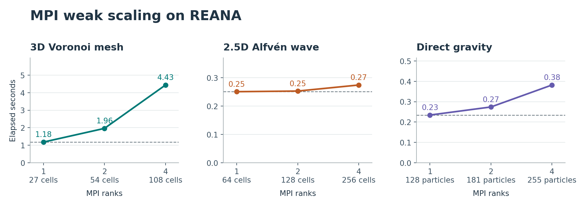
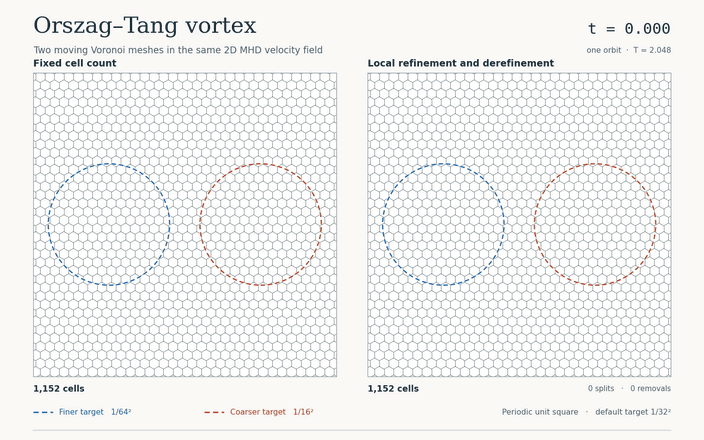
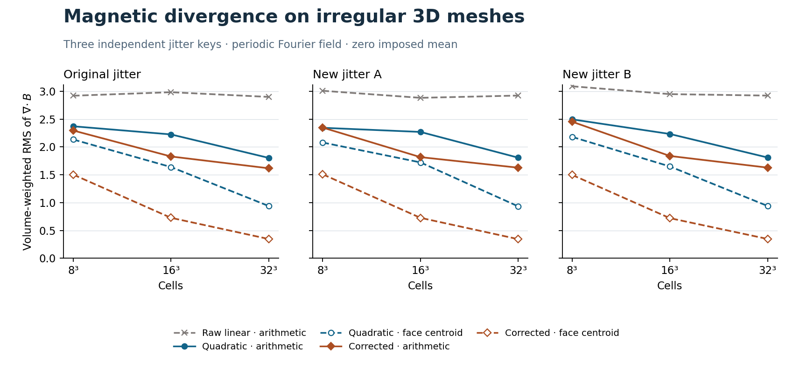
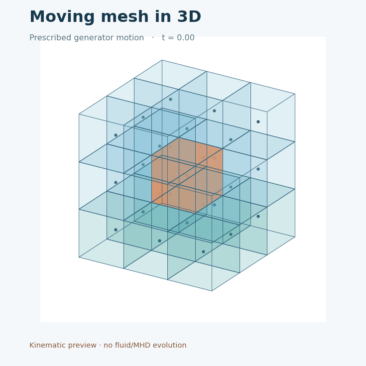
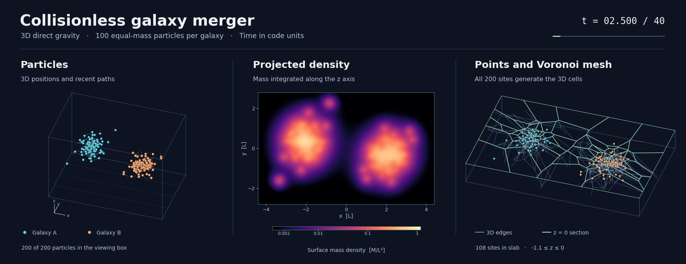
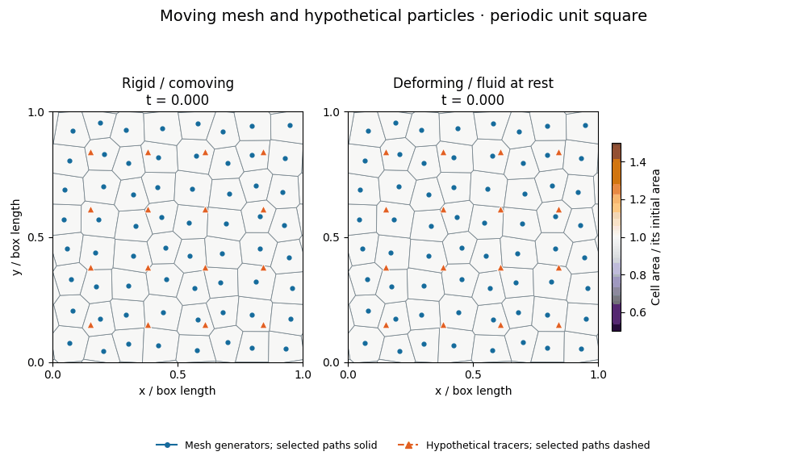
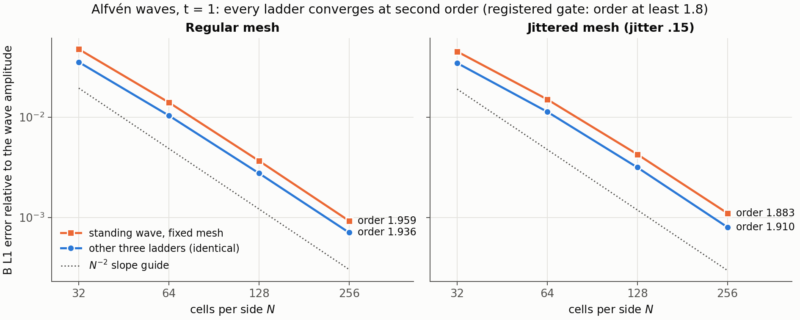

# OpenMHD-RS at a glance

*Updated 28 November 2026.* [Illustrated progress report (PDF)](OVERVIEW.pdf) · [Recent figures](#recent-figures) · [Numerical method](#the-method)

OpenMHD-RS is an independent implementation, in Rust, of the
vector-potential moving-mesh method for ideal magnetohydrodynamics (MHD) of

> V. Springel, A. C. Mayer & R. Pakmor (2026), *Divergence-free
> magnetohydrodynamics on a moving mesh*, [arXiv:2609.35989](https://arxiv.org/abs/2609.35989).

The method evolves a vector potential **A** on a moving Voronoi mesh and obtains the magnetic field **B** as its curl. In the continuum that field has zero divergence. On a discrete mesh the measured divergence depends on the operator, as the 3D plots below show.

## Where the project stands

| Milestone | Scope | Status |
| --- | --- | --- |
| M0 | Paper-to-code specification, reference data, acceptance thresholds | **Accepted** ([#1](https://github.com/arm2arm/openmhd-rs-/issues/1), [#2](https://github.com/arm2arm/openmhd-rs-/issues/2)) |
| M1 | Periodic fixed or rigidly translating 2.5D MHD, single process | **Accepted** for the named iterative profile. [214 fresh cases and 58 checks](../tests/reference/m1_final_acceptance/README.md) |
| M2a | Static bounded and periodic 3D Voronoi geometry | **Accepted.** [Geometry decision and scope](../tests/reference/m2a_static_geometry/acceptance.json) |
| M2b | Static 3D spatial operators, including the quadratic curl | **Accepted** under revision 2. [Operator decision](../tests/reference/m2b_static_operators/acceptance.json) |
| M2c | Prescribed mesh motion and geometric conservation | **In progress.** Centroid rates and smooth moving-curl derivatives have measured results. Event-resolved, coupled moving MHD remains open. [Results](galaxy/M2C_MOVING_CURL_RESULTS.md) |
| M3 | MPI ranks and Rayon threads | All 21 measured problem families matched serial output on one, two and four ranks. Alfvén-wave and gravity checkpoints resumed on a different rank count. [Parallel results](M3_PARALLEL_RESULTS.md) |
| M4 | Refinement, local time steps and gravity | Direct collisionless gravity and a mesh-refinement visualization are implemented. Coupled adaptive MHD and local stepping remain open. [Roadmap](ROADMAP.md) |
| M5 | Validation and release report | Scoped milestone reports are available. The full release remains open. [Validation plan](VALIDATION.md) |

## Recent figures

### Parallel mesh and gravity performance


Building the 64-cell Voronoi mesh took 1.072 s on one Rayon thread and 0.174 s on 16. For 2,048 particles and four gravity steps, one thread took 3.216 s and 16 took 3.914 s. Both calculations reproduced their single-thread scientific files at every thread count tested. [Timings and comparison inputs](M3_PARALLEL_RESULTS.md).



With the Alfvén-wave workload fixed at 64 cells per rank, elapsed time rose from 0.251 s on one rank to 0.275 s on four. The 3D mesh rose from 1.182 s to 4.434 s at 27 cells per rank. Each rank currently holds a full copy of the geometry. [Weak-scaling measurements and exchange sizes](M3_PARALLEL_RESULTS.md#mpi-weak-scaling).

### Refinement in the Orszag–Tang vortex

[](images/orszag_tang_mesh/refinement-comparison.mp4)

Both panels start with the same 1,152 generators and follow velocities recorded from one 64 × 64 planar MHD run. The left keeps its cell count fixed. The right splits and removes generators as the two circles orbit. At $t=0.768$, the median cell area in the red circle is 11.45 times the median in the blue circle. The displayed polygons replay that flow. Gas and magnetic fluxes evolve on the fixed grid. [Full-resolution movie at the original playback rate (18.6 s)](images/orszag_tang_mesh/refinement-comparison.mp4) · [Four stills at the times in Figure 23](images/orszag_tang_mesh/refinement-snapshots.png) · [Method and measurements](galaxy/ORSZAG_TANG_MESH_MOVIE.md).

### Magnetic divergence on irregular 3D meshes



All 24 required irregular-mesh sequences decreased from 8³ to 16³ to 32³ cells. The production quadratic curl reached at most 3.81% relative field error on the three jittered 32³ meshes. [Reconstructed 3D field](images/m2b_operators/fourier_field.png) · [Convergence plots and M2b decision](galaxy/M2B_STATIC_OPERATORS.md).

### What changes when the mesh moves



The cutaway follows one cell through a full cycle of prescribed motion for 27 generators. The rotation test below measures the geometry directly. [3D preview and generator paths](MESH_MOTION_3D_PREVIEW.md).


For a rotating face shared by two 3D cells, halving the time offset reduced both the volume-rate and centroid-velocity errors by about a factor of four. The 42 oblique cases covered six axis permutations, and eight additional controls passed. [Centroid-rate measurements](galaxy/M2C_CENTROID_RATES.md#measured-reana-results).


The experimental shared-face curl preserved the magnetic mean to a normalized error of $1.77 \times 10^{-17}$. Its cell-average field converged with orders 2.48–2.50 on six irregular mesh families. The separate cubic roundoff revision passed 18 fresh cases. Smooth-motion derivative checks passed on five matched step sizes. Two coarser intervals changed the mesh topology and were excluded from that derivative measurement. [M2c results and remaining gates](galaxy/M2C_MOVING_CURL_RESULTS.md).

### A collisionless merger with 100 particles per galaxy

[](images/nbody_merger_100/particles-density-voronoi.mp4)

The three panels use the same 321 snapshots from the direct-gravity run. The density is projected from particle masses, and the Voronoi cells are reconstructed from their 3D positions. At the final time the innermost 100 particles included 49 from one progenitor and 51 from the other. [Play the three-panel movie](images/nbody_merger_100/particles-density-voronoi.mp4) · [Three stages of the merger](images/nbody_merger_100/evolution.png) · [Gravity model and diagnostics](galaxy/NBODY_MERGER_100.md) · [Independent force-gradient plot](galaxy/results/g1_gradient_20261126/gradient-ladder-full.png).

## The method

The paper's equations are restated in the
[M0 specification](PAPER_IMPLEMENTATION_SPEC.md), which cites the paper's
equation and page for every formula. It labels each one as stated in the paper
(P), our derivation (D), our engineering choice (E) or left unspecified by the
paper (U). This section summarises it.

**Fluid.** Ideal MHD in Lorentz–Heaviside units ($\mu_0 = 1$), with an ideal
gas of adiabatic index $\gamma$:

$$
U = (\rho,\ \rho\mathbf v,\ E), \qquad
E = \frac{p}{\gamma - 1} + \tfrac12 \rho |\mathbf v|^2 + \tfrac12 |\mathbf B|^2, \qquad
\partial_t U + \nabla \cdot \mathbf F(U, \mathbf B) = 0 .
$$

**Magnetic field from a vector potential** (P, Eqs. 35–42, 75–76). With a
fixed periodic mean field $\mathbf B_0$:

$$
\mathbf B = \mathbf B_0 + \nabla \times \mathbf A ,
$$

$$
\frac{D_w \mathbf A}{Dt} = (\mathbf v - \mathbf u) \times \mathbf B - \mathsf H^{\mathsf T} \mathbf A
  + \big[(\mathbf w - \mathbf u) \cdot \nabla\big] \mathbf A - \eta \mathbf J + \nabla \phi + \mathbf u \times \mathbf B_0 ,
$$

$$
\frac{D_w \phi}{Dt} = \alpha\, c_s^2\, \nabla \cdot \mathbf A - \beta\, \frac{c_s}{r_\mathrm{cell}}\, \phi .
$$

- $\mathbf w$ is the mesh velocity.
- $\mathbf u$ is a smooth auxiliary velocity that sets the gauge
  $\psi = \mathbf u \cdot \mathbf A$, and $\mathsf H_{ab} = \partial_b u_a$.
- $\phi$ is a cleaning scalar that damps $\nabla \cdot \mathbf A$, with
  $\alpha = 1$ and $\beta = 0.15$, and $\mathbf J = \nabla \times \mathbf B$.
- The resistivity $\eta$ is zero in every run here.

In Eulerian form this is
$\partial_t \mathbf A = \mathbf v \times \mathbf B - \nabla(\mathbf u \cdot \mathbf A) + \nabla \phi - \eta \mathbf J$ (D).
In 2.5D all quantities depend on $(x, y)$ but keep three vector components:
$A_z$ carries the in-plane field, and $A_x, A_y$ carry $B_z$.

**Discrete curl** (P, Eqs. 51–61). $\mathbf A$ and $\phi$ are point values at
the cell centres $\mathbf c_i$. Each component is fitted over the face
neighbours $j$ of cell $i$, weighted by the face areas $a_{ij}$, with a free
intercept:

$$
X_{ij} = (1, \boldsymbol\delta_{ij})^{\mathsf T}, \quad \boldsymbol\delta_{ij} = \mathbf c_j - \mathbf c_i, \qquad
M_i = \sum_j a_{ij} X_{ij} X_{ij}^{\mathsf T}, \qquad
M_i \chi_{i,k} = \sum_j a_{ij} A_{j,k} X_{ij} .
$$

The fitted, unlimited gradients give $\mathbf B_i$ and $\nabla \cdot \mathbf A$.
A separately limited copy reconstructs $\mathbf A$ at the faces for upwind
transport (Eq. 71). The curl converges at second order on regular and
irregular meshes:


A cell-centred least-squares curl is **not** machine-precision constrained
transport. The solver therefore reports three independent discrete divergence
measures of $\mathbf B$ (least-squares, shared-face sum and limited-face sum)
rather than claiming $\nabla \cdot \mathbf B = 0$.

**Gas on the moving mesh** (P, Section 5.1, with derivation D). Each face
moves with velocity $\mathbf w_f$. An HLLD Riemann problem is solved in the
face's rest frame and its flux $f'$ is transformed to the laboratory frame:

$$
f^\mathrm{lab}_{\mathbf p} = f'_{\mathbf p} + \mathbf w_f f_m, \qquad
f^\mathrm{lab}_E = f'_E + \mathbf w_f \cdot f'_{\mathbf p} + \tfrac12 |\mathbf w_f|^2 f_m .
$$

Each shared face adds $-\Delta t\, a_f f^\mathrm{lab}$ to one cell and
$+\Delta t\, a_f f^\mathrm{lab}$ to the other, so mass, momentum and energy are
conserved to roundoff. Periodic budgets stay within $10^{-10}$ in every
validation run.

**Smooth auxiliary velocity.** $\mathbf u$ is a C¹ bicubic Hermite field on a
periodic Cartesian grid. This is our 2D reduction of the paper's adaptive
tricubic construction (Eq. 68).

**Time stepping.** The default is the paper's globally synchronised two-stage
endpoint sequence, with mesh rebuilds for moving generators.



*The moving mesh during integration: 64 periodic Voronoi cells, translating
with a uniform flow (left) and deforming around a fluid at rest (right).
Orange triangles are massless tracers added in post-processing. Details:
[MESH_MOTION_VISUALIZATION.md](MESH_MOTION_VISUALIZATION.md).*

## Two configurations

| | Default `paper-global-v2` | Opt-in candidate |
| --- | --- | --- |
| What it is | The paper's method as specified in M0 | `bulk-frame-heun-quadratic-v1 --projection-screening 1 --riemann hlld-pressure --potential-limiter smooth-extrema` |
| Gauge | $\psi = \mathbf u \cdot \mathbf A$ | Bulk-frame gauge: $\mathbf A = \mathbf a + \mathbf C$, with $\dot{\mathbf C} = \mathbf V_\mathrm{ref} \times \mathbf B_0$ |
| Time integration | Two-stage endpoint sequence | Method-of-lines Heun, every rate re-evaluated |
| A rate | As in the paper | Least-squares projection of the comoving induction rate, damping κ = 1 |
| Projection solve | n/a | Jacobi-preconditioned CG, the standard solve since 2026-11-19 (a cached sparse-Cholesky preconditioner gives the same results to the solver tolerance) |
| A and φ derivatives | Direct-neighbour linear fit | Double-neighbour quadratic fit |
| Flux | HLLD with HLL fallback | HLLD/HLL blend weighted by a pressure sensor |
| A limiter | Neighbour extrema | Bounds widened where two cells confirm a curvature |
| Mesh motion | Fixed, rigid, fluid-following or prescribed | Fixed or rigid only |

Each element of the candidate is an explicitly named engineering choice beyond
the paper's text. Its most consequential one, the limiter, came from a
measured diagnosis. The default limiter clips the smooth extrema of $A$ that
the $b \cdot \nabla A$ transport carries through a fixed mesh, which caps the
standing wave's convergence order near 1.66:


## Validation

Validation follows a registered plan: every case, grid, time, gate and
threshold was declared before running
([M1_FULL_VALIDATION_PLAN.md](M1_FULL_VALIDATION_PLAN.md)). After short bounded
stages, the matrix has 214 evolutions, each run as its own workflow on a REANA
cluster:

- Alfvén waves at N = 32–256 on regular and jittered meshes, fixed and
  comoving, each also jointly boosted;
- coupled and prescribed-flow field loops, a mean-field ladder and temporal
  ladders;
- Brio–Wu at nx = 256–1024 and Orszag–Tang at N = 64–256, against a pinned
  Athena++ reference.

| Registered checks | Default `paper-global-v2` | Opt-in candidate |
| --- | --- | --- |
| Alfvén spatial order (8 ladders, order at least 1.8) | 3/8 pass | **8/8 pass** (1.88–1.96) |
| Alfvén boost pairs (base vs. Galilean-boosted twin) | 13/32 pass | **32/32 pass** |
| Field-loop boost pairs | 16/16 pass | **16/16 pass** |
| Brio–Wu and Orszag–Tang reference and boost gates | jittered Brio–Wu loses positive pressure ([#20](https://github.com/arm2arm/openmhd-rs-/issues/20)) | **all pass**, 15/15 boost pairs |

Sources: [default](M1_COMPLETION_RESULTS.md), and for the candidate
[campaign A of 2026-11-18](../tests/reference/m1_iterative_step_campaigns/README.md).
That campaign also reproduces, to the solver tolerance, the
[2026-11-14 campaign](../tests/reference/m1_standing_limiter/README.md#8-fan-out-campaign-from-the-campaign-snapshot-2026-11-13-to-14),
which used the cached solve. The figures below come from campaign A (`scripts/plot_overview.py`,
[provenance](images/overview/provenance.json)).




The final M1 review accepted the named fixed/rigid 2.5D candidate after all 214 fresh cases passed the 58 registered checks. Its smooth-extrema limiter increased fixed-mesh passive-loop transport errors by 3–10%. The historical default retains its recorded failures. Fully deforming 3D MHD, general boost invariance, cross-node MPI scaling and the full magnetized galaxy merger each require further evidence. [M1 acceptance and measured tradeoffs](../tests/reference/m1_final_acceptance/acceptance.json) · [Current roadmap](ROADMAP.md).

## Try it

The following examples use the serial workspace and the pinned Rust 1.85.1 toolchain. The separate MPI executable can run the same 2.5D profile with multiple ranks. [MPI build and launch commands](PARALLEL_HPC.md#run-a-hybrid-case).

```sh
cargo build --release --locked -p openmhd --bin vector-potential

# Travelling Alfvén wave on a jittered Voronoi mesh, candidate configuration
target/release/vector-potential --case alfven --n 64 --jitter 0.15 --time 1 \
  --profile bulk-frame-heun-quadratic-v1 --projection-screening 1 \
  --riemann hlld-pressure --potential-limiter smooth-extrema --output results/demo_alfven

# Brio–Wu shock tube (2 x 0.125 box, 4 rows), same configuration
target/release/vector-potential --case brio-wu --n 512 --time 0.1 \
  --profile bulk-frame-heun-quadratic-v1 --projection-screening 1 \
  --riemann hlld-pressure --potential-limiter smooth-extrema --output results/demo_brio

# Orszag–Tang vortex, same configuration
target/release/vector-potential --case orszag-tang --n 128 --time 0.5 \
  --profile bulk-frame-heun-quadratic-v1 --projection-screening 1 \
  --riemann hlld-pressure --potential-limiter smooth-extrema --output results/demo_vortex

# The paper's default profile on a deforming mesh
target/release/vector-potential --case deform --motion prescribed --n 16 --jitter 0.15 \
  --time 0.2 --output results/demo_deform
```

Each run writes `initial.csv`, `final.csv`, `summary.json` and `history.json`:
cell states, conservation budgets, the three divergence measures and the step
counters. `vector-potential --help` lists every option. These include
checkpoint/restart for long runs, which is limited to the configurations it
was tested on ([CHECKPOINT_RESTART.md](CHECKPOINT_RESTART.md)).

`python3 scripts/plot_mesh_motion.py` regenerates the translating and deforming mesh illustration. `scripts/plot_overview.py` regenerates the three historical M1 benchmark plots. The recent figure captions link to their own data and rendering instructions.

## Code layout

| Crate | Contents |
| --- | --- |
| `crates/mhd-core` | Ideal-gas states, HLLD/HLL/Rusanov fluxes in moving face frames |
| `crates/moving-mesh` | Periodic 2D and bounded or periodic 3D Voronoi geometry, reconstruction stencils, moving-cell geometry and Lloyd regularisation |
| `crates/mhd-vector-pot` | 2.5D vector-potential evolution and checkpointing, 3D reconstruction, and the shared-face curl and its smooth-motion derivative |
| `crates/mhd-planar` | Planar coupled reference supplying the vortex movie’s velocity history |
| `crates/gravity` | Direct collisionless gravity and kick–drift–kick evolution |
| `crates/mhd-io` | Checkpoint codec and atomic writes |
| `apps/openmhd` | Command-line drivers (`vector-potential`, `brio-reference`, `ct-comparator`, `passive-voronoi`, …) |
| `apps/field-loop` | Kinematic field-loop pilot |
| `scripts/` | Validation drivers, REANA tooling, reductions and plots, with Python tests |

## Read further

- [README](../README.md): full history of the development and how to run each study.
- [PAPER_IMPLEMENTATION_SPEC.md](PAPER_IMPLEMENTATION_SPEC.md): the paper-to-code specification.
- [VECTOR_POTENTIAL_REFERENCE.md](VECTOR_POTENTIAL_REFERENCE.md): the solver's implementation contract.
- [VALIDATION.md](VALIDATION.md) and [M1_FULL_VALIDATION_PLAN.md](M1_FULL_VALIDATION_PLAN.md): validation strategy and the registered plan.
- [ROADMAP.md](ROADMAP.md): milestones.
- [REANA.md](REANA.md): how the validation runs on the cluster.
