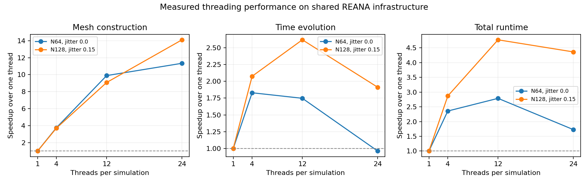

# Deterministic threading results

The user requested using 24 cores inside complex simulations on 2026-11-08.
The [prospective contract](THREADING_PLAN.md) specifies the numerical boundary:
independent outputs are computed concurrently, while original summation order,
shared face exchanges, profiles, positivity checks and rejection semantics are
preserved. This does not change the unresolved M1 physical-validation status.

## Local implementation checks

`cargo fmt --check`, `cargo clippy --all-targets --all-features --locked -- -D
warnings`, all 95 Rust tests and 28 Python tests pass. New tests compare geometry,
operators, coupled state, diagnostics and counters across 1/2/4/24 threads,
including regular/jittered/permuted points, nonzero mean fields, fixed/rigid/
deforming motion, all four profiles, and deterministic error selection.

An independent executable comparison used the pre-threading frozen signal
binary and the new binary at 1/4/24 threads on N16 jitter=.15 standing waves,
t=.02, dt cap=.0005, fluid/grid boost=(2,-1,.8) with in-plane mesh motion.
Initial/final CSVs and histories are byte-identical. Evidence is retained in
`results/threading_legacy_20261108/`. This checks agreement with the old code,
not just agreement among modes of the new implementation.

The nine-case N8/N16 execution check also completes with exact thread-count
agreement. As expected, creating/scheduling many workers can slow tiny meshes;
the default remains one thread. These tiny timings are not evidence of HPC speedup.

## REANA experiment

Workflow `openmhd-threading-20261108.1` uses source snapshot SHA-256
`3c484ae6ae2bd506985d018ce07f19bfaa6c5f3f29fb288b98f05d03b1ab7bcf`,
one simultaneous simulation, up to 24 threads per simulation, and a 64G
memory limit. It runs the workspace/M0 checks, controlled N64/N128 scaling,
and then the N256 original-profile travelling wave to t=1.
Live measurements are in `source/results/reana_threading/{runs,summary}.json`.
The original workflows continue independently and their source is unchanged.

N64/N128 comparisons require identical output clocks and byte-identical physical
files. The N256 demonstration includes extra progress checkpoints that can
split timesteps relative to the older serial study. Its initial snapshot can
be checked bit for bit against that study; later differences cannot be
attributed solely to threading unless output landing times are also matched.
This distinction is explicit before examining N256 results.

## Measured scaling and completed N256 run

The REANA format/Clippy, 95 Rust tests, 28 Python tests, release build and M0
checks pass. All eight N64/N128 runs completed to t=.02, dt cap=.0002 with
positive states and budgets within 1e-10. Every initial/final CSV, summary and
history is byte-identical to the matching one-thread run. These are single
observations on shared infrastructure, not isolated repeated scaling trials.

| Case | Threads | Wall seconds | Total speedup | Mesh speedup | Evolution speedup |
| --- | ---: | ---: | ---: | ---: | ---: |
| N64, regular | 1 | 7.469 | 1.00 | 1.00 | 1.00 |
| N64, regular | 4 | 3.167 | 2.36 | 3.75 | 1.83 |
| N64, regular | 12 | 2.679 | **2.79** | 9.89 | 1.75 |
| N64, regular | 24 | 4.325 | 1.73 | 11.34 | **0.96** |
| N128, jitter=.15 | 1 | 72.678 | 1.00 | 1.00 | 1.00 |
| N128, jitter=.15 | 4 | 25.342 | 2.87 | 3.70 | 2.07 |
| N128, jitter=.15 | 12 | 15.225 | **4.77** | 9.08 | **2.62** |
| N128, jitter=.15 | 24 | 16.658 | 4.36 | **14.10** | 1.91 |

Twenty-four threads accelerate mesh construction well, but do not provide
24x overall speedup. Twelve threads give the best measured total time in
both cases. Serial accumulation/validation and parallel scheduling remain
limits; these observations alone do not identify their individual cost.
The N128 24-thread run used 115.84 process CPU seconds over 16.66 wall seconds
(about 6.95 cores on average), so configuring 24 workers does not mean every
core stays busy throughout the run. Process CPU time includes worker activity.

The N256 demonstration started at `2026-11-08T15:25:17Z` with 24 threads and
completed to t=1 in **2946.84 seconds (49.1 minutes)**. Mesh construction took
193.389 seconds (3.2 minutes), and evolution took 2743.46 seconds (45.7 minutes).
The whole workflow, including toolchain preparation/checks and archiving,
finished at `2026-11-08T16:15:05Z`. All nine numerical executions completed.
Its initial CSV is byte-identical to the verified serial initial snapshot below.

The run accepted 6660 steps, with 5083 CFL retries and no state/geometry
rejections or HLL fallbacks. Sampled density/pressure stayed positive, and the
maximum normalized conservative-budget residual was 1.171e-12, below 1e-10.
All three independent divergence diagnostics are archived. Post-run analytic
magnetic L1 error is 2.428e-5; this single run is not a convergence ladder or
full M1 acceptance. The process used an average of 4.97 CPU cores despite its
24-worker cap. Frequent endpoint CFL retries and serial work remain relevant
performance limitations; no individual cost breakdown is claimed.

The older serial N256 travelling-wave case completed in 8879.76 seconds
(148.0 minutes), 6663 accepted steps and 5092 CFL retries. The observed runtime
ratio is 3.01, but differing checkpoint clocks and shared-cluster conditions
make it an approximate comparison. Its 36,158,655-byte initial CSV was
downloaded and verified against the run manifest. Direct large downloads can
truncate despite client success; the failed copies were rejected and the
successful retry has SHA-256
`af4c3fb574e2e436bee09fcd581d5f4d65b5b09a810da4de62b801598da19696`.
The later serial/threaded clocks differ as described above; their full runtimes
are not an isolated thread-count scaling measurement.

Current local measurements live in
`results/reana_remote_20261108/threading/source/results/reana_threading/`.
The original [partial scaling archive](../tests/reference/threading_scaling/README.md)
is preserved. The [completion archive](../tests/reference/threading_completion/README.md)
adds final run records, verified N256 outputs and command logs. Runtime reservations are controlled by
Kubernetes; this deployment only records an application-level thread cap.
