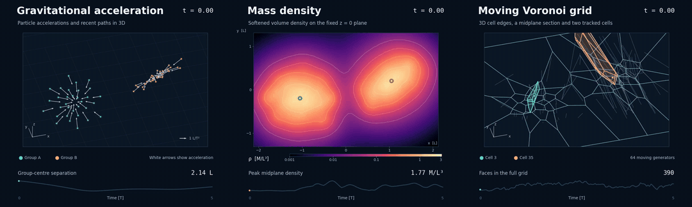

# A collisionless encounter in three views

Two inclined groups of 32 equal-mass particles attract, pass through their closest sampled approach, and separate. These movies follow the same 64 persistent particle IDs through 129 endpoints of a Rust kick–drift–kick evolution on REANA. The setup is an illustrative low-particle encounter. Its initial groups have prescribed rotation and thickness in dimensionless units. Galaxy equilibrium, physical scaling and coalescence require separate simulations.

| Movie | What to watch |
| --- | --- |
| [All three views together](../images/gravity_encounter/synchronized.mp4) | The clocks agree frame for frame. The central views keep their camera and scales fixed. |
| [Gravitational acceleration](../images/gravity_encounter/gravity.mp4) | The white arrows show the actual force per unit mass. The coloured dots and recent paths retain each particle’s original group. The arrow in the lower right calibrates the projected length. |
| [Mass density](../images/gravity_encounter/density.mp4) | The warm contours trace volume density through the fixed Cartesian plane at $z=0$. The coloured rings mark the projected centres of mass. |
| [Moving Voronoi grid](../images/gravity_encounter/grid.mp4) | Faint edges show a cutaway of the 3D mesh. Brighter lines trace the midplane. The highlighted polyhedra follow particle IDs 3 and 35. The count below the image covers the entire box. |

The group-centre separation starts at **2.138** length units, reaches **0.678** at $t=1.914$ in the saved snapshots, and ends at **1.276** at $t=5$. The fixed central framing lets outer particles leave the picture. The trajectory file contains every particle throughout the encounter. [Endpoint data](../data/gravity_encounter/encounter/trajectory.npz) · [Measured run diagnostics](../data/gravity_encounter/encounter/run.json)

## Gravity, density and geometry

The isolated collisionless solver uses direct pair forces, $G=1$, a common Plummer softening length $\epsilon=0.25$, and total mass 2. All particles contribute to gravity. The initial positions and velocities are recorded to 17 significant digits. A synchronized step of $1/512$ advances the system 2,560 times. The output stride is 20 steps. Length $L$, time $T$, and mass $M$ denote code units. Gas, magnetic fields and feedback are outside the scope of this run. [Initial conditions](../data/gravity_encounter/encounter/initial.txt) · [Rust trajectory example](../../crates/gravity/examples/gravity-trajectory.rs)

The acceleration arrows are recorded at each full-step endpoint. The density panel evaluates the three-dimensional density associated with the same softened potential at each point $\mathbf x=(x,y,0)$.

$$
\mathbf a_i=G\sum_{j\ne i}m_j
\frac{\mathbf x_j-\mathbf x_i}{\bigl(|\mathbf x_j-\mathbf x_i|^2+\epsilon^2\bigr)^{3/2}},
\qquad
\rho_\epsilon(\mathbf x)=\sum_j
\frac{3m_j\epsilon^2}{4\pi\bigl(|\mathbf x-\mathbf x_j|^2+\epsilon^2\bigr)^{5/2}} .
$$

Each density kernel integrates to its particle’s mass in three dimensions. The figure uses a fixed logarithmic colour scale in $M/L^3$. The plotted peak comes from the double-precision 240 × 240 midplane calculation before colour quantization. [Density inputs and range](../data/gravity_encounter/density/report.json)

Gravity uses direct summation. To visualize the particle distribution, the Rust geometry driver separately constructs a bounded Voronoi diagram at every recorded time. Each particle generates one cell containing the points closer to it than to any other generator. The display box spans $[-4.5,4.5]\times[-2,2]\times[-1,1]$ in $L$. Its walls bound the visualization mesh and exert no force. Polygon vertices are transformed from the exporting cell’s local coordinates before any display cut is applied. [Per-frame geometry data](../data/gravity_encounter/) · [Reconstruction source](../../reana/gravity_movie_fields.py)

## Recorded checks

| Check | Measured result |
| --- | ---: |
| Maximum relative total-energy change at the encounter snapshots | $2.09\times10^{-6}$ |
| Maximum change in total momentum, in $ML/T$ | $1.685\times10^{-15}$ |
| Maximum scaled discrepancy against an independent pair sum at the saved particle positions | $7.09\times10^{-16}$ |
| One-period circular softened-binary control, maximum position error divided by orbital radius | $4.34\times10^{-6}$ |
| Range of total Voronoi faces across the 129 meshes | 382–441 |
| Maximum relative error in the sum of cell volumes against the bounding-box volume | $1.974\times10^{-16}$ |

The REANA build checked formatting, ran strict Clippy for both participating crates and built both release examples. The separate binary control passed before the encounter was released. Four geometry batches exported the full time history. A second export retained all wireframe edges and reproduced all 129 original Rust transcript hashes. The workflow record contains the source revisions, UUIDs, image digest and file hashes. [REANA provenance](../data/gravity_encounter/provenance.json) · [Control results](../data/gravity_encounter/binary/run.json) · [Encounter energy and momentum ledger](../data/gravity_encounter/encounter/conservation.csv)

## Re-render the recorded trajectories

With Python, NumPy, Matplotlib and FFmpeg available, run this command from the repository root.

~~~sh
python3 scripts/plot_gravity_encounter.py docs/data/gravity_encounter movies
~~~

The renderer writes three individual H.264 files and a synchronized version, each with 129 frames at 12 fps, plus a smaller animated preview. Each movie lasts 10.75 seconds. [Renderer](../../scripts/plot_gravity_encounter.py) · [Media hashes](../images/gravity_encounter/media.json)
