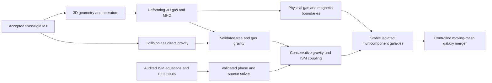

# Shared geometry, gravity and ISM integration contract

Coordinator decisions, 2026-11-22. **Design only; no 3D, gravity or ISM
implementation or acceptance is asserted.** These choices reconcile the
parallel specifications for the [galaxy-merger goal](../GALAXY_MERGER_PLAN.md):

- [3D mesh and operators](MESH_3D_SPEC.md).
- [Particles, gravity and equilibrium initial conditions](GRAVITY_PARTICLES_SPEC.md).
- [Multiphase gas and star formation](ISM_STAR_FORMATION_SPEC.md).

Their publication maps distinguish sourced equations from engineering
choices. This document owns the shared interfaces and dependency decisions,
not a replacement physical model. Contradictory interfaces must be resolved
before implementation; an implementation cannot silently choose one draft.
The pinned M1 scientific source is retained in the
[accepted fixed/rigid 2.5D archive](../../tests/reference/m1_final_acceptance/README.md).
Its fresh campaign, separate final joint review and copied outer consistency
command have completed; later components retain their own validation gates.

## Identity and immutable views

The persistent identity payload is `EntityId { namespace: u64, counter: u64 }`.
Serialize it as exactly 32 hexadecimal digits, never a JSON floating-point
number. Dataset namespaces are explicit, collision-checked run inputs;
serial counters are monotone, overflow-checked and checkpointed. Use distinct
checked `CellId(EntityId)`, `ParticleId(EntityId)` and `EventId(EntityId)`
wrappers. Event namespaces are distinct from real-entity namespaces.
The different wrappers prohibit treating a cell, image or event as a star.

Real gas cells and collisionless particles have unique IDs across the entire
run. Joining two galaxies either uses disjoint namespaces or preserves an
explicit one-time ID remapping. A newly formed star receives a new particle
ID plus parent-cell/event links. Its parent cell retains its ID and generator.
Periodic images, Riemann ghosts and reconstruction samples have no separate
gravitating entity identity. Mesh rebuilds/reordering do not reallocate IDs.

Geometry-local `u32` indices and face indices are invalid outside their
`GeometryEpoch`. A canonical face key uses the complete typed cell IDs,
periodic image offset or physical boundary patch. It has no assumed material
identity through a topology change. Check full-key equality after hashing.
Only validated immutable geometry supplies stencils, curl/transpose plans,
face exchanges or gas gravity views.

`GravityEpoch` additionally identifies physical time, state/catalog revision,
the sorted source-array hash and applicable gas geometry epoch. A gas source
event can invalidate a force cache without changing geometry. Applying a
force by storage index or checking only the geometry epoch is insufficient.
Source plans pin their full input state, geometry, model, dt and allocator
revision; retries invalidate uncommitted plans and restore accepted state.

## Units, state and exchanged quantities

One SI-based `UnitSystem` owns `L0`, `M0`, `V0`, the chosen physical G,
magnetic permeability and pinned conversion provenance. All base scales
are positive finite `f64`. Derived time is `L0/V0`; code G is derived from
these scales. A dimensionless G=1 fixture declares that convention separately.
Do not impose G=1 and three incompatible physical base scales.

The MHD convention is `mu0_code=1`, so magnetic energy density is `B^2/2`.
The gravity specification owns physical magnetic and vector-potential
conversion factors. Cooling receives an explicit cgs adapter from this same
unit map; it does not introduce a second independently configured unit system.
Its returned volumetric rates and integrated energies are converted once.
Gas mass density, hydrogen-nucleus number density and particle number density
remain distinct typed/convention-tagged quantities. Molecular weight and
ionization assumptions accompany every temperature conversion.

| Producer | Consumer | Shared contract |
| --- | --- | --- |
| Geometry | Hydro/MHD | Epoch, real cell IDs, oriented shared faces, volume, lifted centroids/generators, moments, boundary patches and quality report. Each shared conservative exchange is computed once and applied with opposite signs. |
| Conservative gas state | Gravity | Exactly one immutable source per real gas cell: total gas mass, momentum, volume and geometric volume centroid. Cold/hot phases and metals are included in that mass, not additional sources. |
| Particle catalog | Gravity | Current positive mass, physical Cartesian position, softening class, ID and component tag. Component/galaxy tags select diagnostics, never a different force law. |
| Gravity | Integrator | Force and specific potential by ID, pair energy, epoch/source hash, residuals and backend counters. Acceleration is checked `force/current_mass`; force and acceleration are not interchangeable fields. |
| Gas + phase state | ISM planner | Gas mass/momentum/total energy, volume, cold mass, thermal energy, metals, physical source time, radiation state and model identity. No mesh mutation or force solve occurs inside the local source routine. |
| Validated source plan | Atomic commit | Gas/phase/metals deltas, star birth requests, integrated energy channels, birth metadata, event/allocator changes and before/after identities. All affected state commits together or none does. |

The primary gas state remains conservative mass, momentum and total energy.
Thermal energy is recovered after subtracting kinetic and magnetic energies
and must agree with the phase state. For the first finite-phase model,
`U_th=m_c*u_c+m_h*u_h`; its pressure and the conservative energy update must
use the same thermodynamics. An equilibrium pressure reset is not a shortcut
to this consistency. Cold mass and metals need conservative transport with
the accepted gas face exchanges and explicit admissibility checks.

## Gravity, source order and birth metadata

The initial force oracle uses fixed symmetric Plummer softening and isolated
gravity in physical, non-expanding coordinates. Gas is represented by its
volume-centroid monopole; this is an explicit discretization. The same mass,
position and softening representation defines force, potential and energy.
An accelerated backend must first reproduce the accepted direct oracle and
its force/work diagnostics. Periodic minimum-image forces are not isolated
gravity and are not the first merger's force model.

The initial coupled source split is first-order in time. The validated
source transaction materializes new particles only at an accepted global
step endpoint `t_end`. New particles enter the next force evaluation; no
fraction of a preceding kick is replayed for them. Hydro-only Heun or
collisionless KDK accuracy does not prove second-order accuracy of this
combined source split. A later midpoint/Strang scheme has its own contract.

Birth metadata distinguishes:

- `activated_at=t_end`: when the particle joins the dynamical catalog.
- `formation_time=(source_start+source_end)/2`: a first-order population-age
  estimate for the integrated formation interval, not an exact birth event.
- `formation_interval`: both source interval endpoints and the integrated SFR.
- `gross_formed_mass=F`, `prompt_returned_mass=beta*F` and
  `birth_mass=current_mass=L=(1-beta)*F` in the instantaneous-recycling profile.

Local source subcycling retains one proposed packet per successful source
subinterval with nonzero L. A packet keeps that actual subinterval and its
midpoint; all packets from the outer trial activate together at its accepted
global endpoint. Thus
`formation_start <= formation_time <= formation_end <= activated_at=t_end`.
The last inequality may be strict. This explicitly resolves the independent
[ISM review's interval conflict](ISM_COOLING_DESIGN_REVIEW.md): it preserves
the declared per-interval deterministic reference and does not silently merge
packets or overwrite their intervals with the outer step. No subinterval
particle receives an earlier kick/drift. The full transaction includes the
new-new pair terms in its before/after gravity representation ledger.

Delayed return is disabled in the first profile. A later age-dependent model
must explicitly review which formation-time estimate it consumes. Initial
stars require configured formation epochs and population metadata; these
are simulation parameters, not inferred observations. Existing and new stars
use the same current-mass force and integration path.

Births initially occur at the parent volume centroid with its bulk velocity.
Gas loses exactly L and L times that velocity; internal phase exchanges and
prompt return do not add that mass a second time. Source retries consume no
IDs, random counters or ledger entries. Commit ordering is deterministic
by accepted interval, parent ID and local event ordinal. Any future stochastic
law must pin counter keys and distributions; reproducibility at the same
logical dt sequence is distinct from timestep convergence.

Gas retains A, mean flux, B and magnetic energy during the local birth source.
The ISM contract accounts separately for removed kinetic energy, cold thermal
energy carried into an unresolved stellar ledger, radiation and SN heating.
Feedback already represented by phase heating/effective pressure cannot be
injected again. The exact before/after gravitational energy, including any
co-located source-splitting/self-energy representation jump, is also recorded.
An adjusted residual never replaces the raw total-energy history or excuses
the gravity contract's representation-error convergence gate.

## Mesh motion and physical boundary gate

The merger deliverable requires a fully three-dimensional **deforming** mesh
with a validated state-dependent generator-motion policy and topology changes.
A rigid translation, prescribed geometric movie, fixed mesh or extruded 2.5D
solver is useful evidence for a subproblem, not the requested end state.
Generator velocity, volume-centroid motion and gas velocity remain distinct.
The mesh specification owns moving-face speed, volume/GCL consistency,
stage reconstruction and full-vector potential/curl coupling.

The first geometric/operator fixtures can be periodic. The isolated merger
additionally requires a validated bounded/nonperiodic gas/MHD boundary path,
explicit ambient gas and domain-size/ambient controls. Call this additional
dependency **M2d**. Its magnetic, gauge, cleaning, face and energy conditions
must be derived, reviewed and registered before execution; they are not
implied by an isolated gravity solver or a bounded tessellation library.
No periodic-gas/isolated-gravity substitution qualifies as the final merger.
The first bounded reference profile is `box-conducting-slip-relative-v1`,
specified in [the bounded MHD contract](BOUNDARY_MHD_SPEC.md): an impermeable
conducting slip box, zero normal magnetic flux, nonzero compact-support
interior A, no separately imposed mean field, and unbounded collisionless
particles with isolated gravity. This coordinator choice supersedes the
gravity draft's initial hydro-outflow proposal for the first coupled profile.
General outflow remains a separate deferred physical model.

The continuum wall choice does not accept its proposed discrete operators.
Constrained fits, cleaning adjoints, bounded curl/projection/GCL coupling and
a globally compatible reflection fixture require independent review and
REANA evidence. Signed wall impulses, torques and work enter the component
ledgers; stationary walls doing zero work do not prove negligible reflection.
Domain/ambient controls must bound interior effects before galaxy acceptance.
The initial merger's field topology must satisfy this profile. M2d remains
unimplemented and unaccepted.

## Implementation dependency and final evidence

After scoped M1 acceptance, standalone 3D geometry/operator work and the
collisionless direct-gravity reference may proceed in parallel. Pure ISM
algebra/rate work can be developed separately after its source inputs are
audited. Each new numerical implementation first passes its own immutable
REANA preflight and relevant independent fixtures. Coupling waits for the
participating component gates; independent module progress does not waive
the coupled gates.

The dependency for the final simulation remains complete:

The final demonstration has live dark matter, gas and existing/new stars,
nonzero magnetic fields, self-gravity and active multiphase star formation.
Its newborn stars alter the same live gravity system. It includes a completed
configured encounter, accepted isolated initial conditions, timestep/mass/
softening/domain controls, restart parity, component/source/boundary ledgers,
mesh and all named magnetic-divergence diagnostics, projected outputs and
provenance. A collisionless-only merger is an earlier G1/G4 deliverable.

Every new executable test/evolution runs on REANA. Independent ready cases
have separate concurrent workflows with explicit per-job threads/memory;
there is no aggregate CPU cap. Preserve build/physical prerequisites, stop
dependent escalation on verified failures, and distinguish missing observations
from physical failure or success. Register case values, reference uncertainty,
norms and tolerances before execution. Each component's prospective tables
must become concrete frozen fixture packets before they can prove acceptance.

Source review and independent output reduction remain separate from a runner's
green verdict. Data reuse requires exact identity of **every** input consumed,
including geometry/projection bins. Neither a source contract nor passing
small algebra tests establish AREPO equivalence, galaxy realism or completion
of this goal.
