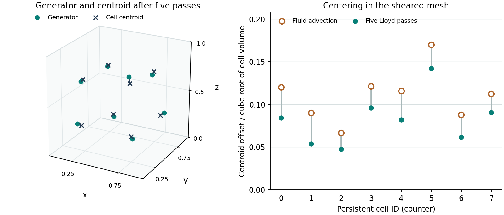

# Predictive Lloyd motion of 3D gas mesh generators

The opt-in `moving_mesh::three_d::predict_lloyd_step3` function advances a validated 3D Voronoi mesh through a specified interval using one fluid velocity and sound speed per persistent gas cell. It returns the generator velocities and the validated endpoint mesh. This is the geometric, volume-centroid variant of the predictive Lloyd method implemented in AREPO by Mocz et al. [Method, section 2, equations 1–3](https://arxiv.org/pdf/1503.07868#page=2).

## Update

Let $\mathbf r_i$ be the initial generator position, $\mathbf v_i$ the prescribed fluid velocity, and $\Delta t>0$. The first prediction uses $\mathbf w_i^{(0)}=\mathbf v_i$. At each iteration, build a fresh Voronoi mesh at $\mathbf r_i+\Delta t\,\mathbf w_i^{(k)}$ and obtain its volume centroids $\mathbf c_i^{(k)}$. All cells use this same prediction. With a chosen fraction $f$, define

$$
\mathbf d_i=\mathbf c_i^{(k)}-(\mathbf r_i+\Delta t\,\mathbf v_i),\qquad
\mathbf w_i^{(k+1)}=\mathbf v_i+
  \frac{\mathbf d_i}{\Delta t}\min\!\left(1,\frac{f c_{s,i}\Delta t}{\lVert\mathbf d_i\rVert}\right).
$$

Zero displacement gives zero correction. Omitting the limiter gives $\mathbf w_i^{(k+1)}=(\mathbf c_i^{(k)}-\mathbf r_i)/\Delta t$. The opt-in default takes up to five iterations with $f=0.1$. Zero iterations or a zero limiter fraction gives fluid advection. A fraction of one permits a correction up to the local sound speed. The implementation ends early if every generator velocity is exactly unchanged.

Positions and box widths share length units, $\Delta t$ uses time units, and fluid velocities and sound speeds use the corresponding speed units. Centroids assume uniform density within each cell. On a periodic box the displacement uses the continuous trajectory through the boundary. Wrapped primary positions and signed image counts are returned separately. On a bounded box, a generator that reaches or crosses a wall rejects the step. Geometry errors propagate to the caller, which retains the initial mesh. Each changed prediction requires one complete rebuild using the serial half-space reference.

A small, centred cell can keep its fluid velocity. The correction responds to the offset of its predicted generator from its centroid. Cell splitting and merging belong to mesh adaptation. The current implementation covers prescribed mesh motion. Conservative moving-face fluxes, magnetic evolution and particle forces have their own integration paths.

## Run one step

From the repository root, the eight-cell shear example uses

~~~sh
cargo run --release -p moving-mesh --example lloyd3-step -- \
  docs/galaxy/fixtures/lloyd3_shear.txt 0.25 5 0.1
~~~

The final arguments are the timestep, correction count and sound-speed fraction (`none` selects the uncapped update). The input starts with `domain periodic|bounded x0 y0 z0 Lx Ly Lz`. Each `cell` line supplies a 32-hex-digit ID, three primary coordinates, three signed winding integers, three fluid velocity components and the local sound speed. The CSV reports each ID, endpoint coordinates and windings, mesh velocity, cell volume and endpoint centroid displacement. [Input catalog](fixtures/lloyd3_shear.txt) · [Rust interface](../../crates/moving-mesh/src/three_d/lloyd.rs) · [Independent test cases](../../crates/moving-mesh/tests/lloyd3.rs).

## Measured shear step on REANA

Eight irregular generators in the bounded unit cube moved for $\Delta t=0.25$ in the prescribed shear $v_x=(y-0.5)/4$, with $v_y=v_z=0$ and $c_s=1$. Two independent workflows ran the same release executable and the same input catalog. For each endpoint cell the centering error is $e_i=\lVert\mathbf c_i-\mathbf r_i^{\rm end}\rVert/V_i^{1/3}$.

| Generator motion | RMS centering error | Maximum centering error | Total volume |
| --- | ---: | ---: | ---: |
| Fluid advection | 0.114104 | 0.169886 | 1.000000 |
| Five Lloyd passes, $f=0.1$ | 0.086786 | 0.141925 | 1.000000 |

The RMS centering error fell by **23.9%** for this step. The largest measured speed correction was 0.10000000000000003 in code units. Both endpoint volumes summed to the box volume within $1.2\times10^{-16}$.

The CSV files contain the endpoint coordinates, velocities and centroid offsets used in the figure. The validation record identifies the compiled source, executables, individual test workflows and both example runs. [Advection CSV](results/lloyd3_shear/shear-0.csv) · [Lloyd CSV](results/lloyd3_shear/shear-5.csv) · [Validation record](results/lloyd3_shear/validation.json).
