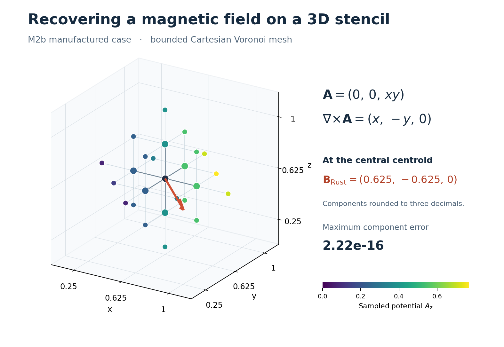

# M2b static operators in three dimensions

The Rust reference recovers a point-sampled magnetic field from vector potential on a fixed Voronoi geometry. The magnetic field at the central cell in the figure below comes from an actual REANA comparison with the manufactured field $A_z=xy$. The points are the 24 cell centroids in its two-ring stencil. [Registered tests and thresholds](MESH_3D_SPEC.md#9-prospective-reana-fixtures-gates-and-dependencies) · [Workflow and input hashes](results/m2b_operators/o01_example/origin.json).

## Operators

Write $J_{ka}=\partial_a A_k$, with field component first and coordinate second. The magnetic recovery uses

$$
\mathbf B=\mathbf B_0+
  (J_{zy}-J_{yz},\ J_{xz}-J_{zx},\ J_{yx}-J_{xy}).
$$

Each fit evaluates at the geometric centroid. For $h=V_i^{1/3}$, the design uses the three components of the dimensionless displacement $d/h$. The linear basis has a free intercept and three first derivatives. The quadratic basis adds the three diagonal terms divided by two and the three mixed terms. Linear observations carry face-area weights. The quadratic objective weights each observation by $1/|d|$. A column-pivoted Householder QR factors the column-normalized weighted rectangular matrix. After restoring its column scales and permutation, the implementation converts first and second derivatives back to physical length units. [Point fits](../../crates/moving-mesh/src/three_d/fit/mod.rs) · [QR and condition decisions](../../crates/moving-mesh/src/three_d/fit/qr.rs).

The implementation sorts observations by persistent cell ID and periodic image. It subtracts the first sample value before applying derivative rows. The assembled curl coalesces repeated real owners and scatters the equal-and-opposite baseline contribution in its transpose. Rank and conditioning decisions use the registered pivot ratio and triangular 1-norm condition estimate, with outward enclosures through the selected factorization. The small manufactured cases also measure independent LAPACK singular values. [Geometry and stencil construction](../../crates/moving-mesh/src/three_d/operator_mesh.rs) · [Magnetic operators](../../crates/mhd-vector-pot/src/operators3.rs).

## What the Fourier measurements test

The periodic unit cube contains $N^3$ generators for $N=8,16,32$. One grid is Cartesian. The other displaces each coordinate by up to 15% of the spacing using the original G02 counter-based seed 20261122. At the actual cell centroids the input is

$$
\mathbf A=(\sin 2\pi y\sin 2\pi z,\ \sin 2\pi z\sin 2\pi x,\ \sin 2\pi x\sin 2\pi y).
$$

The first analytic curl component is $2\pi\sin(2\pi x)[\cos(2\pi y)-\cos(2\pi z)]$. Cyclic permutations give the other two. The cases use zero imposed mean and $\mathbf B_0=(0.3,-0.2,0.4)$. The curl error is the volume-weighted mean Euclidean error divided by the volume-weighted mean magnitude of the analytic fluctuating field. The report also retains the error relative to the fixed field scale $2\pi$.

The benchmark builds regular metrics analytically. For the jittered family it obtains a periodic ridge inventory with SciPy/Qhull, then integrates each oriented polygon and its generator-based pyramids. Two image layers suffice here. Every point lies within $\sqrt{3}(0.5+0.15)/N$ of a generator, while a three-index separation is at least $2.7/N$. A generator beyond twice the covering radius cannot cut the focal cell. The N=8 cross-check compares the full owner/image keys, centroids, volumes, normals and face areas with the accepted M2a Rust output. The proof of the halo size uses the registered jitter bound. [Benchmark geometry](../../reana/m2b_periodic_geometry.py) · [M2a comparison input](results/m2a_general_20261125/repaired-base-results.json).

Three independent divergences accompany each recovered field. One traces a new linear fit to neighbouring magnetic samples. Two sum face fluxes, using respectively the mean of the two samples and independently slope-limited linear reconstructions. A fourth diagnostic traces the curl Jacobian from the same quadratic potential Hessians. Each shared face contributes once with opposite signs. The case reports retain dimensional and locally scaled divergences, signed volume means, RMS values, maxima, weak-field locations and the magnetic mean error. [Fourier driver](../../crates/mhd-vector-pot/examples/m2b-o02.rs) · [Independent reduction](../../scripts/summarize_m2b_operators.py).

On the uniform cubic grid, symmetry makes the face-mean divergence of this particular Fourier field zero in exact arithmetic. For example, the two mixed differences acting on $A_z=\sin(2\pi x)\sin(2\pi y)$ cancel. Binary64 may leave a residual of order machine precision times a derivative scale. The registered criterion still tests strict RMS decrease at both refinements. Applying the same face formula to the sampled analytic field gives an independent measurement of the geometric interpolation contribution on each mesh.

## Auxiliary velocity and adjoint controls

The uniform periodic auxiliary grid shares the eight corner jets $u,u_x,u_y,u_z,u_{xy},u_{xz},u_{yz},u_{xyz}$ between adjacent cells. Tricubic Hermite interpolation differentiates the same polynomial for all nine velocity-Jacobian entries. Periodic cubic B-spline deposition sums aliased weights, weights each generator by volume in persistent-ID order and retains the attempted 4/2/1 root grids. The tests cover the 64 tensor monomials on anisotropic cells, all coordinate faces and periodic seams, volume weighting, empty supports and translated origins. Two nonzero dot-product tests and two gauge-constant tests exercise the linear and quadratic curl on actual M2a geometry. M2c covers evolving mesh geometry. [Auxiliary implementation](../../crates/mhd-vector-pot/src/auxiliary3.rs) · [Registered Rust controls](../../crates/mhd-vector-pot/tests/m2b_operators.rs).

### Unequal-wave-number diagnostic

The measured zero-mean regular-grid face RMS increases from approximately $1.2\times10^{-14}$ at $8^3$ to $3.4\times10^{-14}$ at $32^3$. To distinguish symmetry cancellation from a defective derivative, a separate short control uses $A_z=\sin(2\pi x)\sin(4\pi y)$, $A_x=A_y=0$, with the same binary, mesh sizes and face-sum rule. Its analytic field is $(4\pi\sin(2\pi x)\cos(4\pi y),-2\pi\cos(2\pi x)\sin(4\pi y),0)$. The unequal wave numbers break the exchange symmetry of the registered example. The control records the dimensional face RMS of both the recovered and exact sampled fields at each resolution. The original O02 verdict uses the original field and strict RMS criterion. [Diagnostic source](../../reana/m2b_mixed_mode.py).
