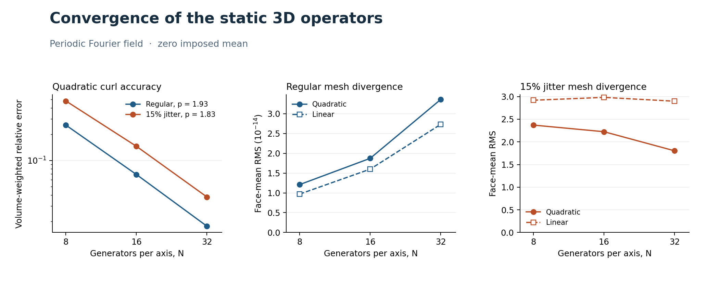

# M2b static operators in three dimensions

**November 27, 2026. M2b remains open on the face-mean divergence criterion.**
All 87 polynomial and rank cases and all 74 auxiliary controls passed.
The quadratic curl met both accuracy
thresholds in all four Fourier refinement sequences. The registered face RMS
must decrease at both refinements. It rose at roundoff scale on the regular
meshes and at the first refinement of the linear fit on the jittered meshes.


The figure samples 125 cell centroids from the 32³ zero-mean jittered run.
Every arrow has the same displayed length. Color gives the signed $B_z$.

| Mesh, zero imposed mean | Relative quadratic curl error at 8³ / 16³ / 32³ | Fitted order | Quadratic face-mean divergence RMS at 8³ / 16³ / 32³ |
| --- | --- | --- | --- |
| Regular | 25.42% / 6.90% / 1.76% | 1.926 | 1.21×10⁻¹⁴ / 1.87×10⁻¹⁴ / 3.36×10⁻¹⁴ |
| 15% jitter in each coordinate | 48.10% / 14.53% / 3.81% | 1.830 | 2.371 / 2.224 / 1.803 |

The imposed-mean cases give the same curl errors to the displayed precision
and the same pass/fail decisions. The quadratic order threshold is 1.8 and
the finest relative error limit is 10%. The largest normalized signed flux
sum over all 12 runs and both fits is $4.13\times10^{-17}$, within the
$10^{-12}$ bound. Local divergence remains measurable despite cancellation
in the signed sum. At 32³ with jitter and zero mean the quadratic field gives
RMS values of 1.024 for the cell fit, 1.803 for the face mean and 1.375 for
the limited face reconstruction. Tracing the Hessians of the same potential
fit gives $2.57\times10^{-15}$.



## Polynomial reproduction

The Rust reference recovers a point-sampled magnetic field from vector potential on a fixed Voronoi geometry. The magnetic field at the central cell in the figure below comes from an actual REANA comparison with the manufactured field $A_z=xy$. The points are the 24 cell centroids in its two-ring stencil. [Registered tests and thresholds](MESH_3D_SPEC.md#9-prospective-reana-fixtures-gates-and-dependencies) · [Workflow and input hashes](results/m2b_operators/o01_example/origin.json).


## Operators

Write $J_{ka}=\partial_a A_k$, with field component first and coordinate second. The magnetic recovery uses

$$
\mathbf B=\mathbf B_0+
  (J_{zy}-J_{yz},\ J_{xz}-J_{zx},\ J_{yx}-J_{xy}).
$$

Each fit evaluates at the geometric centroid. For $h=V_i^{1/3}$, the design uses the three components of the dimensionless displacement $d/h$. The linear basis has a free intercept and three first derivatives. The quadratic basis adds the three diagonal terms divided by two and the three mixed terms. Linear observations carry face-area weights. The quadratic objective weights each observation by $1/|d|$. A column-pivoted Householder QR factors the column-normalized weighted rectangular matrix. After restoring its column scales and permutation, the implementation converts first and second derivatives back to physical length units. [Point fits](../../crates/moving-mesh/src/three_d/fit/mod.rs) · [QR and condition decisions](../../crates/moving-mesh/src/three_d/fit/qr.rs).

The implementation sorts observations by persistent cell ID and periodic image. It subtracts the first sample value before applying derivative rows. The assembled curl coalesces repeated real owners and scatters the equal-and-opposite baseline contribution in its transpose. Rank and conditioning decisions use the registered pivot ratio and triangular 1-norm condition estimate, with outward enclosures through the selected factorization. The small manufactured cases also measure independent LAPACK singular values. [Geometry and stencil construction](../../crates/moving-mesh/src/three_d/operator_mesh.rs) · [Magnetic operators](../../crates/mhd-vector-pot/src/operators3.rs).

## What the Fourier measurements test

The periodic unit cube contains $N^3$ generators for $N=8,16,32$. One grid is Cartesian. The other displaces each coordinate by up to 15% of the spacing using the original G02 counter-based seed 20261122. At the actual cell centroids the input is

$$
\mathbf A=(\sin 2\pi y\sin 2\pi z,\ \sin 2\pi z\sin 2\pi x,\ \sin 2\pi x\sin 2\pi y).
$$

The first analytic curl component is $2\pi\sin(2\pi x)[\cos(2\pi y)-\cos(2\pi z)]$. Cyclic permutations give the other two. The cases use zero imposed mean and $\mathbf B_0=(0.3,-0.2,0.4)$. The curl error is the volume-weighted mean Euclidean error divided by the volume-weighted mean magnitude of the analytic fluctuating field. The report also retains the error relative to the fixed field scale $2\pi$.

The benchmark builds regular metrics analytically. For the jittered family it obtains a periodic ridge inventory with SciPy/Qhull, then integrates each oriented polygon and its generator-based pyramids. Two image layers suffice here. Every point lies within $\sqrt{3}(0.5+0.15)/N$ of a generator, while a three-index separation is at least $2.7/N$. A generator beyond twice the covering radius cannot cut the focal cell. The N=8 cross-check compares the full owner/image keys, centroids, volumes, normals and face areas with the accepted M2a Rust output. The proof of the halo size uses the registered jitter bound. [Benchmark geometry](../../reana/m2b_periodic_geometry.py) · [M2a comparison input](results/m2a_general_20261125/repaired-base-results.json).

Three independent divergences accompany each recovered field. One traces a new linear fit to neighbouring magnetic samples. Two sum face fluxes, using respectively the mean of the two samples and independently slope-limited linear reconstructions. A fourth diagnostic traces the curl Jacobian from the same quadratic potential Hessians. Each shared face contributes once with opposite signs. The case reports retain dimensional and locally scaled divergences, signed volume means, RMS values, maxima, weak-field locations and the magnetic mean error. [Fourier driver](../../crates/mhd-vector-pot/examples/m2b-o02.rs) · [Independent reduction](../../scripts/summarize_m2b_operators.py).

On a uniform cubic grid, both the six-neighbour linear derivative and the arithmetic face-mean derivative reduce to $D_a q_i=(q_{i+e_a}-q_{i-e_a})/(2h)$. These periodic differences commute, so the divergence of the linear discrete curl vanishes in exact arithmetic. For the quadratic stencil the exchange symmetry of the equal-wave-number modes also cancels the two mixed terms acting on each potential component. Binary64 leaves a residual near roundoff. Strict decrease at both refinements is the original criterion. Applying the same face formula to the sampled analytic field gives an independent measurement of the geometric interpolation contribution.

## Auxiliary velocity and adjoint controls

The uniform periodic auxiliary grid shares the eight corner jets $u,u_x,u_y,u_z,u_{xy},u_{xz},u_{yz},u_{xyz}$ between adjacent cells. Tricubic Hermite interpolation differentiates the same polynomial for all nine velocity-Jacobian entries. Periodic cubic B-spline deposition sums aliased weights, weights each generator by volume in persistent-ID order and retains the attempted 4/2/1 root grids. The tests cover the 64 tensor monomials on anisotropic cells, all coordinate faces and periodic seams, volume weighting, empty supports and translated origins. Two nonzero dot-product tests and two gauge-constant tests exercise the linear and quadratic curl on actual M2a geometry. M2c covers evolving mesh geometry. [Auxiliary implementation](../../crates/mhd-vector-pot/src/auxiliary3.rs) · [Registered Rust controls](../../crates/mhd-vector-pot/tests/m2b_operators.rs).

All 74 Rust tests passed in independent REANA workflows. The 64 monomials
and three shared-face and periodic-seam tests had zero measured error on
their dyadic samples. The two relative adjoint errors were
$1.07\times10^{-14}$ (linear) and $1.83\times10^{-15}$ (quadratic), below
the $10^{-12}$ limit. Constant vector potentials produced zero curl in
both fits. The largest
volume-weighted one-root mean error was $4.44\times10^{-16}$.

The packet contains 71 results from the original submissions and three from
input-identical replacements. The three originals had zero backend jobs
after more than 25 minutes. All four remote inputs per workflow matched
the release before the replacements were selected. The run records preserve
the original UUIDs and queue states as well as the finished replacements.
[Original and replacement identities](results/m2b_operators/auxiliary-origins.json).

### Unequal-wave-number diagnostic

The measured zero-mean regular-grid face RMS increases from approximately $1.2\times10^{-14}$ at $8^3$ to $3.4\times10^{-14}$ at $32^3$. To distinguish symmetry cancellation from a defective derivative, a separate short control uses $A_z=\sin(2\pi x)\sin(4\pi y)$, $A_x=A_y=0$, with the same binary, mesh sizes and face-sum rule. Its analytic field is $(4\pi\sin(2\pi x)\cos(4\pi y),-2\pi\cos(2\pi x)\sin(4\pi y),0)$. The unequal wave numbers break the exchange symmetry of the registered example. The control records the dimensional face RMS of both the recovered and exact sampled fields at each resolution. The original O02 verdict uses the original field and strict RMS criterion. [Diagnostic source](../../reana/m2b_mixed_mode.py).

| Field used for the shared-face sum | 8³ | 16³ | 32³ |
| --- | ---: | ---: | ---: |
| Quadratic curl | 1.608 | 0.755 | 0.219 |
| Analytic magnetic field sampled at cell centroids | 10.410 | 2.928 | 0.754 |
| Linear curl | 8.38×10⁻¹⁵ | 1.44×10⁻¹⁴ | 2.40×10⁻¹⁴ |

The quadratic control shows a decreasing truncation error once the symmetry
is broken. The linear differences still commute on this mesh.

### Where the irregular face flux is sampled

On the jittered mesh the linear curl gives face-mean divergence RMS values of 2.919, 2.982 and 2.898 at the three resolutions. Even exact cell-centred magnetic samples give 2.359, 1.802 and 1.609. A separate diagnostic evaluates the analytic field at each polygon's face centroid. It compares that flux with the original two-centroid mean and measures the leading displacement term $J_B(x_f)[(x_L+x_R)/2-x_f]$ on every face. All coordinates use the same periodic image. The calculation verifies the byte identity of the entire original Rust geometry and potential input. [Face-location diagnostic](../../reana/m2b_face_location.py).

| Exact-field diagnostic | 8³ | 16³ | 32³ |
| --- | ---: | ---: | ---: |
| Face-mean divergence RMS from the two cell samples | 2.359 | 1.802 | 1.609 |
| Divergence RMS with the analytic field at the polygon centroid | 0.616 | 0.305 | 0.152 |
| RMS midpoint-to-face-centroid displacement, in grid spacings | 0.0582 | 0.0590 | 0.0590 |
| Correlation of the predicted displacement term with the measured divergence difference | 0.905 | 0.962 | 0.989 |

At 32³ the field-sampling location accounts for a substantial part of the
irregular-mesh residual even when the input magnetic field is analytic. The
remaining face-centroid value includes the error of using one quadrature
point per face. The recovered linear and quadratic fields add their own curl
errors. These diagnostics establish a numerical reason to test a face-aware
reconstruction on independent irregular meshes. [Six diagnostic workflow outputs](results/m2b_operators/diagnostics.json).

## Reproduce the reductions and figures

The output archive retains the original reference fixtures, candidate stdout,
full cell fields and per-workflow download receipts. The reducer rechecks the
hashes, decodes the polynomial derivative words, recalculates the analytic
curl and volume-weighted errors, and reads the exact Rust test outcomes.
The published figures used Python 3.9.6, NumPy 2.0.2 and Matplotlib 3.9.4.
The Fourier jobs ran with Python 3.11.6, NumPy 1.26.4 and SciPy 1.11.3.
[Build and runtime identities](results/m2b_operators/builds.json) ·
[Output archive](results/m2b_operators/workflow-outputs.tar.gz) ·
[Archive SHA-256](results/m2b_operators/archive.json) ·
[Reduced case results](results/m2b_operators/summary.json).

From the repository root, run

```sh
packet=docs/galaxy/results/m2b_operators
out=$(mktemp -d)
tar -xzf "$packet/workflow-outputs.tar.gz" -C "$out"
python3 scripts/summarize_m2b_operators.py "$out/o01-gate.json" "$out/O02" \
  "$out/O03" "$out/summary.json" --polynomial-outputs "$out"
python3 scripts/plot_m2b_fourier.py "$out/summary.json" \
  "$out/O02/workflow/openmhd-m2b-o02-3531889-010/outputs/fields.npz" "$out/figures"
```

A successful reduction prints the original scientific verdict, including any
failed refinement criterion. The local output directory holds the regenerated
figures and all measured cell fields.
