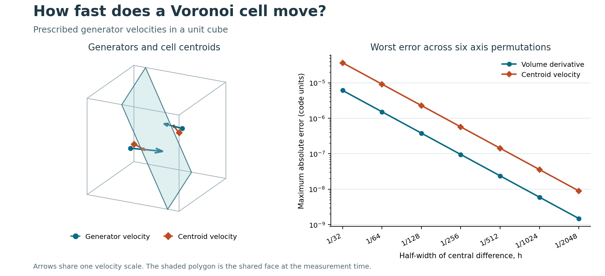

# Volume and centroid motion on a 3D Voronoi mesh

A mesh generator can move inside a cell whose centroid stays still. For example, in a bounded box with one generator and fixed walls, the box is the entire cell for every generator position. With multiple generators, even the rotation of a shared face can shift a centroid. M2c's first operator computes the velocity of the actual geometric centroid and the instantaneous volume change from the prescribed generator motion.

## Rust interface

Call `prescribed_motion_rates3` with a validated geometry, a velocity for every persistent cell ID, and the common velocity of the cuboid walls. Use zero for stationary walls. The periodic case uses the velocities of the real generators at both ends of each image pair. Position, velocity and time must use one consistent unit system. The returned rates use the geometry's epoch. Rebuild the mesh and recompute the rates when the geometry changes. [Rust implementation](../../crates/moving-mesh/src/three_d/motion.rs).

```rust
let rates = prescribed_motion_rates3(&geometry, &generator_velocities, [0.0; 3])?;
let handle = geometry.cell_by_id(id).ok_or("unknown cell ID")?;
let cell = rates.cell(handle)?;
let d_volume_dt = cell.volume_rate;
let d_centroid_dt = cell.centroid_velocity;
```

## Face motion and cell moments

For a shared face of area $A_f$, let $\boldsymbol n$ point from the left generator to the lifted right generator. Let $d$ be their separation, $\boldsymbol m$ their midpoint and $\boldsymbol f$ the face area centroid, all in the same chart. With generator velocities $\boldsymbol w_L,\boldsymbol w_R$, the normal speed is affine across the face. Its value at the area centroid and its tangential gradient are

$$
u_f = \tfrac12(\boldsymbol w_L+\boldsymbol w_R)\cdot\boldsymbol n
 + (\boldsymbol w_L-\boldsymbol w_R)\cdot(\boldsymbol f-\boldsymbol m)/d,
\qquad
\boldsymbol\gamma_f = (I-\boldsymbol n\boldsymbol n^T)(\boldsymbol w_L-\boldsymbol w_R)/d .
$$

For each cell of volume $V_i$ and centroid $\boldsymbol c_i$, integrate the face motion with its incidence sign $s_{if}$. The area-averaged face covariance $M_f$ comes from the static geometry. The covariance term accounts for the change in first moment when one part of a face moves faster than another.

$$
\dot V_i = \sum_f s_{if} A_f u_f,\qquad
\dot{\boldsymbol c}_i = \frac{1}{V_i}\sum_f s_{if} A_f
 \left[(\boldsymbol f_i-\boldsymbol c_i)u_f+M_f\boldsymbol\gamma_f\right].
$$

The implementation evaluates each canonical shared-face flux once, then applies opposite signs in the two owner charts. A face between a cell and its own periodic image contributes twice, with distinct centroid offsets. A translating physical wall has $u_f=\boldsymbol w_{\rm wall}\cdot\boldsymbol n$ and $\boldsymbol\gamma_f=0$. These identities apply on a smooth mesh branch. [Equation derivation and scope](MOVING_MHD_STAGE_SPEC.md#3-actual-centroid-velocities-and-differentiated-curl) · [Preregistered test inputs and thresholds](M2C_CENTROID_PROTOCOL.md).

## Measured REANA results

The frozen Rust 1.85.1 release build passed the workspace format and strict Clippy checks. The 42 oblique cases and eight controls all passed in separate REANA workflows. A subsequent REANA workflow independently integrated the bisector columns using rational arithmetic and checked both cells at all three observation times. Replaying the archived outputs produced the same summary bytes.



| Quantity | Minimum observed order | Largest error at $h=1/2048$ |
| --- | ---: | ---: |
| Cell volume derivative | 1.999952 | 1.484e-09 |
| Centroid velocity, maximum component | 2.000001 | 8.916e-09 |

Each minimum covers all six adjacent refinements in each of six axis permutations. The largest absolute difference from the exact shape or rate was 1.110e-16 in the fixture's code units. The largest centroid–generator velocity difference was at least 0.09570 in every case. Omitting the rotating face's covariance term changed a centroid velocity component by 0.08854. The periodic controls include a face shared with the same generator's image and a two-owner slab crossing the seam. [Raw packet, workflow IDs and build records](results/m2c_centroid/measurements.tar.gz) · [Per-spacing measurements](results/m2c_centroid/summary.json) · [Archive and reduction identities](results/m2c_centroid/manifest.json).

From the repository root, replay the original outputs with Python's standard library. Matplotlib is needed only to regenerate the figure.

```sh
packet=docs/galaxy/results/m2c_centroid/measurements.tar.gz
python3 scripts/review_m2c_centroid.py "$packet" /tmp/m2c-centroid-summary.json
cmp /tmp/m2c-centroid-summary.json docs/galaxy/results/m2c_centroid/summary.json
python3 scripts/plot_m2c_centroid.py "$packet" /tmp/m2c-centroid-summary.json /tmp/m2c-centroid-rates.png
```

The archive contains the frozen source, release test executable, workflow specifications, input digests and raw native outputs. For a new scientific run, select one Rust method per REANA workflow. For example, the native test target is `centroid_rates3` and the selection `xyz::h128` rebuilds the two endpoint geometries at $t=\pm1/128$.

The next operator is `S-CDOT`, the time derivative of the discrete curl as the mesh moves, with field samples held fixed. Finite-step volume conservation, topology changes and coupled 3D MHD have separate gates. [M2c and moving-field validation sequence](MOVING_MHD_STAGE_SPEC.md#11-prospective-independent-reana-packets-and-next-review).
