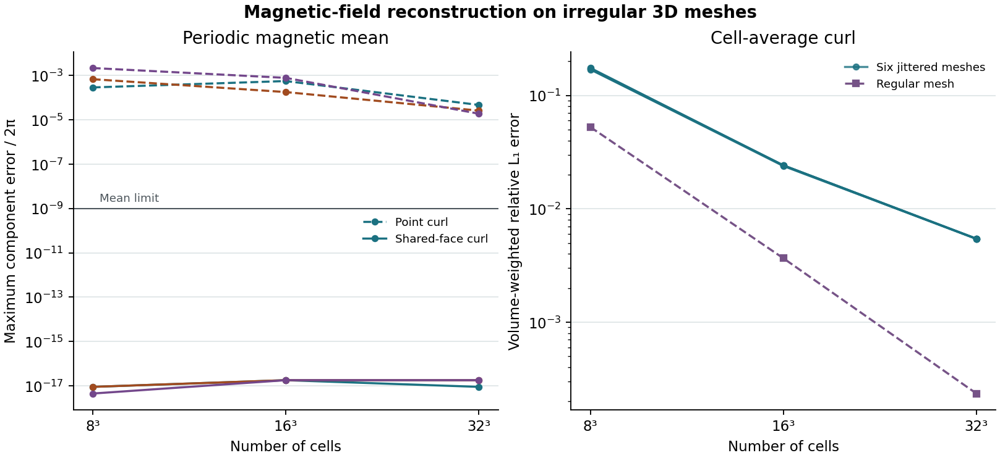

# M2c moving-curl results

The periodic point-curl derivative passes the registered smooth-motion tests. The same point-curl reconstruction fails the configured magnetic mean at initialization on all three jittered mesh families. These measurements address different questions. The derivative checks how the operator changes with geometry. The initialization check tests whether the operator can supply a physically admissible periodic field for a moving run.

## Point-curl derivative

For fixed real-owner potential samples, the implementation differentiates the free-intercept weighted quadratic fit using its original scaled pivoted QR factors. It includes centroid motion, volume scaling, inverse-distance weights and the least-squares residual. The transpose and volume-weighted diagonal operate on real-owner coefficients after combining repeated images and the baseline sample. Each operator belongs to a single validated geometry epoch and prescribed velocity field. [Implementation](../../crates/mhd-vector-pot/src/operators3/motion.rs) · [Protocol](M2C_VALIDATION_PROTOCOL.md).

All 10 selections passed in separate REANA workflows. On the 27-cell periodic deformation, the maximum scaled error against central differences of independently rebuilt endpoint curls decreased from 4.95724×10⁻⁶ at step 1/16 to 1.21001×10⁻⁹ at 1/1024. The six successive orders ranged from 1.99996 to 2.00036. The finest-error limit was 10⁻⁷. The largest local scaled QR condition estimate was 10.80. Separate tests covered the polynomial chain rule with moving samples, volume-weighted diagonal, transpose, constants, rigid motion and stale geometry/velocity rejection. The remote reduction and portable replay agree. [Numerical results and workflow IDs](results/m2c_moving/point-cdot.json) · [Raw cases, native executable and build receipts](results/m2c_moving/point-cdot.tar.gz) · [Reduction receipt](results/m2c_moving/point-cdot-reduction-workflow.json).

## Magnetic mean before the first moving timestep

Each of the 24 workflows used the original native M2b field and Voronoi volumes. The table gives the largest component of the volume-weighted mean error divided by 2π, taking the worse of the two imposed means. The registered limit is 10⁻⁹. Both imposed means passed on every regular mesh and failed on every jittered mesh. Exact rational summation of the stored binary64 words confirms the offset. [All measurements](results/m2c_moving/initial-mean.json) · [Original and new workflow receipts](results/m2c_moving/initial-mean.tar.gz).

| Mesh family | 8³ cells | 16³ cells | 32³ cells |
| --- | ---: | ---: | ---: |
| Regular | 1.688e-17 | 7.625e-18 | 1.155e-17 |
| Original jitter | 2.913e-04 | 5.649e-04 | 4.713e-05 |
| Fresh jitter A | 6.855e-04 | 1.800e-04 | 2.614e-05 |
| Fresh jitter B | 2.186e-03 | 7.880e-04 | 1.895e-05 |

## Shared-face candidate

`periodic-shared-face-quadratic-curl-v1` retains the potential as a centroid point sample. It integrates each owner's quadratic over the actual polygon using its surface covariance, averages the two face values, and applies one signed curl exchange to both adjoining cells. The magnetic result is a cell average. Its acceptance depends on its own reconstruction, moving derivative, field evolution and energy tests. [Rust interface](../../crates/mhd-vector-pot/src/operators3/shared_face.rs) · [Validation protocol](M2C_SHARED_FACE_VALIDATION.md).

### Cell-average field and divergence

All 42 REANA spatial cases used the same native Rust executable, with seven periodic meshes, two imposed means and three resolutions. All 42 passed the mean budget. The largest component error divided by 2π was 1.767×10⁻¹⁷ against a limit of 10⁻⁹. All 14 refinement sequences passed the field-error requirements. The table gives the nonzero-mean results. The zero-mean results agree to the displayed precision. Independent integration of the Fourier curl over each actual cell gave a maximum normalized reference bound of 2.001×10⁻¹². The REANA reduction and the local replay agreed on all 831 reported values and identities. [All levels, norms and workflow IDs](results/m2c_moving/shared-face/summary.json) · [Original measurements by family](results/m2c_moving/shared-face/manifest.json) · [Portable replay](../../scripts/review_m2c_shared_face.py).

| Mesh | Relative L1 at 8³ | Relative L1 at 16³ | Relative L1 at 32³ | Order |
| --- | ---: | ---: | ---: | ---: |
| Regular | 0.05260 | 0.003662 | 0.0002351 | 3.903 |
| Jitter seed 1 | 0.17427 | 0.02402 | 0.005434 | 2.502 |
| Jitter seed 2 | 0.17433 | 0.02406 | 0.005439 | 2.501 |
| Jitter seed 3 | 0.17066 | 0.02413 | 0.005431 | 2.487 |
| Original M2b jitter | 0.16941 | 0.02417 | 0.005443 | 2.480 |
| Fresh jitter A | 0.17304 | 0.02418 | 0.005446 | 2.495 |
| Fresh jitter B | 0.16982 | 0.02384 | 0.005448 | 2.481 |

The left panel follows the three original M2b jitter families at the nonzero imposed mean. The right panel includes all six irregular families and the regular cube.



The volume-weighted RMS of each independent divergence decreased on every irregular ladder. On the regular equal-wave grid, the zero-mean cell-fit RMS went from 1.71×10⁻¹⁴ to 2.78×10⁻¹⁴ to 9.58×10⁻¹⁴. The arithmetic-face RMS went from 1.16×10⁻¹⁴ to 2.73×10⁻¹⁴ to 9.67×10⁻¹⁴. Both regular ladders therefore failed the registered strict-decrease rule. The limited-face RMS decreased. The largest absolute volume-weighted signed arithmetic-face divergence over the full campaign was 5.28×10⁻¹⁶.

On a uniform cube the independent cell-fit and arithmetic-face derivatives have the centered symbol i sin(kₐh)/h. Coordinate exchange and axis reflection are symmetries of the full quadratic fit and of the shared-face integration. For a Fourier component with wave vector (k, ±k, 0), those symmetries give equal or opposite x and y curl-derivative symbols. The two mixed contributions to the divergence cancel in exact arithmetic. The original potential is a sum of these modes and their cyclic permutations. As a diagnostic comparison, every recorded residual from these two operators was below 0.53% of the earlier M2b cube roundoff allowance. The M2c verdict above uses the original strict-decrease rule. [Earlier bound and assumptions](M2B_CLOSURE_PROTOCOL.md).

The three separately registered unequal-wave cube controls broke the x–y exchange symmetry. The cell-fit and arithmetic-face RMS then each decreased from 3.10836 to 2.20475 to 0.70277. An independent arithmetic flux reconstructed from the returned field verified the native readings. This measures sensitivity to a resolvable signal. The original CF-SPACE verdict stays open. [Unequal-wave records](results/m2c_moving/shared-face/mixed-cube.json) · [Case measurements](results/m2c_moving/shared-face/mixed-cube.tar.gz).

The three small native dense-map cases checked every real-owner input column against a separate weighted fit and triangle quadrature. The maximum difference was 8.22×10⁻¹⁴ against the 10⁻¹² identity budget. The large static meshes used imported shared metrics. Two original 32³ workflows on fresh jitter B rejected a face of area 1.67×10⁻¹⁸. At its rounded vertices the normalized covariance leaked 7.87×10⁻⁹ out of the bisector plane. The exporter integrated the covariance in that plane after checking the vertices against a coordinate-roundoff bound. Both original failures and both passing replacement workflows are identified in the packet. The Rust scientific binary and its 10⁻⁹ tangency limit were identical in all four workflows. [Conditional plane integration](../../reana/m2c_shared_face_spatial.py) · [Native map measurements and build](results/m2c_moving/shared-face/build-map.tar.gz).

The initial example build failed on an incompatible Rust error type. The successful replacement used a typed collection of the same linear fits and passed formatting, strict workspace Clippy and release compilation before scientific release. [Original build failure](results/m2c_moving/shared-face/initial-build-failure.tar.gz).

### Moving polygon and magnetic-field derivative

Let **b** be the cell-average curl perturbation and **S** the canonical oriented face area vector. For fixed real-owner potential samples, the implementation differentiates each shared face exchange once. With incidence sign σ, its cell formula is

$$
V_i \, \dot{\mathbf b}_i =
\sum_{f\in i}\sigma_{if}
\left(\dot{\mathbf S}_f \times \overline{\mathbf A}_f
+ \mathbf S_f \times \dot{\overline{\mathbf A}}_f\right)
- \dot V_i\, \mathbf b_i .
$$

The constant harmonic magnetic field is added separately. The face derivative includes the motion of the face centroid, the surface covariance, the cell centroids, the fit scale and the least-squares weights. On a simple Voronoi vertex, differentiating its three supporting bisectors gives its velocity. The code differentiates the triangle area, first moment and second moment using those velocities. A common translation handles persistent rigid degeneracies exactly. The nonrigid routine returns a typed error on a multiply supported vertex. [Native polygon rates](../../crates/moving-mesh/src/three_d/polygon_motion.rs) · [Shared-face curl derivative](../../crates/mhd-vector-pot/src/operators3/shared_face_motion.rs).

The initial and fully instrumented builds each passed formatting, strict workspace Clippy, locked release compilation and discovery. Each of their nine native selections ran in a separate REANA workflow. The instrumented packet retains all 81 generator words, face and vertex identities, fit stencils and every endpoint and predicted vector component. [Full measurements](results/m2c_moving/face-motion-detailed.tar.gz) · [Earlier native measurements](results/m2c_moving/face-motion-initial.tar.gz).

On the 27-owner jittered mesh, the positive endpoints of the 1/128 and 1/256 half-steps had one extra face, nine existing faces with changed vertex supports and eight changed stencils. The reduction excluded both from smooth-branch convergence. At the five smaller half-steps from 1/512 through 1/8192, all three sampled geometries had the same 210 faces, vertex supports and fit stencils. Using those five levels gave the following errors against separately rebuilt endpoints. [All cases, orders and workflow identities](results/m2c_moving/face-motion.json) · [Reduction receipt](results/m2c_moving/face-motion-reduction-terminal.json).

| Derivative quantity | Finest scaled error | Successive observed orders |
| --- | ---: | ---: |
| Cell-averaged field at fixed potential samples | 2.7653×10⁻⁹ | 1.9967–2.0001 |
| Field with the Fourier potential sampled at moving centroids | 2.4515×10⁻⁹ | 1.9998–2.0033 |
| Oriented face area | 9.6248×10⁻¹⁰ | 1.99999–2.00003 |
| Face centroid | 9.1900×10⁻⁸ | 2.00000–2.00040 |
| Three rows of the surface covariance | 2.0222×10⁻⁹ to 4.0647×10⁻⁹ | 1.99999–2.00015 |

All seven measured quantities were below the 10⁻⁷ finest-step threshold. The largest difference between the last two Richardson-extrapolated references, including endpoint word spacing, was 2.94×10⁻¹¹ on a 10⁻⁹ budget. The independent transpose, constant-input and volume-weighted mean-derivative defects were 4.44×10⁻¹⁶, 8.27×10⁻¹⁵ and 1.57×10⁻¹⁷. The single-owner rigid translation and nonrigid multiple-support rejection controls also passed. Matching support at the three observation times tests a local derivative. Certifying every event inside a physical step and advancing through it are still required for M2c.

## Milestone decision and replay

M2c remains open. The measured shared-face Fourier mean, field accuracy and smooth-motion derivative support this opt-in implementation. The original regular-cube strict-decrease rule failed. Further adoption gates include localized polynomial and support-policy comparisons, moving finite-step conservation and events, physical time accuracy, boost and energy-partition tests, and the coupled moving-MHD cases. [Candidate gate table](CURL_3D_MEAN_SPEC.md) · [Roadmap](../ROADMAP.md).

With Python 3.9 or newer and NumPy, the following commands in the repository root reproduce the published reductions from their retained measurements.

```sh
p=docs/galaxy/results/m2c_moving
python3 -B scripts/review_m2c_shared_face.py "$p/shared-face" /tmp/m2c-field.json
python3 -B scripts/review_m2c_shared_face_mixed.py "$p/shared-face/mixed-cube.tar.gz" /tmp/m2c-unequal-wave.json
python3 -B scripts/review_m2c_shared_motion.py "$p/face-motion-detailed.tar.gz" /tmp/m2c-motion.json
```
