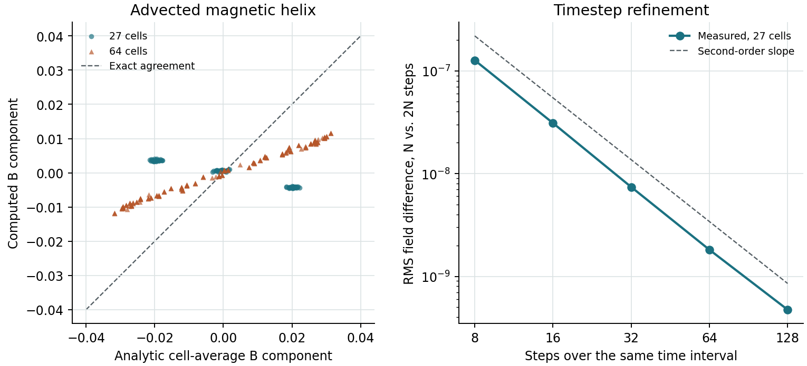

# Coupled 3D MHD on prescribed, smoothly deforming periodic meshes

This finite-step reference evolves gas mass, three momenta, total energy, three centroid samples of the vector potential and the cleaning scalar. The field is the prescribed harmonic mean plus the cell-average shared-face curl. It implements the two-stage covariant increment in [the moving-stage contract](MOVING_MHD_STAGE_SPEC.md), equations S1–S14. The full M2c decision also requires the registered spatial ladders, moving event exchanges, boosts, restart, blasts and vortices.

## Numerical scope

The mesh is periodic and the generators have prescribed constant velocities during a step. Rigid translation admits irregular cells. For nonrigid motion this first integrator accepts a Cartesian product of planes with one axial speed per plane. The periodic squared distance separates into three independent one-dimensional nearest-neighbour problems. Each successive plane gap, including the seam, is affine in time. Positive endpoint gaps above a coordinate-roundoff margin keep the cyclic neighbours fixed throughout the interval. The code also checks the rebuilt face keys and quadratic stencil identities. More general trajectories require event resolution.

The smooth periodic auxiliary velocity and cleaning source are rebuilt at the predicted and accepted endpoints. The face solve uses the HLLD pressure blend, the signal-weighted completion and limited linear primitive reconstructions. A separate donor reconstruction transports the potential. The induction target includes the full reference-frame completion and the volume-dilation term. The screened normal equations include the derivative of the moving curl. The old half correction enters the final potential exactly once. The two finite-volume updates use signed Euler and Heun swept-volume corrections; projection leaves the extensive total energy alone. Each stage returns one gas and induction exchange per face, its finite-volume target field, and the geometry, raw-update and projection contributions to cell magnetic energy.

Initialization, predictor and final closure check the configured mean at 1e-9 of a fixed initial field scale and positive thermal pressure. Each trial uses a global CFL factor of 0.3 and verifies the old, predicted and final signal, cleaning, transport, distortion and relative-motion limits. Both endpoint gas budgets must lie within 1e-10 of the initial scales. A failed trial leaves the accepted state and geometry intact. The current entry point is a single-process small-mesh reference.

## Prospective finite-step experiment

Use code units, a unit periodic cube, magnetic permeability one, density one, gamma 5/3 and a final time of 1/32. Initial gas integrals come from the analytic cell integrals. A and phi are point samples. Compare B to the analytic **cell average** over the transported cell. Use 27 sites on three nonuniform planes per axis, with supplemental 64-cell controls. The canonical initial words, plane speeds and analytic states are specified in the [executable](../../crates/mhd-vector-pot/examples/m2c-smooth-step.rs).

The translating force-free wave has uniform gas velocity U=(1,1/2,−1/4), zero mean field and field perturbation of amplitude 0.05 transverse to n=(1,1,1)/√3. In an orthonormal right-handed frame perpendicular to n, the field rotates as cosine and sine of 2π(x+y+z−sum(U)t). Its curl is −2π√3 times the field, so its Lorentz force vanishes. With an added parallel guide field of strength 0.5 and gas velocity U minus the rotating perturbation, the nonlinear circular Alfvén wave travels at parallel speed U·n+0.5. Pressure is one or, for the magnetic-pressure-dominated control, 0.005 times the squared field magnitude (plasma beta 0.01). Rectangular volume averaging multiplies each Fourier component by the product of the three sinc factors. The finite-volume initialization includes the analytic subcell kinetic and magnetic energy.

Run each selected flow, mesh, boost, size and step count as its own REANA workflow after immutable format, strict workspace Clippy, release build and test discovery. The primary temporal series uses the deforming 27-cell force-free wave with 8, 16, 32, 64 and 128 equal steps, plus a 256-step comparison. Compare successive endpoint fields in volume-weighted RMS on the same spatial mesh. Report the orders and compare them with 1.8. This self-convergence check does not establish the independent same-ODE uncertainty required for S-ORDER. Report the analytic cell-average errors independently; the full spatial gate uses finer meshes.

Run the uniform, force-free, nonlinear Alfvén and low-beta controls on the deforming 27-cell mesh. Include fixed and rigid translation controls, the two prescribed joint boosts (2,−1,1/2) and (10,7,−3), and thread-count and finer-mesh comparisons. Compare mass, momentum and total energy using the initial mass, mass times the square root of twice the initial specific total energy, and the initial total energy, respectively. Check the 1e-12 GCL and 1e-9 true normal residual limits, 1e-9 mean and 1e-10 budget limits, positive states and 1e-10 uniform drift. Undo the boost in momentum and total energy per persistent owner and compare the field to 1e-8 of the initial fluctuation amplitude. Compare the observed cell volumes and lifted centroids to the independently moving plane midpoints. Retain the measured finite-target mismatch, the three independent divergence diagnostics and the signed and unsigned magnetic transfers for each channel. Only the separately registered physical ladders can close M2c.

A local reproduction after release compilation uses `cargo run --release -p mhd-vector-pot --example m2c-smooth-step -- advection deforming 32 0 3 2`. Scientific validation runs use REANA.

## Measured results

On November 28, 2026, REANA ran the frozen Rust source `76d948d` through workspace formatting, strict Clippy, release compilation and test discovery with Rust 1.85.1. All five regression tests and all 24 physical configurations passed the registered finite-step checks. The physical cases completed 792 timesteps, with two stages per step. The build, each case and the reduction have separate workflow IDs. [Workflow receipts](results/m2c_smooth_step/provenance.json) · [Case measurements](results/m2c_smooth_step/summary.json).

| Quantity over the registered cases | Measured | Limit |
| --- | ---: | ---: |
| Maximum scaled change in any global gas budget | 2.06 × 10⁻¹⁶ | 10⁻¹⁰ |
| Maximum component drift of the configured magnetic mean, scaled | 3.03 × 10⁻¹⁶ | 10⁻⁹ |
| Maximum relative geometric conservation residual | 5.91 × 10⁻¹⁵ | 10⁻¹² |
| Maximum screened-system true residual | 1.00 × 10⁻¹¹ | 10⁻⁹ |
| Maximum uniform-state drift | 5.55 × 10⁻¹⁷ | 10⁻¹⁰ |
| Largest field difference in eight boost comparisons, relative to field amplitude | 4.32 × 10⁻¹⁴ | 10⁻⁸ |
| Minimum density and thermal pressure in code units | 0.99645 and 0.0020860 | Both positive |

For every input, the volume and lifted centroid matched the independent moving-plane calculation at the sampled endpoints. The three signed magnetic-energy contributions summed to the change in magnetic energy within 1.96 × 10⁻¹⁶ of its initial value. A separate measurement compares the recovered field to the finite-volume induction target. The largest last-step volume-weighted RMS mismatch was 1.12 × 10⁻⁴ in code field units. The force-free 16-step run gave byte-identical native output with one and two Rayon threads. [Residuals, signed and unsigned transfers, target mismatches and all three divergence diagnostics](results/m2c_smooth_step/summary.json).

### Time refinement and spatial error

At fixed 27-cell spatial resolution, halving the timestep from 8 through 256 steps gave successive endpoint field differences of 1.27 × 10⁻⁷, 3.10 × 10⁻⁸, 7.40 × 10⁻⁹, 1.82 × 10⁻⁹ and 4.74 × 10⁻¹⁰ in volume-weighted RMS. The four orders were **2.03, 2.07, 2.03 and 1.94**. Each cleared the prospective 1.8 threshold for this temporal comparison.

The coarse meshes poorly resolved the magnetic helix. Its spatial error was already large at initialization, before any gas or magnetic update. In the table, relative error is the volume-weighted RMS vector error divided by the analytic cell-average field RMS. Alignment is the volume-weighted cosine between the reconstructed and analytic vector fields. A value of −1 corresponds to a reversed field.

| Cells | Initial relative error | Final relative error at 16 steps | Initial alignment | Final alignment |
| ---: | ---: | ---: | ---: | ---: |
| 27 | 123.3% | 119.9% | −0.997 | −0.990 |
| 64 | 61.8% | 65.9% | +0.999 | +0.998 |



M2c remains open. The next spatial test is the registered 8³, 16³ and 32³ field-advection ladder with independently bounded physical errors. Further gates cover an independent same-ODE temporal reference, magnetic-energy transfer errors, physical fluxes across face births and removals, restart, and the 3D blast and vortex. [Moving-stage gates](MOVING_MHD_STAGE_SPEC.md#11-prospective-independent-reana-packets-and-next-review) · [Shared-face validation](M2C_SHARED_FACE_VALIDATION.md).

### Reproduce the measurements

The [measurement archive](results/m2c_smooth_step/measurements.tar.gz) includes the source manifest, build logs and runtime, the prospective matrix, original workflow and input receipts, native stdout and stderr. The build used four CPUs and 8 GiB. Each regression used one CPU and 4 GiB. Each physical run requested one or two CPUs and 4 GiB according to its thread count. All 29 cases have unique version-1 workflow IDs. Transient REANA connection errors during acquisition were retried against the original workflow identities.

The standard-library Python reduction independently recomputes the analytic moving-cell geometry and fields, gas budgets, boosts and time refinement. Replaying the original bytes locally and on a separate Linux REANA workflow gave identical gate outcomes and metrics within 2 × 10⁻¹² relative or 10⁻¹⁴ absolute tolerance. [Reduction workflow](results/m2c_smooth_step/reduction/reana.yaml) · [Uploaded input hashes](results/m2c_smooth_step/reduction/inputs.json).

The following commands replay the archive and render the figure from the repository root.

```sh
python3 scripts/review_m2c_smooth_step.py docs/galaxy/results/m2c_smooth_step/measurements.tar.gz /tmp/m2c-summary.json
python3 scripts/plot_m2c_smooth_step.py /tmp/m2c-advection.png --summary /tmp/m2c-summary.json
```
