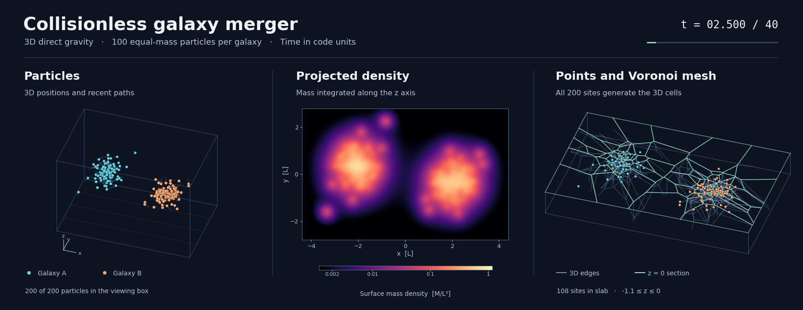

# A 3D collisionless merger with 100 particles per galaxy

Two spherical progenitors start five length units apart on a bound, off-centre orbit. Each contains exactly 100 live, equal-mass particles. Every particle interacts gravitationally with the other 199. IDs and progenitor labels persist throughout the evolution. The run uses dimensionless units with $G=1$ and mass one per progenitor.

## Recorded outcome

The cores first came within one initial half-mass radius ($0.664$) at $t=7.5$. After the first passage they moved apart and returned. From $t=12$ through $40$, they stayed inside that separation at every saved endpoint. During the final eight time units the largest measured separation was $0.471$ and galaxy A supplied 46–58 of the inner 100 particles. At the final time, the inner half contained **49 from A and 51 from B**, and **199 of the 200** had negative specific energy in the total system. The registered finite-time mixed-remnant criterion passed in both merger runs.

[Particles, density and Voronoi mesh (MP4, 16 seconds)](../images/nbody_merger_100/particles-density-voronoi.mp4) · [Particle motion and core separation (MP4)](../images/nbody_merger_100/merger.mp4) · [Three merger stages (PNG)](../images/nbody_merger_100/evolution.png) · [Standalone rotatable viewer (save the raw HTML and open it locally)](../images/nbody_merger_100/orbit.html) · [All 321 full-resolution particle snapshots (NPZ)](../data/nbody_merger_100/trajectory.npz).

| Quantity | Standard merger | Half-timestep merger | Isolated galaxy A |
| --- | ---: | ---: | ---: |
| Final tagged-core separation | 0.2434 | 0.2475 | — |
| Final half-mass radius | 1.0361 | 1.0148 | 0.6268 |
| Bound particles at the final time | 199/200 | 199/200 | 100/100 |
| Maximum relative energy drift at saved times | $4.04\times10^{-6}$ | $1.01\times10^{-6}$ | $2.48\times10^{-6}$ |

The standard merger's maximum total momentum and angular-momentum drifts were $1.32\times10^{-15}$ and $1.76\times10^{-15}$ in code units. The largest acceleration discrepancy against the independent pair sum was $1.73\times10^{-15}$ relative to the sum of individual pair acceleration magnitudes. The two timestep runs started from byte-identical initial catalogs. At this resolution, the evidence supports core coalescence and mixing over the simulated interval. Detailed remnant structure and a physical time or mass calibration would require separate modelling. [Workflow identities and comparisons](../data/nbody_merger_100/validation.json) · [Primary conservation ledger](../data/nbody_merger_100/conservation.csv) · [Core and mixing history](../data/nbody_merger_100/structure.csv).

Both movies show the same 321 measured endpoints at 20 frames per second. The centre panel of the three-panel movie shows the surface density obtained by integrating the softened particle mass kernels along $z$,

$$
\Sigma_\epsilon(x,y)=\sum_i \frac{m_i\epsilon^2}{\pi[(x-x_i)^2+(y-y_i)^2+\epsilon^2]^2}.
$$

Its logarithmic colour scale stays fixed. The 3D view reports how many particles are inside its display box. All 200 contribute to gravity and projected density at every step. The offline HTML viewer rotates freely and displays every second saved position, including both endpoints. Select **Fit all particles** to include the outermost particles at a fixed scale. [Projection parameters](../data/nbody_merger_100/density.json) · [Media and display precision](../images/nbody_merger_100/media.json).

### How to read the Voronoi panel

Every one of the 200 measured 3D positions generates a cell at each saved time. The view cuts away the upper half and shows a slab from $z=-1.1$ to $z=0$. Blue-grey lines trace the cell edges within that slab. Mint lines show where cell faces intersect its top plane. Coloured points mark the generators inside the displayed slab. The left and right panels share a camera direction, and the right panel uses a closer fixed framing. These cells were reconstructed after the collisionless gravity run. [Display geometry](../data/nbody_merger_100/voronoi.npz) · [Camera, timing and media hashes](../images/nbody_merger_100/triptych.json).

REANA reconstructed the Euclidean 3D Voronoi diagram with SciPy/Qhull. Eight distant auxiliary sites close the exterior cells. A per-frame distance bound keeps them outside the nearest-site competition throughout the viewing box. Analytic controls checked a tetrahedral cross-section and two particles at unequal heights. Across all frames, the largest scaled distance difference among the three nearest generators of a displayed edge was $2.1\times10^{-14}$ before display quantization. [Reconstruction and analytic controls](../../reana/nbody_merger_voronoi.py) · [Measured residuals](../data/nbody_merger_100/voronoi.json) · [REANA workflows](../data/nbody_merger_100/voronoi_workflows.json) · [SciPy Voronoi](https://docs.scipy.org/doc/scipy/reference/generated/scipy.spatial.Voronoi.html).

## Initial conditions and evolution

The density model is a Plummer sphere with scale radius 0.55 and radial cutoff 2.2. Each galaxy has 50 stratified enclosed-mass radii, with an independently chosen isotropic axis and two antipodal particles at each radius. Given radius $r$, the squared speed as a fraction of the squared escape speed is drawn from $\mathrm{Beta}(3/2,9/2)$. Velocities are isotropic and antipodally paired. The two seeds are 20261127 and 20261128. A single rescaling per galaxy enforces $2K=-W$ for its realized softened internal forces, where $W=\sum_i m_i\,\mathbf r_i\cdot\mathbf a_i$. This supplies a low-resolution, initially virialized galaxy model. [Plummer sampling background, section 4.3.3](https://arxiv.org/pdf/astro-ph/0610872#page=8).

| Parameter | Value |
| --- | --- |
| Particle mass | 0.01 |
| Initial centres | $(-2.5,0,0)$ and $(2.5,0,0)$ |
| Initial bulk velocities | $(0.12,0.14,0.05)$ and its negative |
| Boundary and force law | Isolated, direct pairwise Newtonian gravity with fixed Plummer softening $\epsilon=0.25$ |
| Integrator | Synchronized kick–drift–kick |
| Standard run | 10,240 steps of $1/256$ to $t=40$ |
| Recorded states | Initial state and every 0.125 time units, 321 samples |

The two colours identify galaxies of origin. This single-species run evolves only massive collisionless particles.

## Diagnostics fixed before execution

The standard merger, a same-seed isolated copy of galaxy A, and a merger with half the timestep run separately. All three use the same saved times. At every saved time, an independent NumPy pair sum checks the Rust accelerations, total energy, momentum and angular momentum. The scaled force tolerance is $10^{-12}$, the scaled ledger tolerance $10^{-11}$ and the relative energy-drift limit $5\times 10^{-4}$.

To follow surviving cores, tag the 20 initially most-bound particles of each isolated progenitor by specific internal energy and keep their IDs fixed. Each core position is the componentwise median of its tracers. The remnant centre uses the componentwise median of all particles. Its inner half comprises the 100 nearest particles.

The finite-run mixed-remnant criterion uses the interval $32\leq t\leq40$. Both the 90th percentile of the core separations in that interval and the final separation must lie below one initial progenitor half-mass radius. Each origin must contribute at least 25% of the inner half at every sampled time in that interval. At least 90% of the full system must be instantaneously bound at the last endpoint, using the total potential with self terms excluded and velocities in the system centre-of-mass frame. Record the continuous diagnostics even when any criterion fails.

## Reproduce

Build the Rust release example, then give the Python case driver a fresh output directory. The driver requires Python 3 and NumPy. Select `isolated` or `merger-half-dt` to reproduce either comparison.

~~~sh
cargo build --release --locked -p gravity --example gravity-trajectory
python3 reana/nbody_merger_100.py merger target/release/examples/gravity-trajectory merger-output
~~~

The driver exports 3D positions, velocities, accelerations, initial core IDs, and the Rust conservation ledger. [Case driver](../../reana/nbody_merger_100.py) · [Rust trajectory exporter](../../crates/gravity/examples/gravity-trajectory.rs).

To render the published data with Python, NumPy, Matplotlib and FFmpeg, run

~~~sh
python3 scripts/plot_nbody_merger_100.py docs/data/nbody_merger_100 merger-media
~~~

The renderer writes the MP4, a three-epoch figure and the self-contained interactive viewer. [Renderer](../../scripts/plot_nbody_merger_100.py).
