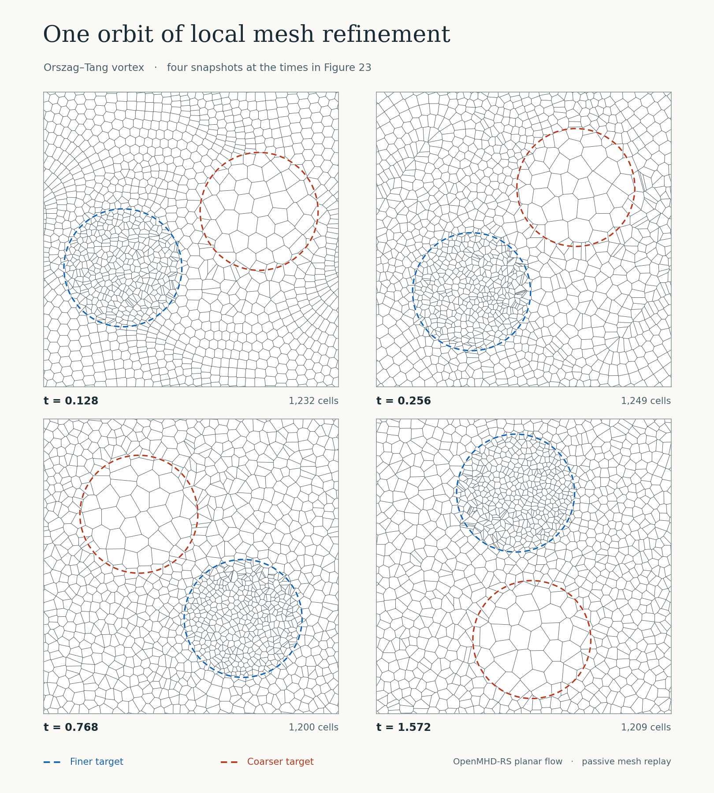

# How local refinement follows the Orszag–Tang vortex

[](../images/orszag_tang_mesh/refinement-comparison.mp4)

**[Play the side-by-side movie](../images/orszag_tang_mesh/refinement-comparison.mp4).** The left panel follows a fixed set of 1,152 generators. The right panel starts from the identical positions and can split or remove generators. Both panels use the same velocity at a given position and simulation time. The blue circle requests finer cells and the red circle requests coarser cells. The four stills use the times in the published caption. [Figure 23, p. 31](https://arxiv.org/pdf/2609.35989#page=31) · [Authors’ original AREPO companion movie](https://wwwmpa.mpa-garching.mpg.de/~volker/arepo2_mhd/mesh_motion_refinement_test_orszagtang_2D.mp4).

## Flow and mesh

The velocity comes from one OpenMHD-RS `mhd-planar` ideal-MHD run on a fixed periodic 64 × 64 grid in the unit square. At the start, the gas has density $25/(36\pi)$, pressure $5/(12\pi)$, adiabatic index $5/3$, and velocity $(-\sin(2\pi y),\sin(2\pi x))$. The native planar solver reconstructs the magnetic field from the out-of-plane vector potential and advances the conservative fluid state with synchronized Heun steps at CFL 0.3. The exporter saves 129 snapshots of the cell-centered velocity, from $t=0$ through $2.048$, spaced by 0.016 code-time units. [Planar equations and update](../../crates/mhd-planar/src/lib.rs) · [Native velocity exporter](../../crates/mhd-planar/examples/orszag-tang-flow.rs) · [Pressure, density and budget history](results/orszag_tang_mesh_movie/flow/history.csv).

The displayed polygons are two **passive mesh replays**. The MHD solution supplies the velocity to both. Gas and magnetic fluxes stay on the underlying fixed solver grid. This experiment illustrates how an adaptation policy redistributes mesh resolution in a time-dependent MHD flow. Coupled refinement would additionally require evolving and conservatively transferring the fluid and magnetic states on the changing mesh.

Two staggered 32 × 18 lattices form the initial near-hexagonal tiling. The replay interpolates the actual velocity bilinearly in space and linearly in time. It advances generators with a two-stage Heun drift at intervals of 0.004. Both panels also move a fraction $1-e^{-8\Delta t}$ of the way toward each generator’s own Voronoi centroid per step. Periodic image generators close cells across the box edges. [Mesh replay and periodic geometry](../../reana/orszag_tang_mesh_movie.py).

The two circles have radius 0.2. Their centers orbit counterclockwise at opposite ends of a diameter, each at distance 0.25 from the center of the box. One orbit takes 2.048 code-time units. The blue target area is $1/64^2$, the red target is $1/16^2$, and the background target is $1/32^2$. Every 0.008 units the right panel checks whether an area exceeds twice its local target or falls below half the target. Oversized cells split into two symmetrically displaced generators. A deterministic nonadjacent subset of undersized generators is removed. The surviving generators retain their identities. These choices specify the replay’s split placement, deletion order and regularization. [Original experiment, section 6.13 and equation 115](https://arxiv.org/pdf/2609.35989#page=31).

## What the two meshes did

The fixed-count mesh kept all 1,152 original generator IDs. Over one orbit, the adaptive mesh split 4,843 cells and removed 4,741 generators, finishing with 1,254 cells. The total Voronoi area differed from the unit-square area by at most 2.23 × 10⁻¹⁶ in either replay. At the four published times, the coarse-to-fine median area ratio ranged from 8.17 to 11.45. The table reports the median cell area inside the red circle divided by the median inside the blue circle. [Per-frame adaptive measurements](results/orszag_tang_mesh_movie/adaptive/metrics.csv) · [Fixed-count measurements](results/orszag_tang_mesh_movie/fixed-count/metrics.csv).

| Simulation time | Adaptive cells | Cells in blue region | Cells in red region | Red / blue median area |
| ---: | ---: | ---: | ---: | ---: |
| 0.128 | 1,232 | 365 | 41 | 8.17 |
| 0.256 | 1,249 | 398 | 35 | 10.30 |
| 0.768 | 1,200 | 415 | 32 | 11.45 |
| 1.572 | 1,209 | 424 | 36 | 10.90 |

The common MHD evolution took 6,626 accepted steps with 4,380 rejected trials. Across the 129 stored checkpoints, minimum density was 0.05080, minimum pressure was 0.01141, and the largest reported relative conserved-budget error was 1.08 × 10⁻¹³ or smaller. [Native flow history](results/orszag_tang_mesh_movie/flow/history.csv).

## Reproduce the figure

The retained archive contains both sets of generator identities and positions, their actual times, the compressed velocity stream and a per-frame count, area and adaptation ledger. Each mesh case ran as an independent REANA workflow after the common native flow completed. The build, flow and both mesh runs have linked workflow identifiers and output hashes. [Workflow provenance](results/orszag_tang_mesh_movie/provenance.json) · [Snapshot measurements](results/orszag_tang_mesh_movie/comparison.json) · [Encoded media and hashes](results/orszag_tang_mesh_movie/media.json).

With NumPy, SciPy, Matplotlib and FFmpeg available, render the archived trajectories from the repository root.

```sh
python3 scripts/plot_orszag_tang_mesh_movie.py \
  docs/galaxy/results/orszag_tang_mesh_movie /tmp/orszag-tang-movie
```
