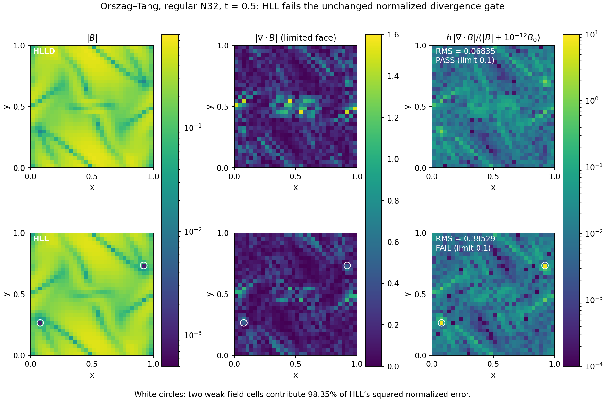

# HLL campaign stopped at the coarse vortex gate

REANA `openmhd-m1-hll-campaign-20261110.1` ended **failed** at
2026-11-10 03:23:35 UTC after 1039 seconds, including preparation and checks.
No workflow remains active. The immutable source/preflight packet is
[preserved separately](../preflight/README.md); executable sources match
`1c6a024`. No numerical thresholds changed.

| Bounded stage | Outcome | Seconds |
| --- | --- | ---: |
| Short shocks | Pass | 61.45 |
| Mesh-symmetry controls | Pass; two expected historical paper-profile failures retained | 40.40 |
| Short wave convergence/boost | Pass | 70.66 |
| Coarse shock/vortex | **Fail: regular N32 vortex normalized divergence** | 78.85 |
| Medium waves/loops | Not started | — |

All 20 coarse physics evolutions complete with positive states, passing
conservative budgets and all ten boost pairs passing. The required regular
N32 vortex pair fails the limited-face normalized divergence gate at
**0.385293086709 / 0.385293086708**, limit **0.1**. The historical HLLD
base result is 0.068346057812. The jittered N32 HLL cases pass their state and
diagnostic checks. Both N16 jittered mean-field drifts exceed .001, as below
the preregistered finest-quick-grid acceptance rule; these coarse observations
are preserved and do not cause this stage's failure.

There are 51 completed evolutions and two known literal-paper pressure
failures across the four stages. The medium, mean-field, calibration, full
physics and full wave/loop/temporal phases never start. Full M1 is unaccepted;
the bounded finest-shock HLL remedy is **not adopted as a general fix**.

## What the failed diagnostic measures

The independent finite-volume operator averages componentwise limited face
reconstructions of cell B, sums oriented area fluxes and divides by cell
volume. Each cell value is normalized by
`sqrt(V/pi) / (|B| + 1e-12 B0)`, with `B0=1/sqrt(4*pi)`, before computing
the volume-weighted RMS. This is not the curl's algebraic divergence.

The HLL regular base's dimensional divergence RMS is **.246179870440**, lower
than HLLD's **.328671429673**. Two cells, IDs 258 and 765, contribute
**98.3495%** of HLL's squared normalized norm. Their HLL field magnitude is
.000941158204, versus .043522915120 under HLLD; their dimensional divergence
is about .46153 versus .45866. Thus the gate failure is dominated by weaker
cell fields in the normalization, rather than an increase in dimensional
divergence at those cells. This does not authorize deleting cells, changing
the denominator or accepting the failed gate, and does not prove which
solution is physically more accurate.



`independent_reduction.json` independently recomputes the dimensional and
normalized norms from hash-verified stored CSV divergence values for both
HLL frames and the historical HLLD base. It does not independently reconstruct
the face operator. All reductions match their recorded summaries within
1e-12. The inspected plot reproduces byte for byte with:

```sh
python3 scripts/plot_hll_vortex_diagnostic.py
```

All 13 final output artifacts verify against the final REANA manifest.
The compact measurement archive preserves all four stage manifests, run maps,
provenance, summaries and histories, including failed controls; eight stage
summary/run-map hashes match the parent gate. Selected raw HLL/HLLD CSVs and
HLL geometry verify against their original per-run hashes. Full raw outputs
remain on REANA. `sha256.json` covers this archive. The next numerical trial
must address the finest shock and this vortex together before any full-matrix
escalation. Global HLL and all historical failed evidence remain available.
