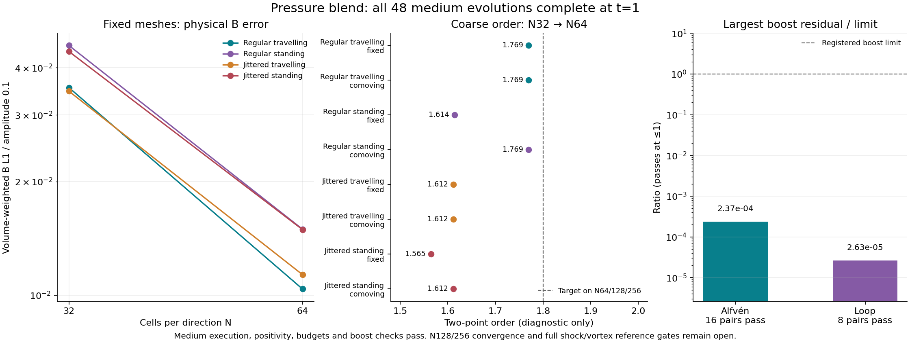

# Pressure-blend campaign: bounded and mean pass; calibration build fails

Workflow `openmhd-m1-pressure-campaign-20261110.1`, UUID
`b04502aa-c906-4efa-9333-7f2649a28757`, ran from 04:39:05 to **05:22:00 UTC**
on 2026-11-10. It was explicitly stopped after the wave-calibration driver
failed during a concurrent Cargo build. **Full M1 is not accepted.** No full
physics or full wave/loop/temporal stage started.

The candidate is explicitly `bulk-frame-heun-quadratic-v1` with accelerated
projection, screening 1 and `hlld-pressure`. The snapshot SHA256 is
`de65afe4f1920ec3a6db0535f904d48112227ce1fc57324fe604b3fbaf8b5c95`.
All Rust/Cargo inputs are unchanged from the passing focused trial. Tests and
evolutions ran only on REANA, within 24 aggregate worker cores and 64 GB.
Local work is archival verification, independent reduction and plotting.

| Phase | Result |
| --- | --- |
| [Preflight](preflight/README.md) | All eight commands pass: 163 release/all-target Rust, 80 Python, M0 and build/style checks |
| [Four short stages](short/README.md) | 51 completed evolutions; two known literal-profile planar pressure failures retained |
| Medium N32/64 waves/loops, t=1 | All 48 complete; 16 Alfvén and eight loop boost pairs pass |
| Nonzero-mean-field ladder | All 24 complete; all 12 boost pairs and four candidate refinement rows pass |
| N128 calibration | Wave driver fails before evolution; vortex started and was interrupted by the stop |
| Full physical matrices | Unexecuted |

## Complete bounded gate and medium measurements

`bounded_gate.json` records all five stages passing and
`full_matrix_precondition_met=true`. The full gate takes 1497.38 seconds,
including its builds; the medium stage takes 1073.24 seconds. Across the five
stages there are **99 completed evolutions and two expected literal-profile
failures**. Historical failures remain failures of their named profile.

The medium maximum normalized Alfvén boost L1 is **2.36822135e-12**, against
1e-8 under both conventions. Maximum loop B-relative L1 is **2.63445009e-8**,
against .001. That largest value belongs to the N64 jittered fixed-mesh pair;
it is larger than the other loop residuals and is retained for comparison
at N128/256. Its initial, t=.25 and final snapshots are preserved for both
frames, in addition to the four standard snapshot selections.

Medium minimum density/pressure are **.997706592 / .0995632953** and the
largest normalized history-budget residual is **3.96248e-14**, against 1e-10.
The eight coarse N32→N64 magnetic orders are **1.565–1.769**; N64 B L1/.1
is .0103923–.0149575. These coarse observations do not establish the required
N64/128/256 order >=1.8 or finest-grid accuracy gate.



`medium/` contains all original numeric reports, exact execution sources,
provenance and selected snapshots. All **384 raw artifacts** and all source
and result hashes were checked before compaction. `reduce_pairs.py`
independently checks all 24 pairs from hash-verified final CSVs using NumPy;
`independent_pairs.json` agrees with the execution classifications. The
wave-amplitude convention is the stricter of the two recorded conventions.
The source and plot hashes are in `medium/plot_provenance.json`.

## Nonzero-mean-field evidence

The 24-run mean ladder takes 58.30 seconds including its build. It uses
mean B=(.3,.2,.1), t=.02, regular/jitter .15 meshes, N8/16/32/64 and N16 time
caps .001/.0005/.00025. The maximum transformed primitive/energy-component
error is **1.04360964e-14**, against 1e-9. All 12 pairs pass, with matched
geometry and auxiliary-root histories. Minimum density/pressure are
.999866680/.999762046; the largest normalized budget residual is 2.75124e-14.

The four candidate refinement rows are present, alongside empty historical
profile rows. Their B boost residuals are 2.82e-17–1.84e-16. Negative fitted
orders describe roundoff-sensitive boost residuals; they are not analytic
accuracy orders and receive no invented convergence threshold.

`mean/` preserves the exact reports, sources and provenance. All **168 raw
artifacts** were hash verified before compaction. Its independent NumPy
reduction checks all 12 full-field maximum-error boost comparisons and records
the results in `independent_pairs.json`.

## Calibration execution failure

Both calibration drivers invoke Cargo concurrently against the same
`source/target` tree. The wave log reports missing `libfaer_traits-*.rlib`
and `libgemm-*.rlib` while removing build files; Cargo exits 101 and the
measurement wrapper records return code 1. The vortex log compiles the same
crates successfully and records the same binary hash as the passed phases.
This is evidence of shared-build interference, not a numerical MHD failure;
the underlying filesystem locking behaviour has not been independently
diagnosed. No wave calibration evolution started.

The campaign waits for both calibration futures before checking results,
so the sibling vortex continued after the wave build failed. It was stopped
to avoid further work in a campaign that could not advance. Its partial run
is not a completed calibration or a successful memory measurement.
`calibration_build_failure/` retains the exact logs, failed memory record,
vortex manifest/provenance, running execution/campaign checkpoints and the
authoritative **stopped** workflow status. A checkpoint still labelled running
does not override REANA's terminal status. A forced stop produces no normal
final-wrapper success manifest.

Next fix explicit reuse of the already validated binary in concurrent
drivers and cancellation of calibration siblings on failure. Test the runner
changes on REANA before another complete campaign. Preserve all grids,
physical targets, thresholds, numerical source and failed records.

## Reproduction and provenance

`bounded_sources.tar.gz` verifies all 160 bounded-gate source dependencies;
all five summary/run-map hash pairs verify. The preflight archive separately
checks all 321 frozen source files. Compact subpackets have their own checksum
manifests. Full raw files remain in the named REANA workspace and local
`results/reana_remote_m1_pressure_campaign_20261110`.

For either independent pair reduction, pass its corresponding raw phase
directory to the archived `reduce_pairs.py`. For example:

```sh
python3 medium/reduce_pairs.py /path/to/bounded/waves_medium
python3 mean/reduce_pairs.py /path/to/mean
python3 medium/plot.py medium/summary.json.gz pressure_medium_gate.png \
  --title 'Pressure blend: all 48 medium evolutions complete at t=1'
```

No numerical source or scientific threshold changes accompany this archive.
The optional plot title preserves the historical plotting default. These
results do not close M1 or its open issues.
