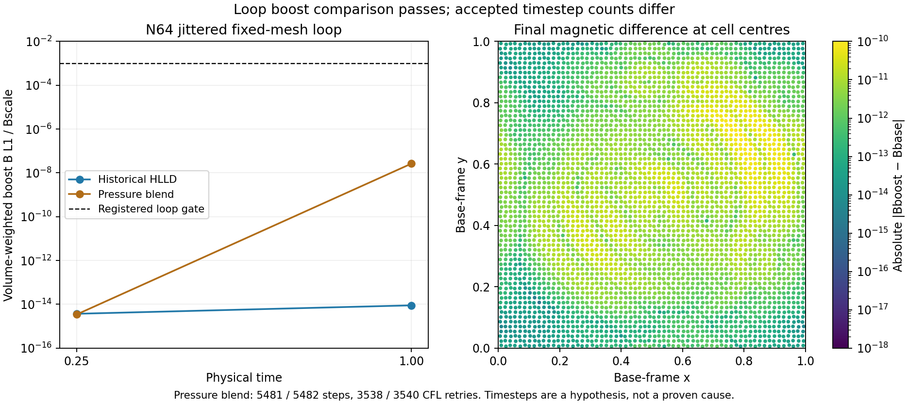

# Passed loop pair: timestep sensitivity remains an observation

This is postprocessing of the completed N64, jitter .15, fixed-mesh loop
pair in the pressure-blend medium gate. The registered relative magnetic
boost-error limit remains .001. The comparison passes by a wide margin.
The six historical HLLD snapshots come from an older frozen bounded
campaign, **not a new same-binary control**. Their hashes match that
campaign's archived run records.

| Observation | Pressure blend, base / boost | Historical HLLD, base / boost |
| --- | --- | --- |
| Accepted steps | 5481 / 5482 | 5481 / 5481 |
| CFL retries | 3538 / 3540 | 3538 / 3538 |
| State rejections and HLL fallbacks | 0 / 0 | 0 / 0 |
| Relative B L1 difference at t=.25 | 3.42894e-15 | 3.69219e-15 |
| Relative B L1 difference at t=1 | 2.63445e-8 | 8.94885e-15 |
| Maximum absolute B difference at t=1 | 8.42032e-11 | 1.65464e-17 |

The magnetic norm is volume-weighted vector L1 divided by
`.001/sqrt(4*pi)`, with permeability one and gamma 5/3. Both initial
magnetic fields agree exactly. The final pressure difference remains
3.44169e-14 in the pressure-blend pair.

Different accepted-step counts establish different timestep-sequence
lengths. They do **not** establish that timestep selection caused the
magnetic residual. Only the initial, t=.25 and t=1 snapshots are retained
here; there is no accepted-step trace or matched-schedule experiment.
The lines between plotted samples do not measure a continuous growth rate.
If a later required loop gate fails, a prospective accepted-step trace and
matched-schedule comparison can distinguish controller sensitivity from
spatial/flux amplification. These observations warrant no solver or
tolerance change while the full campaign remains pending.



`reduce_loop.py` verifies the archived run-map and raw-snapshot hashes,
then recomputes these values and the plot. It performs no evolution or
numerical test. From the repository root, with NumPy 2.0.2 and Matplotlib
3.9.4:

```sh
python3 tests/reference/m1_pressure_campaign/loop_followup/reduce_loop.py
```

`observation.json` records input, script and plot hashes and software
versions. `historical_members_sha256.json` inventories the six exact
historical files; `archive_sha256.json` covers this observation packet.
The plotting-only positive colour floor never enters the reductions.
