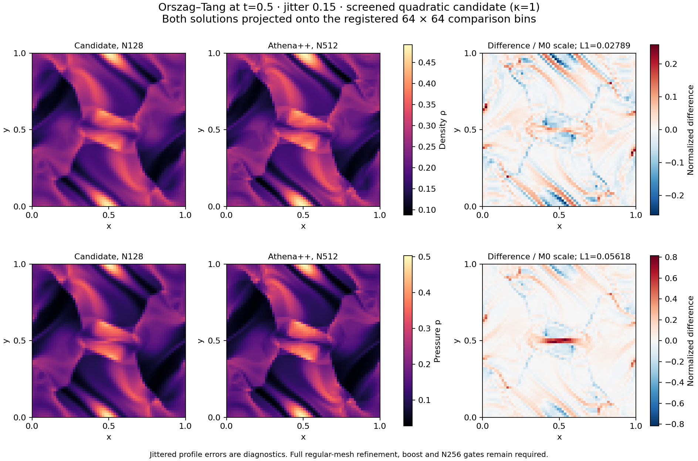
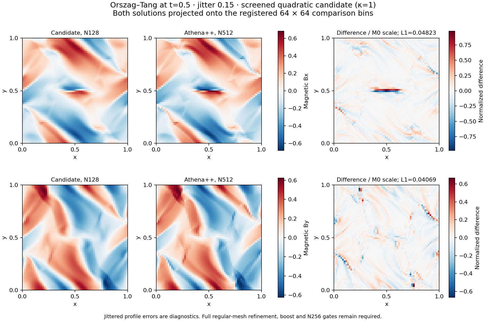

# Pressure-blend N128 calibration

All three N128 cases complete and pass calibration on
`openmhd-m1-pressure-reuse-20261110.1`, UUID
`7a615758-c141-4903-a2ea-8da3094ddd58`. The full 30-case physics matrix
starts at **06:51:35 UTC** on 2026-11-10. **Full M1 remains unaccepted.**

The frozen source and complete preflight are retained in
[reuse_preflight](../reuse_preflight/README.md). Candidate settings are
`bulk-frame-heun-quadratic-v1 --accelerated-projection --projection-screening 1
--riemann hlld-pressure`. Both drivers explicitly reuse executable SHA256
`90d40a752e357ed6a459e828d8a48cba51eed13549229271583f89fb7384a426`.
Both drivers' final provenance confirms that digest; neither performs a Cargo
build. All tests/evolutions run on REANA; local work is archival verification
and postprocessing only.

## Completed wave pair

Both waves use N128, jitter .15, t=1, gamma=5/3, transverse amplitude .1,
mean B=(1,0,0), f64 and dimensionless permeability one on a periodic unit
square. The base mesh is fixed; the joint boost (2,-1,0) also translates
the boosted mesh. Each case uses eight threads; the concurrent vortex uses
eight more, within the 24-core / 64-GB limit.

| Frame | Wall seconds | Relative B L1 | Minimum density | Minimum pressure | Maximum normalized budget |
| --- | ---: | ---: | ---: | ---: | ---: |
| Base | 1710.13 | .003164205891 | .9983741312 | .09994094477 | 8.74720e-15 |
| Boosted | 1894.93 | .003164205891 | .9983741312 | .09994094477 | 1.26689e-14 |

History minima and budgets include the initial, t=.25 and final outputs.
Accepted states also pass the solver's conservative/curl positivity recovery.
Both runs record 3667 accepted steps, 2695 CFL retries, zero state rejections,
74 accepted HLL fallbacks and 111 attempted fallbacks. Intentional pressure
blends are recorded separately from invalid-HLLD fallbacks.

The independent NumPy reduction of the hash-verified final CSVs gives maximum
normalized boost L1 **2.74698759e-14**, below 1e-8 under both recorded
conventions. The relative magnetic amplitude-error limit .02 and budget limit
1e-10 also pass. This is one calibration pair, not a full invariance claim.

The matching N64 magnetic relative L1 is .01134162001. Its N64→N128 order
is **1.841711** in both frames. The required finest-three N64/128/256 fit
for all eight wave families remains pending. The retained orthogonal mode
analysis verifies all six raw snapshots and closes the error decomposition:
the final base phase error is -.002721070 radians and accounts for 72.36%
of squared magnetic error. This identifies an error component, not its cause.

The Linux measurement wrapper reports **667,435,008 bytes** peak process
RSS and 1896.65 seconds for the two-wave driver. This is the largest process
RSS, not the simultaneous memory sum or a measured N256 memory requirement.
The final worker allocation uses the larger of the wave and vortex measurements.

## Completed vortex and resource allocation

The fixed N128 jitter .15 Orszag–Tang case reaches t=.5 in **2546.31 s**.
It uses the unchanged M0 initial conditions, gamma=5/3, mean B=0 and periodic
unit-square domain. Final minimum density/pressure are .09550151/.03372150;
the largest recorded normalized budget residual is 6.11269e-15. There are
5686 accepted steps, 3786 CFL retries, zero state rejections, 60102 accepted
HLL fallbacks and 78292 attempted fallbacks. These counters are retained,
not interpreted as a general positivity or stability guarantee.

| Diagnostic | Measured | Limit | Result |
| --- | ---: | ---: | --- |
| Mean-B drift / Bscale | 9.41954247e-5 | .001 | Pass |
| Limited-face dimensionless divergence RMS | .0257406494 | .1 | Pass |

The independent NumPy reduction reproduces both final diagnostics and
initial/final conservative budgets from the raw cells. The divergence
normalization is `sqrt(V/pi) div(B) / (|B| + 1e-12 Bscale)`, followed by
volume-weighted RMS. Its input face-divergence values are exported solver
data, not a separately rebuilt operator. The raw neighbour-LS and arithmetic
face operators are also retained; no machine-zero divergence is claimed.

The candidate and pinned Athena++ N512 solution are projected onto the same
registered 64² bins. Independently reproduced scaled L1 errors are density
.02788781, pressure .05617992, Bx .04823179 and By .04068548. These jittered
reference comparisons are diagnostics. They are larger than the historical
HLLD calibration's .02193370/.04421541/.03771381/.03373601; that older frozen
run is not a new same-binary control. Passing divergence/mean-field checks
does not imply improved reference accuracy or replace regular-mesh refinement.




Both figures were visually inspected; matching candidate/reference colour
ranges and independently checked error norms are preserved. Reproduce them:

```sh
python3 scripts/plot_m1_vortex_calibration.py tests/reference/m1_pressure_campaign/reuse_calibration/vortex docs/images/m1_completion/pressure_calibration
```

Vortex driver peak process RSS is **666,353,664 bytes**, with wall time
2547.03 s. The larger wave peak, multiplied by the preregistered factor 8,
gives an **estimated** N256 requirement of 5,339,480,064 bytes per worker.
With 8 GB reserved, the runner selects **10 workers × 2 threads = 20 cores**.
The estimate plus reserve is below the 64-GB cap. This allocation is verified
from both successful measurements; actual N256 peak memory is not measured
by this calibration.

## Provenance and reproduction

All **27 raw artifacts** (16 wave, 11 vortex) and every execution source/result
hash verify against the frozen export. `wave/` and `vortex/` retain exact compressed reports,
configurations, execution sources and provenance. `reduce_pairs.py` in that
directory accepts the raw wave phase directory and recomputes the boost
comparison. `wave_checks.json` records the physical measurements and scope.
`wave_modes.json.gz` retains the six snapshot hashes, decomposition closure
and `scripts/analyze_alfven_modes.py` source hash. The original memory record
and stage logs are retained alongside them. The vortex's exact projected
bins, independent final-cell reduction and plot provenance are also retained.
`calibration_verification.json` verifies both drivers' executable reuse,
successful measurements, 59/73 wave/vortex source dependencies and the resource
allocation. The original `wave_checks.json` is an earlier wave-only checkpoint;
its pending-vortex wording is historical.

`campaign_checkpoint.json` is a running checkpoint with completed bounded,
mean and both calibration phases. It is not a final workflow-success record.
The execution correction in issue #25 now has real successful concurrent
calibration evidence in addition to its passing regression tests. Full
physics/wave matrices and final review remain required for M1 closure.
