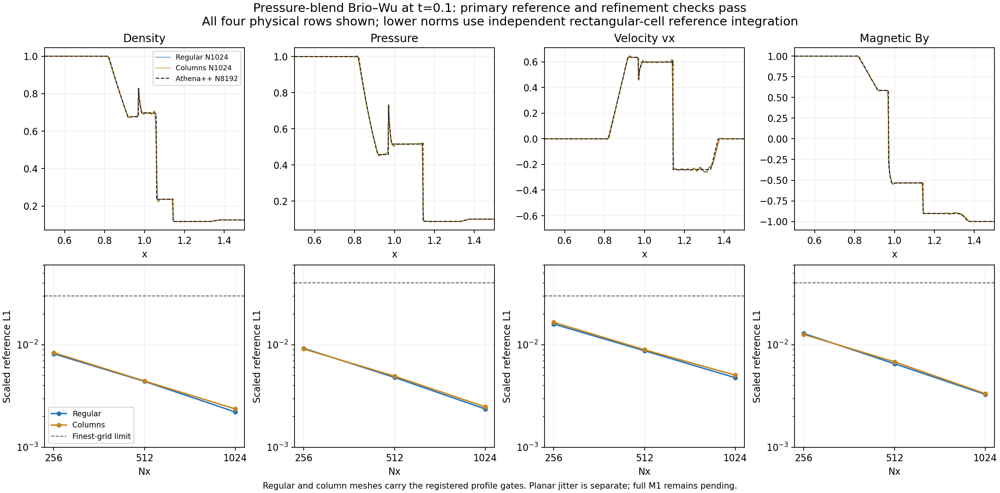

# Independent primary shock-reference verification

All 12 regular/column Brio–Wu cases in the running pressure-blend campaign
pass this independent reference calculation: Nx256/512/1024 × base/boost
for both primary mesh families. All four ladders satisfy the original
finest-error limits and finest-below-coarsest rule. The calculation agrees
with the production L1/L2 errors to **4.30212e-16** at worst.
This completes a shock-reference subset, **not full physics or M1 acceptance**;
the finer vortices and full wave/loop/temporal matrix remain pending.

Workflow `openmhd-m1-pressure-reuse-20261110.1`, UUID
`7a615758-c141-4903-a2ea-8da3094ddd58`, uses the frozen source parent
`4f491de`, named quadratic Heun profile, accelerated projection, screening 1
and `hlld-pressure`. These cases use gamma=2, f64, permeability one,
periodic box [0,2]×[0,.125], four rows, interface x=1 and final time .1.
The joint boost (2,-1,0) translates the mesh. The physical comparison window
is [.5,1.5]×[0,.125]. The independent Athena++ N8192 reference and M0 packet
match both their pinned repository hashes and this execution's provenance.

| Field | Regular Nx256 → Nx1024 L1 | Column Nx256 → Nx1024 L1 | Finest limit |
| --- | ---: | ---: | ---: |
| Density | .00815629 → .00221029 | .00836609 → .00236412 | .03 |
| Pressure | .00922884 → .00236075 | .00909274 → .00247511 | .04 |
| vx | .01589488 → .00476532 | .01652437 → .00504441 | .03 |
| By | .01289062 → .00327458 | .01259146 → .00332921 | .04 |

The table and figure show base-frame values; all boosted values, L2 errors,
middle-resolution observations and individual checks are retained in
`independent_reference.json`. The four physical rows are plotted separately,
without imposing symmetry or averaging them into one numerical state.



## Independent calculation

The primary meshes have rectangular cells. The reduction derives each
rectangle directly from the **raw oriented face planes**, checks its area
against the recorded cell volume, transforms the x bounds back to the base
frame and clips the interval to the registered central window. It integrates
the pinned piecewise-constant fine reference using 50-digit decimal prefix
integrals. The reference is averaged over each intersected cell **before**
forming volume-weighted L1/L2 errors, as required by the packet.

No production polygon-clipping, projection or error routine is imported.
This is a separate reference-integration calculation, not a new independent
MHD solution or a check of arbitrary planar-cell polygon clipping. The
planar-jitter reference and Bx measurements remain separate diagnostics
under the existing approved scope. The [full shock boost checkpoint](../reuse_physics_checkpoint/README.md)
retains all nine shock boost comparisons, including that planar family.

## Evidence and reproduction

The archive retains all **24 input files** used here: raw face-plane geometry
and final cells for the 12 primary cases. Each decompressed file matches its
per-run execution digest. `runs_checkpoint.json.gz` is the immutable earlier
22-run physics checkpoint, including cases outside this reduction's scope.
`provenance_checkpoint.json` is initial phase provenance, not a final
unchanged-source/result verdict for the entire physics matrix.

`reduce_reference.py` accepts either the original raw phase directory or
this self-contained compressed archive. The archive route was executed and
reproduces every measured value and input hash exactly. From the repository
root, with NumPy 2.0.2 and Matplotlib 3.9.4:

```sh
python3 tests/reference/m1_pressure_campaign/reuse_shock_reference/reduce_reference.py tests/reference/m1_pressure_campaign/reuse_shock_reference results/recreated_shock_reference
python3 tests/reference/m1_pressure_campaign/reuse_shock_reference/plot.py
```

Use a fresh output directory for the first command. These are data reductions
and plotting, not evolutions or numerical tests. All evolutions ran on REANA.
`independent_reference.json` records input/reference/packet/source hashes;
`plot_provenance.json` binds the inspected figure to those observations.
The plot was rendered and visually checked; its minor tick labels were
removed to keep the three actual resolutions readable. No threshold changes
or additional numerical evolution are involved.
