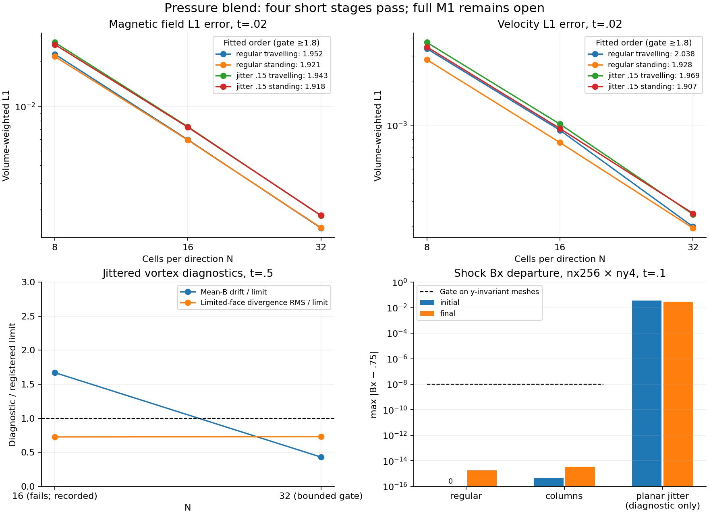

# Pressure-blend campaign: four short stages pass

The first four stages pass for the explicit
`bulk-frame-heun-quadratic-v1 --accelerated-projection --projection-screening 1
--riemann hlld-pressure` candidate. **The medium stage and full M1 acceptance
remain pending at this checkpoint.**

Workflow `openmhd-m1-pressure-campaign-20261110.1`, UUID
`b04502aa-c906-4efa-9333-7f2649a28757`; snapshot SHA256
`de65afe4f1920ec3a6db0535f904d48112227ce1fc57324fe604b3fbaf8b5c95`.
The [preflight archive](../preflight/README.md) preserves the frozen source,
runtime and eight passing commands. All numerical tests/evolutions run on
REANA; local work here is archival verification and scientific postprocessing.

| Short stage | Outcome | Wall seconds, including build |
| --- | --- | ---: |
| Shock to t=.01 | 4/4 complete; state, budget, diagnostic and boost gates pass | 62.12 |
| Shock symmetry to t=.1 | Candidate passes; two literal column controls pass; two literal planar pressure failures retained | 101.18 |
| Short wave/shock controls | 21/21 complete; wave order, boost and regular Bx gates pass | 118.99 |
| Coarse shock/vortex | 20/20 complete; positivity, budgets, boosts and finest-quick-grid diagnostics pass | 141.03 |

There are 49 completed candidate evolutions, two completed literal-profile
column controls and two failed literal-profile planar controls. The latter
still fail at t=.00336336379 in cell 253; this candidate does not repair the
historical `paper-global-v2` path. Their failure CSVs and errors remain in the
archive. No timeout or unrelated error is substituted for this expected
negative control.

The N8/16/32, t=.02 magnetic-error orders are **1.95181, 1.92106, 1.94291,
1.91819** (regular travelling/standing, jittered travelling/standing).
Velocity orders are **2.03811, 1.92797, 1.96896, 1.90690**. All exceed the
short-screen limit 1.8. These are not the full N64/128/256, t=1 fit.

The N32 regular/jittered vortex maximum normalized limited-face divergence
RMS is **.06846058 / .07301384**, limit .1. The jittered N32 normalized mean-B
drift is **.0004307554**, limit .001. Its coarse N16 counterpart remains a
**failed diagnostic**, .001670799. The preregistered quick-stage rule gates
diagnostics on the finest quick grid; it does not reclassify N16 as passing.
Full physics requires the registered N64/128/256 ladder and its diagnostics.

Across all 51 completed histories, minimum density is .102394764, minimum
pressure .043215232 and maximum normalized conservative-budget residual is
1.64641e-14, against 1e-10. All ten coarse-physics boost pairs pass. Candidate
column-shock Bx departure at nx256 is at most 3.55272e-15. Planar-jitter Bx is
.02909623 and remains a diagnostic under the owner-approved amendment;
it is not labelled a passed 1e-8 Bx gate.



## Verification and reproduction

`measurements.tar.gz` retains all **471 raw artifacts** and 20 stage reports,
manifests, provenance files and logs. Every raw artifact matches its run hash;
each stage summary/run map matches the gate checkpoint. All 76 dependencies
listed by the short-stage provenance match the complete frozen source manifest
and local export. The binary identity agrees across all stages. The preflight
archive separately verifies all 321 frozen source files.

`members_sha256.json` covers all 491 archive members. `reduce.py` independently
uses NumPy to check 16 wave cases against the analytic wave, all four short
order fits, eight final vortex norms/mean fields, 16 normalized shock/vortex
boost comparisons and 51 final conserved budgets. The maximum discrepancy
between its independently summed final budgets and the stored values is
1.70384e-14. Divergence values in the CSV and intermediate history extrema are
stored solver outputs; this reduction does not independently reconstruct the
face-divergence operator. The four wave boost comparisons remain verified
execution results, outside this independent boost reduction.

`independent_reduction.json` records those calculations. `plot.py` is the
exact plotting source; its only repository change adds an optional figure
title without altering the data reduction or historical default title.
`plot_provenance.json` records inputs, command, software versions and plot hash.
`sha256.json` covers the compact archive. The gate/campaign JSONs are immutable
**running checkpoints**, not a final workflow-success or full-acceptance record.

Regenerate the reduction with `python3 reduce.py` from this directory. Extract
`measurements.tar.gz` into a fresh review directory, then regenerate the plot:

```sh
python3 plot.py /path/to/extracted/measurements pressure_short_gate.png \
  --title 'Pressure blend: four short stages pass; full M1 remains open'
```

The medium N32/64 wave/loop stage runs next, followed only on success by the
mean-field ladder, N128 calibration and full physical matrices. No issue or
milestone closes on these short-stage results.
