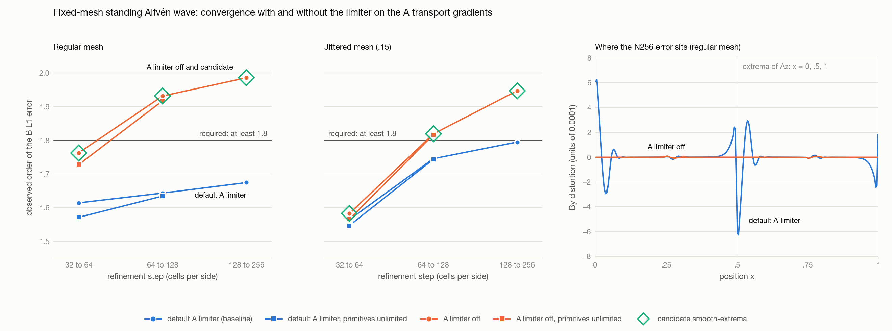

# Standing-wave limiter evidence (issue #26)

Implementing-assistant analysis, not independent scientific review. No gate,
grid, reference or default changes here. M1 remains unaccepted. The
prospective contract is [docs/M1_STANDING_WAVE_PLAN.md](../../../docs/M1_STANDING_WAVE_PLAN.md).

## 1. Localisation in the retained outputs (2026-11-12, no evolution)

`localise.py` reduces eight existing regular fixed-mesh base snapshots of the
stopped `openmhd-m1-pressure-reuse-20261110.1` workflow: the failing standing
ladder (parallel velocity 1) and the passing travelling ladder (parallel
velocity 0). All eight raw SHA256 values match the retained 104-case run map.
It imports no production error routine. At t=1 both families have analytic
phase `2 pi x`.

For each transverse field component it removes the volume-weighted mean and
fundamental mode, then measures where the remaining L1 distortion lies:
within 1/16 box length of that component's **own extrema**, or of the extrema
of the **vector-potential component** whose x-derivative it is (the field
component's zeros). Each window set covers a quarter of the box, so a uniform
distortion gives .25 in both columns.

| Family | N | B L1 | By distortion L1 | near By extrema | near Az extrema |
| --- | ---: | ---: | ---: | ---: | ---: |
| standing | 32 | 4.5796e-3 | 9.613e-4 | .022 | .541 |
| standing | 64 | 1.4957e-3 | 3.590e-4 | .021 | .665 |
| standing | 128 | 4.7879e-4 | 1.267e-4 | .015 | .854 |
| standing | 256 | 1.4997e-4 | 4.532e-5 | .021 | **.936** |
| travelling | 32 | 3.5430e-3 | 7.357e-4 | .427 | .101 |
| travelling | 64 | 1.0392e-3 | 1.610e-4 | .670 | .054 |
| travelling | 128 | 2.7667e-4 | 3.446e-5 | .876 | .036 |
| travelling | 256 | 7.0955e-5 | 7.652e-6 | **.933** | .028 |

Bz behaves the same way (.937 near Ay extrema for the standing wave, .929
near its own extrema for the travelling wave). Two-point slopes between N64
and N256:

| Family | B L1 | By fundamental error | By distortion | Bz distortion |
| --- | ---: | ---: | ---: | ---: |
| standing | 1.659 | 1.959 | **1.493** | **1.426** |
| travelling | 1.936 | 1.978 | 2.198 | 2.143 |

Only odd harmonics are present; even harmonics are at roundoff
(`localisation.json` keeps modes 1–9). At N256 the standing distortion peaks
at 6.3e-4, the travelling one at 9.6e-5 (By) and 1.5e-4 (Bz).

**Reading.** The fundamental converges at second order in both families. The
standing failure is carried by distortion that sits at the extrema of `A`,
converges at about 1.45 and is absent in the travelling family, where the
smaller distortion sits at the field's own extrema. This is what clipping of
the `A` gradients used by the `b · grad(A)` transport would produce, and that
term is active only when fluid moves through the mesh. It is a localisation,
not a controlled demonstration; the controls are registered in the plan.

Reproduce (needs the raw CSVs, which are not duplicated here):

```sh
python3 tests/reference/m1_standing_limiter/localise.py \
  results/reana_remote_m1_pressure_reuse_20261110/source/results/reana_m1-campaign/waves \
  /tmp/localisation.json
```

The four travelling snapshots were downloaded read-only from the stopped
workflow at `source/results/reana_m1-campaign/waves/<case>/final.csv` and
hash-checked. `archive_sha256.json` covers the other files in this directory.

## 2. Software checks and default parity (2026-11-12)

- `preflight/`: receipts and logs of `openmhd-limiter-preflight-20261112.1`
  for source `f60eaa8` (clean tree), snapshot SHA256
  `06bd0ccf82073cd2486efad602b4b3ba29ab50e2839f0fd90902355d04c97338`. All
  eight commands pass: format, strict Clippy, 160 debug and 169 release Rust
  tests, 100 Python tests, M0 and reference checks. Binary SHA256
  `b8ea90ab804e0fa86963ff2eac3ea0be4439a727a34438490ea5eab79c2911b3`. Every
  workflow below reuses this binary.
- `parity.json`: the six default-option fan-out cases rerun with that binary.
  Every final CSV is byte-identical to the 2026-11-11 fan-out and to the
  stopped campaign, no summary gains limiter metadata, and the three boost
  pairs pass. This checks that the default path is unchanged; it is not a
  physical result.

The owner paused the work on 2026-11-12 with only the `none` ladder submitted
and resumed it on 2026-11-13. Sections 3–5 are the measurements.

## 3. Controls and the decision on H1 (2026-11-12/13)

Fixed-mesh standing ladders, base frame, one REANA workflow per case.
`controls.json` is the output of `reduce_controls.py`, which recomputes every
norm from the hash-checked snapshots and reproduces the recorded B L1 errors
to 2e-13. The orders are log2 ratios of successive B L1 errors; "finest
three" is the registered least-squares fit over N64/128/256.

| Configuration | `A` transport gradient | Primitives | Mesh | N32 | N64 | N128 | N256 | 64→128 | 128→256 | Finest three |
| --- | --- | --- | --- | ---: | ---: | ---: | ---: | ---: | ---: | ---: |
| baseline | neighbour-extrema | limited | regular | 4.5796e-3 | 1.4957e-3 | 4.7879e-4 | 1.4997e-4 | 1.643 | 1.675 | **1.6591** |
| `none` | unlimited | limited | regular | 4.7651e-3 | 1.4040e-3 | 3.6800e-4 | 9.2884e-5 | **1.932** | 1.986 | **1.9590** |
| primitive-unlimited | neighbour-extrema | unlimited | regular | 4.4130e-3 | 1.4848e-3 | 4.7824e-4 | not run | **1.635** | | |
| all-unlimited | unlimited | unlimited | regular | 4.5864e-3 | 1.3845e-3 | 3.6647e-4 | not run | 1.918 | | |
| baseline | neighbour-extrema | limited | jitter .15 | 4.4155e-3 | 1.4925e-3 | 4.4503e-4 | 1.2823e-4 | 1.746 | 1.795 | **1.7705** |
| `none` | unlimited | limited | jitter .15 | 4.5151e-3 | 1.5073e-3 | 4.2713e-4 | 1.1074e-4 | 1.819 | 1.948 | **1.8834** |
| primitive-unlimited | neighbour-extrema | unlimited | jitter .15 | 4.3541e-3 | 1.4899e-3 | 4.4481e-4 | not run | 1.744 | | |
| all-unlimited | unlimited | unlimited | jitter .15 | 4.4547e-3 | 1.5045e-3 | 4.2702e-4 | not run | 1.817 | | |

Where the By distortion sits at N128 (same measure as section 1; a uniform
distortion gives .25):

| Configuration | Mesh | Distortion L1 | Peak | near `Az` extrema | near By extrema |
| --- | --- | ---: | ---: | ---: | ---: |
| baseline | regular | 1.267e-4 | 1.23e-3 | **.854** | .015 |
| primitive-unlimited | regular | 1.264e-4 | 1.23e-3 | **.857** | .009 |
| `none` | regular | 2.496e-6 | 2.08e-5 | .031 | .791 |
| all-unlimited | regular | 4.822e-8 | 7.57e-8 | .207 | .305 |
| baseline | jitter .15 | 6.414e-5 | 8.01e-4 | **.834** | .031 |
| primitive-unlimited | jitter .15 | 6.327e-5 | 8.02e-4 | **.843** | .020 |
| `none` | jitter .15 | 5.203e-6 | 3.22e-5 | .226 | .366 |
| all-unlimited | jitter .15 | 4.418e-6 | 2.74e-5 | .271 | .253 |

At N256 `none` gives .041 (regular) and .326 (jitter) near the `Az` extrema,
against .936 and .893 for the baseline. Bz behaves the same way.

**Decision by the registered rule: H1 is supported.** Switching off only the
limiter of the `A` transport gradients raises the regular N64→N128 order by
.289 (required: at least .2) and removes the concentration at the potential
extrema on both meshes. Unlimiting the primitives while keeping the default
`A` limiter changes the order by −.008 and leaves the concentration in place.
With `none` both ladders meet the unchanged gate (1.9590 and 1.8834 against
1.8, finest relative B L1 9.3e-4 and 1.1e-3 against .02); the frozen
production evaluator reports the same two passes
(`plans/diag-none_checkpoint.json.gz`).

Three further observations, none of them a gate:

- With the default `A` limiter the explicitly requested `neighbour-extrema`
  runs record how many cells it clips at the start and at t=1: 256 → 512 of
  1024 (N32), 512 → 1280 of 4096 (N64) and 1024 → 3840 of 16384 (N128) on the
  regular mesh. The clipped set starts as the columns at the extrema and grows
  during the run.
- With everything unlimited the regular-mesh distortion is 4.8e-8 at N128 and
  converges faster than third order: a linear scheme creates almost no
  harmonics here. With `none` the remaining 2.5e-6 sits at the field's own
  extrema, as in the travelling family, which is where the primitive limiter
  acts.
- On the jittered mesh the distortion without the `A` limiter stops falling
  between N128 and N256 (By 5.2e-6 → 3.1e-6, Bz 9.2e-6 → 8.4e-6) while the
  total B L1 error still converges at 1.948. It is 3–8 % of the total at N256.
  Its origin is not investigated here.

`none`, primitive-unlimited and all-unlimited are smooth-wave diagnostics.
They justify no production setting.

## 4. Candidate `smooth-extrema` on the failing ladders (2026-11-13)

Sixteen workflows `openmhd-lim-cand-standing-23a9fca451d0-0000…0015`: both
meshes, N32–256, base and joint-boost frames. All completed with positive
states and budgets within 1e-10.

| Mesh | Frame | N32 | N64 | N128 | N256 | 64→128 | 128→256 | Finest three |
| --- | --- | ---: | ---: | ---: | ---: | ---: | ---: | ---: |
| regular | base | 4.7651e-3 | 1.4040e-3 | 3.6800e-4 | 9.2884e-5 | 1.932 | 1.986 | **1.9590** |
| regular | boost | 4.7651e-3 | 1.4040e-3 | 3.6800e-4 | 9.2884e-5 | 1.932 | 1.986 | 1.9590 |
| jitter .15 | base | 4.5151e-3 | 1.5073e-3 | 4.2713e-4 | 1.1074e-4 | 1.819 | 1.948 | **1.8834** |
| jitter .15 | boost | 4.5151e-3 | 1.5073e-3 | 4.2713e-4 | 1.1074e-4 | 1.819 | 1.948 | 1.8834 |

**Both standing fixed ladders meet the unchanged gate** (base-frame
finest-three order at least 1.8, finest relative B L1 at most .02): 1.9590
with 9.29e-4 and 1.8834 with 1.11e-3, against the baseline's 1.6591 and
1.7705. The frozen production evaluator reports `pass` for both ladders
(`plans/cand-standing_checkpoint.json.gz`), and `reduce_controls.py`
reproduces the orders from the hash-checked snapshots. All eight boost pairs
pass under both normalisations; the largest relative L1 difference is 8.8e-13
against 1e-8.

- On the regular mesh all four candidate base snapshots, N32 to N256, are
  **byte-identical** to the `none` snapshots: the relaxed limiter never
  changes a gradient there. On the jittered mesh the largest difference from
  `none` in any state column of the final snapshot is 6.0e-7 (N32), 7.6e-8
  (N64), 5.6e-9 (N128) and 3.2e-9 (N256), against errors of 1e-4 to 5e-3.
- The limiter is inactive in every cell at the start and at the end of all
  sixteen runs.
- The N256 runs took 18,609 to 27,432 s of wall time on four threads while
  other workflows shared the cluster.



Colour is the state of the limiter on the `A` transport gradients (blue
default, orange off, green diamond the candidate, which coincides with
"off"); squares mark unlimited primitives. The right panel is By without its
mean and fundamental at N256 on the regular mesh, averaged over each column.
`plot_controls.py` draws the figure from `controls.json` and two hash-checked
snapshots; `controls_plot.json` records its inputs. The tables above carry
every plotted order. The image has its own light background.

This passes the gate that issue #26 was opened for. It is one gate of the
registered matrix, measured for an opt-in configuration; section 6 lists what
it does not show.

## 5. Candidate screens against the baseline (2026-11-13)

`screens.json` is the output of `compare_screens.py`. Pair and gate statuses
are the frozen production evaluation stored in each plan checkpoint; the
baseline is the stopped campaign (same profile, projection, screening and
Riemann solver, default `A` limiter). 98 workflows, all completed.

**Waves and loops, N32/64, t=1 (48 cases, the bounded gate's medium stage).**
All 24 boost pairs pass (largest Alfvén relative L1 2.3e-12 against 1e-8,
largest loop relative B L1 4.1e-14 against 1e-3). The six travelling or
comoving Alfvén families reproduce the baseline B L1 to within 6.2e-5
relative; the two fixed standing families change as in section 4.

Fixed-mesh field loops are where the relaxed limiter costs something. The
loop potential is a cone, so both its tip and its rim are kinks:

| Loop, fixed mesh | passive B L1 ratio | passive A L1 ratio | min `Az` candidate / baseline | max `Az` candidate / baseline | magnetic energy kept candidate / baseline |
| --- | ---: | ---: | --- | --- | --- |
| regular N32 | 1.035 | 1.057 | −.0082 / −.0070 | .2400 / .2363 | .8099 / .8077 |
| regular N64 | 1.034 | 1.066 | −.0057 / −.0046 | .2625 / .2610 | .9172 / .9202 |
| jitter N32 | 1.051 | 1.091 | −.0075 / −.0055 | .2373 / .2332 | .7972 / .7923 |
| jitter N64 | 1.046 | 1.099 | −.0059 / −.0049 | .2612 / .2597 | .9153 / .9174 |

`Az` is in units of the initial field strength; the exact range is [0, .3].
The candidate keeps the tip slightly better and undershoots the rim by
17–36 % more than the baseline; its passive-diagnostic errors are 3–10 %
larger. Both undershoots shrink with resolution. These passive loop errors
are diagnostics, not registered gates. The comoving loops reproduce the
baseline to within 4e-6 relative.

**Nonuniform mean-field ladder (24 cases).** All 12 boost pairs pass; the
largest field difference is 1.0e-14 against 1e-9. The limiter is inactive in
all 24 runs.

**Shock/vortex screen (26 cases: the registered Brio–Wu ladders and the
N64/128 Orszag–Tang vortices).** All 26 runs pass their state and diagnostic
gates with positive density and pressure; all 13 boost pairs pass (largest
5.4e-14). Every reference L1 error is within .9984–1.0021 of the baseline.
The N128 vortex limited-face divergence RMS is .0198 (regular) and .0253
(jitter) against .0197 and .0257, limit .1. The registered profile-family
gate needs the four N256 vortices and is **unexecuted** in this screen; the
finest regular and column Brio–Wu errors are 6–17 times below their limits
and below the coarsest grid (informational).

Two of the 126 submissions failed during upload with one input file missing
(`openmhd-lim-cand-waves-c492c267e219-0044`, `openmhd-lim-cand-mean-e43ea941cc32-0012`).
The missing file was uploaded to the same workflow, which was then started;
no workflow was duplicated. Each case verifies every input hash before it
runs. The submission records carry the note.

## 6. Scope

A passing ladder and passing screens are not the registered matrix. The
candidate is an opt-in engineering limiter that admits curvature-confirmed
extrema; the default limiter, every threshold, grid and reference are
unchanged. The 126 candidate and control runs above come from the `f60eaa8`
binary; the complete registered matrices are being rerun from one later
snapshot (section 7) and nothing here substitutes for them. M1 remains
unaccepted. What is still required is listed in the
[plan](../../../docs/M1_STANDING_WAVE_PLAN.md).

## 7. Software checks of the campaign snapshot (2026-11-13)

`campaign_preflight/`: receipts and logs of
`openmhd-limiter-campaign-preflight-20261113.1` for source `7fef6e2` (clean
tree), snapshot SHA256
`e6f390efb2cd463462843e7a4afa3bc8c10ae2438052cd4dd952fb90d81e8afa`. All eight
commands pass: format, strict Clippy, 160 debug and 169 release Rust tests,
112 Python tests, M0 and reference checks. No Rust or Cargo file differs from
the `f60eaa8` snapshot; the 12 added Python tests cover the limiter option in
the bounded-gate runners, the full-matrix case lists and the verdict reducer.

The exported binary has SHA256
`7544a6ab44e4442bf8ff2379f251870221e3446589400f9fa2c26a299634a366`. It differs
from the `f60eaa8` binary although the Rust sources are identical: the build
is not bit-reproducible between workflow workspaces. The fan-out campaign
declared in
[M1_FULL_VALIDATION_PLAN.md](../../../docs/M1_FULL_VALIDATION_PLAN.md#explicit-smooth-extrema-continuation-2026-11-13-before-execution)
therefore reruns every registered case with this one binary.

## 8. Fan-out campaign from the campaign snapshot (2026-11-13 to 14)

The sequence was declared before execution in
[M1_FULL_VALIDATION_PLAN.md](../../../docs/M1_FULL_VALIDATION_PLAN.md#explicit-smooth-extrema-continuation-2026-11-13-before-execution).
`campaign/` holds its evidence.

**Every registered phase check passes.** `campaign/verdict.json` is the output
of the frozen `scripts/fanout_campaign_verdict.py`; `campaign/summary.json`
is the output of `summarise_campaign.py`, which collects the production gate
evaluations next to the baseline and the registered limits.

| Phase | Workflows | Result |
| --- | --- | --- |
| Short bounded stages | `openmhd-limiter-bounded-20261113.1` | all four stages pass (`campaign/bounded/gate.json`) |
| Mean-field ladder | `openmhd-lim-full-mean-758d415bab22-*` (24) | 12/12 boost pairs pass, largest difference 1.0e-14 |
| Medium bounded stage | `openmhd-lim-full-medium-18b64ff0fa7e-*` (48) | 24/24 boost pairs pass, largest relative L1 2.3e-12 |
| Shock/vortex matrix | `openmhd-lim-full-physics-b0835f299725-*` (30) | all registered physics gates pass |
| Wave/loop/temporal matrix | `openmhd-lim-full-waves-8eb6a53d6596-*` (112) | 8/8 spatial gates, 48/48 boost pairs, 12 temporal rows |
| Calibration checks | the N128 cases of the two matrices | pass |

All 214 per-case workflows completed with positive states and budgets within
1e-10; none failed, timed out or was stopped. The short stages ran inside one
further workflow that builds its own binary (`4ae7fcb40364…`) from the same
snapshot; every per-case run used the preflight binary.

Alfvén ladders, finest-three B L1 order (required: at least 1.8):

| Mesh | Wave | Motion | Order | Finest relative B L1 | Baseline order |
| --- | --- | --- | ---: | ---: | ---: |
| regular | travelling | fixed | 1.9362 | 7.1e-4 | 1.9362 |
| regular | travelling | comoving | 1.9362 | 7.1e-4 | 1.9362 |
| regular | standing | fixed | **1.9590** | 9.3e-4 | **1.6591** |
| regular | standing | comoving | 1.9362 | 7.1e-4 | 1.9362 |
| jitter .15 | travelling | fixed | 1.9099 | 8.0e-4 | 1.9098 |
| jitter .15 | travelling | comoving | 1.9099 | 8.0e-4 | 1.9098 |
| jitter .15 | standing | fixed | **1.8834** | 1.1e-3 | **1.7705** |
| jitter .15 | standing | comoving | 1.9099 | 8.0e-4 | 1.9098 |

The two ladders that failed with the default limiter pass; the other six are
unchanged to the fourth digit. Boost pairs: 32/32 Alfvén (largest relative L1
9.3e-12 against 1e-8) and 16/16 loop (largest relative B L1 4.9e-9 against
1e-3). The twelve temporal differences converge at 1.98–2.08.

Shock/vortex, finest grid of each family:

| Family | Gated | Finest L1: candidate (baseline) | Limits |
| --- | --- | --- | --- |
| Brio–Wu regular, nx1024 | yes | ρ .00221 (.00221), p .00236 (.00236), vx .00477 (.00477), By .00327 (.00327) | .03, .04, .03, .04 |
| Brio–Wu column jitter | yes | ρ .00236 (.00236), p .00248 (.00248), vx .00505 (.00504), By .00333 (.00333) | same |
| Brio–Wu planar jitter | diagnostic | ρ .00677, p .00752, vx .01215, By .00950 | same |
| Orszag–Tang regular, N256 | yes | ρ .00739 (.00740), p .01593 (.01595), Bx .01447 (.01449), By .01247 (.01249) | .06, .1, .1, .1 |
| Orszag–Tang jitter .15 | diagnostic | ρ .00867, p .01850, Bx .01648, By .01403 | same |

All 15 shock/vortex boost pairs pass (largest 2.4e-11). At N256 the vortex
limited-face divergence RMS is .0129 (regular) and .0149 (jitter) against
.1, and the mean-field drift at most 9.4e-6 against 1e-3.

Field loops: the N256 loops completed for the first time (the stopped
campaign interrupted them), so they have no baseline. Where a baseline
exists, the fixed-mesh passive B L1 is 3.5–5.1 % and the passive A L1
5.7–9.9 % larger with the candidate, as in section 5; comoving loops are
unchanged. These diagnostics are not gates.

Reproducibility across builds: the 162 cases that these plans share with the
section 4–5 plans, which used the `f60eaa8` binary, have byte-identical final
snapshots in every case.

Wall time on four threads with 23 N256 cases sharing the cluster: N256 loops
41,352–54,798 s, N256 vortices 31,086–45,570 s, N256 Alfvén waves
16,898–33,964 s. The sequence took 25.5 hours after submission.

**What this is and is not.** It is the complete registered matrix, measured
once, for an opt-in configuration. It is not M1 acceptance: the limiter
admits curvature-confirmed extrema and costs 3–10 % on fixed-mesh loop
diagnostics, which is the owner's decision, and independent review has not
happened. No default changed.

## 9. Files and reproduction

`plans/` holds, for each plan, the exact case specifications and workflow
identities, the submission record, the monitor's final checkpoint and the run
records. `archive_sha256.json` covers every other file in this directory.

Reproduce the reductions and the figure from the downloaded plan directories
(the raw snapshots are local under `results/` and remain in each REANA
workspace):

```sh
B=results/reana_remote_m1_pressure_reuse_20261110/source/results/reana_m1-campaign
python3 tests/reference/m1_standing_limiter/reduce_controls.py --baseline-raw $B/waves \
  --plan potential-none=results/limiter_plan_diag-none_20261112 \
  --plan primitive-unlimited=results/limiter_plan_diag-primitive_20261113 \
  --plan all-unlimited=results/limiter_plan_diag-linear_20261113 \
  --plan smooth-extrema=results/limiter_plan_cand-standing_20261113 --output /tmp/controls.json
python3 tests/reference/m1_standing_limiter/compare_screens.py \
  --waves results/limiter_plan_cand-waves-medium_20261113 \
  --mean results/limiter_plan_cand-mean_20261113 \
  --physics results/limiter_plan_cand-physics-screen_20261113 \
  --baseline-physics $B/physics/runs.json --baseline-raw $B/waves --output /tmp/screens.json
python3 tests/reference/m1_standing_limiter/plot_controls.py --baseline-raw $B/waves \
  --none-plan results/limiter_plan_diag-none_20261112 --output /tmp/controls.png --provenance /tmp/controls_plot.json
```
